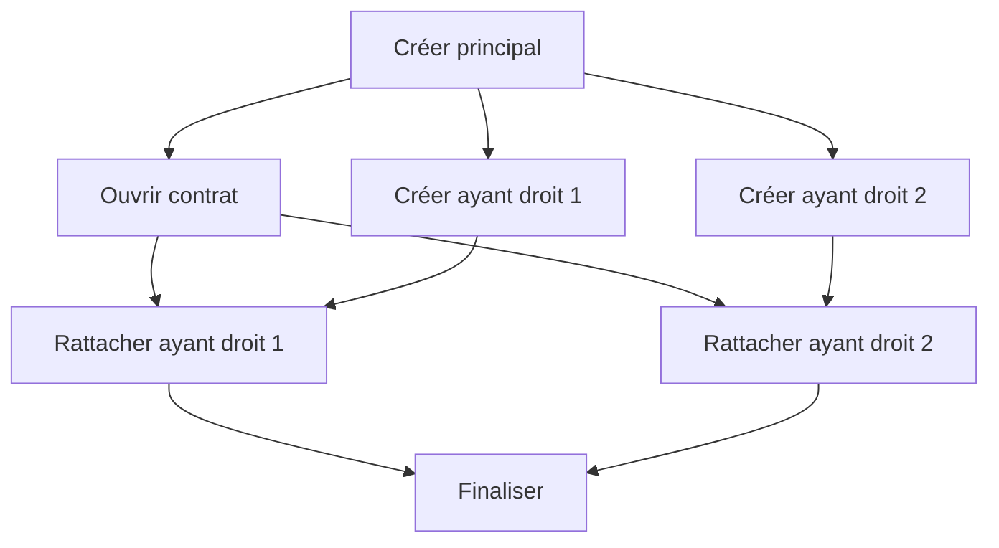
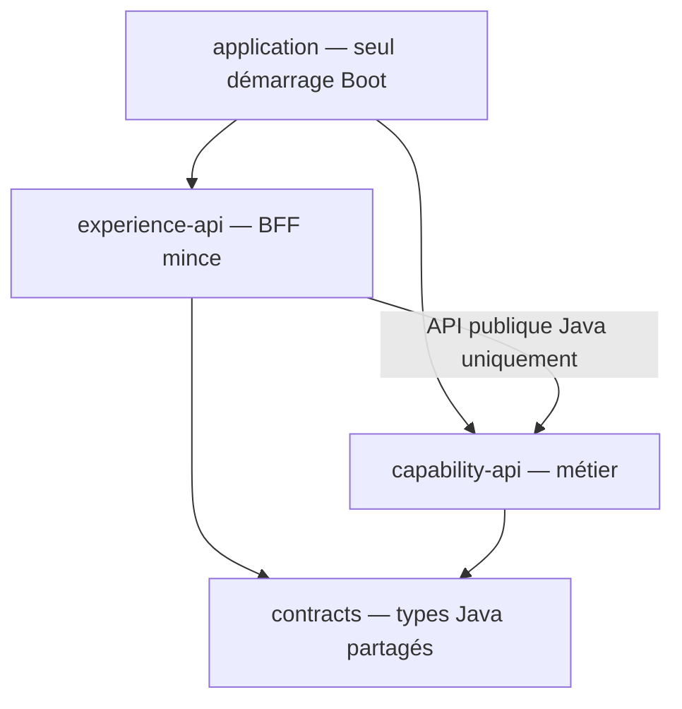
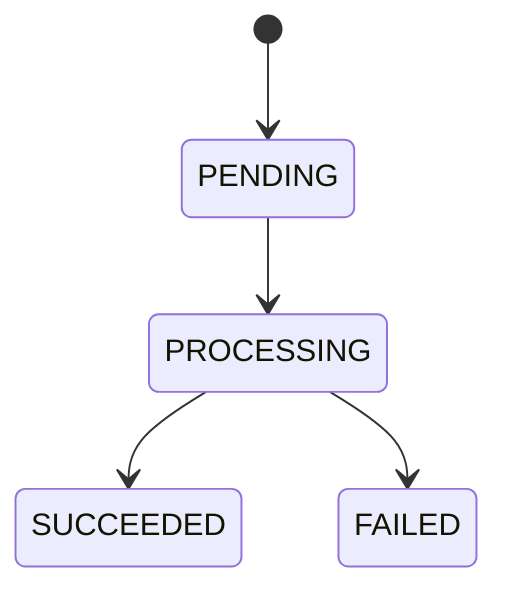
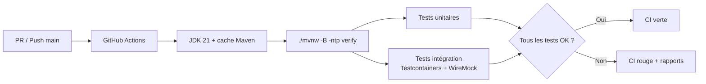
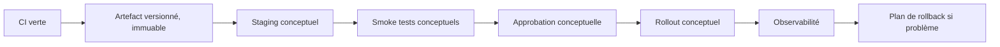

# DAT — ConfluxLab

**Type :** pseudo-projet technique et pédagogique Java/Spring.  
**Objectif :** comprendre, illustrer et défendre à l'oral une architecture inspirée du parcours AXA.  
**État :** progression organisée dans `docs/stages/` à la demande de l'utilisateur ; travail par petits incréments, sans implémentation globale en une seule fois. Le sprint 01 est clôturé techniquement et documenté sur demande explicite de l'utilisateur le 2026-10-21 ; sa restitution orale n'a pas été évaluée. Cette clôture n'autorise aucune story suivante.

**Dans le périmètre :** backend, tests automatisés et **CI opérationnelle lors de la phase de code**.  
**Hors périmètre pratique :** CD, déploiement, cloud, serveur distant, infrastructure de production.

## 1. Principes de conception

- **Fidélité aux principes rapportés** : préserver la séparation Experience / Capability, MongoDB tampon, UUID, Spring Event, asynchronisme, Feign et Resilience4j.
- **Simplification métier** : un seul cas d'usage, la création d'une famille fictive.
- **Modernisation pédagogique** : Java 21 / Spring Boot 3.x, sans prétendre qu'il s'agissait des versions réellement utilisées chez AXA.
- **Traçabilité** : distinguer explicitement **[AXA rapporté]**, **[Simulation ConfluxLab]**, **[Proposition]** et **[Non confirmé]**.
- **Document-first** : théorie et DAT d'abord ; code uniquement lorsque le périmètre/contrat sont validés.
- **Minimum suffisant** : ne pas introduire de nouvelles briques qui n'illustrent pas une compétence ciblée.

## 2. Cas d'usage

Une requête HTTP demande la création d'une famille fictive de **trois personnes** : un assuré principal et deux ayants droit.

1. Le module Experience/BFF reçoit la demande HTTP, valide son format et appelle l'interface Java publique du module Capability, dans la même application Spring Boot.
2. Dans la cible finale, Capability API génère un UUID et sauvegarde la demande `PENDING` dans MongoDB. À l'étape INT-06, cette acceptation est réalisée dans un stockage temporaire en mémoire, sans MongoDB.
3. Capability publie un **événement Spring local** contenant l'UUID ; un listener `@Async` est planifié.
4. Capability renvoie l'acceptation et Experience retourne **HTTP `202 Accepted`** avec un `requestId` et une `statusUrl`, sans attendre les appels partenaires.
5. Le listener lit la demande, la fait évoluer en `PROCESSING` et exécute l'orchestration métier.
6. Les appels passent par un client Feign configuré avec les mécanismes pertinents de Resilience4j.
7. MongoDB reçoit l'état final `SUCCEEDED` ou `FAILED`.
8. Le client consulte **GET `/api/v1/requests/{requestId}`**.

**Nuance importante :** le traitement `@Async` peut commencer **avant** la fin de la réponse HTTP `202` ; le schéma décrit les responsabilités, pas une garantie de chronologie de ces deux opérations.

## 3. Orchestration métier simplifiée

Six opérations fictives, qui ne décrivent **pas** les endpoints réels GFP/Open :

- **A** — Créer l'assuré principal.
- **B** — Ouvrir le contrat, après A.
- **C** — Créer l'ayant droit 1, après A.
- **D** — Créer l'ayant droit 2, après A.
- **E** — Rattacher l'ayant droit 1 au contrat, après B **et** C.
- **F** — Rattacher l'ayant droit 2 au contrat, après B **et** D.

B, C et D peuvent être lancées en parallèle ; E et F n'attendent que leurs prérequis respectifs. Il ne s'agit pas de lancer aveuglément les six appels simultanément.

## 4. Stack technique proposée

| Domaine | Technologies / rôle |
|---|---|
| Langage | Java 21 |
| Framework | Spring Boot 3.x, Spring MVC, Bean Validation |
| Structure | Monolithe modulaire : modules logiques Experience/BFF et Capability, une seule application Spring Boot et un seul artefact exécutable |
| Communication interne | Appels Java via les interfaces publiques des modules ; pas de HTTP interne ni d'accès aux classes internes d'un autre module |
| Build | Maven multi-modules + Maven Wrapper ; bibliothèques `contracts`, `capability-api`, `experience-api` et assemblage unique `application` réalisé dans INT-03 |
| Persistance | MongoDB, Spring Data MongoDB |
| Événements | Spring Events in-process, `@Async` |
| Orchestration concurrente | `CompletableFuture`, executor borné |
| HTTP sortant | Spring Cloud OpenFeign vers le partenaire externe uniquement, pas entre Experience et Capability |
| Résilience | Resilience4j ; timeouts, retry sélectif, fallback explicite |
| Partenaire fictif | WireMock |
| Tests | JUnit 5, Mockito, Spring Boot Test, Testcontainers MongoDB |
| Observabilité | Logs corrélés, Actuator ; métriques à définir |
| **CI (pratique, après le DAT)** | **GitHub Actions + Maven `verify` + rapports de tests** |
| **CD (théorie uniquement)** | Promotion, environnement, stratégie de rollout et rollback |

Aucun frontend, Kafka, Kubernetes, authentification avancée ou plateforme cloud dans le MVP.

### 4.1 Responsabilités des modules

**[Simulation ConfluxLab — choix retenu dans le cadre de la délégation utilisateur pour le BFF]** : Experience est un BFF mince. Il expose le contrat REST, valide la forme des entrées et adapte les réponses/erreurs. Capability porte les règles métier, les invariants, les statuts, la persistance et l'orchestration. Elle ne se repose pas sur la seule validation du BFF pour protéger ses invariants. Les deux modules restent séparés dans la même application ; aucun appel HTTP interne n'est nécessaire.

### 4.2 Frontières fixées dans INT-01

**[Simulation ConfluxLab — cadrage réalisé sur feu vert pour INT-01]** : conserver les noms des modules existants. `capability-api` porte le métier complet, pas un second serveur HTTP ; son API publique Java sera distinguée de ses classes internes. Le module `contracts` est conservé comme bibliothèque de types Java d'échange, sans contrôleur, repository, document MongoDB ou dépendance vers Experience/Capability. Le schéma initial et ses contraintes sont définis et testés dans INT-05, sans service métier ajouté ; voir le [contrat HTTP initial](http-contracts.md).

Graphe de dépendances **assemblé dans INT-03 et protégé par les contrôles automatiques d'INT-04** :

Aucun cycle, aucune dépendance Capability → Experience, aucun HTTP interne ni accès du BFF aux repositories. Dans INT-03, les dépendances Maven suivent ce graphe ; seul `application` déclare le plugin Boot. Son démarrage `dev.confluxlab.ConfluxLabApplication` est à la racine des packages pour découvrir Experience et Capability dans le même contexte Spring.

Le BFF injecte `dev.confluxlab.capability.api.FamilyRequests` ; son implémentation reste dans `capability.internal`, sans import de ce package par Experience. Dans INT-03/04, l'exception publique provisoire `CapabilityNotReadyException`, sans statut HTTP, signalait l'indisponibilité des deux opérations, adaptée en `503` par le BFF. L'acceptation mémoire l'a remplacée pour le POST dans INT-06, puis la consultation réelle dans INT-07 a permis de supprimer cette exception et son mapping provisoire.

Le `clean verify` global d'INT-03 réussit avec 64 tests et le JAR réel démarre sans base ni partenaire. Les deux routes valides répondent `503` ; les réponses de succès des tests de délégation proviennent uniquement d'un double. Voir les [preuves INT-03](../../notes/sprint-01/INT-03-assembler-les-modules.md). Les modèles d'échange sont définis dans INT-05 ; cette preuve historique ne réalisait pas encore l'acceptation, développée ensuite dans INT-06. Le suivi effectif a ensuite été réalisé dans INT-07, sans modifier ces preuves historiques. Les contrôles automatiques de frontières ont ensuite été réalisés dans INT-04, sans modification du métier.

**INT-04 — garde-fous retenus :** ArchUnit 1.4.1, en dépendance `test` du module d'assemblage, analyse les classes de production sous `dev.confluxlab`, en excluant les sorties de test. Les règles interdisent les cycles entre sous-packages racine, Capability → Experience, Experience → Capability hors `capability.api..`, toute dépendance de `contracts` vers les autres modules, et le retour des bibliothèques vers l'assemblage. Le package racine `dev.confluxlab`, qui contient le démarrage Boot, est réservé à l'assemblage et protégé séparément, car il n'appartient pas aux slices des sous-packages. Les dépendances vers un éventuel `dev.confluxlab.application..` sont protégées de la même manière.

Les mêmes règles sont exercées avec des fixtures de test délibérément fautives et un graphe autorisé ; les diagnostics vérifient les classes source et cible des violations. Le `clean verify` global d'INT-04 réussit avec **76 tests** (dont 5 de frontières, 7 de détection et les 3 tests d'assemblage existants). ArchUnit et les fixtures sont absents de l'artefact livré. Ces contrôles de dépendances de bytecode ne remplacent ni les tests métier, ni une revue des appels indirects par réflexion/configuration ; ils supposent que les packages respectent les responsabilités convenues. Voir le [tutoriel INT-04](../../notes/sprint-01/INT-04-verifier-les-frontieres.md).

### 4.3 Acceptation temporaire réalisée dans INT-06

**[Simulation ConfluxLab — incrément autorisé]** : `InMemoryFamilyRequests` remplace le bean indisponible, valide une copie locale du payload avec les contraintes existantes, génère un UUID et conserve un `StoredFamilyRequest` en `PENDING` avec `createdAt`, avant de retourner l'acceptation. Les noms de types et le stockage restent internes. Le BFF conserve le contrat HTTP et la construction des liens publics ; aucun appel réseau interne ou accès à la map ne lui est ajouté.

Le store utilise `ConcurrentHashMap` et `putIfAbsent` : une collision ne remplace pas une demande existante et échoue sans acquittement. La liste conservée est copiée et rendue non modifiable ; `PersonPayload` ne référence que des valeurs immuables. Un `Clock` UTC injectable fournit l'horodatage. Les contraintes sont vérifiées aussi sur les appels Java directs, sans inventer de règle d'identité ou de métier supplémentaire ; leur refus public est adapté en `400` générique, les erreurs inattendues en `500` générique.

Cette mémoire est **volatile, non bornée et sans nettoyage** : le `202` ne garantit ni durabilité, ni idempotence, ni début de traitement. Deux POST identiques créent deux demandes indépendantes. À l'étape INT-06, le GET restait `503`, même pour un UUID accepté ; son `Location` préparait INT-07, désormais réalisée. Aucun événement, `@Async`, MongoDB ou partenaire n'est ajouté. Un futur provider MongoDB devra remplacer ce stockage, pas le rendre artificiellement durable par documentation.

Le `clean verify` global INT-06 passe avec **96 tests**. Le JAR réel a répondu `202` à deux POST avec UUID distincts, `503` au GET et `400` au corps invalide, puis a été arrêté ; les tests internes prouvent séparément la conservation du payload avant retour. Voir le [tutoriel INT-06](../../notes/sprint-02/INT-06-accepter-une-demande.md).

### 4.4 Consultation réalisée dans INT-07

**[Simulation ConfluxLab — incrément autorisé]** : `getRequest(UUID)` recherche la demande dans le store interne et projette uniquement `requestId`, `status` et le `createdAt` d'origine vers `RequestView`. Cette lecture ne crée aucune entrée, ne change aucun statut, n'actualise aucune date et ne déclenche aucun traitement. Le contrôleur continue d'appeler l'interface publique, sans accéder au stockage.

L'absence est signalée par `RequestNotFoundException`, publique mais sans dépendance HTTP, puis adaptée en `404` générique dans Experience. Un identifiant HTTP manifestement mal formé est refusé en `400` par la conversion MVC, avant l'appel à Capability. Un argument Java `null` est rejeté explicitement comme erreur d'argument avant le store ; ce cas ne se confond pas avec une demande inconnue. Aucun durcissement supplémentaire de canonicalisation ou de version UUID n'est introduit.

Le `clean verify` global INT-07 réussit avec **108 tests**, dont les tests de frontières toujours actifs. Le JAR réel démontre POST `202` puis GET `200 PENDING`, des métadonnées stables et limitées à trois champs, ainsi que `404`/`400`. Après un redémarrage local, l'UUID précédemment accepté répond `404`, confirmant la volatilité ; les deux processus sont arrêtés. Les fixtures de lecture couvrent les quatre valeurs de statut, mais l'application actuelle ne produit que `PENDING` : aucune transition métier n'est ajoutée. Voir le [tutoriel INT-07](../../notes/sprint-02/INT-07-consulter-la-demande.md).

### 4.5 Refus et confidentialité vérifiés dans INT-08

**[Simulation ConfluxLab — incrément autorisé]** : la matrice des contraintes existantes est exercée en HTTP et en Java direct. Les tests prouvent l'absence d'appel à l'acceptation pour les refus MVC et l'absence d'interaction avec le store pour les refus de Capability ; une borne positive à 100 caractères évite de valider un système qui rejetterait tout. Aucune règle d'identité ou d'assurance supplémentaire n'est inventée. Deux demandes restent isolées malgré un refus intercalé et depuis deux appelants Java concurrents, sans fonctionnalité asynchrone ajoutée en production.

Un défaut a été reproduit : un identifiant mal formé contenant un marqueur fictif était recopié par MVC dans `ProblemDetail.instance`, malgré un détail générique. Le helper d'erreur fournit désormais `URI.create("")`, non nulle, pour empêcher cet écho automatique. La sérialisation actuelle omet cette valeur vide ; les tests protègent à la fois l'objet Java et l'absence stricte du champ et du marqueur dans le JSON. Ce couplage MVC/Jackson est volontairement testé ; aucun identifiant d'erreur supplémentaire n'est introduit. Le changement concerne les erreurs gérées par cet advice, pas une garantie sur tous les logs, proxys ou filtres.

Le `clean verify` global réussit avec **181 tests**. Les erreurs `500` et le refus de Capability sont simulés explicitement par doublures ; le JAR réel valide des refus `400`/`415`/`404`, la confidentialité et deux acceptations/consultations indépendantes. Le processus est arrêté. Cette couverture de non-régression est plus large que le minimum nécessaire pour comprendre le principe, pas une preuve de sécurité exhaustive. Voir le [cours INT-08](../../notes/sprint-02/INT-08-tester-les-refus.md).

## 5. Contrats HTTP

Le [contrat initial INT-05](http-contracts.md) précise les champs, contraintes, exemples JSON et refus. INT-06 démontre maintenant le POST `202` après acceptation réelle en mémoire. INT-07 démontre maintenant le GET `200` pour une demande présente en mémoire, `404` si elle est absente et `400` pour les formats d'identifiant invalides testés. L'ancien `503` du placeholder a été supprimé ; aucun comportement d'erreur MongoDB ou partenaire n'est déduit de cette évolution. `RequestView` est actuellement limité aux métadonnées ; résultat et erreur métier détaillés appartiennent à une évolution ultérieure du suivi.

**POST `/api/v1/families`**

- Reçoit une demande de création fictive.
- Retourne `202 Accepted` avec `requestId`, `statusUrl` et `status`.
- Si l'acceptation échoue avant la prise en charge, répondre avec une erreur HTTP explicite, sans prétendre que le traitement est lancé.

**GET `/api/v1/requests/{requestId}`**

- Dans INT-07, retourne uniquement les métadonnées de `RequestView` ; le résultat ou motif d'échec métier appartient à une évolution ultérieure, non implémentée.
- Statuts minimaux : `PENDING`, `PROCESSING`, `SUCCEEDED`, `FAILED`.
- Une panne partenaire **après le `202`** modifie le statut consultable, pas la réponse HTTP déjà envoyée.

## 6. Données MongoDB

Collection cible : **`family_requests`**, non créée à l'étape INT-09.

**[Simulation ConfluxLab — INT-09 réalisée sur demande de passage à cette tâche]** : le modèle interne `StoredFamilyRequest` reste un record Java sans annotation MongoDB, non exposé au BFF. Son contrat de données est le suivant :

| Champ | Rôle et règle de mise à jour |
|---|---|
| `requestId` | UUID de corrélation fixé à la création ; unicité en base à réaliser dans INT-10 |
| `status` | `PENDING` à la création, puis transitions autorisées ci-dessous |
| `payload` | Copie des données reçues, liste des ayants droit non modifiable ; inchangée pendant le cycle |
| `createdAt` | `Instant` de création fourni par l'horloge de Capability ; ne change jamais |
| `updatedAt` | Initialement égal à `createdAt`, puis date de la dernière transition ; ne recule pas |
| `completedAt` | Absent en `PENDING`/`PROCESSING` ; égal à `updatedAt` à l'entrée dans un état final |
| `result?` | Champ cible optionnel pour un résultat métier en succès ; structure et implémentation différées au traitement partenaire, aucun champ vide ajouté au record |
| `error?` | Champ cible optionnel pour un motif métier d'échec, pas une exception/trace brute ; structure et implémentation différées, aucune exposition HTTP ajoutée |

`PENDING` signifie « acceptée, en attente », `PROCESSING` « prise en charge », `SUCCEEDED` « terminée en succès » et `FAILED` « terminée en échec ». Le modèle refuse tout autre passage, y compris une répétition du même état ou la sortie d'un état final. Un échec technique avant l'acceptation n'est pas une transition de ce graphe ; il ne produit pas de faux `202`.

`pending(...)` initialise les dates. `transitionTo(...)` retourne un **nouveau record**, conserve l'UUID, le payload et `createdAt`, et met à jour les dates. Elle ne sauvegarde rien. Deux appelants partant du même objet pourraient chacun produire un objet `PROCESSING` : la prise en charge atomique en base appartient à INT-11, pas à cette validation locale. Le constructeur permet de représenter un état stocké avec des dates cohérentes ; il ne prouve pas l'historique des transitions.

**Preuves INT-09 :** deux nouveaux tests de cycle/refus et un test existant d'acceptation exécutés avec succès ; pas de nouveau build global ni de test MongoDB. Le POST utilise désormais `pending(...)` mais reste en mémoire ; aucun traitement de production n'appelle les transitions. Le suivi HTTP reste limité à `requestId`, `status`, `createdAt`. Voir le [cours INT-09](../../notes/sprint-03/INT-09-definir-les-donnees-et-transitions.md).

L'UUID **corrèle** la demande HTTP, le futur document persisté, l'événement et le traitement ; il n'assure ni idempotence, ni verrouillage, ni unicité de la création côté partenaire.

## 7. Sujets techniques prioritaires

- `@Async` et Spring Events locaux : exécution, exceptions, race conditions et perte d'événements à l'arrêt.
- `CompletableFuture` : graphe de dépendances, propagation des échecs, bornage des pools.
- Feign/Resilience4j : timeout, retry uniquement quand répétition sûre, fallback sans succès fictif.
- MongoDB/partenaire : états, opérations partielles, reprise, absence de transaction distribuée.
- CI : comment un commit déclenche compilation/tests, avec MongoDB et WireMock **isolés et reproductibles**.
- CD : expliquer séparément livraison, déploiement, approbations, rollback et stratégie de migration.

## 8. Performance et observabilité

Distinguer :

1. **Latence HTTP** = réception du POST jusqu'au `202`.
2. **Durée métier** = acceptation jusqu'à état terminal.
3. **Taux de réussite** = demandes réussies / demandes terminées dans un échantillon défini.

L'asynchronisme peut réduire l'attente HTTP **sans** réduire la durée métier. Le parallélisme peut accélérer les appels indépendants si les ressources et les contraintes partenaires le permettent.

Les résultats AXA rapportés (environ **30 s → 2,5 s** et **50 % → >90 %** de réussite sous charge) sont un **récit historique à contextualiser**, pas une promesse ni un benchmark ConfluxLab.

## 9. Validation fonctionnelle et technique

| Cas | Ce qui doit être observable |
|---|---|
| Succès nominal | `202` puis `SUCCEEDED` |
| Partenaire lent | Réponse HTTP rapide ; statut encore en cours |
| Deux créations concurrentes | UUID et statuts distincts, absence de confusion entre dossiers |
| `5xx` transitoire | Comportement de retry documenté, opération répétable uniquement |
| Erreur définitive | `FAILED` et diagnostic lisible |
| Crash après insertion en base | Risque de `PENDING` abandonné ; limite d'un événement non durable |
| Séquentiel vs parallèle | Mesures séparées latence HTTP / durée métier |
| CI : changement cassant | Test en échec ⇒ workflow rouge, sans déploiement |

**Mécanisme à apprendre :** `@Async` ne transforme pas un appel Feign bloquant en I/O non bloquante. Les pools doivent être dimensionnés pour des appels qui immobilisent des threads.

## 10. Progression pédagogique par sprints

Le [plan de travail dans `docs/stages/`](../stages/README.md) détaille les objectifs, incréments, tests, exclusions et critères de clôture. Il remplace la progression globale précédente : théorie, implémentation ciblée, tests et explication sont associés dans chaque sprint.

| Sprint | Objet | Livrable cible |
|---|---|---|
| 01 | Socle et frontières modulaires | Build reproductible, une application, EXP/Capability séparées |
| 02 | Contrat REST et BFF mince | POST/GET testés, stockage temporaire explicitement non durable |
| 03 | MongoDB et statuts | Persistance vérifiée, transitions contrôlées |
| 04 | Spring Events et `@Async` | Découplage HTTP/travail, analyse des fenêtres de panne |
| 05 | `CompletableFuture` et concurrence | Graphe A–F vérifié avec doublures contrôlées |
| 06 | Feign, WireMock et Resilience4j | Parcours partenaire, erreurs et répétitions sûres testées |
| 07 | Validation complète et observabilité | Scénarios intégrés, logs corrélés et mesures du labo |
| 08 | CI pratique sur accord | GitHub Actions réellement exécuté, rapports et détection de régression |
| 09 | CD théorique et entretien | Schéma conceptuel et restitution orale, aucun déploiement |

**Règle utilisateur : ne pas tout développer en une fois.** Avant chaque tâche de développement numérotée d'un sprint, présenter son périmètre et attendre le feu vert explicite de l'utilisateur pour cette tâche. L'accord sur un sprint ou sur une tâche ne couvre pas les suivantes. Les tâches portent un identifiant `INT-XX` unique et stable à l'échelle du projet. Après chaque tâche terminée, rédiger une note `notes/sprint-XX/INT-YY-<nom-de-la-tache-en-kebab-case>.md` dans le dossier `notes/` à la racine, titrée `# INT-YY — <Nom de la tâche>`, contenant réalisation, explications, décisions, fichiers, vérifications réellement observées et limites ; la lier depuis la fiche du sprint et `notes/README.md`. Puis s'arrêter et attendre le feu vert pour développer la tâche suivante. Aucun statut de réalisation ne peut être déduit du seul plan ou de la présence d'une note ; les fiches de travail restent dans `docs/stages/` et les comptes rendus dans `notes/`. Une note rétrospective ou partielle ne vaut ni tâche terminée ni autorisation de poursuivre. Cette planification n'autorise pas l'exécution anticipée des sprints, de la CI ou d'un déploiement.

## 11. CI — Incluse dans le périmètre pratique

### 11.1 Pourquoi l'ajouter ?

La CI est directement utile à la compréhension de la stack : elle démontre que l'application compile, que les tests du parcours et des cas de panne sont reproductibles et qu'une régression est détectée **avant** fusion. Elle introduit GitHub Actions **sans imposer de déploiement**.

### 11.2 Workflow cible (spécification, pas encore créé)

**Déclencheurs proposés** : `pull_request` et `push` sur la branche principale.

**Pipeline P0 — minimal mais utile :**

1. Checkout + configuration JDK 21 ; cache Maven.
2. `./mvnw -B -ntp verify` depuis la racine du dépôt.
3. Tests unitaires : validation, orchestration des six tâches, transitions d'état, politiques de retries/fallback.
4. Tests d'intégration isolés : MongoDB Testcontainers et API WireMock (timeouts, `5xx`, états finaux).
5. Rapports de tests exploitables en cas d'échec ; permissions GitHub minimales ; aucune variable de production.

**Point de rigueur :** `mvn verify` ne suffit pas, à lui seul, à garantir l'exécution des classes `*IT` ; les tests d'intégration devront être raccordés au cycle Maven (par ex. plugin Failsafe). Vérifier cela dans la CI réelle.

**Pipeline P1 — options après premier succès :** format/lint, JaCoCo, analyse des dépendances, archivage des JARs ; **pas** de seuil de couverture arbitraire.

**Definition of Done CI (quand implémentée) :** un nouveau clone peut lancer les tests sans service externe réel ; une PR cassant la logique métier fait échouer le workflow ; succès observé sur un run GitHub Actions ; commandes et preuves enregistrées.

## 12. CD — Uniquement en théorie

**Définition :** comprendre les étapes de livraison et de déploiement automatisé, sans les exécuter sur ConfluxLab.

Sujets d'entretien à maîtriser :

- Différence entre **continuous delivery** (livrable prêt et contrôlé) et **continuous deployment** (déploiement automatique après validations).
- Promotion de **la même version** d'artefact entre environnements, plutôt qu'un rebuild non traçable.
- Secrets, variables de configuration et autorisations minimales, **sans créer ni stocker de secrets dans le dépôt**.
- Stratégies rolling / blue-green / canary : choix selon risque, coût, capacité de rollback.
- Smoke tests, healthchecks/readiness, métriques, rollback et limites des migrations de données.

**Décision ferme de périmètre :** pas de fichier `.github/workflows/deploy.yml`, pas de publication de conteneur, pas de SSH, pas de VPS, pas de cloud et pas de déploiement effectif.

## 13. Décisions de cadrage

| ID | Décision proposée | Statut |
|---|---|---|
| D-01 | Un seul cas d'usage de création, trois personnes fictives | Proposée |
| D-02 | Monolithe modulaire : une application Spring Boot, modules Experience/BFF et Capability, appels Java internes ; partenaire externe simulé | Validée par l'utilisateur |
| D-03 | MongoDB tampon + UUID + Spring Event local + `@Async` | Proposée |
| D-04 | `CompletableFuture` et Feign/Resilience4j | Proposée |
| D-05 | Java 21 + Spring Boot 3.x + Maven | Proposée |
| **D-06** | **CI GitHub Actions pratique quand le projet sera codé** | **Recommandée** |
| **D-07** | **CD théorique seulement, aucun déploiement effectif** | **Recommandée** |
| D-08 | Doctrine d'apprentissage : faits AXA ≠ simulation ≠ proposition | Proposée |
| D-09 | BFF mince pour le contrat HTTP ; métier, invariants et orchestration dans Capability | Retenue dans le cadre de la délégation utilisateur pour le BFF |
| D-10 | Travail par sprints et petits incréments, point de validation avant la suite ; plan dans `docs/stages/` | Validée par l'utilisateur |

**[Simulation ConfluxLab — décision utilisateur] :** le monolithe modulaire est le modèle de déploiement du laboratoire, sans prétendre décrire le déploiement historique AXA. Experience ne doit pas accéder directement au stockage de Capability ; les dépendances entre modules restent unidirectionnelles et passent par leurs interfaces publiques. Feign/Resilience4j reste réservé au partenaire externe.

**Questions ouvertes (non bloquantes pour le cadrage) :** évolution du suivi au-delà des métadonnées initiales ; implémentation de l'acceptation et du suivi derrière l'interface assemblée dans INT-03 ; définition historique précise des 2,5 s ; politiques exactes de pools/retries non confirmées. Ces inconnues ne doivent pas être comblées par une histoire inventée.

---

*DAT ConfluxLab V0.2 — évolution du DAT édité par l'utilisateur : ajout d'une CI pratique différée, et d'une CD strictement conceptuelle.*
