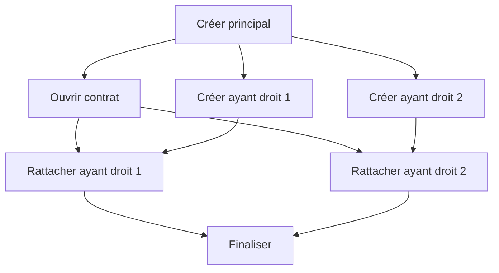
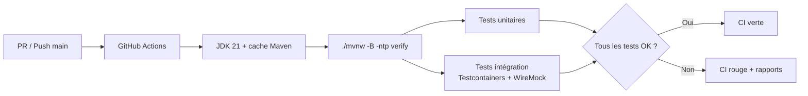
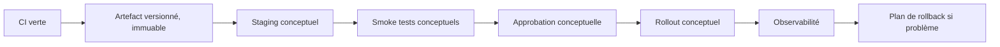

# DAT — ConfluxLab

**Type :** pseudo-projet technique et pédagogique Java/Spring.  
**Objectif :** comprendre, illustrer et défendre à l'oral une architecture inspirée du parcours AXA.  
**État :** progression organisée dans `docs/stages/` à la demande de l'utilisateur ; travail par petits incréments, sans implémentation globale en une seule fois. Aucun sprint n'est déclaré terminé.  
**Dans le périmètre :** backend, tests automatisés et **CI opérationnelle lors de la phase de code**.  
**Hors périmètre pratique :** CD, déploiement, cloud, serveur distant, infrastructure de production.

## 1. Principes de conception

- **Fidélité aux principes rapportés** : préserver la séparation Experience / Capability, MongoDB tampon, UUID, Spring Event, asynchronisme, Feign et Resilience4j.
- **Simplification métier** : un seul cas d'usage, la création d'une famille fictive.
- **Modernisation pédagogique** : Java 21 / Spring Boot 3.x, sans prétendre qu'il s'agissait des versions réellement utilisées chez AXA.
- **Traçabilité** : distinguer explicitement **[AXA rapporté]**, **[Simulation ConfluxLab]**, **[Proposition]** et **[Non confirmé]**.
- **Document-first** : théorie et DAT d'abord ; code uniquement lorsque le périmètre/contrat sont validés.
- **Minimum suffisant** : ne pas introduire de nouvelles briques qui n'illustrent pas une compétence ciblée.

## 2. Cas d'usage

Une requête HTTP demande la création d'une famille fictive de **trois personnes** : un assuré principal et deux ayants droit.

1. Le module Experience/BFF reçoit la demande HTTP, valide son format et appelle l'interface Java publique du module Capability, dans la même application Spring Boot.
2. Capability API génère un UUID et sauvegarde la demande `PENDING` dans MongoDB.
3. Capability publie un **événement Spring local** contenant l'UUID ; un listener `@Async` est planifié.
4. Capability renvoie l'acceptation et Experience retourne **HTTP `202 Accepted`** avec un `requestId` et une `statusUrl`, sans attendre les appels partenaires.
5. Le listener lit la demande, la fait évoluer en `PROCESSING` et exécute l'orchestration métier.
6. Les appels passent par un client Feign configuré avec les mécanismes pertinents de Resilience4j.
7. MongoDB reçoit l'état final `SUCCEEDED` ou `FAILED`.
8. Le client consulte **GET `/api/v1/requests/{requestId}`**.

**Nuance importante :** le traitement `@Async` peut commencer **avant** la fin de la réponse HTTP `202` ; le schéma décrit les responsabilités, pas une garantie de chronologie de ces deux opérations.

## 3. Orchestration métier simplifiée

Six opérations fictives, qui ne décrivent **pas** les endpoints réels GFP/Open :

- **A** — Créer l'assuré principal.
- **B** — Ouvrir le contrat, après A.
- **C** — Créer l'ayant droit 1, après A.
- **D** — Créer l'ayant droit 2, après A.
- **E** — Rattacher l'ayant droit 1 au contrat, après B **et** C.
- **F** — Rattacher l'ayant droit 2 au contrat, après B **et** D.

B, C et D peuvent être lancées en parallèle ; E et F n'attendent que leurs prérequis respectifs. Il ne s'agit pas de lancer aveuglément les six appels simultanément.

## 4. Stack technique proposée

| Domaine | Technologies / rôle |
|---|---|
| Langage | Java 21 |
| Framework | Spring Boot 3.x, Spring MVC, Bean Validation |
| Structure | Monolithe modulaire : modules logiques Experience/BFF et Capability, une seule application Spring Boot et un seul artefact exécutable |
| Communication interne | Appels Java via les interfaces publiques des modules ; pas de HTTP interne ni d'accès aux classes internes d'un autre module |
| Build | Maven + Maven Wrapper ; découpage en modules Maven éventuel, sans multiplier les applications |
| Persistance | MongoDB, Spring Data MongoDB |
| Événements | Spring Events in-process, `@Async` |
| Orchestration concurrente | `CompletableFuture`, executor borné |
| HTTP sortant | Spring Cloud OpenFeign vers le partenaire externe uniquement, pas entre Experience et Capability |
| Résilience | Resilience4j ; timeouts, retry sélectif, fallback explicite |
| Partenaire fictif | WireMock |
| Tests | JUnit 5, Mockito, Spring Boot Test, Testcontainers MongoDB |
| Observabilité | Logs corrélés, Actuator ; métriques à définir |
| **CI (pratique, après le DAT)** | **GitHub Actions + Maven `verify` + rapports de tests** |
| **CD (théorie uniquement)** | Promotion, environnement, stratégie de rollout et rollback |

Aucun frontend, Kafka, Kubernetes, authentification avancée ou plateforme cloud dans le MVP.

### 4.1 Responsabilités des modules

**[Simulation ConfluxLab — choix retenu dans le cadre de la délégation utilisateur pour le BFF]** : Experience est un BFF mince. Il expose le contrat REST, valide la forme des entrées et adapte les réponses/erreurs. Capability porte les règles métier, les invariants, les statuts, la persistance et l'orchestration. Elle ne se repose pas sur la seule validation du BFF pour protéger ses invariants. Les deux modules restent séparés dans la même application ; aucun appel HTTP interne n'est nécessaire.

## 5. Contrats HTTP

**POST `/api/v1/families`**

- Reçoit une demande de création fictive.
- Retourne `202 Accepted` avec `requestId`, `statusUrl` et `status`.
- Si l'acceptation échoue avant la prise en charge, répondre avec une erreur HTTP explicite, sans prétendre que le traitement est lancé.

**GET `/api/v1/requests/{requestId}`**

- Retourne l'état courant et, si disponible, le résultat ou le motif de l'échec.
- Statuts minimaux : `PENDING`, `PROCESSING`, `SUCCEEDED`, `FAILED`.
- Une panne partenaire **après le `202`** modifie le statut consultable, pas la réponse HTTP déjà envoyée.

## 6. Données MongoDB

Collection : **`family_requests`**.

Champs : `requestId`, `status`, `payload`, `createdAt`, `updatedAt`, `completedAt?`, `result?`, `error?`.

L'UUID **corrèle** la demande HTTP, le document persisté, l'événement et le traitement ; il n'assure ni idempotence, ni verrouillage, ni unicité de la création côté partenaire.

## 7. Sujets techniques prioritaires

- `@Async` et Spring Events locaux : exécution, exceptions, race conditions et perte d'événements à l'arrêt.
- `CompletableFuture` : graphe de dépendances, propagation des échecs, bornage des pools.
- Feign/Resilience4j : timeout, retry uniquement quand répétition sûre, fallback sans succès fictif.
- MongoDB/partenaire : états, opérations partielles, reprise, absence de transaction distribuée.
- CI : comment un commit déclenche compilation/tests, avec MongoDB et WireMock **isolés et reproductibles**.
- CD : expliquer séparément livraison, déploiement, approbations, rollback et stratégie de migration.

## 8. Performance et observabilité

Distinguer :

1. **Latence HTTP** = réception du POST jusqu'au `202`.
2. **Durée métier** = acceptation jusqu'à état terminal.
3. **Taux de réussite** = demandes réussies / demandes terminées dans un échantillon défini.

L'asynchronisme peut réduire l'attente HTTP **sans** réduire la durée métier. Le parallélisme peut accélérer les appels indépendants si les ressources et les contraintes partenaires le permettent.

Les résultats AXA rapportés (environ **30 s → 2,5 s** et **50 % → >90 %** de réussite sous charge) sont un **récit historique à contextualiser**, pas une promesse ni un benchmark ConfluxLab.

## 9. Validation fonctionnelle et technique

| Cas | Ce qui doit être observable |
|---|---|
| Succès nominal | `202` puis `SUCCEEDED` |
| Partenaire lent | Réponse HTTP rapide ; statut encore en cours |
| Deux créations concurrentes | UUID et statuts distincts, absence de confusion entre dossiers |
| `5xx` transitoire | Comportement de retry documenté, opération répétable uniquement |
| Erreur définitive | `FAILED` et diagnostic lisible |
| Crash après insertion en base | Risque de `PENDING` abandonné ; limite d'un événement non durable |
| Séquentiel vs parallèle | Mesures séparées latence HTTP / durée métier |
| CI : changement cassant | Test en échec ⇒ workflow rouge, sans déploiement |

**Mécanisme à apprendre :** `@Async` ne transforme pas un appel Feign bloquant en I/O non bloquante. Les pools doivent être dimensionnés pour des appels qui immobilisent des threads.

## 10. Progression pédagogique par sprints

Le [plan de travail dans `docs/stages/`](../stages/README.md) détaille les objectifs, incréments, tests, exclusions et critères de clôture. Il remplace la progression globale précédente : théorie, implémentation ciblée, tests et explication sont associés dans chaque sprint.

| Sprint | Objet | Livrable cible |
|---|---|---|
| 01 | Socle et frontières modulaires | Build reproductible, une application, EXP/Capability séparées |
| 02 | Contrat REST et BFF mince | POST/GET testés, stockage temporaire explicitement non durable |
| 03 | MongoDB et statuts | Persistance vérifiée, transitions contrôlées |
| 04 | Spring Events et `@Async` | Découplage HTTP/travail, analyse des fenêtres de panne |
| 05 | `CompletableFuture` et concurrence | Graphe A–F vérifié avec doublures contrôlées |
| 06 | Feign, WireMock et Resilience4j | Parcours partenaire, erreurs et répétitions sûres testées |
| 07 | Validation complète et observabilité | Scénarios intégrés, logs corrélés et mesures du labo |
| 08 | CI pratique sur accord | GitHub Actions réellement exécuté, rapports et détection de régression |
| 09 | CD théorique et entretien | Schéma conceptuel et restitution orale, aucun déploiement |

**Règle utilisateur : ne pas tout développer en une fois.** Avant chaque tâche de développement numérotée d'un sprint, présenter son périmètre et attendre le feu vert explicite de l'utilisateur pour cette tâche. L'accord sur un sprint ou sur une tâche ne couvre pas les suivantes. Les tâches portent un identifiant `INT-XX` unique et stable à l'échelle du projet. Après chaque tâche terminée, rédiger une note `notes/sprint-XX/INT-YY-<nom-de-la-tache-en-kebab-case>.md` dans le dossier `notes/` à la racine, titrée `# INT-YY — <Nom de la tâche>`, contenant réalisation, explications, décisions, fichiers, vérifications réellement observées et limites ; la lier depuis la fiche du sprint et `notes/README.md`. Puis s'arrêter et attendre le feu vert pour développer la tâche suivante. Aucun statut de réalisation ne peut être déduit du seul plan ou de la présence d'une note ; les fiches de travail restent dans `docs/stages/` et les comptes rendus dans `notes/`. Une note rétrospective ou partielle ne vaut ni tâche terminée ni autorisation de poursuivre. Cette planification n'autorise pas l'exécution anticipée des sprints, de la CI ou d'un déploiement.

## 11. CI — Incluse dans le périmètre pratique

### 11.1 Pourquoi l'ajouter ?

La CI est directement utile à la compréhension de la stack : elle démontre que l'application compile, que les tests du parcours et des cas de panne sont reproductibles et qu'une régression est détectée **avant** fusion. Elle introduit GitHub Actions **sans imposer de déploiement**.

### 11.2 Workflow cible (spécification, pas encore créé)

**Déclencheurs proposés** : `pull_request` et `push` sur la branche principale.

**Pipeline P0 — minimal mais utile :**

1. Checkout + configuration JDK 21 ; cache Maven.
2. `./mvnw -B -ntp verify` depuis la racine du dépôt.
3. Tests unitaires : validation, orchestration des six tâches, transitions d'état, politiques de retries/fallback.
4. Tests d'intégration isolés : MongoDB Testcontainers et API WireMock (timeouts, `5xx`, états finaux).
5. Rapports de tests exploitables en cas d'échec ; permissions GitHub minimales ; aucune variable de production.

**Point de rigueur :** `mvn verify` ne suffit pas, à lui seul, à garantir l'exécution des classes `*IT` ; les tests d'intégration devront être raccordés au cycle Maven (par ex. plugin Failsafe). Vérifier cela dans la CI réelle.

**Pipeline P1 — options après premier succès :** format/lint, JaCoCo, analyse des dépendances, archivage des JARs ; **pas** de seuil de couverture arbitraire.

**Definition of Done CI (quand implémentée) :** un nouveau clone peut lancer les tests sans service externe réel ; une PR cassant la logique métier fait échouer le workflow ; succès observé sur un run GitHub Actions ; commandes et preuves enregistrées.

## 12. CD — Uniquement en théorie

**Définition :** comprendre les étapes de livraison et de déploiement automatisé, sans les exécuter sur ConfluxLab.

Sujets d'entretien à maîtriser :

- Différence entre **continuous delivery** (livrable prêt et contrôlé) et **continuous deployment** (déploiement automatique après validations).
- Promotion de **la même version** d'artefact entre environnements, plutôt qu'un rebuild non traçable.
- Secrets, variables de configuration et autorisations minimales, **sans créer ni stocker de secrets dans le dépôt**.
- Stratégies rolling / blue-green / canary : choix selon risque, coût, capacité de rollback.
- Smoke tests, healthchecks/readiness, métriques, rollback et limites des migrations de données.

**Décision ferme de périmètre :** pas de fichier `.github/workflows/deploy.yml`, pas de publication de conteneur, pas de SSH, pas de VPS, pas de cloud et pas de déploiement effectif.

## 13. Décisions de cadrage

| ID | Décision proposée | Statut |
|---|---|---|
| D-01 | Un seul cas d'usage de création, trois personnes fictives | Proposée |
| D-02 | Monolithe modulaire : une application Spring Boot, modules Experience/BFF et Capability, appels Java internes ; partenaire externe simulé | Validée par l'utilisateur |
| D-03 | MongoDB tampon + UUID + Spring Event local + `@Async` | Proposée |
| D-04 | `CompletableFuture` et Feign/Resilience4j | Proposée |
| D-05 | Java 21 + Spring Boot 3.x + Maven | Proposée |
| **D-06** | **CI GitHub Actions pratique quand le projet sera codé** | **Recommandée** |
| **D-07** | **CD théorique seulement, aucun déploiement effectif** | **Recommandée** |
| D-08 | Doctrine d'apprentissage : faits AXA ≠ simulation ≠ proposition | Proposée |
| D-09 | BFF mince pour le contrat HTTP ; métier, invariants et orchestration dans Capability | Retenue dans le cadre de la délégation utilisateur pour le BFF |
| D-10 | Travail par sprints et petits incréments, point de validation avant la suite ; plan dans `docs/stages/` | Validée par l'utilisateur |

**[Simulation ConfluxLab — décision utilisateur] :** le monolithe modulaire est le modèle de déploiement du laboratoire, sans prétendre décrire le déploiement historique AXA. Experience ne doit pas accéder directement au stockage de Capability ; les dépendances entre modules restent unidirectionnelles et passent par leurs interfaces publiques. Feign/Resilience4j reste réservé au partenaire externe.

**Questions ouvertes (non bloquantes) :** packages ou modules Maven pour matérialiser les frontières du monolithe ; définition historique précise des 2,5 s ; politiques exactes de pools/retries non confirmées. Ces inconnues ne doivent pas être comblées par une histoire inventée.

---

*DAT ConfluxLab V0.2 — évolution du DAT édité par l'utilisateur : ajout d'une CI pratique différée, et d'une CD strictement conceptuelle.*
