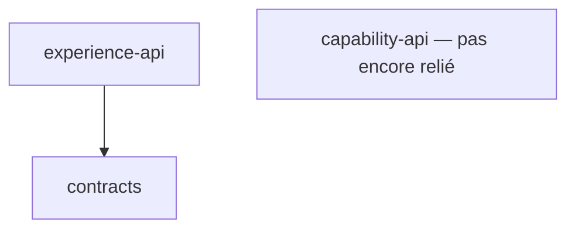
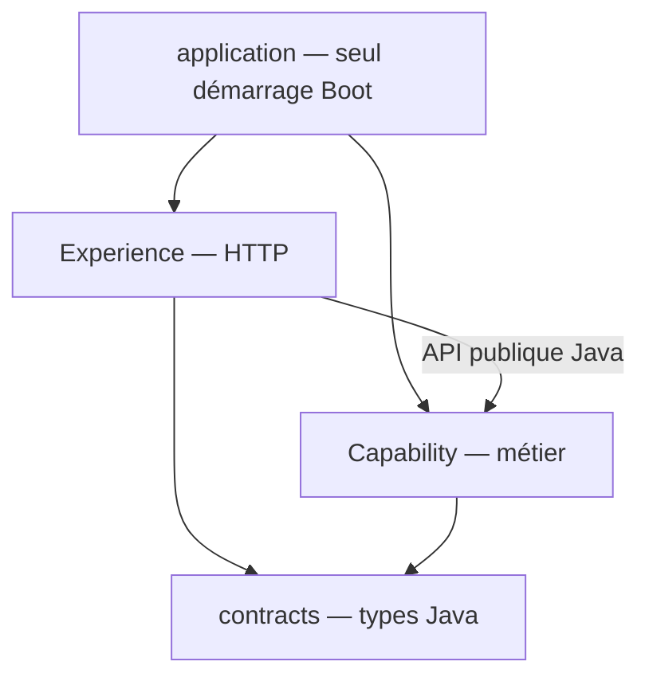

# INT-01 — Inspecter et fixer les frontières

| Repère | Valeur |
|---|---|
| **Sprint** | [01 — Socle du monolithe](../../docs/stages/sprint-01-socle.md) |
| **Statut** | Cadrage terminé ; application non assemblée et frontières non testées |
| **Objectif du tutoriel** | Comprendre l'organisation du code avant de commencer le métier |
| **Source des preuves** | Cadrage initial et reprise Maven conservés ; actualisation du statut de compilation après les tests d'INT-05 |
| **Suivi** | [Actions et repères centralisés](../todos.md) |

## 1. Objectif et vocabulaire

À la fin de cette lecture, tu dois pouvoir expliquer **qui reçoit une requête, qui prend la décision métier et qui conserve les données**. Il n'est pas nécessaire de connaître MongoDB ou `CompletableFuture` pour comprendre cette séparation.

Un **module** est une partie du code avec un rôle précis. Une **application** est ce que l'on démarre. Trois modules Maven ne veulent donc pas dire trois serveurs.

Une **dépendance** signifie ici « ce code a besoin des types définis dans cet autre module pour compiler ». Une flèche dans un schéma de dépendances ne signifie pas automatiquement un appel HTTP.

Une **interface publique** regroupe ce qu'un module autorise les autres à utiliser. Ses classes internes restent des détails d'implémentation : le BFF n'a pas à connaître la façon dont Capability lit MongoDB.

## 2. Comprendre le problème

### 2.1 L'amorce initiale

La première ébauche plaçait le démarrage Spring Boot dans Experience et prévoyait un appel HTTP vers Capability sur un autre port. Il manquait aussi le POM parent et les types partagés. Cette version n'était pas une application fonctionnelle.

L'utilisateur a ensuite précisé le choix d'un **monolithe modulaire**. On conserve la séparation des responsabilités, mais **une seule application démarre l'ensemble**.

| Partie | Question à laquelle elle répond | Ce qu'elle ne doit pas faire |
|---|---|---|
| **Experience / BFF** | « Comment recevoir la requête HTTP et présenter la réponse au client ? » | Porter les règles métier, accéder directement aux repositories, orchestrer les six appels |
| **Capability** | « La demande est-elle acceptable et comment la traiter ? » | Dépendre du BFF ou supposer que sa validation suffit à protéger le métier |
| **contracts** | « Quels types Java échange-t-on entre modules ? » | Contenir contrôleurs, règles métier, documents MongoDB ou clients HTTP |
| **application**, futur assemblage | « Comment démarrer et relier ces modules ? » | Devenir un nouveau module métier |

Le nom `capability-api` est conservé pour éviter un renommage inutile. Dans ce projet, il désigne le module métier et son API Java, **pas un second serveur REST**.

### 2.2 Un exemple de responsabilité

Si un client envoie un JSON mal formé, le BFF doit pouvoir le refuser. Si les données violent une règle métier, Capability doit protéger cette règle, même lorsqu'elle est appelée directement en Java dans un test.

Le BFF ne devrait pas aller lire une collection MongoDB pour prendre cette décision. Sinon, il dépendrait d'un détail de stockage que Capability devrait pouvoir modifier sans réécrire le contrôleur HTTP.

## 3. Travail réalisé pas à pas

### 3.1 Examiner les modules réellement présents

Le [POM racine](../../pom.xml) contient cet extrait :

```xml
<modules>
    <module>contracts</module>
    <module>capability-api</module>
    <module>experience-api</module>
</modules>
```

Cela demande à Maven de **prendre ces trois projets dans le même build**. C'est une liste de construction, pas une configuration des échanges métier et pas une liste de serveurs à démarrer.

Le parent hérite également de Spring Boot 3.5.7 et configure Java 21. Le rôle du parent et les étapes du build sont expliqués dans le [tutoriel INT-02](INT-02-rendre-le-build-reproductible.md).

### 3.2 Distinguer regroupement et dépendance

Dans [`experience-api/pom.xml`](../../experience-api/pom.xml), la dépendance suivante existe réellement :

```xml
<dependency>
    <groupId>dev.confluxlab</groupId>
    <artifactId>contracts</artifactId>
    <version>${project.version}</version>
</dependency>
```

- `groupId` et `artifactId` identifient la bibliothèque utilisée.
- `${project.version}` reprend ici la version du projet, `0.1.0-SNAPSHOT`.
- La dépendance rend les classes de `contracts` disponibles pour compiler Experience, **si ces classes existent**.

Lors du cadrage, `contracts` ne contenait aucun DTO : résoudre son artefact Maven ne créait pas les classes importées. C'était la cause du blocage d'INT-02. [INT-05](../sprint-02/INT-05-definir-les-contrats.md) définit désormais ces types et le build global a réussi, sans que les appels métier entre modules soient déjà implémentés.

À ce stade, `capability-api/pom.xml` ne déclare pas de dépendance vers les autres modules. Le seul lien Maven interne effectivement déclaré est donc :



### 3.3 Décrire la cible sans la présenter comme réalisée

La décision de cadrage est consignée dans le [DAT](../../docs/dat/ConfluxLab.md#42-frontières-fixées-dans-int-01) :



**Ce deuxième schéma est la cible, pas l'état actuel du code.** Le futur module `application` assemblera les modules et produira le seul JAR Boot exécutable. Une bibliothèque JAR ordinaire fournit du code ; elle n'a pas besoin d'être un serveur autonome.

Le BFF appellera Capability en Java. Feign/Resilience4j servira aux partenaires externes fictifs, pas à créer un réseau artificiel à l'intérieur de la même application.

### 3.4 Conserver ce qui a déjà été réparé

Le dépannage Maven a ajouté le parent, les POM des bibliothèques et le Wrapper, et retiré le reconditionnement Boot d'Experience. La reprise INT-01/INT-02 n'a pas écrasé ces modifications.

L'ancien `CapabilityClient` HTTP et `ExperienceApplication` sont encore dans l'ébauche. Leur présence ne prouve pas une conformité au schéma cible. Aucun service métier ni assemblage n'a été ajouté pendant le cadrage ou cette réécriture documentaire.

## 4. Commandes expliquées

Les commandes ci-dessous ont été exécutées **lors des travaux antérieurs**, depuis la racine du projet. Elles sont documentées ici, pas relancées automatiquement par le tutoriel.

```sh
./mvnw -v
docker version --format '{{.Client.Version}} / {{.Server.Version}}'
./mvnw -B -ntp validate
./mvnw -B -ntp -pl contracts,capability-api -am clean verify
./mvnw -B -ntp verify
```

| Commande | Ce qu'elle permet de comprendre | Résultat observé pendant la reprise |
|---|---|---|
| `./mvnw -v` | Quelle version de Maven et quel JDK exécutent le build | Maven 3.9.16 et Java Temurin 21.0.12.1 |
| `docker version ...` | Si le client Docker et le daemon, le service qui lance les conteneurs, répondent | Client et serveur 29.8.0 ; aucun conteneur lancé par cette vérification |
| `validate` | Si Maven comprend les POM et leur structure | Succès du parent et des trois modules |
| `-pl contracts,capability-api -am clean verify` | Construire seulement les deux bibliothèques et leurs prérequis après suppression de leurs sorties générées | Succès ; modules encore vides, pas de tests métier exécutés |
| `verify` sans sélection | Vérifier le projet entier, Experience compris | Échec de compilation : trois types absents de `contracts` |

`-pl` sélectionne des projets et `-am` inclut leurs dépendances présentes dans le build. **Un succès avec `-pl` ne prouve pas que les projets non sélectionnés compilent.** `-B` évite les interactions Maven ; `-ntp` réduit les affichages de progression des transferts.

## 5. Vérifications et limites

### 5.1 Ne pas confondre les dates du diagnostic

| Moment | Constat |
|---|---|
| Avant l'initialisation et le dépannage | Pas de dépôt Git local, pas de POM parent/Wrapper ; exécutable Docker trouvé, daemon non encore vérifié |
| Après l'initialisation Git et la reprise Maven | Git lié à GitHub, parent/POM/Wrapper présents ; Maven et daemon Docker répondent |
| Pendant le cadrage INT-01 | Rôles et graphe cible documentés ; code de frontière non implémenté/testé |
| Pendant cette réécriture | Réorganisation du cours et du suivi, sans nouvelle commande Maven, application ou conteneur |

L'ancienne erreur « not a git repository » appartient au premier diagnostic. Elle n'est pas l'état actuel du dépôt. De même, « pas de POM parent » décrit l'amorce, pas le socle Maven réparé.

### 5.2 Ce qui n'est pas prouvé

Un schéma correct ne prouve pas que le code le respecte. Aucun test de frontières, aucun appel Java BFF → Capability et aucun démarrage du futur assemblage n'ont été démontrés dans INT-01.

La tâche est terminée **pour son périmètre de cadrage**, pas pour tout le sprint. Le blocage des trois DTO a été levé par INT-05 et le build global est vert avec 59 cas de test de contrats ; cela ne valide pas l'assemblage, les frontières ou un parcours HTTP. Les preuves historiques du dépannage JDTLS restent distinctes dans INT-02.

## 6. Suivi centralisé

- [TD-R001 — Modules, responsabilités et application unique](../todos.md#td-r001).
- [TD-R002 — Comprendre ce que Maven a réellement validé](../todos.md#td-r002).
- [TD-B001 — Définir les contrats et DTO manquants](../todos.md#td-b001).
- [TD-B002 — Réévaluer le build global](../todos.md#td-b002).
- [TD-B003 — Assembler et remplacer l'appel HTTP interne](../todos.md#td-b003).
- [TD-B004 — Tester les frontières](../todos.md#td-b004).
