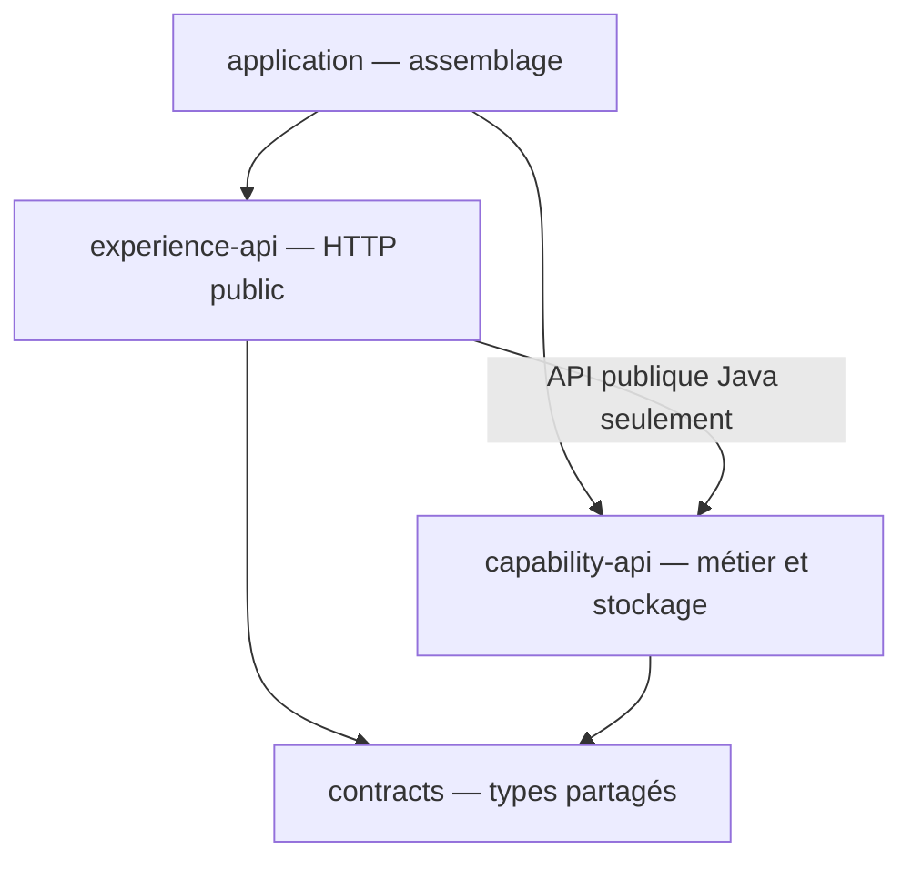
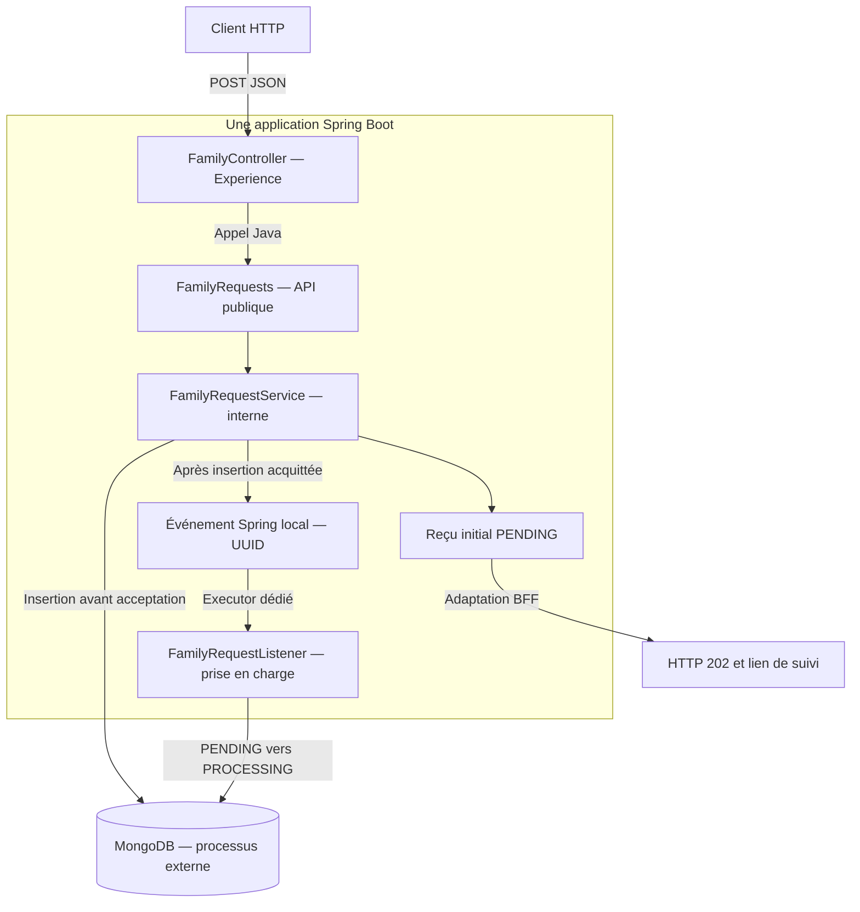

# INT-01, INT-03 et INT-04 — Architecture, assemblage et frontières

**[Simulation ConfluxLab] — Résultat réalisé du [sprint 01](../../docs/stages/sprint-01-socle.md).** Une application Spring Boot assemble des modules aux responsabilités séparées, reliés en Java et protégés par des contrôles de dépendances. Ce découpage décrit le laboratoire, pas le déploiement historique AXA.

Ce cours couvre INT-01/03/04 ; [INT-02 et INT-37 — Build reproductible et versionnement](INT-02-build-et-versionnement.md) explique Maven, le Wrapper et Git. Les notes sont regroupées **par sujet cohérent**, pas obligatoirement par sprint. Révision documentaire du 2026-10-22 : aucun code, test, build, démarrage ou commit exécuté ; les preuves ci-dessous restent historiques.

## 1. Plusieurs modules, une seule application

Un **module Maven** organise des sources et leur construction ; un **processus JVM** exécute l'application. Ici, trois bibliothèques sont réunies dans le seul JAR Boot exécutable. Une dépendance Maven n'est pas un appel réseau.

| Module / POM | Responsabilité | Produit |
|---|---|---|
| [contracts](../../contracts/pom.xml) | DTO : données échangées, contraintes de contrat et statuts ; aucun contrôleur, document ou repository | Bibliothèque JAR |
| [capability-api](../../capability-api/pom.xml) | API Java publique ; cas d'usage, invariants, stockage et orchestration internes | Bibliothèque JAR |
| [experience-api](../../experience-api/pom.xml) | BFF mince : HTTP, validation de forme, adaptation des réponses/erreurs | Bibliothèque JAR |
| [application](../../application/pom.xml) | Assemblage et seul démarrage Boot, sans nouveau métier | Seul JAR Boot exécutable |

Le nom `capability-api` ne signifie pas « second serveur REST ». Le graphe des **dépendances Maven directes** est :



Capability ne dépend pas d'Experience ; les contrats restent indépendants de leurs consommateurs. L'assemblage reçoit aussi les dépendances transitives de ses bibliothèques. Les POM rendent ces relations explicites ; ils ne suffisent pas à réserver les seuls types du package `api`.

### Flux actuel : prolongement du socle, pas preuve historique



Le GET reprend BFF → API Java → service pour lire les seules métadonnées, sans mutation. Le listener peut commencer avant le retour HTTP. Le graphe d'orchestration A–F existe en Java, mais n'est pas raccordé au listener ; aucun partenaire ni état final métier n'est produit par ce chemin. Cette lecture des sources actuelles n'est pas une nouvelle exécution.

## 2. Assembler le code et les objets Spring

Dans [`application/pom.xml`](../../application/pom.xml), extrait partiel :

```xml
<plugin>
    <groupId>org.springframework.boot</groupId>
    <artifactId>spring-boot-maven-plugin</artifactId>
</plugin>
```

Seul l'assemblage déclare ce plugin. Le parent Boot fournit sa version et l'exécution `repackage` : l'archive finale contient `BOOT-INF/`, les classes applicatives et les bibliothèques. Le `.jar.original` est un intermédiaire, pas un second exécutable à démarrer. Les trois autres modules restent des JAR ordinaires.

Dans le `main` de [`ConfluxLabApplication`](../../application/src/main/java/dev/confluxlab/ConfluxLabApplication.java), fragment :

```java
SpringApplication.run(ConfluxLabApplication.class, args);
```

La classe est annotée `@SpringBootApplication` et placée dans **`dev.confluxlab`** : le scan découvre les packages frères `experience` et `capability`. Une dépendance Maven fournit du code au **classpath** ; le scan et la configuration créent les **beans**, objets gérés et injectés par Spring. Le démarrage laissé dans `experience` n'aurait pas automatiquement découvert son package frère.

L'interface publique [`FamilyRequests`](../../capability-api/src/main/java/dev/confluxlab/capability/api/FamilyRequests.java) expose ces signatures, extrait :

```java
RequestAccepted createFamily(CreateFamilyRequest request);
RequestView getRequest(UUID requestId);
```

Elle définit les opérations accessibles aux autres modules, pas leur implémentation. Le contrôleur reçoit cette interface par constructeur ; un bean concret doit la réaliser. L'implémentation reste dans `capability.internal`, sans être connue du BFF.

Dans le POST de [`FamilyController`](../../experience-api/src/main/java/dev/confluxlab/experience/FamilyController.java), fragment :

```java
RequestAccepted accepted = familyRequests.createFamily(request);
String statusUrl = "/api/v1/requests/" + accepted.requestId();
RequestAccepted publicResponse = new RequestAccepted(accepted.requestId(), accepted.status(), statusUrl);
return ResponseEntity.accepted()
        .location(URI.create(statusUrl))
        .body(publicResponse);
```

La première ligne est un **appel Java dans la même JVM**, sans client HTTP interne. Les suivantes adaptent le résultat au contrat public (`202`, `Location`, corps). Le BFF maîtrise les URL, pas la persistance ; Capability valide aussi ses appels Java directs, sans se fier au seul `@Valid` HTTP. Feign/Resilience4j est réservé au partenaire externe, pas à ce lien interne.

### Distinguer l'assemblage historique du comportement actuel

**INT-03/04, avant INT-06 :** le client HTTP interne et l'ancien démarrage d'Experience ont été supprimés. Le bean provisoire `UnavailableFamilyRequests` signalait une indisponibilité, adaptée en `503`, sans conserver de demande. Le `202` préparé par un **double de test** prouvait la délégation du contrôleur, pas une acceptation réelle. Le bean provisoire puis son exception/mapping ont été retirés dans INT-06/07.

**Sources actuelles :** dans [`FamilyRequestService`](../../capability-api/src/main/java/dev/confluxlab/capability/internal/FamilyRequestService.java), après validation et construction de la demande, fragment :

```java
store.save(stored);
events.publishEvent(new FamilyRequestSubmitted(requestId));
return new RequestAccepted(requestId, stored.status(), "/api/v1/requests/" + requestId);
```

L'insertion précède publication et reçu. [`MongoFamilyRequestStore`](../../capability-api/src/main/java/dev/confluxlab/capability/internal/MongoFamilyRequestStore.java) est le store de production, sans fallback mémoire ; le [listener](../../capability-api/src/main/java/dev/confluxlab/capability/internal/FamilyRequestListener.java) tente ensuite la transition atomique vers `PROCESSING` sur un pool dédié borné. L'événement local n'est pas durable : `202` ne signifie ni famille créée ni reprise garantie.

Le GET actuel projette les métadonnées en `200`, l'absence en `404`. Une erreur inattendue de stockage ou un rejet de soumission relève du `500` générique de l'[advice HTTP](../../experience-api/src/main/java/dev/confluxlab/experience/ApiExceptionHandler.java), pas de l'ancien `503`. La base est nécessaire pour réussir POST/GET ; [configuration et prérequis actuels](INT-02-build-et-versionnement.md#4-commandes-et-prérequis-sans-réexécution).

## 3. Protéger les frontières, pas seulement démarrer

Java permet d'utiliser une classe `public` d'un JAR dépendant, même si son package s'appelle `internal`. Dans [`ModuleArchitectureRules`](../../application/src/test/java/dev/confluxlab/ModuleArchitectureRules.java), fragment :

```java
static final ArchRule EXPERIENCE_ONLY_USES_PUBLIC_CAPABILITY_API = noClasses()
        .that().resideInAPackage(EXPERIENCE)
        .should().dependOnClassesThat(
                resideInAPackage(CAPABILITY).and(resideOutsideOfPackage(CAPABILITY_API)));
```

Lecture : aucune classe d'Experience ne dépend d'un type de Capability **hors** de `dev.confluxlab.capability.api..`. Le `and` sélectionne la cible interdite ; `..` inclut les sous-packages. Un champ typé avec un document ou repository interne suffit à créer une dépendance interdite, même sans appel de méthode.

| Garde-fou des cinq règles | Intention |
|---|---|
| Aucun cycle entre sous-packages racine | Éviter Experience → Capability → Experience |
| Aucun Capability → Experience | Le métier reste indépendant du BFF |
| Experience → API publique seulement | Aucun accès aux détails internes de Capability |
| `contracts` indépendant des autres modules | Les types partagés ignorent leurs consommateurs |
| Aucun retour des bibliothèques vers l'assemblage | Protéger aussi le démarrage au package racine, hors des slices |

Dans [`ModuleArchitectureTest`](../../application/src/test/java/dev/confluxlab/ModuleArchitectureTest.java), fragment :

```java
private static final JavaClasses PRODUCTION_CLASSES = new ClassFileImporter()
        .withImportOption(ImportOption.Predefined.DO_NOT_INCLUDE_TESTS)
        .importPackages("dev.confluxlab");
```

ArchUnit lit le **bytecode compilé** de production, pas les exemples volontairement fautifs. Les mêmes règles sont éprouvées séparément dans [`ArchitectureRuleDetectionTest`](../../application/src/test/java/dev/confluxlab/ArchitectureRuleDetectionTest.java) : six violations attendues, avec origine/cible dans le diagnostic, et un graphe autorisé. Un test négatif vert signifie « rejet observé », pas « dépendance autorisée ».

Le [test de contexte](../../application/src/test/java/dev/confluxlab/ApplicationAssemblyTest.java) répond à une autre question : Spring trouve-t-il le BFF et une seule implémentation de `FamilyRequests` ? Aujourd'hui il utilise MongoDB de test. **Contexte, frontière et comportement métier sont trois preuves différentes.** ArchUnit 1.4.1 reste en scope `test`, sans infrastructure supplémentaire.

Limites : règles fondées sur les packages et le bytecode importé, pas sur tous les appels par réflexion/configuration. Les slices visent les cycles intermodules, pas tous les cycles internes ; elles ne parsèment pas les POM. Une classe métier mal placée dans `api` exige toujours une revue.

## 4. Preuves historiques et limites

| Étape | Résultat consigné | Ce qu'il démontre |
|---|---|---|
| INT-01 | Responsabilités et graphe cible documentés dans le DAT | Cadrage, pas preuve d'exécution |
| INT-03 — 2026-10-21 | `clean verify` : **64 tests** = 59 contrats + 2 délégation + 3 assemblage/disponibilité ; 0 échec/erreur/ignoré | Trois bibliothèques ordinaires et seul JAR Boot inspectés ; JAR démarré sans base/partenaire, POST/GET valides `503` sans `Location`/`requestId`, puis arrêté |
| INT-04 — 2026-10-21 | `clean verify` : **76 tests** = 64 + 5 frontières + 7 détection ; 0 échec/erreur/ignoré | Contexte réutilisé, archive sans ArchUnit/fixtures ; aucun nouveau lancement HTTP du JAR |

Pour situer la démonstration, commande Java de référence depuis `conflux-lab/`, **non relancée** :

```sh
# Exige le JAR construit et, aujourd'hui, MongoDB pour POST/GET ; arrêter avec Ctrl+C.
java -jar application/target/application-0.1.0-SNAPSHOT.jar --server.port=0 --server.address=127.0.0.1
```

Le port libre est attribué au lancement et se lit dans les logs ; loopback limite l'écoute à la machine locale. Le démarrage historique sans base ne prouve pas un parcours actuel sans MongoDB. Ni les évolutions MongoDB/async ni cette rédaction ne remplacent les 64/76 tests historiques.

La [clôture technique et documentaire du 2026-10-21](../../docs/stages/sprint-01-socle.md#journal-de-clôture--2026-10-21) ne vaut pas évaluation orale : restitution non évaluée. Aucun parcours partenaire complet, CI verte, benchmark ou déploiement n'est déduit de ces preuves. Les limites d'outillage sont dans le [cours build/versionnement](INT-02-build-et-versionnement.md#6-preuves-et-limites-historiques).

## 5. Repères et suivi

- [DAT — frontières](../../docs/dat/ConfluxLab.md#42-frontières-fixées-dans-int-01), [TD-R001 — modules/application](../todos.md#td-r001), [TD-R010 — assemblage/doubles](../todos.md#td-r010), [TD-R011 — frontières/détecteurs](../todos.md#td-r011).
- Réalisations : [TD-B003 — assemblage](../todos.md#td-b003), [TD-B004 — frontières](../todos.md#td-b004). Suite distincte : [TD-B018 — parcours partenaire et finalisation à autoriser](../todos.md#td-b018).
- Sujet complémentaire : [INT-02 et INT-37 — Build reproductible et versionnement](INT-02-build-et-versionnement.md). Cette réorganisation n'autorise ni développement ni nouvelle validation ou publication.
