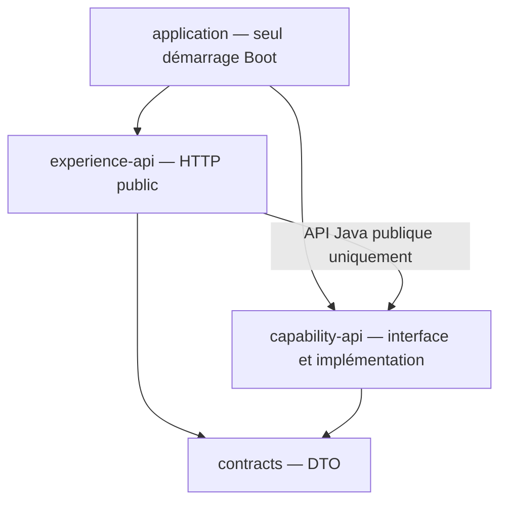

# INT-03 — Assembler les modules

> **Actualisation INT-06 — 2026-10-21, après la clôture du sprint 01.** L'[acceptation INT-06](../sprint-02/INT-06-accepter-une-demande.md) est désormais réalisée : enregistrement en mémoire avant retour du `202`, avec UUID et statut `PENDING`. Le GET reste en `503` jusqu'à INT-07 ; pas de MongoDB, d'événement Spring ni d'asynchronisme. Les vérifications historiques ci-dessous ont été exécutées par l'agent ; aucun build n'est relancé pour cette actualisation.

| Contexte | Description |
|---|---|
| **Sprint** | [01 — Socle du monolithe modulaire](../../docs/stages/sprint-01-socle.md) |
| **Statut** | **Terminée sur feu vert explicite pour INT-03 uniquement** ; contrôles de frontières INT-04 réalisés ensuite ; acceptation INT-06 non réalisée à la clôture du sprint 01, le 2026-10-21, avant INT-06 |
| **Date des vérifications INT-03 (avant INT-04)** | 2026-10-21 |
| **Objectif du tutoriel** | Comprendre comment plusieurs bibliothèques deviennent une seule application, puis démontrer un appel Java entre leurs modules |
| **Origine des preuves** | Sources modifiées dans cette tâche, tests ciblés, nouveau `clean verify`, inspection des quatre JAR et démarrage borné du JAR réel |
| **Historique distinct** | Les 59 tests de contrats viennent d'INT-05 ; ils ont été réexécutés dans le build global de cette tâche. Les diagnostics JDTLS restent ceux d'INT-02 |
| **Suivi** | [Registre central](../todos.md) ; cette note ne donne aucun feu vert pour la tâche suivante |

**[Simulation ConfluxLab]** Le découpage et le raccordement présentés ici sont ceux du laboratoire, pas une description certifiée du déploiement historique AXA.

**Actualisation historique après INT-04 — 2026-10-21, avant INT-06.** Les contrôles de frontières ont été réalisés et vérifiés par l'agent dans la session [INT-04 — Vérifier les frontières](INT-04-verifier-les-frontieres.md) : `clean verify` réussi, **76 tests** (64 existants + 5 contrôles de production + 7 tests de détection), diagnostics à zéro. Les 64 tests détaillés ci-dessous restent la preuve historique INT-03 du 2026-10-21, avant INT-04. Aucun build n'avait été relancé pour cette actualisation ; INT-06 n'était pas réalisée à cette date.

## Sommaire

- [1. Objectif et vocabulaire](#1-objectif-et-vocabulaire)
- [2. Comprendre le problème initial](#2-comprendre-le-problème-initial)
- [3. Travail réalisé pas à pas](#3-travail-réalisé-pas-à-pas)
- [4. Commandes et démonstration expliquées](#4-commandes-et-démonstration-expliquées)
- [5. Vérifications, compromis et limites](#5-vérifications-compromis-et-limites)
- [6. Formulation d'entretien](#6-formulation-dentretien)
- [7. Suivi centralisé](#7-suivi-centralisé)

## 1. Objectif et vocabulaire

Avant de créer une famille, nous devons pouvoir démarrer le programme qui relie ses composants. L'objectif n'est pas de tout implémenter, mais de rendre le socle exécutable **sans mentir sur le métier encore absent**.

| Mot | Sens concret dans cette tâche |
|---|---|
| **Module Maven** | Projet ayant son propre POM ; il produit ici une bibliothèque ou l'assemblage final |
| **Bibliothèque JAR** | Archive de classes utilisables par d'autres projets ; elle n'est pas nécessairement lançable avec `java -jar` |
| **JAR Boot exécutable** | Archive contenant le démarrage Spring Boot et les bibliothèques nécessaires pour lancer l'application |
| **Assemblage** | Module qui réunit les bibliothèques et configure leur démarrage, sans ajouter un nouveau métier |
| **Bean / contexte Spring** | Objet géré par Spring / ensemble des objets et de leur configuration dans l'application |
| **Injection par constructeur** | Spring fournit une dépendance au constructeur plutôt que de laisser le contrôleur la construire |
| **Interface publique** | Types que Capability autorise les autres modules à utiliser ; ses classes internes ne sont pas un contrat intermodule |
| **Double de test** | Objet substitué à une dépendance dans un test ; il peut retourner des données préparées sans réaliser le métier |
| **Smoke test** | Vérification courte que l'artefact construit démarre et répond ; ce n'est pas une validation complète du parcours |

Une seule application peut charger plusieurs JAR. **Un module n'est pas un processus**, et une dépendance Maven n'est pas un appel réseau.

## 2. Comprendre le problème initial

Après INT-05, les trois bibliothèques compilaient et les contrats étaient testés. Mais cela ne prouvait pas que l'application pouvait démarrer :

- le démarrage était encore nommé `ExperienceApplication` et situé dans Experience ;
- aucun module ne produisait le JAR Boot final ;
- le contrôleur passait par `CapabilityClient`, un client HTTP visant par défaut `localhost:8081` ;
- Capability ne fournissait aucune opération métier ; démarrer un second serveur aurait contredit le monolithe retenu.

L'appel réseau introduisait artificiellement URL, connexion et timeouts entre deux modules censés vivre dans la même JVM. Nous le remplaçons à la source, plutôt que de garder une façade HTTP devenue inutile.

**Problème à ne pas cacher :** une interface seule ne peut pas être injectée sans implémentation. Pour rendre l'assemblage démarrable avant INT-06/07, il faut fournir un bean provisoire, mais il ne doit ni inventer un identifiant, ni prétendre conserver une demande.

## 3. Travail réalisé pas à pas

### 3.1. Ajouter le module d'assemblage Maven

Le [POM racine](../../pom.xml) contient désormais cet extrait :

```xml
<modules>
    <module>contracts</module>
    <module>capability-api</module>
    <module>experience-api</module>
    <module>application</module>
</modules>
```

La liste regroupe les projets du build. Les dépendances déclarées dans leurs POM fixent ensuite ce dont chaque projet a besoin pour compiler et déterminent l'ordre de construction.

Le graphe **réellement assemblé dans cette tâche** est :



- [`capability-api/pom.xml`](../../capability-api/pom.xml) dépend de `contracts` et de `spring-context`, qui fournit notamment `@Service`, sans ajouter un serveur web à Capability.
- [`experience-api/pom.xml`](../../experience-api/pom.xml) dépend de Capability pour utiliser son interface, tout en conservant sa dépendance directe aux DTO.
- [`application/pom.xml`](../../application/pom.xml) assemble Experience et Capability. Le starter web déjà porté par Experience arrive également sur son classpath par transitivité.

**Transitivité** signifie qu'une dépendance peut apporter ses propres dépendances. La déclaration directe de Capability dans `application` rend néanmoins explicite que l'assemblage réunit les deux modules, au lieu de le laisser implicite.

Seul `application/pom.xml` déclare ce plugin, extrait partiel :

```xml
<build>
    <plugins>
        <plugin>
            <groupId>org.springframework.boot</groupId>
            <artifactId>spring-boot-maven-plugin</artifactId>
        </plugin>
    </plugins>
</build>
```

Sa version et l'exécution `repackage` sont héritées de la configuration du parent Spring Boot 3.5.7. Déclarer le plugin dans l'assemblage l'active ici ; les trois bibliothèques restent des JAR ordinaires. Le parent racine conserve le packaging `pom` et ne devient pas une application.

Le build prépare d'abord un JAR ordinaire, puis `repackage` le transforme en JAR Boot. Le fichier `application-0.1.0-SNAPSHOT.jar.original` est la sauvegarde intermédiaire créée par le plugin, **pas un second exécutable à lancer**.

### 3.2. Placer le seul démarrage au bon endroit

Contenu de [`ConfluxLabApplication.java`](../../application/src/main/java/dev/confluxlab/ConfluxLabApplication.java) :

```java
package dev.confluxlab;

import org.springframework.boot.SpringApplication;
import org.springframework.boot.autoconfigure.SpringBootApplication;

@SpringBootApplication
public class ConfluxLabApplication {

    public static void main(String[] args) {
        SpringApplication.run(ConfluxLabApplication.class, args);
    }
}
```

`SpringApplication.run` démarre le contexte et, avec les dépendances web présentes, le serveur HTTP embarqué. `@SpringBootApplication` réunit notamment l'auto-configuration et la recherche de composants dans son package et ses sous-packages.

Le placement dans **`dev.confluxlab`** est intentionnel : `dev.confluxlab.experience` et `dev.confluxlab.capability` se trouvent en dessous. Un démarrage laissé dans `dev.confluxlab.experience` ne scannerait pas automatiquement le package frère de Capability. Ajouter la dépendance Maven ne suffirait alors pas à fournir le bean attendu.

L'ancien `ExperienceApplication` a été supprimé, pas conservé comme second point de démarrage. La configuration d'application est désormais dans [`application/src/main/resources/application.yml`](../../application/src/main/resources/application.yml), avec le nom `conflux-lab`, le port par défaut 8080 et les options de réduction des détails d'erreur déjà présentes. Les propriétés de l'ancien réseau interne ont été retirées.

### 3.3. Définir la porte d'entrée Java de Capability

Contenu de [`FamilyRequests.java`](../../capability-api/src/main/java/dev/confluxlab/capability/api/FamilyRequests.java), imports omis :

```java
public interface FamilyRequests {

    RequestAccepted createFamily(CreateFamilyRequest request);

    RequestView getRequest(UUID requestId);
}
```

Cette interface réutilise les DTO définis dans INT-05. Elle décrit **comment appeler** les opérations ; elle ne réalise ni acceptation, ni stockage, ni validation métier. Aucun nouveau DTO ou protocole de transport interne n'est ajouté dans cette tâche.

Extrait partiel de [`FamilyController.java`](../../experience-api/src/main/java/dev/confluxlab/experience/FamilyController.java) :

```java
private final FamilyRequests familyRequests;

public FamilyController(FamilyRequests familyRequests) {
    this.familyRequests = familyRequests;
}
```

Puis, dans les méthodes du contrôleur :

```java
RequestAccepted accepted = familyRequests.createFamily(request);
```

```java
return ResponseEntity.ok(familyRequests.getRequest(requestId));
```

Ce sont des **appels de méthodes Java sur un objet injecté**, pas de la sérialisation JSON vers un autre port. Le BFF conserve l'adaptation HTTP et la construction du lien de suivi public ; il n'acquiert aucun stockage ni règle métier. Les annotations HTTP du contrôleur continuent de décrire la façade publique, pas la communication interne.

L'ancienne exception HTTP du client et les classes `CapabilityClient`, `CapabilityClientConfiguration`, `CapabilityProperties` ont été supprimées. Pour l'acceptation actuelle, voir la [note INT-06](../sprint-02/INT-06-accepter-une-demande.md).

### 3.4. Rendre l'indisponibilité honnête et observable

Extrait partiel **historique** de `UnavailableFamilyRequests.java` (INT-03, 2026-10-21, avant INT-06). Ce service provisoire a été supprimé dans [INT-06](../sprint-02/INT-06-accepter-une-demande.md) :

```java
@Service
class UnavailableFamilyRequests implements FamilyRequests {

    @Override
    public RequestAccepted createFamily(CreateFamilyRequest request) {
        throw new CapabilityNotReadyException();
    }

    @Override
    public RequestView getRequest(UUID requestId) {
        throw new CapabilityNotReadyException();
    }
}
```

`@Service` permet à Spring de détecter et de créer ce bean. La classe est **package-private** : l'absence de `public` empêche le BFF de la référencer directement depuis son package. Spring peut toutefois la découvrir et la fournir via l'interface publique. Le package `internal` signale aussi l'intention ; les contrôles automatisés de frontières ont depuis été réalisés dans [INT-04](INT-04-verifier-les-frontieres.md).

L'exception [`CapabilityNotReadyException`](../../capability-api/src/main/java/dev/confluxlab/capability/api/CapabilityNotReadyException.java) appartient à l'API publique, mais ne contient **aucun `HttpStatus`**. Capability signale son indisponibilité ; Experience décide de la représentation HTTP.

Extrait partiel de [`ApiExceptionHandler.java`](../../experience-api/src/main/java/dev/confluxlab/experience/ApiExceptionHandler.java) :

```java
@ExceptionHandler(CapabilityNotReadyException.class)
public ResponseEntity<ProblemDetail> handleCapabilityNotReady(CapabilityNotReadyException exception) {
    return ResponseEntity.status(HttpStatus.SERVICE_UNAVAILABLE)
            .body(problem(HttpStatus.SERVICE_UNAVAILABLE));
}
```

`ProblemDetail` représente une erreur structurée. Le détail choisi par le BFF est `Family request operations are not available yet.` Les anciens messages réseau de type « upstream » ne sont plus utilisés pour un appel interne Java.

**Pourquoi `503` ?** Dans l'incrément INT-03 du 2026-10-21, avant INT-06, l'application démarrait, mais les opérations n'étaient pas encore disponibles. Cette réponse empêche un faux `202` de laisser croire qu'une demande perdue a été acceptée. Le GET ne fabrique pas non plus un suivi ou un `404` prétendument issu d'une recherche. Ce choix provisoire n'est ni une panne de MongoDB, ni une politique de retry, ni une promesse de délai de disponibilité. Aucun `Retry-After` n'est inventé.

### 3.5. Tester deux niveaux différents

À l'étape INT-03 (2026-10-21, avant INT-06), [`FamilyControllerTest`](../../experience-api/src/test/java/dev/confluxlab/experience/FamilyControllerTest.java) comportait **2 tests unitaires**, sans contexte Spring :

- Mockito fournit un double de `FamilyRequests` ; le contrôleur reçoit ce double dans son constructeur.
- Le POST vérifie la délégation et la reconstruction du lien public ; le GET vérifie la transmission de l'UUID et de la vue.
- `verify(...)` contrôle l'appel attendu ; `verifyNoMoreInteractions(...)` vérifie l'absence d'appel supplémentaire au double.

Extrait partiel du test de création :

```java
when(familyRequests.createFamily(request)).thenReturn(
        new RequestAccepted(REQUEST_ID, RequestStatus.PENDING, "/ignored-by-bff"));
FamilyController controller = new FamilyController(familyRequests);

ResponseEntity<RequestAccepted> response = controller.createFamily(request);
```

Le `202` et le `PENDING` de ce test proviennent du **double préparé**, pas de l'implémentation livrée dans INT-03. Ils démontrent l'adaptation et la délégation, pas l'enregistrement d'une demande.

À cette même étape INT-03 (2026-10-21, avant INT-06), [`ApplicationAssemblyTest`](../../application/src/test/java/dev/confluxlab/ApplicationAssemblyTest.java) comportait **3 tests avec le vrai contexte**, sans remplacer Capability par un mock :

```java
@SpringBootTest(classes = ConfluxLabApplication.class)
@AutoConfigureMockMvc
class ApplicationAssemblyTest {
```

- Le contexte contient le contrôleur et exactement une implémentation de l'interface.
- Un POST valide obtient `503`, avec un corps `application/problem+json`, sans `Location` ni `requestId`.
- Un GET avec UUID valide obtient lui aussi `503`, sans suivi inventé.

**MockMvc** traverse la couche MVC dans le contexte de test, mais n'ouvre pas un véritable port TCP. C'est pourquoi un démarrage distinct du JAR et de vraies requêtes HTTP locales ont également été vérifiés.

## 4. Commandes et démonstration expliquées

### 4.1. Environnement réellement utilisé

Toutes les commandes de build sont parties de la racine `conflux-lab/`, contenant `pom.xml` et `mvnw`. JDK et accès aux dépendances Maven sont requis ; aucun MongoDB, Docker ou partenaire n'est nécessaire à cet incrément.

```sh
java -version
python3 --version
./mvnw -v
```

Résultats constatés : **Temurin 21.0.12.1**, **Python 3.12.0**, **Maven 3.9.16** sous Linux. Python sert seulement au contrôle ponctuel de l'archive et du processus ; ce n'est pas une dépendance de l'application ni du build Maven.

### 4.2. Commencer par les nouveaux tests

Commande réellement exécutée :

```sh
./mvnw -B -ntp -pl application -am -Dtest=FamilyControllerTest,ApplicationAssemblyTest -Dsurefire.failIfNoSpecifiedTests=false test
```

| Option | Rôle et limite |
|---|---|
| `-B` | Mode batch, sans interaction Maven |
| `-ntp` | Réduit l'affichage de progression des téléchargements |
| `-pl application` | Sélectionne le module d'assemblage |
| `-am` | Inclut ses dépendances présentes dans le réacteur : les trois bibliothèques sont donc construites |
| `-Dtest=...` | Sélectionne les deux classes de nouveaux tests ; les 59 tests de contrats ne sont pas exécutés par cette commande ciblée |
| `-Dsurefire.failIfNoSpecifiedTests=false` | Permet aux modules sans ces classes précises de participer au réacteur ; ne masque pas un échec de test, mais exige de vérifier les nombres effectivement exécutés |
| `test` | Compile les sources et tests, puis exécute la sélection ; ne produit pas encore le JAR final |

**Résultat observé :** 2 tests de contrôleur et 3 d'assemblage réussis, aucun échec/erreur/ignoré. La sélection seule ne remplace pas la vérification globale.

### 4.3. Reconstruire et tester tout le projet

Commande réellement exécutée :

```sh
./mvnw -B -ntp clean verify
```

`clean` supprime les sorties générées dans `target/`, pas les sources. Le cycle qui suit recompile tous les modules, exécute les tests raccordés, construit les archives et applique le reconditionnement Boot à `application`. Des dépendances manquantes peuvent être téléchargées ; les sorties et rapports sont écrits localement, sans commit, publication ou déploiement.

| Classe de test | Tests exécutés | Échecs / erreurs / ignorés |
|---|---:|---|
| `ContractValidationTest` | 43 | 0 / 0 / 0 |
| `ContractJsonTest` | 16 | 0 / 0 / 0 |
| `FamilyControllerTest` | 2 | 0 / 0 / 0 |
| `ApplicationAssemblyTest` | 3 | 0 / 0 / 0 |
| **Total** | **64** | **0 / 0 / 0** |

**Résultat : `BUILD SUCCESS`**, parent et quatre modules réussis. Les rapports Surefire se trouvent sous le `target/surefire-reports/` des modules ayant des tests.

### 4.4. Vérifier le résultat packagé, pas seulement les classes

Un contrôle Python ponctuel, exécuté depuis la racine, a inspecté les quatre JAR avec `zipfile` :

| Archive construite sous `<module>/target/` | Observation |
|---|---|
| `contracts-0.1.0-SNAPSHOT.jar` | Bibliothèque ordinaire, pas de `BOOT-INF/` ni de `Main-Class` |
| `capability-api-0.1.0-SNAPSHOT.jar` | Bibliothèque ordinaire, mêmes contrôles |
| `experience-api-0.1.0-SNAPSHOT.jar` | Bibliothèque ordinaire, mêmes contrôles |
| `application-0.1.0-SNAPSHOT.jar` | `BOOT-INF/`, manifeste `Start-Class: dev.confluxlab.ConfluxLabApplication` et les trois bibliothèques sous `BOOT-INF/lib/` |

Le même contrôle a lancé **cette commande Java comme processus enfant**, sans commande serveur laissée indéfiniment en arrière-plan :

```sh
java -jar application/target/application-0.1.0-SNAPSHOT.jar --server.port=0 --server.address=127.0.0.1
```

- `-jar` exécute l'archive construite, plutôt que le classpath de test.
- `--server.port=0` demande au système un port libre ; il a été **37961** pendant cette vérification, sans garantie pour un prochain lancement.
- `--server.address=127.0.0.1` limite l'écoute à la machine locale.
- Le superviseur Python a attendu au maximum 45 secondes le démarrage, puis utilisé `urllib.request` avec un timeout de 5 secondes par requête.
- Le POST a envoyé la fixture existante [`create-family.json`](../../contracts/src/test/resources/contracts/create-family.json), sans données réelles.
- Dans un bloc `finally`, le contrôle a demandé l'arrêt du processus, avec attente bornée et arrêt forcé prévu uniquement si nécessaire. **Le processus a bien été arrêté.**

Sortie utile réellement observée :

```text
contracts: ordinary library
capability-api: ordinary library
experience-api: ordinary library
application: Boot executable
JAR started on loopback port 37961, no MongoDB/partner configured
POST /api/v1/families -> 503 application/problem+json, no Location/requestId
GET /api/v1/requests/e91aa057-68f9-4d38-9d24-e8eb7f747630 -> 503 application/problem+json, no Location/requestId
JAR process stopped; log: application/target/int-03-smoke.log
INT-03 packaged smoke check: PASS
```

Le log est une sortie locale générée, ignorée par Git et supprimable par un prochain `clean`, pas une preuve versionnée durable. Les requêtes ont visé la façade publique depuis un client de test : **elles ne réintroduisent pas d'HTTP entre Experience et Capability**.

Pour reproduire manuellement la démonstration, construire avec `clean verify`, lancer la commande Java ci-dessus, relever le nouveau port dans le log Tomcat, envoyer la fixture au POST et appeler le GET indiqué, puis arrêter avec `Ctrl+C`. L'outil utilisé pendant cette session était Python, pas `curl` ; aucune commande `curl` n'est présentée comme exécutée. Le POST `503` ci-dessus décrit l'artefact INT-03 du 2026-10-21, pas le résultat attendu des sources actuelles : voir la [note INT-06](../sprint-02/INT-06-accepter-une-demande.md).

## 5. Vérifications, compromis et limites

### Ce que cette tâche démontre

- Un seul démarrage Spring Boot et un seul JAR exécutable assemblent les modules.
- Experience et Capability sont dans le même contexte, reliés par l'API Java publique.
- Lors d'INT-03 (2026-10-21, avant INT-04), le build global et les 64 tests ont réussi ; l'artefact réel a démarré sans base ni partenaire configurés.
- Le comportement livré dans INT-03 (2026-10-21, avant INT-06) était une indisponibilité explicite, sans identifiant ni prise en charge inventés.
- Une revue indépendante en lecture seule du câblage, des dépendances et des tests n'a identifié aucun défaut bloquant ou important. Elle ne remplace pas les vérifications exécutées.

### Ce que cette tâche ne démontre pas

- **À l'issue d'INT-03 (2026-10-21, avant INT-06), INT-06/07/08 n'étaient pas réalisées** : aucune génération d'UUID, conservation en mémoire, acceptation réelle, consultation métier ou couverture complète des refus à cette étape.
- Les réponses `202`/`200` des tests unitaires proviennent du double. Les réponses réelles vérifiées sur les routes valides dans INT-03 étaient `503`.
- Aucun MongoDB, événement Spring, `@Async`, orchestration, Feign/Resilience4j, partenaire ou CI n'est ajouté.
- Le contexte est testé pour prouver l'assemblage ; les contrôles automatiques contre cycles et imports interdits n'étaient pas inclus dans INT-03. Ils ont depuis été réalisés dans [INT-04](INT-04-verifier-les-frontieres.md).
- Pas de nouvelle validation de la GUI Zed, de Windows, de clone vierge ni de mesure de performance. Le temps de démarrage des logs n'est pas un benchmark et ne décrit pas AXA.

### Compromis à comprendre

La dépendance Maven Experience → Capability rend disponibles les classes publiques de l'artefact, pas seulement le package `api`. L'implémentation provisoire d'INT-03 était package-private et aucun import interne n'était utilisé ; le garde-fou de dépendances pour les futurs types publics internes a depuis été ajouté dans [INT-04](INT-04-verifier-les-frontieres.md). Le découpage Maven seul n'est pas une garantie complète de frontière.

Le bean indisponible était un raccordement temporaire d'INT-03 (2026-10-21), pas un fallback métier ni une implémentation en mémoire déguisée. Il a été supprimé dans [INT-06](../sprint-02/INT-06-accepter-une-demande.md), qui réalise désormais l'acceptation derrière la même porte d'entrée, sans conserver deux beans concurrents pour cette interface ; le GET reste indisponible jusqu'à INT-07.

Les tests affichent un avertissement Mockito sur l'auto-attachement d'un agent Java et des avertissements JVM associés. Sous le JDK 21 vérifié, cela n'empêche pas les succès. Aucune correction de configuration pour un futur JDK ni compatibilité avec celui-ci n'est revendiquée.

## 6. Formulation d'entretien

> « Dans ConfluxLab, un monolithe modulaire a été assemblé : Maven construit trois bibliothèques, puis un seul module `application` produit le JAR Spring Boot exécutable. Le contrôleur HTTP appelle une interface Java publique de Capability dans la même JVM ; il n'y a plus de client HTTP interne. L'agent a vérifié la délégation avec un double, l'injection avec le vrai contexte Spring, puis le démarrage du JAR et ses réponses HTTP. À l'étape INT-03 (2026-10-21, avant INT-06), l'acceptation métier n'était pas encore développée : l'implémentation retournait explicitement une indisponibilité, adaptée en `503` par le BFF, plutôt qu'un faux `202`. C'est un incrément pédagogique du laboratoire, pas une affirmation sur le déploiement historique AXA. »

**Relance :** « Un `202` dans le test unitaire prouve-t-il que la demande est conservée ? » **Non.** Dans les tests d'INT-03 (2026-10-21, avant INT-06), il venait d'un double ; seul un test avec une acceptation réelle et une lecture du stockage peut prouver cette prise en charge.

**Relance :** « Ajouter une dépendance Maven vers Capability suffit-il à injecter son service ? » **Non.** Il faut une implémentation enregistrée comme bean et une configuration qui la découvre ; le placement du démarrage et le test du contexte vérifient ce raccordement.

## 7. Suivi centralisé

- [TD-B003 — Assemblage et remplacement de l'HTTP interne, terminé avec preuves](../todos.md#td-b003).
- [TD-B004 — Contrôles automatiques des frontières, réalisés dans INT-04](../todos.md#td-b004).
- [TD-B005 — Acceptation, suivi et refus : à autoriser à la clôture du sprint 01 (2026-10-21, avant INT-06)](../todos.md#td-b005).
- [TD-R001 — Plusieurs modules, une seule application](../todos.md#td-r001).
- [TD-R005 — Contrat et annotations ne suffisent pas à prouver le métier](../todos.md#td-r005).
- [TD-R010 — Assemblage Spring, injection et distinction double/comportement livré](../todos.md#td-r010).
