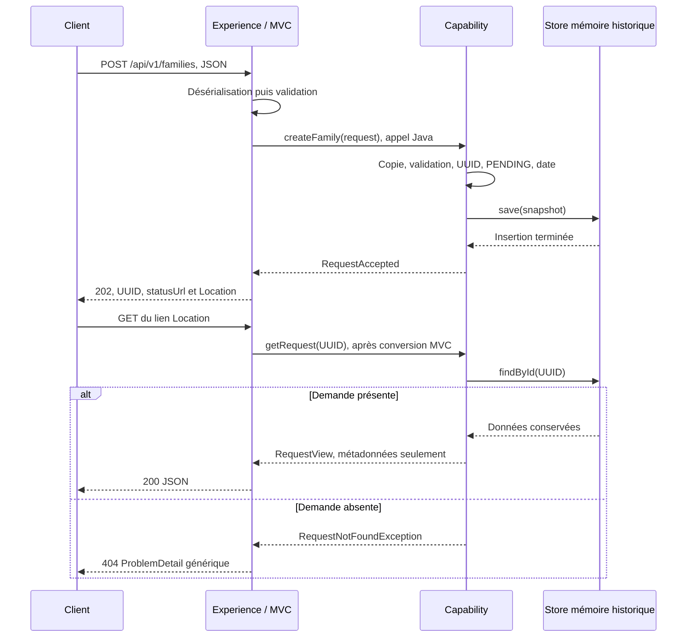

# INT-05 à INT-08 — Accepter et consulter une demande

**[Simulation ConfluxLab]** Ce cours regroupe le contrat, l'acceptation, le suivi et les refus du [sprint 02](../../docs/stages/sprint-02-rest.md). Les personnes et règles sont fictives : ce n'est pas une description certifiée du SI AXA.

**Résultat technique historique :** un client envoie une famille de trois personnes, reçoit un UUID après conservation de sa demande, puis consulte ses seules métadonnées. `202 Accepted` ne signifie jamais « famille créée ». Les preuves du 2026-10-21 sont reprises des quatre notes d'origine, sans nouvelle exécution ; la compréhension orale de l'apprenant reste non évaluée.

## 1. Situer la version avant de lire le flux

| Repère | Comportement réellement livré à cette étape |
|---|---|
| INT-05, préparée avant l'assemblage INT-03 | Cinq types et contrat JSON ; compilation débloquée, pas encore d'acceptation ni de serveur assemblé |
| Socle INT-03/04, avant INT-06 | POST et GET valides `503` : opérations explicitement indisponibles, aucune acceptation réelle |
| INT-06 | POST `202` après conservation mémoire ; GET encore `503`, même avec l'UUID accepté |
| INT-07 puis INT-08 | GET `200` des métadonnées, absence `404`, formats invalides testés `400` ; refus et confidentialité consolidés dans INT-08 |
| Sources de production actuelles | Depuis INT-10 : MongoDB, sans fallback mémoire ; depuis INT-14/15 : événement local et prise en charge async sur pool dédié borné |

**Référence historique inspectée : `fedb8b7`**, commit INT-08. Les fragments mémoire ci-dessous viennent de `git show fedb8b7:<chemin>`, pas du service actuel. Les DTO, l'API publique Java, le contrôleur et l'advice inspectés sont inchangés entre ce commit et l'arbre courant. Le [DAT](../../docs/dat/ConfluxLab.md) reste la référence d'architecture.

La perte après redémarrage et les demandes restant `PENDING` décrivent **le stade 02**, pas la production actuelle du laboratoire. Les évolutions MongoDB/async sont situées en fin de cours, sans leur attribuer les anciennes preuves.

## 2. Le contrat : quelles données échangent les modules ?

`contracts` est une bibliothèque Java de DTO, pas un service ni un modèle de stockage. Son [POM](../../contracts/pom.xml) déclare l'API Jakarta Validation en production ; Jackson et l'implémentation de validation y servent aux tests. Les exemples complets restent dans le [contrat HTTP](../../docs/dat/http-contracts.md).

| Type réel | Données transportées | Rôle dans le flux |
|---|---|---|
| [PersonPayload](../../contracts/src/main/java/dev/confluxlab/contracts/PersonPayload.java) | `firstName`, `lastName` : `String` ; `birthDate` : `LocalDate` | Une personne fictive |
| [CreateFamilyRequest](../../contracts/src/main/java/dev/confluxlab/contracts/CreateFamilyRequest.java) | `principal` ; `dependents` : liste de personnes | Un principal et exactement deux ayants droit |
| [RequestAccepted](../../contracts/src/main/java/dev/confluxlab/contracts/RequestAccepted.java) | `requestId` : `UUID`, `status`, `statusUrl` : `String` | Reçu du POST, pas résultat métier |
| [RequestView](../../contracts/src/main/java/dev/confluxlab/contracts/RequestView.java) | `requestId`, `status`, `createdAt` : `Instant` | Trois métadonnées de suivi, jamais le payload |
| [RequestStatus](../../contracts/src/main/java/dev/confluxlab/contracts/RequestStatus.java) | `PENDING`, `PROCESSING`, `SUCCEEDED`, `FAILED` | Vocabulaire des états, pas leur mécanisme de transition |

Composants extraits de `PersonPayload.java` — fragment, pas record complet :

```java
@NotBlank @Size(max = 100) String firstName,
@NotBlank @Size(max = 100) String lastName,
@NotNull @PastOrPresent LocalDate birthDate
```

À l'entrée, les noms doivent être présents, non blancs et de longueur maximale 100 ; la naissance doit être renseignée et non future. La longueur compte les unités UTF-16 de Java, pas les caractères affichés ; aucune normalisation, regex ASCII ou règle d'âge n'est ajoutée. « Aujourd'hui » dépend de l'horloge et du fuseau du validateur.

Composants extraits de `CreateFamilyRequest.java` :

```java
@NotNull @Valid PersonPayload principal,
@NotNull @Size(min = 2, max = 2) List<@NotNull @Valid PersonPayload> dependents
```

Dans le flux, on vérifie trois niveaux : présence du principal et ses champs, présence/taille de la liste, puis présence et champs de chaque ayant droit. Une liste de bonne taille ne garantit pas que ses personnes soient valides.

| Annotation Jakarta | Ce qu'elle impose lors d'une validation | Limite utile |
|---|---|---|
| `@NotNull` | Valeur présente | Ne contrôle pas son contenu |
| `@NotBlank` | Chaîne non nulle, non vide, non blanche | Ne nettoie pas la saisie |
| `@Size` | Longueur ou cardinalité bornée | N'interdit pas `null` à elle seule |
| `@PastOrPresent` | Date passée ou du jour | Utilise l'horloge du validateur |
| `@Valid` | Validation en cascade d'un objet ou élément présent | N'interdit pas `null` à elle seule |

Un **record** génère constructeur, accesseurs comme `firstName()`, comparaison et `toString()`, sans setters. Ses références sont finales, mais une liste référencée peut rester mutable. Ni `new CreateFamilyRequest(...)` ni Jackson ne déclenchent seuls Bean Validation. Les annotations des réponses ne valident pas automatiquement les retours HTTP ; `@NotBlank` sur `statusUrl` ne prouve pas sa cohérence avec l'UUID.

## 3. MVC valide l'entrée ; le BFF appelle Capability en Java

Dans le [FamilyController](../../experience-api/src/main/java/dev/confluxlab/experience/FamilyController.java), `@Valid @RequestBody CreateFamilyRequest request` sépare deux opérations : Jackson lit le JSON vers un DTO, puis l'intégration MVC déclenche ses contraintes. Une date impossible échoue au parsing ; une date lisible mais future échoue à la validation. Ces deux chemins donnent ici `400`, avant l'acceptation.

| Annotation Spring du bord HTTP | Utilité réelle |
|---|---|
| `@RestController`, `@RequestMapping("/api/v1")` | Exposer les routes et sérialiser leurs corps |
| `@PostMapping("/families")`, `@RequestBody` | Recevoir le POST et convertir son corps |
| `@GetMapping("/requests/{requestId}")`, `@PathVariable` | Lire le chemin et demander sa conversion vers `UUID` |
| `@RestControllerAdvice`, `@ExceptionHandler` | Adapter les exceptions en réponses HTTP communes |

L'interface publique [FamilyRequests](../../capability-api/src/main/java/dev/confluxlab/capability/api/FamilyRequests.java) expose seulement ces deux opérations — fragment :

```java
RequestAccepted createFamily(CreateFamilyRequest request);
RequestView getRequest(UUID requestId);
```

Le contrôleur injecte cette interface ; son implémentation et le store restent internes à Capability. **Une application Spring Boot, un seul JAR, des appels Java dans la même JVM** : ni Feign ni HTTP loopback entre ces modules. Feign est réservé au futur partenaire externe. Le BFF ne lit jamais la map ou MongoDB.

Flux historique complet à la fin d'INT-08 ; les entrées refusées par MVC s'arrêtent avant l'appel Java :



## 4. Accepter : protéger aussi l'appel Java et conserver avant le reçu

Source historique : [`InMemoryFamilyRequests.java` à `fedb8b7`](https://github.com/libileh91/conflux-lab/blob/fedb8b72bc484c47800d3017f35f728d47d78ac5/capability-api/src/main/java/dev/confluxlab/capability/internal/InMemoryFamilyRequests.java). Après un refus explicite de la racine Java `null`, le service prépare et valide cette copie locale — extrait partiel :

```java
CreateFamilyRequest snapshot = new CreateFamilyRequest(request.principal(),
        request.dependents() == null ? null : new ArrayList<>(request.dependents()));
if (!validator.validate(snapshot).isEmpty()) {
    throw new InvalidFamilyRequestException();
}
```

Ce contrôle protège les appels directs qui contournent MVC. Le refus arrive avant tout accès au store ; il applique les contraintes existantes, sans inventer de règle d'identité ou d'assurance. Copier avant de valider évite de conserver ensuite une liste changée par l'appelant ; ce n'est pas un protocole de synchronisation si celui-ci la modifie pendant la copie.

Dans le même service historique, le cœur de l'acceptation est :

```java
UUID requestId = UUID.randomUUID();
StoredFamilyRequest stored = new StoredFamilyRequest(
        requestId, RequestStatus.PENDING, snapshot, Instant.now(clock));
store.save(stored);
return new RequestAccepted(requestId, stored.status(), "/api/v1/requests/" + requestId);
```

Capability choisit l'UUID, `PENDING` et `createdAt`. **Le reçu vient après `save`** : une exception de stockage remonte, sans faux acquittement. L'horloge injectable est fournie par `Clock.systemUTC()` dans la configuration historique ; elle ne règle pas automatiquement le `ClockProvider` de Bean Validation.

Le constructeur de [`StoredFamilyRequest` historique](https://github.com/libileh91/conflux-lab/blob/fedb8b72bc484c47800d3017f35f728d47d78ac5/capability-api/src/main/java/dev/confluxlab/capability/internal/StoredFamilyRequest.java) fige ensuite la liste validée — fragment :

```java
payload = new CreateFamilyRequest(payload.principal(), List.copyOf(payload.dependents()));
```

Ce **snapshot** est une copie non modifiable de la liste ; ses éléments contiennent eux-mêmes des valeurs immuables. Le record interne ne devient pas pour autant une réponse publique. Son `toString()` inclurait les personnes : ne pas le journaliser.

Le [`store historique`](https://github.com/libileh91/conflux-lab/blob/fedb8b72bc484c47800d3017f35f728d47d78ac5/capability-api/src/main/java/dev/confluxlab/capability/internal/InMemoryFamilyRequestStore.java) utilise une `ConcurrentHashMap`. Son insertion refuse l'écrasement — fragment :

```java
if (requests.putIfAbsent(request.requestId(), request) != null) {
    throw new IllegalStateException("Request identifier already exists.");
}
```

`putIfAbsent` rend atomique cette insertion, sans « vérifier puis écrire ». Une collision échoue ; elle ne remplace pas le dossier existant. La map reste **volatile, non bornée et sans nettoyage**. Un UUID corrèle une demande ; il ne garantit ni idempotence, ni authentification, ni autorisation. Deux POST identiques produisent ici deux demandes indépendantes.

Au retour Java, le BFF construit le lien public depuis l'UUID et adapte le reçu — extrait partiel de `FamilyController.java` :

```java
String statusUrl = "/api/v1/requests/" + accepted.requestId();
RequestAccepted publicResponse = new RequestAccepted(accepted.requestId(), accepted.status(), statusUrl);
return ResponseEntity.accepted()
        .location(URI.create(statusUrl))
        .body(publicResponse);
```

`accepted` provient de `familyRequests.createFamily(request)`. `Location` et `statusUrl` désignent donc le même suivi relatif ; `Location` ne redirige pas automatiquement le client. À INT-06, ce lien était déjà fourni, mais le GET répondait encore `503` : une route et un lien ne prouvent pas leur réalisation.

## 5. Consulter : lire une projection, pas relancer le métier

Depuis INT-07, le service recherche l'UUID après avoir rejeté l'argument Java `null` — fragment historique de `InMemoryFamilyRequests.getRequest` :

```java
StoredFamilyRequest stored = store.findById(requestId)
        .orElseThrow(RequestNotFoundException::new);
return new RequestView(stored.requestId(), stored.status(), stored.createdAt());
```

`Optional` représente ici une présence ou une absence. Seule l'absence devient `RequestNotFoundException` ; une panne de lecture n'est pas transformée en faux `404`. Capability ne choisit aucun statut HTTP : le BFF traduit cette exception publique, sans payload, en `404`.

La projection reprend exactement l'UUID, le statut stocké et la date d'origine. Pas de `save`, nouvel UUID, `Instant.now` ou traitement : le **polling**, répétition du GET, ne doit pas faire avancer la demande. Le payload des personnes reste interne. L'enum autorisait déjà quatre statuts, mais au stade 02 les demandes créées restaient `PENDING` ; les autres valeurs vérifiaient seulement la projection dans les tests, pas des transitions réalisées.

| Situation, au stade 02 achevé | Réponse HTTP | Sens et frontière |
|---|---|---|
| POST valide, conservation réussie | `202 application/json` + `Location` | Reçu : `requestId`, `status=PENDING`, `statusUrl` |
| Entrée invalide ou JSON illisible | `400 application/problem+json` | Pas de reçu ; refus MVC ou contrôle Java de Capability |
| GET, texte non convertible en UUID | `400 application/problem+json` | Conversion MVC refusée avant Capability |
| GET, UUID valide mais absent | `404 application/problem+json` | Absence dans le store courant, pas panne de lecture |
| GET, demande présente | `200 application/json` | `requestId`, `status`, `createdAt` seulement |
| POST, contenu `text/plain` testé | `415 application/problem+json` | Type de contenu non pris en charge |
| Échec inattendu d'acceptation ou lecture | `500 application/problem+json` | Ni faux `202`, ni absence artificielle ; pannes simulées dans les preuves |

**Redémarrage historique :** le JAR a donné `202` puis `200`, et le même UUID a donné `404` après redémarrage sur une nouvelle map vide. Cela n'annule pas le POST observé : le store courant ne connaît plus la demande. Ce résultat n'est pas celui du stockage MongoDB actuel. Un futur état métier `FAILED` serait encore autre chose : une demande connue peut rester consultable en HTTP `200` malgré l'échec de son traitement.

## 6. Erreurs : un détail générique ne suffit pas à la confidentialité

L'[ApiExceptionHandler](../../experience-api/src/main/java/dev/confluxlab/experience/ApiExceptionHandler.java) centralise les traductions : `Invalid request.`, `Request not found.`, `An unexpected error occurred.` ; les autres refus gérés utilisent `Request rejected.`. Il remplace aussi les corps d'erreurs MVC pour ne pas exposer valeurs rejetées, erreurs de binding ou diagnostics Jackson. Les exceptions publiques de Capability restent indépendantes d'HTTP.

INT-08 a révélé un défaut concret : même avec `detail: "Invalid request."`, MVC recopiait `/api/v1/requests/not-a-uuid-INT08FictivePerson` dans `ProblemDetail.instance`. Ce chemin pouvait contenir une saisie sensible. Correctif réel, déjà présent à `fedb8b7` — fragment du helper :

```java
ProblemDetail problem = ProblemDetail.forStatusAndDetail(status, detail);
problem.setInstance(URI.create(""));
return problem;
```

La référence URI vide est valide et **non nulle** : MVC ne complète plus `instance` avec le chemin rejeté. Avec la sérialisation MVC/Jackson historiquement observée dans cette stack, cette valeur vide est **omise du JSON**. Ce sont deux effets distincts, pas une règle universelle de sérialisation. Un éventuel `instance: ""` après changement de stack serait une différence de représentation, pas à lui seul une fuite ; les tests existants exigent l'omission.

L'objet Java et le JSON HTTP ont été contrôlés séparément. Les réponses testées ne contiennent ni marqueur privé, trace, cause, payload, ni `Location`/`requestId`/`statusUrl` de succès. La [configuration applicative](../../application/src/main/resources/application.yml) désactive aussi l'inclusion standard des messages, binding errors, stacktraces et noms d'exceptions. Cela ne constitue pas un audit de tous les logs, filtres, proxys ou erreurs hors de cet advice.

## 7. Preuves conservées et commandes dans leur contexte

**Historique du 2026-10-21, repris des notes INT-05/06/07/08, pas exécuté pour ce regroupement.** Les totaux sont des photographies successives du réacteur, **à ne pas additionner** ; un cas paramétré n'est pas nécessairement une méthode de test. Le compteur n'est ni un objectif de couverture ni une mesure d'apprentissage.

| Étape | Résultat rapporté | Ce que la preuve apporte |
|---|---|---|
| Contrats INT-05 | **59 cas** : 43 validation, 16 JSON ; `clean verify` réussi | Contraintes et conversions ; compilation débloquée, sans serveur ou test HTTP |
| Acceptation INT-06 | **22 cas ciblés**, puis **96 tests globaux**, sans échec/erreur/ignoré | Conservation avant retour, snapshot, UUID distincts, pas de reçu si `save` échoue ; JAR : deux POST `202`, GET encore `503`, corps invalide `400` |
| Suivi INT-07 | **25 cas au passage ciblé initial**, puis **108 tests globaux**, sans échec/erreur/ignoré | Global après renforcement de la projection ; JAR : deux POST/GET indépendants, dates stables, `404`/`400`, puis ancien UUID `404` après redémarrage |
| Refus INT-08 | **93 cas ciblés finaux**, puis **181 tests globaux**, sans échec/erreur/ignoré | Non-appel de l'acceptation pour refus MVC ; 25 entrées Java invalides sans interaction store ; isolation, borne valide à 100 caractères, confidentialité et frontières |
| Avant commit INT-08 | **1 test ciblé de confidentialité réussi**, `BUILD SUCCESS` | Ni suite globale ni JAR relancés ; ce n'est pas un second passage des 181 tests |

Ces comptes ne constituent pas un minimum pédagogique. Le point utile du correctif est expliqué plus haut : vérifier l'absence d'écho dans l'objet Java **et** sa représentation JSON, sans supposer que la chaîne URI vide sera sérialisée comme un champ vide.

Les `500` viennent de doublures contrôlées, pas d'une panne réelle de base. La démonstration JAR INT-08 a observé `400`/`415`/`404` génériques sans marqueur ni `instance`, et deux demandes valides dont les vues restent stables autour des refus. L'absence d'écriture est prouvée par instrumentation des tests, **pas par le seul statut HTTP**. Les essais de concurrence vérifient l'isolation, pas un gain de performance. Tous les processus de démonstration ont été arrêtés.

Commandes essentielles **historiquement exécutées depuis la racine `conflux-lab/`**, JDK 21 et dépendances Maven accessibles si absentes du cache ; aucun Docker/MongoDB/partenaire n'était requis au stade 02 :

```sh
./mvnw -B -ntp -pl contracts -am test
./mvnw -B -ntp clean verify
```

La première sélectionne les contrats et leurs prérequis : résultat INT-05 de 59 cas. La seconde a produit les contrôles globaux successifs du tableau ; au premier passage INT-05, seuls des JAR bibliothèques existaient, pas encore le JAR Boot. `-B -ntp` évite l'interaction et la progression des transferts ; `clean` supprime les sorties `target/`, `verify` reconstruit et vérifie les modules, sans publier ni déployer. Les avertissements Mockito/JVM d'auto-attachement sous Java 21 étaient non bloquants, sans garantie pour un futur JDK.

Commande du JAR utilisé dans les démonstrations historiques INT-06/07/08 :

```sh
java -jar application/target/application-0.1.0-SNAPSHOT.jar --server.port=0 --server.address=127.0.0.1
```

Le port `0` laisse choisir un port libre ; loopback limite l'écoute au poste. Démarrage, requêtes et arrêt étaient bornés ; les logs sous `target/` sont temporaires, ignorés par Git, pas des preuves durables. **Ces commandes ne sont pas réexécutées ici et ne sont pas une recette sans base pour les sources actuelles** : MongoDB est désormais requis pour réussir POST/GET et le cycle `verify` inclut les IT depuis INT-12.

## 8. Ne pas confondre ce stade avec le flux actuel

Le [service actuel](../../capability-api/src/main/java/dev/confluxlab/capability/internal/service/FamilyRequestService.java) conserve la validation et la projection, mais utilise `StoredFamilyRequest.pending(...)`, normalise les dates à la milliseconde, attend l'insertion puis publie `FamilyRequestSubmitted`. Le [store MongoDB](../../capability-api/src/main/java/dev/confluxlab/capability/internal/persistence/MongoFamilyRequestStore.java) emploie `insert`, avec UUID `_id` unique, pas un upsert. L'ancien store mémoire ne sert plus qu'aux tests ; aucun repli mémoire n'est configuré.

Le [listener actuel](../../capability-api/src/main/java/dev/confluxlab/capability/internal/event/FamilyRequestListener.java), `@EventListener` et `@Async("familyRequestExecutor")`, tente la prise en charge atomique vers `PROCESSING`. Il peut démarrer **avant** le retour HTTP : le reçu reste initialement `PENDING`, tandis que le GET peut déjà lire `PROCESSING`. Il s'arrête à cette prise en charge ; l'orchestration n'y est pas encore raccordée, aucun traitement partenaire ni état final n'est produit par ce parcours.

L'événement local reste non durable, sans reprise automatique. Une erreur MongoDB peut laisser une issue d'écriture inconnue ; un rejet de soumission peut laisser un document `PENDING` malgré une erreur HTTP. « Pas de faux reçu » ne signifie donc pas « toute erreur prouve l'absence de document ». La persistance après redémarrage est une preuve ultérieure d'[INT-12](../sprint-03/INT-10-insertion-et-persistance-mongodb.md), pas la démonstration mémoire INT-07 inversée par interprétation.

## Repères utiles du registre

- [TD-B001 — Contrats définis](../todos.md#td-b001) et [TD-B005 — Parcours REST mémoire vérifié](../todos.md#td-b005) : suivi historique, pas nouvelle autorisation.
- [TD-R004 — Acceptation, suivi et réussite](../todos.md#td-r004) ; [TD-R005 — Annotations et validations effectives](../todos.md#td-r005).
- [TD-R008 — Horloge de validation](../todos.md#td-r008) ; [TD-R009 — Records et immuabilité de surface](../todos.md#td-r009).
- [TD-R012 — Conserver avant le reçu](../todos.md#td-r012) ; [TD-R013 — Lecture, absence et format](../todos.md#td-r013) ; [TD-R014 — Refus, effets et confidentialité](../todos.md#td-r014).
