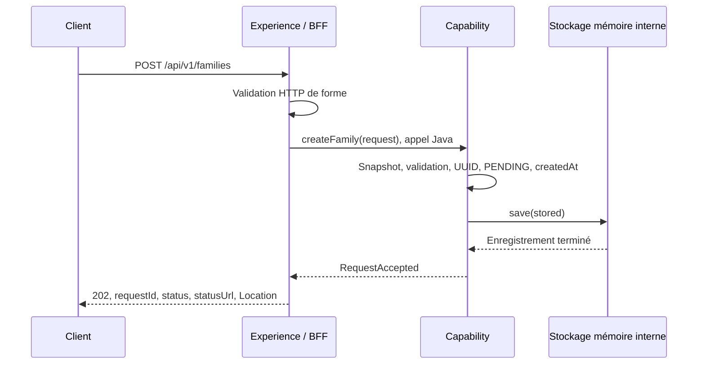

# INT-06 — Accepter une demande

> **Depuis INT-10 :** ce cours conserve les extraits et preuves historiques de l'acceptation mémoire. Le service actuel est `FamilyRequestService` et le store mémoire a été déplacé dans les tests ; le [cours INT-10](../sprint-03/INT-10-persister-avant-d-accepter.md) explique la persistance MongoDB désormais utilisée en production.

> **Repère temporel — depuis INT-07.** Le GET d'une demande conservée retourne `200` avec les seules métadonnées `requestId`, `status` et `createdAt` ; UUID inconnu : `404`, UUID malformé : `400`. Les constats, extraits et preuves chiffrées ci-dessous, notamment les anciens GET `503`, restent historiques et propres aux étapes décrites. Voir le [cours INT-07](INT-07-consulter-la-demande.md).

| Contexte | Description |
|---|---|
| **Sprint** | [02 — Contrat REST et BFF mince](../../docs/stages/sprint-02-rest.md) |
| **Statut** | **Terminée sur feu vert explicite « ok go 06 »**, sans autorisation pour INT-07/08 |
| **Date des preuves** | 2026-10-21 |
| **Objectif du cours** | Comprendre et démontrer une acceptation réelle en mémoire, sans la confondre avec création de famille, suivi disponible ou conservation durable |
| **Sources des preuves** | Sources et tests de cette tâche, tests ciblés, `clean verify` global, rapports Surefire, diagnostics et démarrage borné du JAR |
| **Historique distinct** | INT-05 avait défini les DTO ; INT-03/04 avaient câblé et protégé les modules avec deux routes indisponibles. Ce cours remplace la lecture rétrospective de l'ébauche HTTP par l'explication de l'acceptation maintenant réalisée |
| **Limite principale** | GET toujours `503`, mémoire locale perdue au redémarrage, aucun événement ou traitement métier |
| **Suivi** | [Registre central](../todos.md) ; aucun commit ou push effectué dans cette tâche |

**[Simulation ConfluxLab]** Les personnes et le parcours sont fictifs. Java 21, Spring Boot 3.5.7 et cette implémentation mémoire sont les choix du laboratoire, pas une reproduction certifiée du SI AXA.

## Sommaire

- [1. Objectif et vocabulaire](#1-objectif-et-vocabulaire)
- [2. Comprendre le problème initial](#2-comprendre-le-problème-initial)
- [3. Travail réalisé pas à pas](#3-travail-réalisé-pas-à-pas)
- [4. Tests et preuves](#4-tests-et-preuves)
- [5. Commandes et démonstration](#5-commandes-et-démonstration)
- [6. Limites et formulation d'entretien](#6-limites-et-formulation-dentretien)
- [7. Suivi centralisé](#7-suivi-centralisé)

## 1. Objectif et vocabulaire

Le client doit recevoir un identifiant **parce qu'une demande a été conservée**, pas simplement parce qu'un contrôleur sait construire un JSON. Dans cet incrément, la conservation est réelle mais uniquement en mémoire de l'application.

| Terme | Sens concret ici |
|---|---|
| **Acceptation** | Vérifier l'entrée, créer une demande `PENDING`, la conserver et seulement ensuite retourner son reçu |
| **Acquittement / reçu** | Réponse confirmant cette acceptation ; ici HTTP `202` avec un UUID et des liens |
| **UUID de corrélation** | Identifiant reliant réponse et demande stockée ; il ne dédoublonne pas les demandes |
| **`PENDING`** | Demande acceptée en attente ; aucun traitement n'est lancé dans cette tâche |
| **Snapshot** | Copie des données conservées pour ne pas dépendre des modifications ultérieures de la liste de l'appelant |
| **Stockage volatile** | Données attachées au processus, perdues lorsque celui-ci s'arrête |
| **`ConcurrentHashMap`** | Map Java permettant des accès concurrents ; elle n'est ni une base durable ni une limite de consommation mémoire |
| **`putIfAbsent`** | Insertion atomique qui refuse d'écraser une valeur déjà présente pour la même clé |
| **`Clock`** | Source de temps injectable ; les tests peuvent fournir une horloge fixe |
| **Doublure / mock** | Dépendance remplacée dans un test pour simuler un comportement, notamment un échec |

**`202` ne signifie jamais « famille créée ».** Dans le labo actuel, il signifie « demande conservée en mémoire ». Le lien de suivi est préparé, mais son endpoint n'est pas encore implémenté.

## 2. Comprendre le problème initial

L'ébauche historique décrite dans l'ancienne version de cette note utilisait un client HTTP interne. INT-03 l'a supprimé et a injecté l'interface Java publique `FamilyRequests` dans le BFF. L'implémentation provisoire levait une exception d'indisponibilité pour le POST comme pour le GET ; les `202` des tests unitaires du contrôleur provenaient d'un double.

Cette histoire reste consultable dans la [version de la note publiée avant INT-06](https://github.com/libileh91/conflux-lab/blob/4e4acafe43575f588ae73438ab3c78d1453883ea/notes/sprint-02/INT-06-accepter-une-demande.md), et dans les cours [INT-03](../sprint-01/INT-03-assembler-les-modules.md) et [INT-04](../sprint-01/INT-04-verifier-les-frontieres.md). Ces anciennes preuves ne sont pas présentées comme une acceptation qui aurait déjà existé.

INT-06 doit maintenant changer **l'implémentation derrière l'interface**, sans remettre du réseau ni du stockage dans le contrôleur. L'ordre à respecter est :



Si le store échoue, la branche de succès s'arrête : l'exception remonte et le BFF retourne une erreur générique, pas un reçu artificiel. Aucun événement ou travail partenaire n'est déclenché par ce schéma.

## 3. Travail réalisé pas à pas

### 3.1. Garder la frontière existante

L'interface [`FamilyRequests`](../../capability-api/src/main/java/dev/confluxlab/capability/api/FamilyRequests.java) et le [`FamilyController`](../../experience-api/src/main/java/dev/confluxlab/experience/FamilyController.java) gardent leurs signatures. Le contrôleur continue de recevoir le JSON, déléguer, construire l'URL publique et produire la réponse HTTP.

Dans Capability, `UnavailableFamilyRequests` a été remplacé par `InMemoryFamilyRequests` (aujourd'hui [`FamilyRequestService`](../../capability-api/src/main/java/dev/confluxlab/capability/internal/FamilyRequestService.java)). Service, store, représentation stockée et configuration restent package-private sous `capability.internal` ; Experience ne les importe pas.

Le [POM de Capability](../../capability-api/pom.xml) déclare désormais le starter validation et le starter test, déjà utilisés par la stack du projet. La dépendance directe de validation rend explicite le besoin de Capability, sans compter sur un consommateur pour l'apporter.

### 3.2. Protéger aussi les appels Java directs

Extrait partiel exact de `InMemoryFamilyRequests.createFamily` :

```java
if (request == null) {
    throw new InvalidFamilyRequestException();
}
CreateFamilyRequest snapshot = new CreateFamilyRequest(request.principal(),
        request.dependents() == null ? null : new ArrayList<>(request.dependents()));
if (!validator.validate(snapshot).isEmpty()) {
    throw new InvalidFamilyRequestException();
}
```

- Le cas `null` est traité avant d'appeler le validateur.
- La copie locale évite de valider une liste puis de conserver une autre version modifiée ultérieurement par l'appelant.
- `validator.validate(...)` applique les contraintes existantes du contrat et leur validation en cascade : principal obligatoire, deux ayants droit non nuls, noms et dates valides.
- Les cas invalides ne touchent pas le store.

Le `@Valid` HTTP du BFF ne protège pas un appel direct à l'interface Java. C'est pourquoi cette vérification existe également dans Capability. **Aucune règle métier supplémentaire n'est inventée** : pas de comparaison d'identités ou de règle d'assurance non définie dans le DAT. La couverture complète des refus et des invariants restera l'objet d'INT-08.

La nouvelle exception publique [`InvalidFamilyRequestException`](../../capability-api/src/main/java/dev/confluxlab/capability/api/InvalidFamilyRequestException.java) ne transporte ni `HttpStatus`, ni payload, ni valeurs rejetées. Le BFF la traduit en `400` avec `Invalid request.` ; les échecs inattendus restent des `500` avec `An unexpected error occurred.`. Cette adaptation se trouve dans [`ApiExceptionHandler`](../../experience-api/src/main/java/dev/confluxlab/experience/ApiExceptionHandler.java), pas dans le métier.

### 3.3. Construire puis conserver avant de retourner

Extrait partiel exact du service :

```java
UUID requestId = UUID.randomUUID();
StoredFamilyRequest stored = new StoredFamilyRequest(
        requestId, RequestStatus.PENDING, snapshot, Instant.now(clock));
store.save(stored);
return new RequestAccepted(requestId, stored.status(), "/api/v1/requests/" + requestId);
```

L'UUID et le statut sont décidés par Capability. `createdAt` capture l'instant d'acceptation préparé avant l'insertion. **Le retour du reçu se trouve après `save`** ; aucune exception de stockage n'est avalée pour fabriquer un succès.

Le contrat existant `RequestAccepted` est réutilisé, y compris son champ `statusUrl`. Le BFF reconstruit toujours le lien public à partir de l'UUID ; cela évite d'ajouter un nouveau DTO ou un protocole de transport interne dans cette tâche. Une chaîne de chemin n'est pas un appel HTTP entre modules.

[`FamilyRequestConfiguration`](../../capability-api/src/main/java/dev/confluxlab/capability/internal/FamilyRequestConfiguration.java) fournit un bean `Clock.systemUTC()` pour l'horodatage. Dans les tests du service, une horloge fixe et un `clockProvider` de validation explicite rendent les dates déterministes. **Le bean `Clock` ne configure pas automatiquement l'horloge de Bean Validation en production** : ce sont deux usages de temps distincts.

### 3.4. Conserver un snapshot qui ne peut plus être altéré

Extrait de [`StoredFamilyRequest`](../../capability-api/src/main/java/dev/confluxlab/capability/internal/StoredFamilyRequest.java), imports omis :

```java
record StoredFamilyRequest(UUID requestId, RequestStatus status, CreateFamilyRequest payload, Instant createdAt) {

    StoredFamilyRequest {
        payload = new CreateFamilyRequest(payload.principal(), List.copyOf(payload.dependents()));
    }
}
```

Un record ne rend pas automatiquement sa liste profondément immuable. Ici, **au moment de la conservation**, `List.copyOf` réalise une copie non modifiable de la liste validée. Ses éléments `PersonPayload` contiennent des chaînes et des `LocalDate`, eux-mêmes immuables : les partager ne donne pas de voie de modification du snapshot.

Le test vide la liste initiale après acceptation et vérifie que la copie stockée garde ses deux personnes. Une modification de la liste stockée est également refusée. Cela ne prétend pas définir un protocole de synchronisation pour un appelant qui modifierait simultanément sa propre collection pendant la copie.

Cette représentation interne n'est pas un document MongoDB et n'est jamais sérialisée comme réponse de succès. Ne pas journaliser son `toString()` généré : il inclurait le payload et donc des données personnelles, même si les fixtures actuelles sont fictives.

### 3.5. Insérer sans écraser et reconnaître la limite mémoire

Extrait partiel exact de [`InMemoryFamilyRequestStore`, aujourd'hui doublure de test](../../capability-api/src/test/java/dev/confluxlab/capability/internal/InMemoryFamilyRequestStore.java) :

```java
private final ConcurrentMap<UUID, StoredFamilyRequest> requests = new ConcurrentHashMap<>();

void save(StoredFamilyRequest request) {
    if (requests.putIfAbsent(request.requestId(), request) != null) {
        throw new IllegalStateException("Request identifier already exists.");
    }
}
```

`putIfAbsent` évite un enchaînement fragile « vérifier puis insérer ». L'opération n'écrase jamais silencieusement une demande portant déjà cet identifiant. Une collision d'UUID est très improbable, pas mathématiquement impossible ; si elle survient, l'appel échoue sans acquittement plutôt que de remplacer les données. Aucun retry ou mécanisme de dédoublonnage n'est ajouté.

Le store expose une lecture **interne** `findById`, utilisée par les tests pour prouver ce qui est conservé. **Cela ne réalise pas le GET public.** La méthode `FamilyRequests.getRequest` lève encore `CapabilityNotReadyException`, même pour un UUID accepté. INT-07 devra implémenter cette consultation sur un feu vert distinct.

La map est liée au bean et au processus. Un nouveau store est vide ; un arrêt perd les données. Elle n'a encore ni capacité maximale, ni expiration, ni nettoyage. Cette implémentation est un incrément pédagogique, pas un stockage de production.

## 4. Tests et preuves

### 4.1. Capability : vérifier réellement la conservation

`InMemoryFamilyRequestsTest` (désormais [`FamilyRequestServiceTest`](../../capability-api/src/test/java/dev/confluxlab/capability/internal/FamilyRequestServiceTest.java)) exécute **13 cas** :

- acceptation `PENDING`, UUID, payload et date exacte présents dans le vrai store au retour ;
- deux demandes identiques conservées sous deux UUID distincts ;
- snapshot indépendant de la liste de l'appelant et non modifiable ;
- absence de récupération dans un nouveau store ;
- exception du store propagée sans reçu ;
- GET toujours indisponible après une acceptation ;
- 7 entrées invalides refusées sur appel Java direct, sans interaction avec le store : racine nulle, principal absent, liste absente, cardinalité incorrecte, élément nul, nom blanc et date future.

Les tests de panne et de refus utilisent un mock du store ; les tests de conservation et de copie utilisent la vraie map. Ils ne simulent aucune base MongoDB.

[`InMemoryFamilyRequestStoreTest`](../../capability-api/src/test/java/dev/confluxlab/capability/internal/InMemoryFamilyRequestStoreTest.java) ajoute **3 cas** : store vide, lecture de l'entrée enregistrée et collision refusée sans écrasement.

### 4.2. HTTP : distinguer vrai service et panne simulée

[`FamilyRequestAcceptanceHttpTest`](../../application/src/test/java/dev/confluxlab/FamilyRequestAcceptanceHttpTest.java) utilise le vrai contexte et le vrai service, **sans mock de Capability** :

1. POST valide : `202`, UUID syntaxiquement valide, `PENDING`, `Location` et `statusUrl` relatifs cohérents.
2. Deux POST identiques : UUID distincts, sans dédoublonnage annoncé.
3. Corps `{}` invalide : `400` générique, sans lien ou identifiant de succès.

[`FamilyRequestAcceptanceFailureHttpTest`](../../application/src/test/java/dev/confluxlab/FamilyRequestAcceptanceFailureHttpTest.java) remplace explicitement `FamilyRequests` avec `@MockitoBean` pour simuler un échec d'acceptation. Il attend `500 application/problem+json`, sans `Location`, `requestId`, `statusUrl` ni message interne.

Ce dernier test ne reproduit pas une panne de disque ou MongoDB : il vérifie l'adaptation HTTP. En complément, le test unitaire du service prouve qu'une exception de `save` ne donne pas de reçu.

[`ApiExceptionHandlerTest`](../../experience-api/src/test/java/dev/confluxlab/experience/ApiExceptionHandlerTest.java) couvre directement le nouveau mapping du refus de Capability vers `400`. Le cas HTTP `{}` est refusé par MVC avant Capability ; il ne couvrirait pas, à lui seul, cette nouvelle branche.

L'ancien test POST `503` d'`ApplicationAssemblyTest` a été retiré, car cette attente n'est plus vraie. Ses deux autres tests sont conservés : assemblage et GET indisponible. Les 12 tests d'architecture sont réexécutés sans désactiver de règle.

### 4.3. Résultat global final

Les rapports XML Surefire ont été relus dans cette session :

| Classe | Tests | Échecs / erreurs / ignorés |
|---|---:|---|
| `ContractValidationTest` | 43 | 0 / 0 / 0 |
| `ContractJsonTest` | 16 | 0 / 0 / 0 |
| `InMemoryFamilyRequestsTest` | 13 | 0 / 0 / 0 |
| `InMemoryFamilyRequestStoreTest` | 3 | 0 / 0 / 0 |
| `FamilyControllerTest` | 2 | 0 / 0 / 0 |
| `ApiExceptionHandlerTest` | 1 | 0 / 0 / 0 |
| `ApplicationAssemblyTest` | 2 | 0 / 0 / 0 |
| `FamilyRequestAcceptanceHttpTest` | 3 | 0 / 0 / 0 |
| `FamilyRequestAcceptanceFailureHttpTest` | 1 | 0 / 0 / 0 |
| `ModuleArchitectureTest` | 5 | 0 / 0 / 0 |
| `ArchitectureRuleDetectionTest` | 7 | 0 / 0 / 0 |
| **Total** | **96** | **0 / 0 / 0** |

Par rapport aux 76 cas d'INT-04 : 21 nouveaux cas et suppression de l'attente obsolète POST `503`, soit 96 au total. Une revue indépendante n'a pas identifié de défaut bloquant ou important ; sa suggestion de couvrir directement le nouveau handler a été intégrée avant le build final. Les diagnostics de l'éditeur ne signalent aucune erreur ni aucun avertissement.

## 5. Commandes et démonstration

### 5.1. Tests ciblés, puis contrôle global

**Racine de lancement :** dossier `conflux-lab/` contenant `mvnw` et `pom.xml`. Prérequis : JDK 21 et accès aux dépendances Maven non cachées ; pas de Docker, MongoDB ou partenaire.

Commandes réellement exécutées :

```sh
./mvnw -B -ntp -pl application -am -Dtest=InMemoryFamilyRequestsTest,InMemoryFamilyRequestStoreTest,FamilyRequestAcceptanceHttpTest,FamilyRequestAcceptanceFailureHttpTest,ApplicationAssemblyTest -Dsurefire.failIfNoSpecifiedTests=false test
./mvnw -B -ntp clean verify
```

- `-B -ntp` utilise le mode batch et réduit les messages de progression des transferts.
- `-pl application -am` sélectionne l'assemblage et ses dépendances du réacteur.
- `-Dtest=...` limite le premier passage aux classes choisies. `failIfNoSpecifiedTests=false` permet aux autres modules de ne pas contenir ces noms, sans masquer un échec des tests exécutés.
- `test` compile et teste la sélection ; **22 cas ont réussi** dans ce premier passage.
- Le test direct du handler a ensuite été ajouté et exécuté dans le contrôle global, pas dans la sélection initiale.
- `clean` supprime les sorties `target/`, pas les sources. `verify` recompile, exécute les tests raccordés et produit les bibliothèques puis le JAR Boot.

**Résultat global : `BUILD SUCCESS`, 96 tests réussis**. Ces commandes écrivent des sorties locales et peuvent télécharger des dépendances ; elles ne committent, ne publient et ne déploient rien. Les avertissements Mockito d'auto-attachement d'agent sous Java 21 restent non bloquants ; aucune compatibilité avec un futur JDK n'est déduite de ce résultat.

### 5.2. Démarrer le vrai JAR et exécuter de vraies requêtes

Un superviseur Python ponctuel a réellement lancé ce processus enfant depuis la racine :

```sh
java -jar application/target/application-0.1.0-SNAPSHOT.jar --server.port=0 --server.address=127.0.0.1
```

`--server.port=0` choisit un port libre, et `127.0.0.1` limite l'écoute à la machine locale. Le contrôle a attendu le démarrage au maximum 45 secondes et utilisé `urllib.request`, avec un timeout de 5 secondes par requête, pour envoyer la fixture [`create-family.json`](../../contracts/src/test/resources/contracts/create-family.json).

Sortie utile réellement observée :

```text
Surefire total [tests, failures, errors, skipped]: [96, 0, 0, 0]
JAR started on loopback port 43665, no MongoDB/partner configured
POST #1 -> 202 PENDING, UUID=1d122d1f-9691-4894-b3f8-61ec36802b2b, Location=statusUrl
POST #2 -> 202 PENDING, UUID=0dfa9122-23bb-4979-98ba-987b37ede534, Location=statusUrl
GET check -> 503 application/problem+json, no Location/requestId
POST check -> 400 application/problem+json, no Location/requestId
JAR process stopped; log: application/target/int-06-smoke.log
INT-06 packaged acceptance smoke check: PASS
```

Le GET a utilisé le premier UUID réellement accepté. Le POST invalide envoyait `{}`. Aucun payload personnel n'est imprimé dans ce résultat. Le processus a été arrêté dans un bloc `finally`, avec attente bornée et arrêt forcé prévu si nécessaire ; il n'est pas laissé en arrière-plan.

Le log est local et ignoré par Git ; un prochain `clean` peut le supprimer. Le `202` HTTP observé n'est plus fourni par une doublure. La lecture du payload conservé est prouvée séparément par les tests internes : le GET public ne permet pas encore de le consulter.

### 5.3. Exercice reproductible, non exécuté avec curl dans cette session

**Exemple à lancer manuellement**, si le port 8080 est libre. Dans un premier terminal, après le build :

```sh
java -jar application/target/application-0.1.0-SNAPSHOT.jar --server.port=8080 --server.address=127.0.0.1
```

Dans un second terminal, également depuis la racine, avec `curl` disponible :

```sh
curl -i -H 'Content-Type: application/json' --data-binary @contracts/src/test/resources/contracts/create-family.json http://127.0.0.1:8080/api/v1/families
```

`--data-binary @...` lit la fixture et envoie un POST ; `-i` affiche aussi les en-têtes. Répéter le POST crée une seconde demande, pas une répétition idempotente. Le `Location` obtenu est préparé pour INT-07 : l'appeler retourne encore `503`. Arrêter le premier terminal avec `Ctrl+C` ; les demandes en mémoire disparaissent.

**Ces commandes curl et ce lancement sur 8080 sont un exercice, pas les commandes de la preuve ci-dessus**, qui utilisait Python et le port attribué automatiquement 43665.

## 6. Limites et formulation d'entretien

### Ce qui n'est pas réalisé

- **INT-07 :** aucun GET effectif, aucune consultation `200` ou recherche donnant `404` ; même un UUID accepté reçoit encore `503`.
- **INT-08 :** les refus minimaux testés ici ne constituent pas toute la matrice des erreurs ou une définition complète des invariants métier.
- Aucun MongoDB, événement Spring, `@Async`, orchestration, partenaire, retry, CI ou déploiement.
- Aucune durabilité, idempotence, borne mémoire ou expiration. L'UUID corrèle ; `ConcurrentHashMap` protège des accès concurrents, pas d'un crash ou d'une saturation.
- Aucun benchmark ni résultat attribué à AXA ; aucune nouvelle vérification Windows ou GUI Zed.
- Aucun commit ni push n'a été demandé ou exécuté pour cette tâche.

### Formulation orale proposée

> « Dans ConfluxLab, j'ai implémenté l'acceptation d'une demande dans Capability, derrière une interface Java appelée par le BFF. Capability copie et valide les données, génère un UUID, conserve un snapshot `PENDING` horodaté en mémoire, puis retourne le reçu. Le BFF adapte ce reçu en `202` avec des liens cohérents. Les tests prouvent la conservation avant retour, les identifiants distincts et l'absence de faux acquittement si le stockage échoue. Le JAR réel a aussi été vérifié en HTTP. La mémoire reste volatile et non bornée ; il n'y a encore ni traitement asynchrone ni GET fonctionnel. C'est un incrément du laboratoire, pas une description certifiée de mon travail historique chez AXA. »

**Piège :** « Puisque `Location` existe, le GET fonctionne-t-il déjà ? » **Non.** Le lien appartient au contrat ; sa consultation reste explicitement indisponible jusqu'à INT-07.

**Piège :** « Deux POST identiques avec deux UUID prouvent-ils l'idempotence ? » **Non, c'est l'inverse de la déduction attendue.** Ils produisent ici deux demandes indépendantes. La corrélation et la protection contre l'écrasement d'une clé ne constituent pas un mécanisme de dédoublonnage.

## 7. Suivi centralisé

- [TD-B005 — Acceptation réalisée ; suivi et refus complets toujours à autoriser](../todos.md#td-b005).
- [TD-R004 — Acceptation, suivi et réussite sont distincts](../todos.md#td-r004).
- [TD-R005 — Validation HTTP et protection des appels Java directs](../todos.md#td-r005).
- [TD-R009 — Records et limite d'immuabilité des listes](../todos.md#td-r009).
- [TD-R012 — Conserver avant d'acquitter, sans promettre la durabilité](../todos.md#td-r012).
