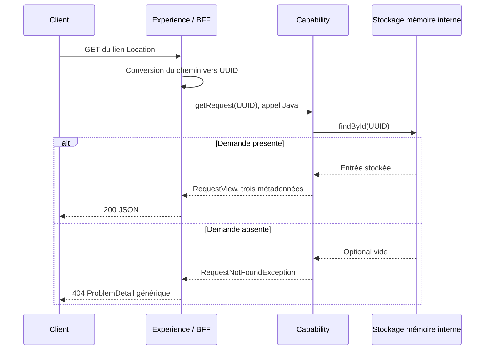

# INT-07 — Consulter la demande

| Contexte | Description |
|---|---|
| **Sprint** | [02 — Contrat REST et BFF mince](../../docs/stages/sprint-02-rest.md) |
| **Statut** | **Terminée sur demande explicite « commit & go 07 »** ; INT-08 non démarrée |
| **Date des preuves** | 2026-10-21 |
| **Objectif du cours** | Retrouver une demande acceptée, exposer seulement ses métadonnées et distinguer format invalide, absence et statut métier |
| **Sources des preuves** | Sources modifiées, tests ciblés, `clean verify` global, rapports Surefire, diagnostics et démonstration HTTP du JAR avec redémarrage |
| **Historique distinct** | Les 96 cas et le GET indisponible d'INT-06 appartiennent à cette étape antérieure ; INT-07 ajoute le suivi sans modifier l'acceptation ou lancer le traitement |
| **Git demandé** | INT-06 commitée localement avant le développement : `6936408`, `feat(INT-06): accept and retain family requests in memory` ; aucun push et aucun commit d'INT-07 |
| **Suivi** | [Registre central](../todos.md) ; le sprint reste ouvert tant qu'INT-08 et son point de clôture ne sont pas réalisés |

**[Simulation ConfluxLab]** Ce parcours est celui du laboratoire, avec des données fictives. Il ne décrit pas les endpoints réels ni les versions historiques d'un SI AXA.

## Sommaire

- [1. Objectif et vocabulaire](#1-objectif-et-vocabulaire)
- [2. Comprendre le problème initial](#2-comprendre-le-problème-initial)
- [3. Travail réalisé pas à pas](#3-travail-réalisé-pas-à-pas)
- [4. Tests et résultats](#4-tests-et-résultats)
- [5. Commandes et démonstration](#5-commandes-et-démonstration)
- [6. Limites et formulation d'entretien](#6-limites-et-formulation-dentretien)
- [7. Suivi centralisé](#7-suivi-centralisé)

## 1. Objectif et vocabulaire

INT-06 savait conserver une demande et retourner `202`, mais le lien fourni ne permettait pas encore de la consulter. INT-07 réalise maintenant cette consultation, **sans transformer le GET en traitement métier**.

| Terme | Sens dans cette tâche |
|---|---|
| **Consultation / GET** | Lecture d'une demande déjà conservée, sans création ou mise à jour |
| **Projection** | Construction d'une vue limitée à partir des données internes ; ici trois métadonnées |
| **Métadonnées** | `requestId`, `status`, `createdAt`, pas le payload des personnes |
| **`createdAt`** | Date de création conservée lors de l'acceptation, pas date du dernier GET |
| **Polling** | Répétition du GET par un client pour consulter l'état ; aucun ordonnanceur de polling n'est ajouté ici |
| **UUID inconnu** | Identifiant convertible en UUID mais absent du store courant |
| **Identifiant mal formé** | Texte que la conversion HTTP vers `UUID` ne peut pas accepter |
| **`ProblemDetail`** | Représentation structurée d'une erreur HTTP, avec un détail générique choisi par le BFF |

Trois résultats à distinguer :

| Situation | Réponse |
|---|---|
| Demande présente | `200 application/json`, métadonnées de cette demande |
| UUID valide mais demande absente | `404 application/problem+json`, `Request not found.` |
| Identifiant manifestement mal formé | `400 application/problem+json`, `Invalid request.` |

Un futur statut métier `FAILED` serait encore autre chose : la demande pourrait être connue et consultable en HTTP `200`, tout en décrivant un traitement échoué. **Aucun traitement ni passage à `FAILED` n'est implémenté dans cet incrément.**

## 2. Comprendre le problème initial

Avant INT-07, [`FamilyController`](../../experience-api/src/main/java/dev/confluxlab/experience/FamilyController.java) exposait déjà la route GET et appelait `FamilyRequests.getRequest(UUID)`. Mais l'implémentation levait `CapabilityNotReadyException` : elle ne cherchait rien et répondait `503` via le BFF, même après un POST accepté.

Le [cours INT-06](INT-06-accepter-une-demande.md) conserve cette étape et ses preuves historiques. Il ne faut pas réinterpréter ses anciens `503` comme des recherches qui auraient échoué en base : le suivi n'était simplement pas encore développé.

Le store disposait déjà d'une lecture interne `findById`, utilisée dans les tests d'acceptation. Nous la branchons derrière l'interface publique existante, sans donner au BFF accès à la map et sans ajouter un endpoint interne.



Un texte non convertible est refusé avant l'appel à Capability. Ce schéma représente l'appel HTTP public puis les appels Java internes ; il n'ajoute aucun réseau entre modules.

## 3. Travail réalisé pas à pas

### 3.1. Lire et projeter dans Capability

Contenu exact de `getRequest` dans [`InMemoryFamilyRequests.java`](../../capability-api/src/main/java/dev/confluxlab/capability/internal/InMemoryFamilyRequests.java) :

```java
@Override
public RequestView getRequest(UUID requestId) {
    if (requestId == null) {
        throw new IllegalArgumentException("requestId must not be null.");
    }
    StoredFamilyRequest stored = store.findById(requestId)
            .orElseThrow(RequestNotFoundException::new);
    return new RequestView(stored.requestId(), stored.status(), stored.createdAt());
}
```

- Un appel Java direct avec `null` est une erreur d'argument et est refusé avant le store. Le paramètre HTTP obligatoire est, lui, converti par MVC : ce contrôle Java n'est pas la source du `400` pour un texte mal formé.
- `findById` recherche exactement l'identifiant reçu et fournit un `Optional`.
- `orElseThrow` transforme seulement **l'absence** en exception dédiée. Il ne masque pas une erreur inattendue du store en faux `404`.
- La vue reprend les trois valeurs **stockées**, pas des valeurs régénérées.

Il n'y a ni `save`, ni `Instant.now`, ni nouvel UUID, ni changement de statut. Le GET n'a donc pas à utiliser le `Clock` d'acceptation. Le test lit avec une horloge décalée d'une heure et exige toujours la date d'origine.

### 3.2. Ne pas exposer la représentation interne

Le DTO [`RequestView`](../../contracts/src/main/java/dev/confluxlab/contracts/RequestView.java) existait déjà ; il n'est pas enrichi dans cette tâche :

```java
public record RequestView(
        @NotNull UUID requestId,
        @NotNull RequestStatus status,
        @NotNull Instant createdAt) {
}
```

Le service ne retourne pas `StoredFamilyRequest`, qui contient le payload des personnes. Les tests HTTP vérifient que le JSON de succès possède exactement les trois champs attendus : aucun payload, principal, ayant droit, résultat ou erreur métier n'est ajouté.

Dans l'application actuelle, les demandes restent `PENDING`. Des tests de projection utilisent les quatre statuts de l'enum pour vérifier que le service retourne bien `stored.status()`, et non un `PENDING` codé en dur. **Ces enregistrements sont des fixtures synthétiques, pas des transitions métier réalisées.**

### 3.3. Garder le statut HTTP dans le BFF

[`RequestNotFoundException`](../../capability-api/src/main/java/dev/confluxlab/capability/api/RequestNotFoundException.java) est une exception publique de Capability avec un message générique, sans `HttpStatus`, UUID ou payload transporté.

Extrait partiel exact de [`ApiExceptionHandler.java`](../../experience-api/src/main/java/dev/confluxlab/experience/ApiExceptionHandler.java) :

```java
@ExceptionHandler(RequestNotFoundException.class)
public ResponseEntity<ProblemDetail> handleRequestNotFound(RequestNotFoundException exception) {
    return ResponseEntity.status(HttpStatus.NOT_FOUND).body(problem(HttpStatus.NOT_FOUND));
}
```

Capability exprime « demande absente ». Experience choisit la représentation `404` et le détail `Request not found.`. Le type d'exception n'a pas besoin de connaître HTTP pour être utilisable depuis un appel Java.

Les erreurs de conversion MVC sont déjà traitées par l'advice avec le détail générique `Invalid request.`. Les réponses du framework ne recopient pas les diagnostics de parsing dans ce détail. Le champ standard `instance` peut désigner le chemin demandé ; ce n'est pas une réponse contenant le payload stocké.

Le contrôleur est inchangé : il délègue puis construit `ResponseEntity.ok(...)`. Les imports restent limités à l'API publique de Capability et aux contrats. La classe provisoire `CapabilityNotReadyException` et son mapping `503` ont été supprimés, puisqu'aucune des deux opérations ne dépend désormais de ce placeholder.

### 3.4. Reconnaître ce qu'un `404` signifie avec de la mémoire volatile

La map, ses règles d'insertion et la copie du payload d'INT-06 ne sont pas modifiées. Après arrêt du processus, un nouveau store est vide.

Ainsi, un UUID peut avoir donné `202`, puis `200`, et donner `404` après redémarrage. **Ce `404` n'affirme pas que la demande n'a jamais été acceptée** : il signifie qu'elle n'est pas présente dans le stockage courant. Le `202` initial n'est pas réécrit rétroactivement et n'a jamais promis une persistance durable.

Aucun MongoDB, mécanisme de récupération, expiration ou bornage mémoire n'est ajouté pour masquer cette limite. La démonstration de redémarrage rend justement la différence observable.

## 4. Tests et résultats

### 4.1. Tests unitaires de lecture

Dans [`InMemoryFamilyRequestsTest`](../../capability-api/src/test/java/dev/confluxlab/capability/internal/InMemoryFamilyRequestsTest.java), l'ancien cas « suivi indisponible » est remplacé par une vérification de la vue d'une demande réellement acceptée : UUID, `PENDING`, date fixe et GET répété avec une horloge décalée.

Les nouveaux cas vérifient également :

- UUID absent : exception dédiée, sans créer d'entrée fictive ;
- UUID Java `null` : erreur d'argument avant tout accès au store ;
- projection de chacun des quatre statuts : un seul `findById`, aucune écriture ou interaction supplémentaire.

Les tests d'acceptation, de snapshot, de collision et de panne d'enregistrement restent présents. Le service compte désormais **19 cas**, et les 3 tests du store restent inchangés.

[`ApiExceptionHandlerTest`](../../experience-api/src/test/java/dev/confluxlab/experience/ApiExceptionHandlerTest.java) ajoute un contrôle direct du mapping vers `404`, en conservant celui du refus d'acceptation vers `400`.

### 4.2. Tests HTTP avec les vrais modules

[`FamilyRequestTrackingHttpTest`](../../application/src/test/java/dev/confluxlab/FamilyRequestTrackingHttpTest.java) charge le vrai assemblage, **sans mock de Capability**, et comporte 6 cas :

| Cas | Ce qui est exigé |
|---|---|
| POST puis GET via `Location` | `200`, même UUID, `PENDING`, `createdAt` analysable en `Instant`, trois champs seulement |
| GET répété | Même date d'origine |
| UUID inconnu | `404` générique, sans champs de succès |
| Trois formats manifestement invalides | Trois cas `400`, détails génériques |
| Deux POST suivis séparément | Chaque GET correspond à l'UUID de son propre POST |

Le GET répété appartient au même cas nominal, ce qui explique le total de 6 plutôt que le nombre de lignes du tableau. L'UUID inconnu fixe est nul en valeur mais syntaxiquement valide : ce n'est pas une référence Java `null`. Le générateur UUID aléatoire de création ne produit pas cette valeur ; aucune restriction de version UUID n'est ajoutée à l'API pour autant.

Pour les erreurs, `doesNotHaveJsonPath()` exige l'absence stricte des champs de succès, même s'ils auraient eu une valeur JSON `null`. Pour le succès, la taille du JSON est égale à trois et les trois métadonnées sont vérifiées.

L'ancien test GET `503` d'`ApplicationAssemblyTest` a été retiré car son attente était devenue fausse. Le test de contexte reste présent, sans configuration MVC inutile dans cette classe. Les tests d'acceptation HTTP et les 12 tests d'architecture restent actifs.

### 4.3. Résultat global final

Les rapports XML Surefire ont été relus après le build :

| Classe | Tests | Échecs / erreurs / ignorés |
|---|---:|---|
| `ContractValidationTest` | 43 | 0 / 0 / 0 |
| `ContractJsonTest` | 16 | 0 / 0 / 0 |
| `InMemoryFamilyRequestsTest` | 19 | 0 / 0 / 0 |
| `InMemoryFamilyRequestStoreTest` | 3 | 0 / 0 / 0 |
| `FamilyControllerTest` | 2 | 0 / 0 / 0 |
| `ApiExceptionHandlerTest` | 2 | 0 / 0 / 0 |
| `ApplicationAssemblyTest` | 1 | 0 / 0 / 0 |
| `FamilyRequestAcceptanceHttpTest` | 3 | 0 / 0 / 0 |
| `FamilyRequestAcceptanceFailureHttpTest` | 1 | 0 / 0 / 0 |
| `FamilyRequestTrackingHttpTest` | 6 | 0 / 0 / 0 |
| `ModuleArchitectureTest` | 5 | 0 / 0 / 0 |
| `ArchitectureRuleDetectionTest` | 7 | 0 / 0 / 0 |
| **Total** | **108** | **0 / 0 / 0** |

Une revue indépendante n'a identifié aucun défaut bloquant ou important. Ses suggestions sur les champs d'erreur strictement absents et la projection des statuts ont été intégrées avant le build final. Les diagnostics de l'éditeur ne signalent aucune erreur ni aucun avertissement.

## 5. Commandes et démonstration

### 5.1. Commit d'INT-06 avant INT-07

Le statut et le diff ont été contrôlés, puis les chemins d'INT-06 ont été explicitement ajoutés à l'index. Commande de commit réellement exécutée depuis la racine :

```sh
GIT_EDITOR=true git commit -m "feat(INT-06): accept and retain family requests in memory"
```

`-m` donne le message ; `GIT_EDITOR=true` empêche l'ouverture d'un éditeur interactif. Cette commande écrit un commit local, pas GitHub. **Résultat : `6936408`, 27 fichiers concernés**, état de travail propre juste après et `main` en avance d'un commit sur la référence locale `origin/main`. Aucun push, nouvelle branche ou amendement n'est réalisé. Les changements d'INT-07 ne sont pas inclus dans ce commit et restent non commités à la fin de cette tâche.

### 5.2. Tests ciblés puis build global

**Racine de lancement :** `conflux-lab/`, contenant `pom.xml` et `mvnw`. Prérequis : JDK 21, Wrapper exécutable et accès aux dépendances non cachées ; pas de Docker, MongoDB ou partenaire.

Commandes réellement exécutées :

```sh
./mvnw -B -ntp -pl application -am -Dtest=InMemoryFamilyRequestsTest,ApiExceptionHandlerTest,ApplicationAssemblyTest,FamilyRequestTrackingHttpTest -Dsurefire.failIfNoSpecifiedTests=false test
./mvnw -B -ntp clean verify
```

- `-B -ntp` active le mode batch et réduit la progression des téléchargements.
- `-pl application -am` sélectionne l'assemblage et ses dépendances du réacteur.
- `-Dtest=...` limite le premier passage aux classes choisies ; `failIfNoSpecifiedTests=false` autorise les modules sans ces noms, sans ignorer les échecs des tests exécutés.
- Le premier passage a réussi avec **25 cas**, avant l'extension du test de projection aux quatre statuts et le renforcement des assertions JSON.
- Le contrôle global final a ensuite réussi avec **108 tests** : il valide donc aussi ces dernières modifications.
- `clean` supprime les sorties générées `target/`, pas les sources. Le cycle `verify` recompile, exécute les tests raccordés et produit les archives, dont le seul JAR Boot.

**Résultat : `BUILD SUCCESS`** pour le parent et les quatre modules. Les commandes écrivent localement et peuvent télécharger des dépendances ; elles ne publient ni ne déploient rien. Les avertissements Mockito/JVM d'auto-attachement d'agent sous Java 21 restent non bloquants, sans preuve de compatibilité avec un futur JDK.

### 5.3. Vérifier le JAR réel et le redémarrage

Un superviseur Python ponctuel a lancé **deux fois successivement** cette commande Java, avec arrêt du premier processus avant le second :

```sh
java -jar application/target/application-0.1.0-SNAPSHOT.jar --server.port=0 --server.address=127.0.0.1
```

Le port `0` choisit un port disponible, `127.0.0.1` limite l'écoute au poste local. Le contrôle attendait au maximum 30 secondes chaque démarrage et utilisait `urllib.request`, avec 5 secondes de timeout par requête. Le POST envoyait la fixture [`create-family.json`](../../contracts/src/test/resources/contracts/create-family.json), sans données réelles.

Sortie utile effectivement observée :

```text
Surefire total [tests, failures, errors, skipped]: [108, 0, 0, 0]
JAR run #1 started on loopback port 37191
POST #1 -> 202; GET -> 200 PENDING, UUID=d4ca2ab4-8735-48d2-9491-4c3a715ea8b2, stable createdAt=2026-10-21T18:56:31.315064215Z, metadata only
POST #2 -> 202; GET -> 200 PENDING, UUID=3be5f614-471d-4dfe-bea9-e72c55c9b435, stable createdAt=2026-10-21T18:56:31.483195943Z, metadata only
GET /api/v1/requests/00000000-0000-0000-0000-000000000000 -> 404 generic ProblemDetail
GET /api/v1/requests/not-a-uuid -> 400 generic ProblemDetail
JAR run #1 stopped
JAR run #2 started on loopback port 40969
GET /api/v1/requests/d4ca2ab4-8735-48d2-9491-4c3a715ea8b2 -> 404 generic ProblemDetail
Restart check: previously accepted UUID is absent from the new in-memory store
JAR run #2 stopped
INT-07 packaged tracking smoke check: PASS; log: application/target/int-07-smoke.log
```

Les dates de création sont en UTC (`Z`) ; elles n'ont pas changé aux GET répétés. Les contrôles de succès exigeaient exactement les trois champs, et ceux d'erreur vérifiaient le détail générique et l'absence de champs de succès ou de payload.

Chaque processus a été arrêté dans un bloc `finally`, avec attente bornée puis arrêt forcé prévu si nécessaire. **Les deux sont arrêtés.** Le log est une sortie locale ignorée par Git, supprimable par un prochain `clean`, pas un artefact de preuve durable.

Pour reproduire manuellement, construire, lancer le JAR, envoyer la fixture au POST puis consulter le `Location` retourné. Répéter le GET doit conserver `createdAt`. Après arrêt et redémarrage, consulter le même ancien lien doit donner `404`. Les ports sont choisis à chaque démarrage : les valeurs 37191 et 40969 ne sont pas une configuration à recopier. Ces essais ont utilisé Python, pas une commande `curl` présentée comme exécutée.

## 6. Limites et formulation d'entretien

- **Mémoire volatile, non bornée et sans nettoyage** : la consultation ne crée pas de durabilité. Le redémarrage peut faire disparaître une demande précédemment acceptée.
- Les demandes produites par le parcours actuel restent `PENDING`. Aucun `PROCESSING`, résultat, erreur métier, événement Spring, `@Async`, orchestration ou partenaire n'est ajouté.
- Les statuts autres que `PENDING` des tests sont des données préparées pour la projection ; pas une simulation de transitions réalisées.
- Les cas de format vérifiés sont explicites ; ils ne définissent pas une politique exhaustive supplémentaire de canonicalisation, de coercition ou de rejet des champs JSON inconnus.
- La corrélation des demandes n'est pas une authentification, une autorisation d'accès ni une idempotence. Ces capacités ne sont pas ajoutées implicitement.
- La couverture complète des refus d'INT-08 reste distincte ; aucun sprint n'est clôturé par anticipation.
- Aucune persistance MongoDB, CI, CD, mesure de performance, nouvelle validation Windows ou interaction GUI Zed n'est revendiquée.
- Le commit demandé porte sur INT-06 uniquement ; aucun commit d'INT-07 ni push n'a été exécuté.

### Formulation orale proposée

> « Dans ConfluxLab, j'ai branché le suivi d'une demande acceptée sur l'interface publique Java de Capability. Le service lit le stockage mémoire et projette seulement l'UUID, le statut et la date de création, sans modifier les données ni lancer de traitement. Le BFF adapte une absence en `404`, tandis qu'un identifiant HTTP mal formé est refusé en `400` avant le service. Les tests vérifient le parcours POST/GET, la stabilité de la date et les réponses limitées aux métadonnées ; le JAR réel a aussi été testé après redémarrage. Ce dernier essai montre la limite du stade actuel : une ancienne demande peut devenir inconnue, puisque le `202` ne promettait pas de durabilité. »

**Piège :** « Un `404` après redémarrage prouve-t-il que le POST n'avait rien enregistré ? » **Non.** Les essais ont observé `202` puis `200` avant l'arrêt. Le `404` décrit le store courant, désormais vide.

**Piège :** « Le GET doit-il remettre à jour `createdAt` ou lancer les opérations pour avancer ? » **Non.** C'est une lecture ; la date vient de l'acceptation et le traitement appartient à un incrément distinct.

## 7. Suivi centralisé

- [TD-B005 — Acceptation et suivi réalisés ; refus complets à autoriser](../todos.md#td-b005).
- [TD-R004 — Acceptation, suivi et résultat métier distincts](../todos.md#td-r004).
- [TD-R012 — Conserver avant acquittement, sans durabilité promise](../todos.md#td-r012).
- [TD-R013 — Lire sans modifier et distinguer absence/format](../todos.md#td-r013).
