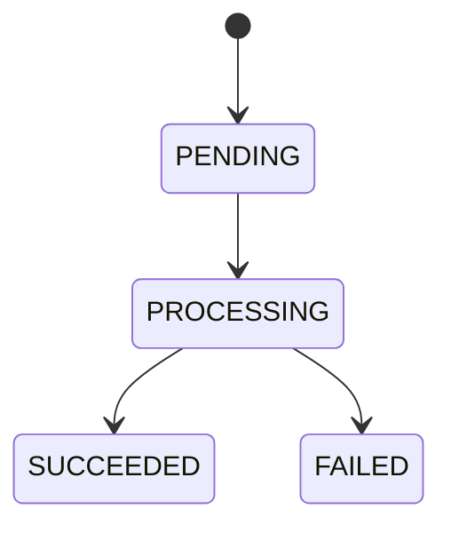

# INT-09 — Définir les données et transitions

| Contexte | Description |
|---|---|
| **Sprint** | [03 — MongoDB et cycle des états](../../docs/stages/sprint-03-mongodb.md) |
| **Statut** | Terminée sur demande « commit la 08 & passer 09 » ; INT-10 non commencée |
| **Date des preuves** | 2026-10-21 |
| **Git** | INT-08 commitée au préalable : `fedb8b7`, sans push ; les changements INT-09 ne sont pas commités |
| **Périmètre** | Modèle Java interne, dates et transitions ; pas encore de repository MongoDB ni de traitement |
| **Preuves de session** | 2 nouveaux tests unitaires et 1 test existant d'acceptation réussis ; pas de nouveau build global |

**[Simulation ConfluxLab]** Les règles et données ci-dessous concernent le laboratoire, pas une implémentation historique AXA. Le passage au sprint 03 a été demandé ; la restitution orale du sprint 02 n'a pas été évaluée.

## 1. Objectif et vocabulaire

La story demande de représenter les informations d'une demande et ses changements d'état avant de remplacer la mémoire par MongoDB.

- Un **état** décrit où en est une demande : en attente, en cours ou terminée.
- Une **transition** est un passage autorisé entre deux états.
- Un **état final** termine le cycle : `SUCCEEDED` ou `FAILED`.
- Un **record Java** représente ici une valeur : une transition retourne un nouvel objet, sans modifier l'ancien.
- Un **`Instant`** représente un instant sur la ligne du temps, sans dépendre du fuseau d'affichage du poste.
- La **persistance** est l'écriture durable dans un stockage ; créer un record Java ne réalise pas cette écriture.

## 2. Comprendre le problème

Avant INT-09, `StoredFamilyRequest` contenait l'UUID, le statut, le payload et `createdAt`. Les quatre statuts existaient dans `RequestStatus`, mais leur présence dans une enum ne définissait aucune règle de passage.

Une simple affectation de statut aurait permis, par exemple, de rouvrir une demande déjà terminée. Sans dates distinctes, on ne pouvait pas non plus distinguer sa création, sa dernière modification et sa fin.

Le graphe retenu est volontairement petit :



`PENDING` signifie « acceptée, en attente ». `PROCESSING` signifie « prise en charge », pas « forcément réussie ». Les deux autres états terminent le cycle. Tout autre passage est refusé, y compris répéter le même état. Un refus avant l'acceptation reste une erreur d'appel : ce n'est pas une demande créée puis passée en `FAILED`.

## 3. Travail réalisé pas à pas

### 3.1. Compléter les données sans les exposer au BFF

Le [DAT, section 6](../../docs/dat/ConfluxLab.md#6-données-mongodb) décrit la collection cible `family_requests`. **Elle n'est pas encore créée.** Le record reste dans le package interne de Capability, sans annotation MongoDB.

Extrait partiel de [`StoredFamilyRequest.java`](../../capability-api/src/main/java/dev/confluxlab/capability/internal/StoredFamilyRequest.java) :

```java
record StoredFamilyRequest(
        UUID requestId, RequestStatus status, CreateFamilyRequest payload,
        Instant createdAt, Instant updatedAt, Instant completedAt) {
```

| Donnée | Règle |
|---|---|
| `requestId`, `payload` | Restent identiques pendant les transitions ; la liste du payload reste copiée et non modifiable |
| `createdAt` | Date de création, jamais réécrite |
| `updatedAt` | Date de création au départ, puis date de la dernière transition |
| `completedAt` | `null` en attente/en cours ; date de la transition finale ensuite |

Les champs cibles optionnels `result?` et `error?` sont décrits dans le DAT, mais ne sont **pas implémentés** : aucun résultat partenaire n'existe encore et son schéma n'est pas défini. Une erreur métier future ne devra pas être une trace technique brute. Ajouter dès maintenant des chaînes ou des maps arbitraires n'apporterait rien à cette story.

Le constructeur contrôle les valeurs obligatoires d'identification/statut/dates et leur cohérence : la dernière mise à jour ne précède pas la création, seuls les états finaux ont une date de fin, et cette date correspond à leur dernière mise à jour. Il recopie toujours la liste du payload. Reconstituer un état avec ce constructeur ne prouve toutefois pas l'historique des passages qui l'ont précédé.

### 3.2. Créer une demande en attente

Extrait exact de la factory interne :

```java
static StoredFamilyRequest pending(UUID requestId, CreateFamilyRequest payload, Instant createdAt) {
    return new StoredFamilyRequest(requestId, RequestStatus.PENDING, payload, createdAt, createdAt, null);
}
```

Une **factory** est simplement une méthode nommée qui construit l'objet. Ici, son nom rend explicites le statut initial et les dates initiales.

[`InMemoryFamilyRequests`](../../capability-api/src/main/java/dev/confluxlab/capability/internal/InMemoryFamilyRequests.java) utilise désormais cette méthode avec l'instant fourni par son `Clock`, puis appelle toujours le store mémoire avant de renvoyer l'acceptation. Le contrat HTTP ne change pas : le GET projette encore uniquement `requestId`, `status`, `createdAt`.

### 3.3. Encadrer les transitions

Extrait partiel de `transitionTo(...)` :

```java
boolean allowed = switch (status) {
    case PENDING -> nextStatus == RequestStatus.PROCESSING;
    case PROCESSING -> nextStatus == RequestStatus.SUCCEEDED || nextStatus == RequestStatus.FAILED;
    case SUCCEEDED, FAILED -> false;
};
```

`switch` examine l'état **actuel**. Un passage interdit lève une `IllegalStateException`. La date fournie ne doit pas précéder `updatedAt` ; une date identique reste permise, car deux actions peuvent partager la même résolution d'horloge.

En cas de passage autorisé, la méthode construit une nouvelle valeur :

```java
return new StoredFamilyRequest(requestId, nextStatus, payload, createdAt, changedAt,
        isTerminal(nextStatus) ? changedAt : null);
```

L'UUID, le payload et la date de création sont conservés. L'opérateur `? :` fixe la date de fin seulement pour `SUCCEEDED`/`FAILED`. L'objet de départ reste inchangé.

**Limite importante : cette méthode n'enregistre pas la nouvelle valeur.** Le store mémoire conserve son objet initial. Aucun composant de production n'appelle encore les transitions ; les demandes HTTP restent donc `PENDING`. Deux threads pourraient chacun calculer un objet `PROCESSING` depuis le même objet initial : une règle locale n'est pas une prise en charge atomique. Cette protection en base appartient à INT-11.

Les fixtures existantes de stockage et de projection ont été adaptées à la factory et au nouveau constructeur. Cela ne crée pas de transition réelle dans l'application.

## 4. Commandes expliquées et résultats

Depuis la racine `conflux-lab/`, avec JDK 21, le Maven Wrapper et les dépendances disponibles :

```sh
./mvnw -B -ntp -pl capability-api -am '-Dtest=StoredFamilyRequestTest,InMemoryFamilyRequestsTest#storesThePayloadAsPendingBeforeReturningAcceptance' -Dsurefire.failIfNoSpecifiedTests=false test
```

- `-B -ntp` : mode batch, sans progression des téléchargements.
- `-pl capability-api -am` : sélectionne Capability et ses dépendances Maven ; ne construit pas l'assemblage HTTP.
- `-Dtest=...` : sélectionne les deux méthodes de la nouvelle classe et une méthode existante de l'acceptation.
- `Classe#méthode` : ne relance pas toute cette classe existante.
- `failIfNoSpecifiedTests=false` : autorise les modules sans ces tests, sans masquer un test effectivement en échec.
- `test` : compile les sources et tests concernés, puis exécute la sélection ; écrit dans les répertoires `target/`. Peut télécharger des dépendances manquantes ; aucun déploiement ou accès MongoDB.

**Résultat réellement observé : 3 tests, 0 échec, 0 erreur, 0 ignoré ; `BUILD SUCCESS`.**

| Test exécuté | Ce qu'il vérifie |
|---|---|
| Nouveau test du cycle | Initialisation des dates, passage en cours, les deux issues finales et conservation des données |
| Nouveau test des refus | Saut direct vers le succès, retour en attente, date qui recule et réouverture des deux états finaux refusés |
| Test existant d'acceptation | Demande et payload conservés en mémoire avant le retour du reçu |

Les deux issues sont parcourues dans de petites boucles au sein des deux nouveaux tests ; aucune matrice exhaustive n'a été ajoutée. Le test existant d'acceptation est réutilisé plutôt que dupliqué.

## 5. Preuves, limites et formulation d'entretien

**Historique distinct :** INT-08 avait un `clean verify` de 181 tests et une démonstration du JAR. Avant son commit `fedb8b7`, un seul test de confidentialité a été relancé avec succès. Ce n'est pas un résultat global INT-09.

**Non exécutés pour INT-09 :** suite globale, tests HTTP/architecture, tests de projection existants, test de store existant, démarrage du JAR, Docker et MongoDB. Les tests de Capability ont été compilés, mais seules les trois méthodes sélectionnées ont été exécutées. Aucun chiffre de couverture ni total global actualisé n'est revendiqué. Le JAR déjà produit par INT-08 n'a pas été repackagé avec ces changements.

**Réponse d'entretien :**

> « J'ai défini un petit cycle métier : une demande acceptée attend, passe en traitement, puis finit en succès ou en échec. Le modèle interne de Capability conserve la création, actualise la dernière modification et fixe une date de fin uniquement à l'état terminal. Une transition retourne une nouvelle valeur et refuse les passages interdits. Je distingue cette validation locale de la sauvegarde : elle ne garantit ni durabilité ni exclusion concurrente. Le repository MongoDB et la mise à jour conditionnelle restent des étapes séparées. »

**Piège :** « Un record immuable empêche deux traitements de démarrer ? » Non : deux appelants peuvent produire deux nouvelles valeurs depuis la même ancienne valeur. Il faudra une écriture conditionnelle atomique en base.

**Piège :** « `FAILED` signifie qu'aucune opération externe n'a eu lieu ? » Non : un futur traitement pourra échouer après un succès partiel. Cet état ne promet aucun rollback distribué.

## 6. Suivi centralisé

- [TD-R015 — Un cycle local n'est ni une sauvegarde ni un verrou](../todos.md#td-r015).
- [TD-B009 — Persister avant d'accepter, INT-10 à autoriser](../todos.md#td-b009).
