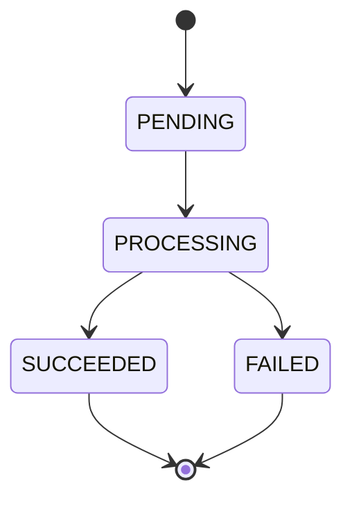

# INT-09 + INT-11 — Modèle et transitions atomiques

> **Portée historique :** ce document décrit les étapes indiquées dans son titre, pas une nouvelle validation du parcours actuel. Le raccordement ultérieur via Feign et la finalisation sont réalisés dans [INT-21 + INT-22](../sprint-06/INT-21-creer-une-famille-de-bout-en-bout.md).

**[Simulation ConfluxLab] — Réalisé techniquement ; clôture pédagogique non confirmée.** Le résultat est un cycle de demande cohérent, dont les changements persistés refusent les tentatives concurrentes ou périmées.

Les preuves INT-09 et INT-11 datent respectivement des **2026-10-21 et 2026-10-22**. Les fragments ci-dessous viennent des sources actuelles inspectées, avec présentation parfois réalignée. **Aucun code, test ou build exécuté pour cette rédaction.**

La [fiche du sprint](../../docs/stages/sprint-03-mongodb.md) porte les critères. Le cours [INT-10 + INT-12 — Insertion et persistance MongoDB](INT-10-insertion-et-persistance-mongodb.md) explique comment le document est créé, acquitté, consulté puis retrouvé après redémarrage ; ici, on explique comment il peut changer d'état.

## 1. Un petit graphe, pas une affectation libre

Un **état** indique où en est une demande. Une **transition** est une flèche autorisée : disposer de quatre constantes dans une enum n'interdit pas, à lui seul, de rouvrir une demande terminée.



`PENDING` signifie « en attente », `PROCESSING` « prise en charge », pas « travail réussi ». `SUCCEEDED` et `FAILED` sont finaux. Une erreur avant acceptation ne correspond pas à une demande passée en `FAILED` : ce graphe décrit le cycle d'une demande enregistrée.

Le record interne [`StoredFamilyRequest`](../../capability-api/src/main/java/dev/confluxlab/capability/internal/persistence/StoredFamilyRequest.java) appartient à Capability, pas au contrat HTTP. Le [DAT — données](../../docs/dat/ConfluxLab.md#6-données-mongodb) fixe ses invariants :

| Champ | Règle pendant le cycle |
|---|---|
| `requestId` | UUID fixé à la création ; ne change jamais |
| `status` | `PENDING` initialement, puis seulement les flèches du graphe |
| `payload` | Données conservées ; liste des ayants droit copiée avec `List.copyOf`, non modifiable |
| `createdAt` | Date d'origine, jamais réécrite par une transition |
| `updatedAt` | Égal à `createdAt` au départ, puis dernière transition ; ne recule pas |
| `completedAt` | `null` en attente/en cours ; égal à `updatedAt` dans un état final |
| `result?`, `error?` | Cibles du DAT **non implémentées** ; aucun schéma partenaire ni exception brute ajouté |

Un `Instant` représente un point sur la ligne du temps, indépendamment du fuseau d'affichage. La factory `pending(...)` initialise les dates ; le constructeur contrôle leur cohérence et copie la liste. Reconstituer un objet cohérent ne prouve toutefois pas les étapes qu'il a réellement traversées.

## 2. Valider localement ne signifie pas sauvegarder

Extrait de `requireTransition(currentStatus, nextStatus)`, dans le modèle :

```java
boolean allowed = switch (currentStatus) {
    case PENDING -> nextStatus == RequestStatus.PROCESSING;
    case PROCESSING -> nextStatus == RequestStatus.SUCCEEDED || nextStatus == RequestStatus.FAILED;
    case SUCCEEDED, FAILED -> false;
};
```

Le `switch` vérifie uniquement le couple de statuts ; un passage interdit déclenche ensuite une `IllegalStateException`. Il ne compare aucune date et ne lit pas MongoDB. Répéter le même état, sauter directement de `PENDING` à un état final ou revenir en arrière est interdit.

`transitionTo(nextStatus, changedAt)` réutilise cette règle, refuse un `changedAt` antérieur à l'`updatedAt` de **cet objet Java**, puis retourne une nouvelle valeur. Extrait de son retour, avec alignement abrégé :

```java
return new StoredFamilyRequest(requestId, nextStatus, payload, createdAt, changedAt,
        isTerminal(nextStatus) ? changedAt : null);
```

L'UUID, le payload et la création restent identiques. La date de fin apparaît uniquement pour une cible finale ; l'objet de départ reste inchangé. Une date égale à la précédente est permise : plusieurs actions peuvent partager la même résolution d'horloge.

**Cette copie ne sauvegarde rien.** Deux threads possédant le même ancien objet `PENDING` pourraient chacun fabriquer un objet `PROCESSING`. L'immuabilité protège la valeur de départ, pas l'exclusivité d'un traitement.

| Contrôle | Ce qu'il sait vérifier |
|---|---|
| `requireTransition(...)` | La flèche entre deux statuts, sans date ni I/O |
| `transitionTo(...)` | Le graphe et la chronologie de l'objet local, sans sauvegarde |
| `MongoFamilyRequestStore.transition(...)` | Le statut et la date actuellement stockés, avec modification atomique |

## 3. Mettre la condition dans MongoDB : le CAS

Une lecture `PENDING` suivie d'une sauvegarde est insuffisante : les deux candidats peuvent lire avant qu'aucun n'écrive. Le **compare-and-set (CAS)** signifie ici « modifier seulement si l'état attendu est encore présent ».

L'opération reste interne à Capability, sans nouvelle route HTTP permettant au client de choisir un statut. Dans [`MongoFamilyRequestStore.transition(requestId, expectedStatus, nextStatus, changedAt)`](../../capability-api/src/main/java/dev/confluxlab/capability/internal/persistence/MongoFamilyRequestStore.java), on prépare d'abord :

```java
StoredFamilyRequest.requireTransition(expectedStatus, nextStatus);
Instant timestamp = Objects.requireNonNull(changedAt, "changedAt").truncatedTo(ChronoUnit.MILLIS);
```

Le couple attendu/cible doit être autorisé avant l'accès en base. La date proposée est normalisée à la **milliseconde**, précision de BSON Date ; ce contrôle n'est ni une synchronisation des horloges ni un choix de propriétaire du travail.

Puis vient le filtre, toujours dans la même méthode :

```java
Query query = Query.query(
    Criteria.where("_id").is(requestId).and("status").is(expectedStatus).and("updatedAt").lte(timestamp)
);
```

`Query` prépare une condition, sans effectuer une première lecture. Les critères sont reliés par un **ET** ; `lte` signifie « inférieur ou égal ».

| Critère MongoDB | Protection |
|---|---|
| `_id == requestId` | Viser au plus un document, identifié par son index unique |
| `status == expectedStatus` | Refuser une tentative qui travaille encore avec un statut périmé |
| `updatedAt <= timestamp` | Ne pas faire reculer la date réellement stockée ; égalité permise |

La condition s'applique à la valeur en base **au moment de l'opération**, pas à une ancienne copie Java. Si l'horloge recule, la transition peut ne plus correspondre ; elle n'invente pas une correction temporelle.

**Exemple pédagogique :** A et B visent le même UUID, tous deux avec `expectedStatus=PENDING`. Si A obtient le passage à `PROCESSING`, B perd sur le statut, **même s'il propose une date plus récente**. Une date valide ne remplace donc jamais la condition d'état.

## 4. Modifier uniquement les champs du cycle

Extrait de l'`Update` préparé par l'adaptateur :

```java
Update update = new Update().set("status", nextStatus).set("updatedAt", timestamp);
if (nextStatus == RequestStatus.PROCESSING) {
    update.unset("completedAt");
} else {
    update.set("completedAt", timestamp);
}
```

`set` change un champ, `unset` le retire. Le graphe ayant exclu les autres cibles, le `else` vise un état final. On ne remplace pas le document par une ancienne copie complète : UUID, payload, `createdAt` et champs non concernés sont préservés.

| Transition gagnante | `createdAt` | `updatedAt` | `completedAt` |
|---|---|---|---|
| `PENDING → PROCESSING` | Inchangé | Date proposée normalisée | Retiré, reconstruit à `null` |
| `PROCESSING → SUCCEEDED/FAILED` | Inchangé | Date proposée normalisée | Même date que `updatedAt` |

Extrait de l'unique commande envoyée à MongoDB :

```java
return Optional.ofNullable(mongoTemplate.findAndModify(query, update,
        FindAndModifyOptions.options().returnNew(true).upsert(false), StoredFamilyRequest.class));
```

`findAndModify` évalue condition et modification **atomiquement sur le document**. `returnNew(true)` renvoie sa valeur après modification ; `upsert(false)` interdit de créer une demande si rien ne correspond. Le store ne fait pas `transitionTo(...)` puis `save(...)`.

| Retour | Sens correct |
|---|---|
| Document présent dans l'`Optional` | Modification gagnante confirmée |
| `Optional.empty()` | UUID absent, statut différent ou date trop ancienne ; ces causes ne sont pas distinguées |
| Exception | Erreur/panne, jamais transformée en refus concurrent normal |

Un timeout peut laisser l'issue de la modification inconnue, comme pour l'insertion : voir les [acquittements et délais](INT-10-insertion-et-persistance-mongodb.md#3-acquittement-et-configuration). Le résultat vide, lui, signifie une absence de correspondance, pas « MongoDB est tombé ».

## 5. Pourquoi un état final ne peut pas être écrasé

Après `PROCESSING → FAILED`, deux protections se complètent :

- Une tentative déclarant `expectedStatus=FAILED` pour rouvrir le cycle est refusée par le **graphe Java**.
- Une tentative restée sur `expectedStatus=PROCESSING`, même avec une date future et une cible `SUCCEEDED`, ne correspond plus au **filtre MongoDB**.

Le même raisonnement protège `SUCCEEDED`. Le statut attendu suffit pour ce graphe **sans retour arrière** ; aucun champ `@Version` ni verrou Java n'est ajouté. Une future reprise qui réintroduirait des cycles demanderait de réévaluer cette hypothèse.

**Branchement historique et actuel :** dans INT-11, seuls les tests appelaient ces transitions. Depuis INT-14, le [`listener`](../../capability-api/src/main/java/dev/confluxlab/capability/internal/event/FamilyRequestListener.java) relit puis tente le CAS `PENDING → PROCESSING`. Sa lecture préalable ne remplace pas le CAS. Il s'arrête à cette tentative : aucun parcours métier ni état final n'est actuellement raccordé.

## 6. Preuves historiques et limites du résultat

| Étape | Vérification réellement observée à cette date |
|---|---|
| **INT-09 — 2026-10-21** | **3 cas ciblés réussis** : 2 nouveaux tests du modèle + 1 acceptation existante. Graphe/dates et stockage encore en mémoire ; pas de MongoDB à cette étape |
| **INT-11 — 2026-10-22** | **4 cas ciblés réussis** : 2 nouveaux tests MongoDB + 2 tests du modèle réutilisés. Un seul gagnant concurrent, refus des statuts/dates périmés, états finaux protégés |

Les deux tests MongoDB sont aujourd'hui dans [`MongoFamilyRequestTransitionIT`](../../application/src/test/java/dev/confluxlab/capability/internal/persistence/MongoFamilyRequestTransitionIT.java). Ils vérifient aussi l'absence d'upsert, la conservation des données et la confidentialité du suivi avec un diagnostic fictif non mappé. Ce témoin de test ne définit pas le futur champ métier `error`.

Les deux candidats sont libérés ensemble ; la preuve porte sur **un seul résultat gagnant**, pas sur une simultanéité physique exacte ni tous les entrelacements possibles. Ces passages étaient ciblés, pas des suites globales. Leur réutilisation sous Failsafe est expliquée dans le [cours insertion et persistance](INT-10-insertion-et-persistance-mongodb.md#5-redémarrage-du-jar-et-failsafe).

Les limites à ne pas transformer en promesses :

- Une prise en charge gagnante n'est **pas exactly-once** : un arrêt juste après peut laisser `PROCESSING`, sans reprise automatique ni tâche durable.
- Le filtre ne vérifie pas une identité de worker et n'est pas un bail. Les règles protègent les accès passant par l'adaptateur ; une écriture directe en base peut les contourner.
- L'atomicité vise un document, **pas une transaction MongoDB + HTTP partenaire**. Un futur `FAILED` peut suivre des effets externes partiels, sans rollback commun.

### Repères et suivi

- [TD-R015 — Cycle local, sauvegarde et verrou](../todos.md#td-r015).
- [TD-B010 — Transitions sécurisées](../todos.md#td-b010), [TD-R018 — Comparer et modifier atomiquement](../todos.md#td-r018).
