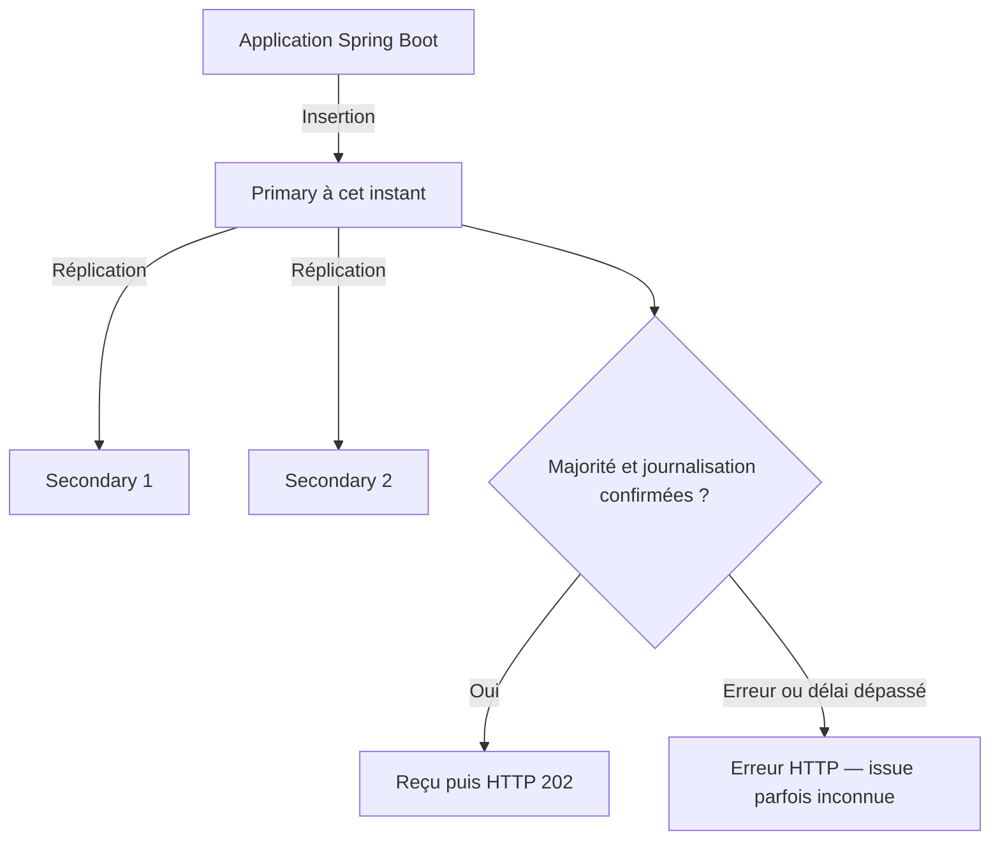

# INT-10 — Persister avant d'accepter : complément replica set

| Contexte | Description |
|---|---|
| **Nature** | Complément théorique demandé après le [cours INT-10](INT-10-persister-avant-d-accepter.md), pas une nouvelle story |
| **Question** | La configuration actuelle reste-t-elle adaptée avec « deux replicas DB » ? |
| **État réel** | ConfluxLab utilise toujours un MongoDB standalone ; aucun replica set n'est configuré ou testé |
| **Périmètre** | Quorum, acquittement, découverte des serveurs, lectures et délais ; aucune modification applicative |

**[Simulation ConfluxLab — hypothèse pédagogique]** Les exemples supposent des membres votants contenant les données, sans arbitre ni membre spécial. Ils ne décrivent pas une topologie historique AXA.

## 1. Réponse courte : conserver la garantie, adapter la topologie

**`MAJORITY + journal` reste cohérent. Il faut surtout configurer un véritable replica set, sa connexion et réévaluer les délais.** Le BFF et l'ordre « insertion confirmée → reçu → `202` » ne changent pas.

Un **primary** reçoit les écritures. Les **secondaries** répliquent les données ; un membre éligible peut devenir primary après une **élection**. Le **quorum** est le nombre de votes nécessaire pour disposer d'une majorité.

« Deux replicas » est ambigu :

| Topologie envisagée | Total | Majorité | Après perte d'un membre |
|---|---:|---:|---|
| 1 primary + 1 secondary | 2 | **2** | Plus de majorité pour maintenir/élire un primary ; les écritures avec cette garantie ne restent pas disponibles |
| 1 primary + 2 secondaries | 3 | **2** | Écritures possibles après stabilisation/élection si les deux membres restants communiquent et qu'un primary éligible est disponible |

**Dans ces cas homogènes**, quorum électoral et nombre de membres requis pour `w=majority` correspondent aux mêmes nombres, mais ce sont deux mécanismes distincts. Un arbitre vote sans stocker de données : ne pas généraliser le tableau en comptant simplement trois processus quelconques.

**[Proposition théorique]** Pour tolérer la perte d'un membre, privilégier trois membres votants contenant les données. Trois conteneurs sur le même hôte ne protègent toutefois pas contre la perte de cet hôte : la haute disponibilité dépend aussi des domaines de panne.

## 2. Ce qui reste adapté dans notre code

Extrait exact de [`FamilyRequestConfiguration.java`](../../capability-api/src/main/java/dev/confluxlab/capability/internal/FamilyRequestConfiguration.java) :

```java
template.setWriteConcern(WriteConcern.MAJORITY.withJournal(true).withWTimeout(5, TimeUnit.SECONDS));
```

- **`MAJORITY`** exprime la garantie attendue selon la configuration du replica set. Avec trois membres du tableau, deux confirmations sont nécessaires, primary compris. Inutile de le remplacer par un nombre fixe `2`.
- **`withJournal(true)`** demande la confirmation de journalisation correspondant au write concern. Une réplication n'est pas une sauvegarde : une suppression accidentelle peut être répliquée aussi.
- **`withWTimeout(...)`** configure l'attente serveur de satisfaction du write concern lorsqu'elle s'applique. Ce n'est ni un timeout HTTP global, ni une borne universelle de journalisation.

Le mécanisme resterait le suivant dans l'hypothèse à trois membres :



Ce schéma est **théorique, non déployé**. La réplication est asynchrone ; `majority` fait attendre le niveau d'acquittement demandé avant le retour normal, pas nécessairement tous les membres ni leur disponibilité immédiate pour toute lecture secondaire.

## 3. Ce qui changerait : la connexion et la découverte

[`application.yml`](../../application/src/main/resources/application.yml) pointe actuellement par défaut vers `localhost:27017`, base `conflux_lab`, avec `retryWrites=false` et la représentation UUID standard.

Exemple théorique d'URI pour deux membres, **non appliqué**, limité aux paramètres de topologie :

```text
mongodb://mongo1:27017,mongo2:27017/conflux_lab?replicaSet=rs0&readPreference=primary&retryWrites=false
```

| Élément | Fonction |
|---|---|
| Plusieurs adresses | Points de découverte initiaux ; le driver peut contacter un autre membre si l'un est indisponible |
| `replicaSet=rs0` | Nom attendu du replica set, qui doit correspondre à la configuration des serveurs |
| `readPreference=primary` | Lectures dirigées vers le primary ; comportement déjà utilisé par défaut |
| `retryWrites=false` | Conservation de notre choix actuel ; une reprise d'écriture serait une décision séparée |

Cet exemple n'affiche pas les délais actuels : une URI complète devrait aussi porter les valeurs retenues après leur réévaluation. Les noms `mongo1`, `mongo2` et `rs0` sont fictifs.

**L'URI ne crée pas le replica set.** Les serveurs doivent être initialisés comme membres du même ensemble. Le driver découvre ensuite les rôles : il ne répartit pas aléatoirement les écritures entre plusieurs bases indépendantes. Les adresses annoncées par MongoDB doivent être accessibles depuis la JVM, notamment lorsque Docker utilise des noms internes.

## 4. Les délais actuels sont à réévaluer, pas à augmenter au hasard

| Réglage actuel | Point d'attention avec réplication/bascule |
|---|---|
| `serverSelectionTimeoutMS=3000` | 3 s peuvent être insuffisantes pour attendre un nouveau primary pendant une élection |
| `connectTimeoutMS=3000` | À confronter au réseau ; ce n'est pas la durée totale d'une écriture |
| `socketTimeoutMS=5000` | Le client peut abandonner avant de recevoir la réponse du serveur |
| `wtimeout` configuré à 5 s | Attente liée au write concern ; ce n'est pas un délai global couvrant sélection, connexion et exécution |

Le socket timeout et le `wtimeout` sont égaux actuellement. On chercherait généralement à laisser une marge au serveur pour répondre avant l'abandon côté client, en tenant compte du budget HTTP et de la durée de bascule acceptable. **Aucune nouvelle valeur de production n'est déduite du seul nombre de replicas.**

## 5. Deux pièges importants : lectures et reprises

### Lire sur un secondary n'est pas automatiquement un meilleur choix

Après un POST confirmé sur le primary, un secondary peut encore ne pas rendre immédiatement la demande visible. Un GET dirigé vers ce membre pourrait donc ne pas retrouver la demande à cet instant.

**Garder les lectures sur le primary reste le choix simple du suivi actuel.** `readPreference` choisit où lire ; ce n'est pas le `readConcern`, qui concerne la visibilité/les garanties des données lues, ni une promesse générale de lecture linéarisable.

### Une reprise du driver n'est pas un POST idempotent

Un replica set permet d'envisager `retryWrites=true` pour les opérations éligibles. Les retryable writes du driver ont leur propre mécanisme d'identification/reprise ; ce n'est pas une boucle qui rejoue tout le cas d'usage HTTP.

Mais une **nouvelle requête POST** génère toujours un nouvel UUID dans notre service : elle peut créer une deuxième demande de même contenu. Après une coupure, une écriture peut avoir réussi sans confirmation reçue ; `500` ou timeout ne prouve donc pas l'absence de document. Ne pas activer un retry applicatif aveugle.

## 6. Portée de cette note et formulation d'entretien

**Sources relues :** configuration Java, URI actuelle et [DAT, section 6.1](../../docs/dat/ConfluxLab.md#61-persister-avant-daccepter--int-10). Le cours INT-10 conserve les preuves historiques sur un standalone ; ces preuves ne démontrent ni élection ni tolérance à la perte d'un membre.

**Aucune configuration applicative modifiée, aucun conteneur supplémentaire et aucun test exécuté.** Si une expérimentation était autorisée ultérieurement, un nominal et une perte de membre avec observation de l'élection/acquittement seraient les vérifications ciblées utiles ; ce texte ne les autorise pas et n'ajoute pas de tâche au sprint.

> « Je conserverais l'insertion acquittée avec majorité et journalisation. Je configurerais le driver pour découvrir le replica set et je réévaluerais les délais de bascule. Deux membres exigent les deux voix : pour continuer à écrire après une perte, je privilégierais trois membres votants contenant les données, sur des domaines de panne adaptés. Une bascule peut néanmoins laisser une écriture sans confirmation côté client ; la réplication ne remplace pas l'idempotence. »

## 7. Suivi centralisé

- [TD-R017 — Quorum, réplication et configuration du driver](../todos.md#td-r017).
- [TD-R016 — Insérer puis acquitter, sans promettre une issue toujours connue](../todos.md#td-r016).
