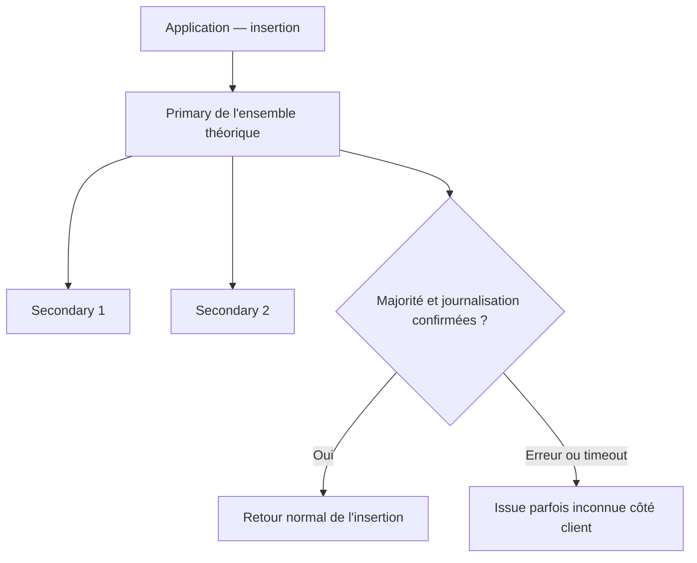

# INT-10 — Complément théorique : standalone ou replica set

**THÉORIE uniquement, pas une nouvelle tâche.** Le cours [INT-10 + INT-12 — Insertion et persistance MongoDB](INT-10-insertion-et-persistance-mongodb.md) décrit l'insertion et ses preuves sur un standalone. Aucun replica set n'est configuré ou testé ; cette note n'autorise aucune expérimentation.

**[Simulation ConfluxLab]** Les topologies ci-dessous sont pédagogiques, pas des configurations historiques AXA. Elles supposent des membres votants contenant les données, sans arbitre ni membre spécial.

## 1. Deux ou trois membres : pourquoi cela change la disponibilité

Un **primary** reçoit les écritures ; les **secondaries** répliquent les données. Une élection peut remplacer le primary. Le **quorum électoral** est la majorité de votes nécessaire pour maintenir/élire un primary.

« Deux replicas » est ambigu : deux membres au total, ou deux secondaries en plus du primary ?

| Topologie | Membres | Majorité | Après perte d'un membre |
|---|---:|---:|---|
| Standalone du labo | 1 | Acquittement local, pas d'élection de groupe | Base indisponible, aucune copie répliquée |
| 1 primary + 1 secondary | 2 | **2** | Plus de quorum ; les écritures avec cette garantie ne restent pas disponibles |
| 1 primary + 2 secondaries | 3 | **2** | Écritures possibles après stabilisation/élection si les survivants communiquent et qu'un primary éligible est disponible |

Dans cette hypothèse homogène, quorum électoral et nombre de confirmations `w=majority` coïncident, mais restent **deux mécanismes distincts**. Un arbitre vote sans stocker les données : trois processus quelconques ne suffisent pas à appliquer ce tableau.

**[Proposition théorique]** Trois membres votants contenant les données permettent d'envisager la perte d'un membre. Trois conteneurs sur le même hôte ne protègent pas de la perte de cet hôte : les domaines de panne comptent aussi.

## 2. Majorité, journal et délais ne promettent pas la même chose

Le réglage réel de [`FamilyRequestConfiguration`](../../capability-api/src/main/java/dev/confluxlab/capability/internal/config/FamilyRequestConfiguration.java), expliqué dans le [cours insertion](INT-10-insertion-et-persistance-mongodb.md#3-acquittement-et-configuration), reste le point de départ :

| Réglage | Sens dans l'hypothèse répliquée |
|---|---|
| `w=majority` | Attendre la majorité requise ; avec trois membres du tableau, deux confirmations, primary compris, pas nécessairement tous les membres |
| `j=true` | Demander la journalisation correspondant au write concern, pas une sauvegarde externe |
| `wtimeout=5 s` | Attente serveur de satisfaction du write concern lorsqu'elle s'applique ; ni borne universelle de flush du journal ni timeout HTTP global |

Sur le standalone actuel, `majority` ne crée aucune réplication : l'instance unique acquitte avec son journal. Une suppression accidentelle peut aussi être répliquée ; réplication et sauvegarde répondent à des risques différents.

La réplication reste asynchrone ; `majority` fait attendre le niveau de confirmation demandé, pas la mise à jour immédiatement lisible de tous les secondaries.



Ce schéma décrit une hypothèse, **pas un cluster déployé**. Le retour normal permet de poursuivre vers l'acceptation ; une confirmation perdue peut laisser une écriture réussie sans résultat certain côté application.

## 3. L'URI découvre l'ensemble, elle ne le crée pas

Exemple de topologie fictive à trois membres, **non appliqué**, limité à la découverte et aux choix de lecture/reprise :

```text
mongodb://mongo1:27017,mongo2:27017,mongo3:27017/conflux_lab?replicaSet=rs0&readPreference=primary&retryWrites=false
```

Les adresses sont des points de découverte initiaux ; `replicaSet=rs0` nomme l'ensemble attendu. Les serveurs doivent déjà être initialisés ensemble, et leurs adresses annoncées doivent être accessibles depuis la JVM, notamment avec les noms internes Docker.

Le driver découvre les rôles : il ne répartit pas les écritures entre plusieurs bases indépendantes. Le BFF, l'appel Java interne et l'ordre « insertion confirmée avant reçu » ne changent pas.

`readPreference=primary` garde les lectures sur le primary, choix simple pour le suivi : un secondary peut être en retard après un POST confirmé. Cela choisit **où lire**, pas les garanties de visibilité de `readConcern` ni une lecture automatiquement linéarisable.

## 4. Adapter les délais, pas les additionner

L'URI illustrative omet volontairement les délais : ils seraient à réévaluer avec le réseau, l'élection et le budget HTTP. Les valeurs réellement présentes dans [`application.yml`](../../application/src/main/resources/application.yml) sont détaillées dans le cours principal.

- `serverSelectionTimeoutMS` peut expirer avant qu'un nouveau primary soit disponible.
- `connectTimeoutMS` concerne la connexion ; `socketTimeoutMS`, l'attente de lecture réseau. Aucun n'est à lui seul la durée totale d'une écriture.
- Socket timeout et `wtimeout` valent actuellement tous deux 5 s : le client peut abandonner avant le diagnostic serveur. Une marge serait à étudier, pas à inventer à partir du nombre de membres.

**Timeout ou `500` ne prouve pas l'absence d'écriture.** Un dépassement du write concern ne constitue pas un rollback automatique. Aucune somme de ces paramètres ne garantit un délai HTTP global.

## 5. Retry du driver ≠ idempotence du POST

Un replica set permet d'envisager `retryWrites=true` pour les opérations éligibles. Leur mécanisme d'identification/reprise appartient au driver ; ce n'est pas une boucle qui rejoue tout le cas d'usage HTTP. Ce choix n'est pas activé par cette note.

Une **nouvelle requête POST** génère toujours un nouvel UUID dans le service et peut créer une seconde demande de même contenu. Ne pas confondre retryable write, répétition sûre d'un appel métier et clé d'idempotence ; ne pas ajouter un retry applicatif aveugle après une issue inconnue.

### Repère et portée

- [TD-R017 — Quorum, acquittement et découverte d'un replica set](../todos.md#td-r017).
- Sources de référence : configuration Java et URI liées ci-dessus, [DAT — persister avant d'accepter](../../docs/dat/ConfluxLab.md#61-persister-avant-daccepter--int-10).
- Aucun réglage modifié, conteneur supplémentaire, test ou build exécuté ; aucune haute disponibilité démontrée.
