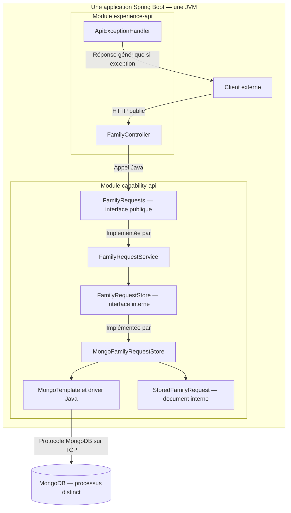
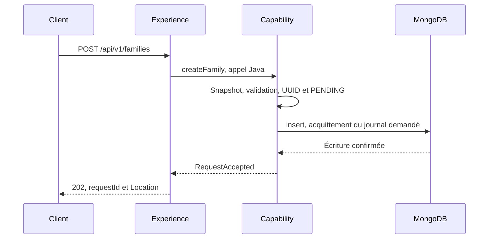
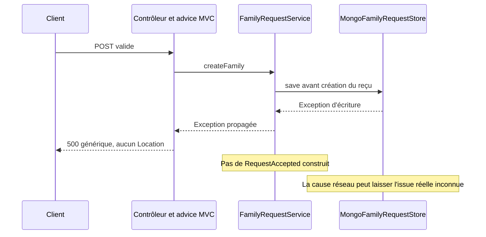
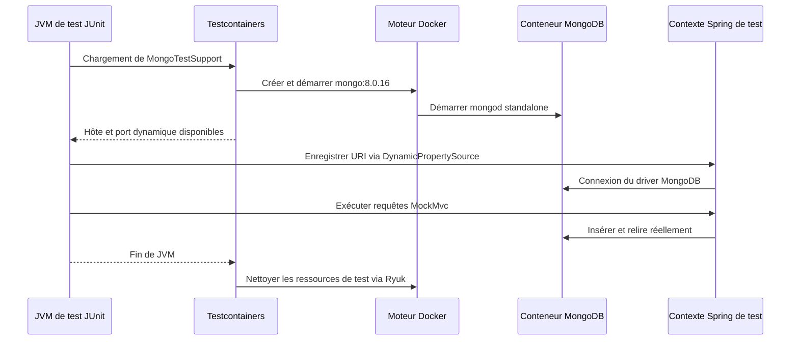

# INT-10 — Persister avant d'accepter

| Contexte | Description |
|---|---|
| **Sprint** | [03 — Persistance MongoDB et cycle des états](../../docs/stages/sprint-03-mongodb.md) |
| **Statut** | Terminée sur feu vert « commit la 9 & go INT-10 », confirmé par « ok continue » ; INT-11/12 non commencées |
| **Date des preuves** | 2026-10-21 |
| **Git** | INT-09 commitée avant le développement : `185bdd7` ; code/configuration/tests INT-10 commités séparément : `36212c5`. Documentation et consignes font l'objet de commits distincts à la demande de publication ; les preuves de réalisation ci-dessous précèdent cette publication |
| **Périmètre** | MongoDB remplace la mémoire de production ; insertion acquittée avant acceptation et relecture par le GET |
| **Preuves** | 2 nouveaux tests et 1 test POST/GET existant réussis avec MongoDB réel temporaire ; panne d'insertion simulée |

**[Simulation ConfluxLab]** Ce travail concerne le laboratoire, avec des personnes fictives. Ni l'image, ni les versions, ni les réglages d'acquittement ne décrivent une configuration historique AXA.

## Parcours de lecture

Cette note est un **cours sur l'incrément réellement implémenté**, pas un catalogue de tout MongoDB. Les passages « extrait exact/partiel » viennent des fichiers liés ; les exemples pédagogiques non exécutés sont signalés. Les schémas décrivent INT-10, sans événement Spring, `@Async` ou partenaire ajouté par anticipation.

- **Première lecture :** sections 1 et 2, puis 3.1 à 3.4 pour comprendre qui fait quoi et pourquoi le `202` vient après l'écriture.
- **Lecture pratique :** section 3.5 pour la configuration et 3.6 pour les conteneurs de test, puis section 4 pour les commandes et preuves.
- **Révision :** section 5 pour les différences à ne pas confondre, les limites et la formulation d'entretien.

### Sommaire

- [1. Objectif et vocabulaire](#1-objectif-et-vocabulaire)
- [2. Architecture et ordre des opérations](#2-comprendre-lordre-des-opérations)
- [3.1. Fichiers, responsabilités et injection Spring](#31-garder-le-métier-et-remplacer-seulement-le-stockage)
- [3.2. Mapping Java vers MongoDB](#32-mapper-le-record-interne-et-protéger-lidentifiant)
- [3.3. Insertion et lecture](#33-insérer-sans-remplacer-une-demande-existante)
- [3.4. Acquittement et chronologie du service](#34-attendre-une-confirmation-décriture-explicite)
- [3.5. Configuration et dépendances](#35-configurer-sans-ajouter-une-plateforme)
- [3.6. Docker, Testcontainers et Spring de test](#36-comprendre-le-câblage-des-tests)
- [4. Commandes, incident et résultats](#4-commandes-incident-rencontré-et-résultats)
- [5. Preuves, limites et entretien](#5-preuves-historiques-limites-et-entretien)
- [6. Suivi centralisé](#6-suivi-centralisé)

## 1. Objectif et vocabulaire

La story demande d'enregistrer la demande **avant** de répondre qu'elle est acceptée. La mémoire Java ne convenait pas pour une conservation au-delà du processus.

| Terme | Sens ici |
|---|---|
| **Persistance** | Écriture dans une base extérieure au processus Java |
| **Document / collection** | Un enregistrement MongoDB / son regroupement, ici `family_requests` |
| **Repository / adaptateur de stockage** | Composant qui traduit les opérations du service en accès MongoDB |
| **`MongoTemplate`** | API synchrone de Spring Data pour lire et écrire dans MongoDB |
| **`_id`** | Clé primaire d'un document, unique dans la collection |
| **Acquittement / write concern** | Confirmation d'écriture demandée au serveur avant de considérer l'opération comme réussie |
| **Journal** | Journal local du moteur de stockage ; ce n'est pas une sauvegarde externe |
| **Standalone** | Une seule instance MongoDB, sans réplication entre plusieurs serveurs |

Le résultat reste une **demande `PENDING`**, pas une famille créée. Aucun événement ni traitement ne démarre dans cet incrément.

## 2. Comprendre l'ordre des opérations

Avant INT-10, la map disparaissait avec la JVM. Construire un UUID ou un JSON `202` ne suffisait donc pas à promettre une conservation durable.

### 2.1. Avant/après : une responsabilité inchangée, un stockage différent

| Sujet | Avant, INT-06 à INT-09 | Depuis INT-10 |
|---|---|---|
| Service métier | `InMemoryFamilyRequests` | `FamilyRequestService`, même responsabilité métier |
| Stockage de production | `ConcurrentHashMap` dans la JVM | MongoDB dans un processus distinct |
| Fin de `save` | Insertion en mémoire terminée | Insertion et acquittement MongoDB obtenus |
| Collision d'identifiant | `putIfAbsent` | Index unique natif de `_id` + `insert` |
| Après arrêt de Java | Map perdue | Les données restent dans MongoDB si la même base et son stockage sont conservés ; démonstration de redémarrage non exécutée ici |
| Contrat du BFF | POST/GET publics, délégation Java | Inchangé |
| Panne de stockage | Exception, pas de faux reçu | Même principe, avec une dépendance réseau et une issue parfois inconnue |

### 2.2. Où s'arrêtent les modules et les processus ?



**Le monolithe reste modulaire.** MongoDB n'est pas une seconde API métier Spring Boot : c'est une base extérieure à l'application. Experience et Capability sont toujours assemblées dans le même processus et communiquent en Java, jamais par HTTP interne. Docker sert à lancer le processus MongoDB, pas à découper ce monolithe en microservices.

Les flèches d'interface représentent les responsabilités et implémentations, pas un proxy HTTP ou une JVM supplémentaire. En cas d'exception, l'advice intervient au niveau MVC ; le service ne connaît pas les codes HTTP.

### 2.3. Chemin de succès : quand le reçu devient-il possible ?

Le parcours devient :



Si l'insertion lève une exception, le service ne construit pas le reçu. L'advice HTTP existant transforme cette erreur en `500` générique. Le BFF ne voit ni document MongoDB, ni template, ni repository.

### 2.4. Chemin d'erreur : ne pas confondre rejet et absence certaine



Le code n'intercepte pas l'erreur pour fabriquer un succès. Le test d'erreur provoque volontairement une exception **avant l'accès réel à MongoDB** ; il prouve la propagation HTTP, pas un scénario de perte réseau après écriture. Ce dernier risque découle du fonctionnement d'un échange réseau et reste une limite documentée.

## 3. Travail réalisé pas à pas

### 3.1. Garder le métier et remplacer seulement le stockage

[`FamilyRequestService`](../../capability-api/src/main/java/dev/confluxlab/capability/internal/FamilyRequestService.java) est le nouveau nom d'`InMemoryFamilyRequests`, devenu trompeur. La validation, l'UUID et la projection du GET ne changent pas de responsabilité.

Le service dépend de la petite interface interne [`FamilyRequestStore`](../../capability-api/src/main/java/dev/confluxlab/capability/internal/FamilyRequestStore.java). Elle expose seulement `save` et `findById`. Sa seule implémentation de production est [`MongoFamilyRequestStore`](../../capability-api/src/main/java/dev/confluxlab/capability/internal/MongoFamilyRequestStore.java).

L'ancien [`InMemoryFamilyRequestStore`](../../capability-api/src/test/java/dev/confluxlab/capability/internal/InMemoryFamilyRequestStore.java) a été déplacé dans **`src/test`**, sans annotation Spring. Les tests unitaires existants restent utilisables avec cette doublure, mais elle n'est plus livrée dans l'application : aucun fallback silencieux vers la mémoire si MongoDB échoue.

Le test du service est renommé [`FamilyRequestServiceTest`](../../capability-api/src/test/java/dev/confluxlab/capability/internal/FamilyRequestServiceTest.java), sans ajout de matrice. Le BFF et l'interface publique `FamilyRequests` ne sont pas modifiés.

#### Carte des fichiers : où lire le mécanisme ?

| Fichier réel | Responsabilité | Ce qu'il ne fait pas |
|---|---|---|
| `application/.../ConfluxLabApplication.java` | Démarrer le contexte Spring Boot unique | Définir une API séparée par module |
| `experience-api/.../FamilyController.java` | Adapter HTTP et appeler l'API publique Java | Accéder à MongoDB |
| `capability-api/.../api/FamilyRequests.java` | Exposer les cas d'usage aux autres modules | Exposer le store interne |
| `capability-api/.../internal/FamilyRequestService.java` | Valider, créer l'identifiant, ordonner l'insertion puis le reçu | Construire une réponse HTTP ou déclencher un traitement futur |
| `capability-api/.../internal/FamilyRequestStore.java` | Définir les deux opérations de stockage nécessaires | Imposer le moteur MongoDB au service |
| `capability-api/.../internal/MongoFamilyRequestStore.java` | Exécuter insertion et lecture MongoDB | Définir l'ordre métier ou un retry |
| `capability-api/.../internal/StoredFamilyRequest.java` | Représenter données, invariants et mapping du document | Être le DTO HTTP de suivi |
| `capability-api/.../internal/FamilyRequestConfiguration.java` | Déclarer le template configuré et l'horloge | Créer un serveur MongoDB |
| `application/src/main/resources/application.yml` | Fournir les paramètres de connexion au processus assemblé | Installer ou démarrer la base |

Les `...` de ce tableau abrègent les packages Java déjà liés dans les sections suivantes ; ce ne sont pas des chemins à copier dans une commande.

#### Injection Spring : qui construit les objets ?

L'[application de démarrage](../../application/src/main/java/dev/confluxlab/ConfluxLabApplication.java) porte `@SpringBootApplication` dans `dev.confluxlab`. Son scan de composants couvre les sous-packages Experience et Capability. Les annotations `@Service`, `@Repository` et `@Configuration` permettent à Spring d'y découvrir les composants concernés.

Un **bean** est un objet construit et géré par le contexte Spring. **L'injection par constructeur** signifie que Spring fournit les dépendances au moment de créer cet objet. Extrait exact de `FamilyRequestService` :

```java
private final FamilyRequestStore store;
private final Validator validator;
private final Clock clock;

FamilyRequestService(FamilyRequestStore store, Validator validator, Clock clock) {
    this.store = store;
    this.validator = validator;
    this.clock = clock;
}
```

- `FamilyRequestStore` est une interface Java interne. En production, le seul bean qui l'implémente est `MongoFamilyRequestStore` : Spring peut donc le choisir sans ambiguïté.
- `Validator` est fourni par l'infrastructure de validation présente avec le starter ; `validate` vérifie les contraintes réellement déclarées, il n'invente pas de métier.
- `Clock` est notre bean UTC. L'injecter permet aux tests de remplacer le temps réel par une horloge fixe sans modifier le service.
- Le constructeur unique n'a pas besoin d'annotation `@Autowired` pour être utilisé par Spring.
- `final` empêche la réaffectation des références ; ce n'est pas une garantie d'immuabilité de tous les objets référencés.

L'interface sert ici à garder un service testable avec une doublure mémoire **sans maintenir deux modes de production**. Ce n'est pas une architecture hexagonale exhaustive : seulement deux méthodes pour le besoin actuel.

### 3.2. Mapper le record interne et protéger l'identifiant

[`StoredFamilyRequest`](../../capability-api/src/main/java/dev/confluxlab/capability/internal/StoredFamilyRequest.java) reçoit `@Document("family_requests")` et `@Id` sur `requestId` :

- `@Document` indique la collection MongoDB ; il ne crée pas une route HTTP.
- `@Id` mappe l'UUID Java vers **`_id`**, pas vers un second champ UUID à indexer séparément.
- L'index unique natif de `_id` refuse une deuxième insertion du même identifiant.
- La configuration utilise les UUID BSON **standard**, pour écrire et relire les mêmes UUID.
- BSON Date stocke les instants à la précision milliseconde. Le service normalise la création à cette précision, plutôt que prétendre conserver des nanosecondes.

Le payload et les dates sont relus avec le document. `result?` et `error?` restent différés comme dans INT-09 : aucun schéma partenaire fictif supplémentaire n'est ajouté.

Extrait partiel du record, avec mise en forme normalisée :

```java
@Document("family_requests")
record StoredFamilyRequest(
        @Id UUID requestId, RequestStatus status, CreateFamilyRequest payload,
        Instant createdAt, Instant updatedAt, Instant completedAt) {
```

Le record fournit des accesseurs tels que `requestId()` et `status()`. Spring Data utilise son mapping pour convertir cette valeur Java vers le document, puis reconstruire le record à la lecture. Le constructeur compact continue de vérifier ses invariants : persister un objet ne dispense pas de protéger son modèle.

**JSON et BSON ne sont pas la même représentation.** JSON est le format textuel utilisé en HTTP ; BSON est le format de documents utilisé par MongoDB, avec notamment des types UUID/binaires et dates. L'UUID dans une réponse JSON est une chaîne, mais `_id` est ici stocké en UUID BSON standard.

| Élément Java | Représentation / rôle dans MongoDB | Exposition au client HTTP |
|---|---|---|
| `requestId`, annoté `@Id` | `_id` unique | `requestId` dans le reçu et le suivi |
| `status` | Valeur du statut | `status` |
| `payload` | Données imbriquées de la demande | Pas dans le suivi |
| `createdAt` | Date de création BSON | `createdAt` dans le suivi |
| `updatedAt`, `completedAt` | Dates internes du cycle | Pas dans le suivi actuel |

Illustration **partielle et non exécutée**, sous une syntaxe de type `mongosh` ; ce n'est pas un export du document observé et les champs de mapping supplémentaires ne sont pas représentés :

```javascript
{
  _id: UUID("e91aa057-68f9-4d38-9d24-e8eb7f747631"),
  status: "PENDING",
  createdAt: ISODate("2026-10-21T12:00:00.000Z"),
  updatedAt: ISODate("2026-10-21T12:00:00.000Z")
  // Le document réel contient aussi le payload reçu.
}
```

L'index `_id` est fourni par MongoDB : nous n'ajoutons pas un deuxième index unique sur un champ `requestId` parallèle. Les détails des types et paramètres sont ceux du labo, pas une migration d'une base historique.

### 3.3. Insérer, sans remplacer une demande existante

Extrait exact de l'adaptateur :

```java
@Override
public void save(StoredFamilyRequest request) {
    // Insert, not upsert: an existing UUID must never be overwritten during acceptance.
    mongoTemplate.insert(request);
}
```

Le nom de l'interface reste `save`, mais son opération MongoDB est **`insert`**. Employer `MongoTemplate.save` permettrait un remplacement selon l'identifiant ; ce n'est pas le comportement voulu pour accepter une nouvelle demande.

Notre classe `@Repository` utilise directement `MongoTemplate`, pas une interface générée `MongoRepository`. Le message de démarrage « Found 0 MongoDB repository interfaces » est donc normal : il ne signifie pas que notre adaptateur manque.

Le GET utilise `findById` et projette toujours uniquement `requestId`, `status`, `createdAt`. Une absence reste distincte d'une panne de lecture. Les transitions d'INT-09 ne sont toujours pas exécutées en production et aucune opération de mise à jour n'est ajoutée.

Extrait exact de lecture dans l'adaptateur :

```java
@Override
public Optional<StoredFamilyRequest> findById(UUID requestId) {
    return Optional.ofNullable(mongoTemplate.findById(requestId, StoredFamilyRequest.class));
}
```

1. `findById` cherche `_id` dans la collection du type annoté.
2. `StoredFamilyRequest.class` indique à Spring Data la classe à reconstruire.
3. Un résultat Java `null` devient `Optional.empty()` ; une exception réseau reste une exception, elle n'est pas transformée en absence.
4. Dans le service, `orElseThrow(RequestNotFoundException::new)` adapte uniquement l'absence. L'advice traduit ensuite cette exception publique en `404`.
5. `new RequestView(stored.requestId(), stored.status(), stored.createdAt())` construit la vue minimale ; sérialiser directement le record stocké exposerait notamment le payload.

| Opération | Effet utile dans ce projet |
|---|---|
| `MongoTemplate.insert` | Créer, ou refuser une clé déjà présente ; choix actuel |
| `MongoTemplate.save` | Peut insérer ou remplacer selon l'identifiant ; pas adapté à notre garantie de non-écrasement à l'acceptation |
| Mise à jour conditionnelle | Modifier seulement si un état attendu est encore présent ; futur INT-11, non implémenté ici |

Une collision provoque une `DuplicateKeyException` Spring dans le test réel. Elle prouve la contrainte de clé en base, **pas l'unicité métier d'une famille** : un nouveau UUID permet toujours d'insérer une demande de contenu identique.

### 3.4. Attendre une confirmation d'écriture explicite

Extrait de [`FamilyRequestConfiguration`](../../capability-api/src/main/java/dev/confluxlab/capability/internal/FamilyRequestConfiguration.java) :

```java
MongoTemplate template = new MongoTemplate(factory, converter);
template.setWriteConcern(WriteConcern.MAJORITY.withJournal(true).withWTimeout(5, TimeUnit.SECONDS));
```

- `MAJORITY` demande un acquittement de majorité. Sur notre standalone, cette majorité est **la seule instance** : cela ne crée pas de réplication.
- `withJournal(true)` demande la confirmation du journal local avant succès.
- `withWTimeout(5, TimeUnit.SECONDS)` configure une attente serveur de satisfaction du write concern lorsqu'elle s'applique, notamment à la réplication. **Ce n'est ni une borne universelle de journalisation, ni un timeout global HTTP** ; sur ce standalone, ne pas compter sur cette valeur pour plafonner une attente de flush du journal. Les délais réseau ont leur propre rôle.
- Le service appelle l'insertion synchrone avant de construire son `RequestAccepted`. Une exception coupe cette branche de succès.

**Limite importante :** une erreur HTTP après timeout ou déconnexion ne prouve pas que rien n'a été écrit. Le serveur peut avoir réussi avant que le client reçoive la confirmation. Aucun retry applicatif ou mécanisme d'idempotence n'est ajouté. Deux POST identiques peuvent toujours produire deux UUID et deux demandes.

#### L'ordre exact dans le code du service

Extrait partiel exact de `createFamily` ; seuls les espaces d'alignement sont normalisés :

```java
UUID requestId = UUID.randomUUID();
StoredFamilyRequest stored = StoredFamilyRequest.pending(
        requestId, snapshot, Instant.now(clock).truncatedTo(ChronoUnit.MILLIS));
store.save(stored);
return new RequestAccepted(requestId, stored.status(), "/api/v1/requests/" + requestId);
```

1. L'entrée a déjà été copiée et validée : les données refusées n'atteignent pas le store.
2. `UUID.randomUUID()` produit la corrélation de cette nouvelle demande ; il ne calcule pas une clé d'idempotence du contenu.
3. `Instant.now(clock)` lit l'horloge injectée ; `truncatedTo(MILLIS)` aligne sa précision sur BSON Date.
4. `pending(...)` initialise le statut et les dates, sans écrire elle-même dans la base.
5. `store.save(stored)` exécute ici un appel **bloquant et synchrone**. Aucun `@Async`, future ou thread métier séparé n'intervient.
6. Seul le retour normal de cette méthode permet d'atteindre `new RequestAccepted(...)`.

Le [contrôleur](../../experience-api/src/main/java/dev/confluxlab/experience/FamilyController.java) appelle d'abord `familyRequests.createFamily(request)`, puis construit `ResponseEntity.accepted()`, `Location` et le corps. Si le service lève une exception, Java quitte cette branche avant la construction de la réponse de succès. Les liens publics restent sous la responsabilité du BFF.

**Le `202` n'est donc pas immédiat au sens « aucun travail avant réponse ».** Il attend les validations et l'écriture MongoDB ; ce sont les futures opérations de création partenaire qui ne sont pas encore attendues ou exécutées. Une panne MongoDB peut retarder ou empêcher l'acceptation.

#### Comment le template configuré est-il créé ?

Extrait partiel exact de `FamilyRequestConfiguration` :

```java
@Configuration(proxyBeanMethods = false)
class FamilyRequestConfiguration {

    @Bean
    MongoTemplate mongoTemplate(MongoDatabaseFactory factory, MongoConverter converter) {
        MongoTemplate template = new MongoTemplate(factory, converter);
        template.setWriteConcern(WriteConcern.MAJORITY.withJournal(true).withWTimeout(5, TimeUnit.SECONDS));
        return template;
    }
```

- `@Configuration` déclare une classe de configuration Spring ; `proxyBeanMethods=false` convient ici car ses méthodes de beans ne s'appellent pas entre elles.
- `@Bean` enregistre la valeur retournée comme bean. Les paramètres de la méthode sont eux-mêmes fournis par le contexte.
- `MongoDatabaseFactory` fournit l'accès à la base configurée ; il ne démarre pas `mongod`.
- `MongoConverter` transforme le modèle Java en données MongoDB et inversement. Il ne sérialise pas la réponse HTTP.
- Le starter et l'auto-configuration Boot apportent l'infrastructure de connexion et de mapping ; nous personnalisons explicitement le template utilisé par l'adaptateur.
- Le write concern est défini sur ce template. Le réglage par défaut affiché dans les logs du client MongoDB n'est pas, à lui seul, la preuve du réglage d'une opération exécutée par un template personnalisé.

### 3.5. Configurer sans ajouter une plateforme

[`application.yml`](../../application/src/main/resources/application.yml) configure `MONGODB_URI`, avec une URL locale par défaut vers `conflux_lab`. Les délais par défaut sont 3 s pour sélection/connexion et 5 s pour lecture réseau ; `retryWrites=false` évite les reprises d'écriture du driver avec cette URL. Une URL fournie par l'utilisateur peut modifier ces options : ne pas confondre valeurs par défaut et politique inviolable.

Le [starter MongoDB](../../capability-api/pom.xml) est une dépendance de Capability. Les classes de persistance restent dans `capability.internal`, jamais dans `contracts` ou Experience.

Extrait partiel exact d'`application.yml` :

```yaml
spring:
  application:
    name: conflux-lab
  data:
    mongodb:
      uri: ${MONGODB_URI:mongodb://localhost:27017/conflux_lab?serverSelectionTimeoutMS=3000&connectTimeoutMS=3000&socketTimeoutMS=5000&retryWrites=false}
      uuid-representation: standard
```

La syntaxe `${NOM:valeur}` signifie : utiliser la propriété/variable `NOM` si elle est fournie, sinon la valeur de repli. Ce texte appartient à la configuration Spring, pas à une commande shell exécutée dans la session.

| Partie | Sens et limite |
|---|---|
| `mongodb://` | Protocole de connexion MongoDB ; pas une URL HTTP |
| `localhost:27017` | Adresse et port du serveur pour le lancement Java local ; dans un autre conteneur, `localhost` désignerait ce conteneur, pas automatiquement l'hôte |
| `/conflux_lab` | Nom de la base de développement ; les tests utilisent `conflux_lab_test` dans leur conteneur temporaire |
| `serverSelectionTimeoutMS=3000` | Attente de sélection d'un serveur approprié ; pas durée totale du POST |
| `connectTimeoutMS=3000` | Délai de connexion réseau ; pas délai d'exécution de l'insertion |
| `socketTimeoutMS=5000` | Délai de lecture réseau ; peut conduire à une issue d'écriture inconnue |
| `retryWrites=false` | Désactive les reprises d'écriture du driver pour cette URI ; n'implémente aucune idempotence métier |
| `uuid-representation: standard` | Convention de représentation des UUID côté driver/mapping ; ne garantit pas l'absence de doublon de contenu |

Les valeurs sont pédagogiques : elles ne constituent pas un dimensionnement de production ni une limite globale de concurrence ou de latence. Aucun secret n'est codé dans cette URL locale. Une configuration réelle comportant des identifiants ne devrait pas être copiée dans Git ou les notes.

#### Les dépendances : pourquoi ces trois emplacements ?

| Emplacement | Ajout ou réglage | Rôle |
|---|---|---|
| `capability-api/pom.xml` | `spring-boot-starter-data-mongodb` | Apporte Spring Data et le driver synchrone au module qui possède la persistance |
| `application/pom.xml` | `org.testcontainers:testcontainers`, scope `test` | Permet aux tests de l'assemblage de contrôler Docker ; pas une dépendance de production du service métier |
| `pom.xml` racine | `testcontainers.version=1.21.4` | Surcharge de maintenance ciblée de la version gérée par le parent Boot, justifiée par l'incident Docker reproduit |

Un **starter** regroupe des dépendances compatibles et active l'auto-configuration adaptée ; il n'est pas une base de données embarquée. Maven télécharge des bibliothèques Java, pas un serveur MongoDB démarré. Le processus MongoDB est fourni séparément par Docker dans nos tests.

#### Pourquoi ne pas choisir autre chose ?

| Choix envisagé | Décision pour cet incrément |
|---|---|
| Garder la map en cas de panne MongoDB | Refusé : un `202` après repli mémoire annoncerait une conservation de nature différente |
| Image Alpine personnalisée | Écartée : Alpine est une base Linux, pas un moteur MongoDB ; compatibilité et maintenance supplémentaires sans bénéfice pédagogique démontré |
| MongoDB embarqué à la place du serveur réel | Non retenu : vérifier l'index et le mapping avec le serveur réel reste le besoin de la story |
| `MongoRepository` généré | Possible mais pas nécessaire pour nos deux opérations ; l'adaptateur avec `MongoTemplate` rend l'insertion et son absence d'upsert explicites |
| Cluster, Atlas, interface graphique, transactions distribuées | Hors périmètre : une instance standalone suffit à cet apprentissage |
| HTTP entre Experience et Capability | Toujours interdit : le besoin de MongoDB ne change pas le monolithe modulaire |

Le choix retenu avec l'utilisateur est l'image officielle **`mongo:8.0.16`**, pas une image Alpine personnalisée. Les tests utilisent une seule instance standalone. [`MongoTestSupport`](../../application/src/test/java/dev/confluxlab/MongoTestSupport.java) partage ce conteneur dans la JVM de test et fournit son port dynamique à Spring. Son cache WiredTiger est réglé à 0,25 Gio ; **la mémoire totale du conteneur n'est pas plafonnée à cette valeur**.

Les tests Spring d'assemblage/HTTP existants utilisent désormais ce support. Les tests unitaires des autres modules restent sans Docker. Les données du conteneur sont fictives et isolées ; aucune base utilisateur n'a été utilisée. Testcontainers utilise aussi son petit conteneur de nettoyage Ryuk, pas un deuxième serveur MongoDB. Les images restent en cache, les conteneurs et données temporaires sont supprimés à la fin.

### 3.6. Comprendre le câblage des tests

Il faut séparer **le chemin applicatif** et **l'outil qui prépare son environnement** : le code métier contacte MongoDB avec le driver ; Testcontainers contacte le moteur Docker pour créer le serveur de test. L'application n'appelle jamais l'API Docker pour enregistrer une famille.



Extrait partiel exact de `MongoTestSupport` :

```java
private static final GenericContainer<?> MONGO = new GenericContainer<>(DockerImageName.parse("mongo:8.0.16"))
        .withExposedPorts(27017)
        .withCommand("mongod", "--bind_ip_all", "--wiredTigerCacheSizeGB", "0.25")
        .withStartupTimeout(Duration.ofSeconds(60));

static {
    MONGO.start();
}
```

- `GenericContainer<?>` est une enveloppe Java pour piloter un conteneur Docker ; `<?>` est un paramètre de type générique, pas une configuration MongoDB.
- `static` fait partager cette référence par les classes utilisant le support dans cette JVM/classloader. Un autre lancement Maven ou un autre fork de test n'utilise pas automatiquement le même conteneur.
- `withExposedPorts(27017)` indique le port interne. Testcontainers alloue un port d'hôte disponible : il ne réserve pas le port fixe local `27017` pour les tests.
- `mongod` est le serveur MongoDB. `--bind_ip_all` le fait écouter sur les interfaces du conteneur ; cela ne constitue pas une règle de pare-feu de l'hôte.
- `--wiredTigerCacheSizeGB 0.25` configure le cache du moteur, pas la mémoire de Java, Docker ou de tout MongoDB.
- `withStartupTimeout` borne l'attente de démarrage du conteneur, pas les opérations métier.
- `MONGO.start()` est exécuté pendant l'initialisation de cette classe. Le premier incident Docker échouait donc avant les requêtes de test, pas au milieu d'un traitement métier.

`@DynamicPropertySource` enregistre ensuite une propriété `spring.data.mongodb.uri` construite avec `MONGO.getHost()` et `MONGO.getMappedPort(27017)`. Cette URI prioritaire de test empêche l'emploi de la base locale de développement par ces tests. Elle existe uniquement dans le contexte de test ; le YAML de production n'est pas réécrit.

#### Qu'est-ce qui est réel ou simulé ?

| Élément | Traitement dans les tests INT-10 |
|---|---|
| Contrôleur, validation, service, mapping et template | Vrais composants Spring |
| Serveur MongoDB | Vrai processus dans un conteneur temporaire |
| HTTP entrant | Simulé par `MockMvc` dans la pile MVC ; pas un client réseau vers un Tomcat démarré sur un port |
| Store annoté `@MockitoSpyBean` dans le nouveau test | Vrai comportement par défaut ; seul l'appel volontairement stubé pour la panne lève une exception simulée |
| Collision d'UUID | Vraie deuxième insertion refusée par MongoDB |
| Coupure réseau MongoDB | Non provoquée ; ne pas présenter le stub de panne comme une preuve de partition réseau |
| Données et personnes | Fictives |

`@SpringBootTest` charge l'application et ses beans ; `@AutoConfigureMockMvc` prépare l'outil de requêtes MVC. `@MockitoSpyBean` ne remplace pas par défaut tout le fonctionnement du store : c'est ce qui permet un test nominal réellement connecté à MongoDB et un test d'erreur déterministe sans ajouter une infrastructure de panne. Les deux usages restent explicitement distingués.

L'analyse statique de l'éditeur avertit que le conteneur partagé n'est pas fermé explicitement dans un `try-with-resources`. Son cycle de vie est ici celui de la JVM de test, avec nettoyage Testcontainers/Ryuk vérifié après exécution. Le fermer à la fin d'une seule méthode rendrait invalide l'URI des contextes Spring qui le réutilisent ensuite. Cet avertissement n'est pas une mesure de fuite mémoire du processus MongoDB.

## 4. Commandes, incident rencontré et résultats

### 4.1. Vérifications et préparation de session

Depuis la racine `conflux-lab/` :

```sh
docker version --format '{{.Server.Version}}'
docker pull mongo:8.0.16
```

Ces commandes lisent la version du serveur Docker et téléchargent l'image dans son cache local. Le serveur observé est **Docker 29.8.0** ; l'image a été téléchargée. Aucun MongoDB n'a été installé comme service sur l'hôte.

### 4.2. Exécuter le strict nécessaire

Prérequis : JDK 21, Maven Wrapper, Docker disponible, accès réseau pour les dépendances/images absentes du cache. Depuis la même racine :

```sh
./mvnw -B -ntp -pl application -am '-Dtest=MongoFamilyRequestStoreTest,FamilyRequestTrackingHttpTest#followsThePostLocationToPendingMetadataAndKeepsCreatedAtAcrossGets' -Dsurefire.failIfNoSpecifiedTests=false clean test
```

`-B -ntp` active le mode batch et réduit la progression des téléchargements. `-pl application -am` compile l'assemblage et ses dépendances. `-Dtest` sélectionne deux nouvelles méthodes et une méthode existante, pas toute la suite. `failIfNoSpecifiedTests=false` autorise les modules qui ne contiennent pas ces noms ; il ne masque pas un test en échec.

`clean` supprime les sorties `target/`, notamment les anciennes classes après renommage ; il ne supprime pas les sources. `test` compile les sources/tests puis exécute la sélection ; il écrit les rapports Surefire mais **ne produit pas le JAR Boot**.

Le premier passage a compilé les modules, puis échoué avant d'accéder à MongoDB : Testcontainers **1.21.3**, géré par Boot, utilisait l'API Docker `1.32`, alors que ce serveur exige au moins `1.40`.

Le [POM racine](../../pom.xml) épingle donc **Testcontainers 1.21.4**. La [note de version](https://github.com/testcontainers/testcontainers-java/releases/tag/1.21.4) annonce précisément la compatibilité avec les changements récents de Docker Engine. Il s'agit d'une mise à jour de maintenance de la branche 1.21, pas d'un changement du moteur MongoDB.

Après correction, **la même sélection a été relancée sans `clean`**, en terminant la commande par `test`. Elle a réussi :

| Test | Preuve réellement observée |
|---|---|
| Nouveau test nominal MongoDB | POST `202`, UUID/payload/dates relus en base ; insertion du même `_id` refusée sans écrasement |
| Nouveau test d'erreur | Exception d'insertion simulée sur le store, avec vrai service et BFF : `500` générique, aucun `Location` ou reçu d'acceptation |
| Test existant POST/GET | Suivi `200 PENDING`, métadonnées seules et `createdAt` stable lors de lectures répétées |

**Résultat final : 3 tests, 0 échec, 0 erreur, 0 ignoré ; `BUILD SUCCESS`.** Deux tests seulement ont été ajoutés, le troisième est réutilisé. Le test de panne n'est pas une panne réseau MongoDB réelle : la doublure sert à rendre ce scénario déterministe.

### 4.3. Nettoyage et commandes manuelles

Après la JVM, cette commande de lecture n'a retourné aucun conteneur :

```sh
docker ps -a --filter label=org.testcontainers=true --format '{{.ID}} {{.Image}} {{.Status}}'
```

Le [README — démarrage local](../../README.md#démarrage-local) donne les commandes manuelles avec volume persistant, packaging et démarrage du JAR. **Elles n'ont pas été exécutées dans cette session** et ne prouvent pas encore un redémarrage avec la même base. Leur volume doit être conservé pour cette future démonstration ; le conteneur temporaire des tests, lui, est volontairement supprimé.

#### Lire la commande Docker manuelle sans la confondre avec Testcontainers

Exemple **non exécuté**, depuis `conflux-lab/`, avec Docker disponible, le nom et le port libres :

```sh
docker run -d --name conflux-lab-mongo -p 127.0.0.1:27017:27017 -v conflux-lab-mongo-data:/data/db mongo:8.0.16 --wiredTigerCacheSizeGB 0.25
```

| Argument | Effet |
|---|---|
| `run` | Crée et démarre un nouveau conteneur ; échoue si le nom existe déjà |
| `-d` | Détache le conteneur du terminal ; le processus continue après la commande |
| `--name conflux-lab-mongo` | Nom stable pour les opérations manuelles ultérieures |
| `-p 127.0.0.1:27017:27017` | Publie le port `27017` du conteneur sur le port `27017` de loopback de l'hôte ; ce n'est pas la publication dynamique des tests |
| `-v conflux-lab-mongo-data:/data/db` | Crée/réutilise un volume Docker nommé pour les fichiers de données ; ce ne sont pas des fichiers ajoutés au dépôt |
| `mongo:8.0.16` | Image et tag du serveur choisi |
| `--wiredTigerCacheSizeGB 0.25` | Argument de MongoDB transmis par l'image officielle à son serveur, pas option de limitation mémoire Docker |

Sans authentification, cet exemple est **strictement local**. Ne pas retirer l'adresse loopback pour l'exposer à un réseau. Le nom du conteneur, le volume et la base `conflux_lab` sont trois objets différents ; supprimer le conteneur n'est pas la même action que supprimer le volume.

Les commandes manuelles `docker stop conflux-lab-mongo` puis `docker start conflux-lab-mongo` arrêtent et relancent le même conteneur. Elles ne remplacent pas une preuve de redémarrage de l'application avec la même base. Ne pas supprimer le volume pour cette démonstration future ; aucune commande de suppression de données n'a été exécutée pour écrire cette note.

#### Compiler les sources, exécuter des tests et produire le JAR : trois choses différentes

- Le passage ciblé de la session a compilé les modules et exécuté **seulement les cas sélectionnés**.
- Le `test` réussi ne signifie pas qu'un JAR Boot a été repackagé ou lancé.
- L'exemple manuel `./mvnw -B -ntp -DskipTests package` produit l'artefact sans exécuter les tests ; il compile normalement les tests. Cette commande est dans le README mais n'a pas été exécutée ici.
- Le lancement `java -jar ...` fait ensuite démarrer le processus Java. Une application démarrée ne prouve pas à elle seule que MongoDB est accessible ; une opération de lecture/écriture doit réussir pour le vérifier.
- Aucun de ces gestes locaux ne constitue un déploiement distant ou une CI verte.

## 5. Preuves historiques, limites et entretien

INT-09 avait été vérifiée par 3 tests ciblés et commitée `185bdd7` avant INT-10. Le dernier `clean verify` global reste celui d'INT-08 (181 tests), pas un résultat actuel. Le `clean` de cette session en a supprimé les anciennes sorties locales ; la note historique conserve la preuve, pas les rapports générés.

**Non exécutés dans INT-10 :** suite globale, tests ArchUnit, tests unitaires existants des autres modules, démarrage du JAR, redémarrage de l'application avec une base conservée, Windows et CI. Les sources/tests du réacteur ont été compilés ; seuls les 3 cas sélectionnés ont été exécutés. Pas de compteur global actualisé ni de couverture chiffrée revendiqués.

**Contrôle documentaire ultérieur, sans nouveau test :** les liens locaux et le registre central ont été vérifiés. Le contrôle éditeur a remonté des erreurs de renommage sur `FamilyRequestServiceTest` avec des noms malformés absents du fichier sur disque. Ce fichier correspond exactement à la version précédente avec le renommage de service attendu, et sa classe compilée est plus récente que sa source. Il y a donc une divergence constatée entre les diagnostics et le fichier compilé ; l'hypothèse d'un état de serveur Java désynchronisé reste **non confirmée**. Ne pas présenter les diagnostics éditeur comme propres, ni ces messages comme un nouveau résultat Maven. Aucun redémarrage du serveur Java n'a été exécuté.

La persistance est branchée et testée, mais il n'existe toujours ni prise en charge atomique, ni traitement asynchrone, ni reprise automatique des `PENDING` abandonnés, ni partenaire. Le journal MongoDB n'est ni une sauvegarde contre la perte du disque, ni une transaction distribuée. INT-11/12 demandent encore leurs feux verts respectifs.

### Les distinctions à savoir expliquer sans réciter des annotations

| Ne pas confondre | Pourquoi cela change le raisonnement |
|---|---|
| Image Docker / conteneur / volume | L'image est le modèle téléchargé, le conteneur exécute `mongod`, le volume conserve des données indépendamment du processus |
| Spring Data / driver / serveur | Spring Data mappe et fournit les opérations Java ; le driver parle le protocole ; le serveur stocke effectivement les données |
| Acquittement / réplication / sauvegarde | Journal confirmé sur un serveur ne crée ni autre copie active ni archive récupérable après perte du disque |
| UUID unique / idempotence métier | Un UUID empêche deux documents de partager une clé, pas deux clés différentes de représenter la même demande |
| Exception d'écriture / absence certaine | Une coupure peut masquer une écriture déjà réussie |
| Immuabilité du record / exclusion concurrente | Deux threads peuvent produire chacun une nouvelle valeur depuis le même état initial |
| `202` / `SUCCEEDED` | Le premier est un résultat HTTP d'acceptation, le second un futur état métier final |
| MockMvc / JAR réellement démarré | Le test traverse MVC et les beans, pas nécessairement le réseau HTTP et le packaging de production |

**Formulation d'entretien :**

> « J'insère la demande avant de construire son reçu d'acceptation. L'UUID est la clé primaire MongoDB et j'utilise une insertion, pas un upsert qui pourrait remplacer une demande. L'écriture est synchrone et attend un acquittement du journal ; une erreur remonte en HTTP sans faux `202`. Le BFF conserve son contrat et ne connaît pas la persistance. Je distingue cela de l'idempotence : après un timeout, l'écriture peut avoir réussi sans confirmation, donc rejouer un POST peut créer une deuxième demande. »

**Piège :** « `majority` sur un seul serveur protège contre la perte de ce serveur ? » Non : il n'y a aucune copie répliquée ; il faut distinguer journal local, réplication et sauvegarde.

**Piège :** « Un UUID unique empêche deux traitements du même document ? » Non : l'unicité protège l'insertion d'une clé, pas la prise en charge concurrente. Cette dernière exige une mise à jour conditionnelle atomique, prévue dans INT-11.

## 6. Suivi centralisé

- [TD-B009 — Persister avant d'accepter, terminée avec preuve](../todos.md#td-b009).
- [TD-R016 — Insérer puis acquitter, sans promettre une issue toujours connue](../todos.md#td-r016).
- [TD-B010 — Sécuriser les mises à jour, INT-11 à autoriser](../todos.md#td-b010).
