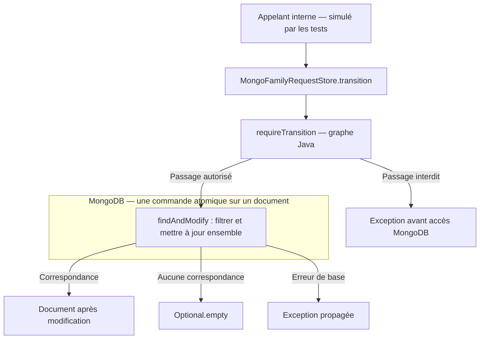
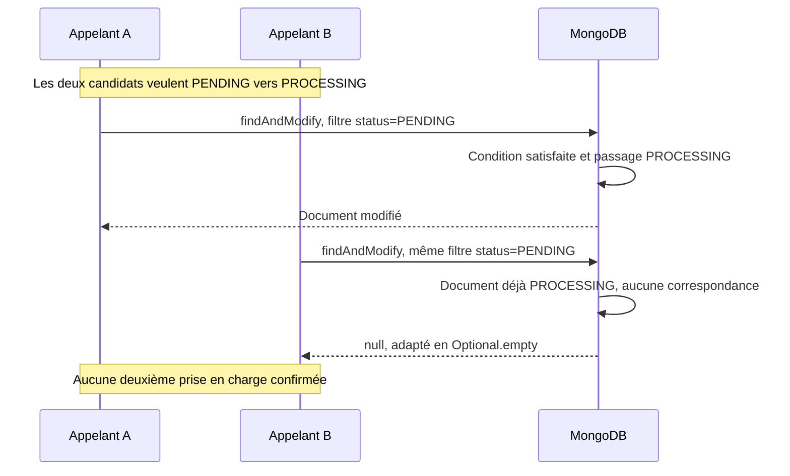

# INT-11 — Sécuriser les mises à jour

| Contexte | Description |
|---|---|
| **Sprint** | [03 — Persistance MongoDB et cycle des états](../../docs/stages/sprint-03-mongodb.md) |
| **Statut** | Terminée sur feu vert « commit ça & push puis go INT-11 » ; INT-12 non commencée |
| **Date des preuves** | 2026-10-22 |
| **Git préalable** | Complément théorique INT-10 commité et poussé avant le développement : `66e0ade` ; changements INT-11 non commités |
| **Périmètre** | Transitions MongoDB conditionnelles et atomiques, dates cohérentes, protection des états finaux et confidentialité du suivi |
| **Vérification exécutée** | 2 nouveaux tests MongoDB et 2 tests unitaires du modèle existants : 4 réussites, aucun échec/erreur/ignoré |

**[Simulation ConfluxLab]** Le code, les personnes et les diagnostics de test sont ceux du laboratoire. Aucun paramétrage ou mécanisme précis n'est attribué au SI historique AXA. Le replica set du complément précédent reste théorique : les tests utilisent toujours un MongoDB standalone.

## Parcours de lecture

1. Sections **1 et 2** : comprendre la course entre deux traitements et pourquoi une commande atomique la résout.
2. Section **3** : commencer par **3.1** pour séparer statut et date, puis lire le filtre, l'Update et les résultats. Le tableau de la section **2** montre pourquoi un second candidat perd même avec une date plus récente.
3. Sections **4 à 6** : comprendre ce que les quatre tests prouvent réellement, leurs commandes et les limites restantes.

### Sommaire

- [1. Problème et vocabulaire](#1-problème-et-vocabulaire)
- [2. Architecture et scénario concurrent](#2-architecture-et-scénario-concurrent)
- [3. Implémentation expliquée](#3-implémentation-expliquée)
- [4. Les tests au strict nécessaire](#4-les-tests-au-strict-nécessaire)
- [5. Commandes et preuves](#5-commandes-et-preuves)
- [6. Limites et réponse d'entretien](#6-limites-et-réponse-dentretien)
- [7. Suivi centralisé](#7-suivi-centralisé)

## 1. Problème et vocabulaire

INT-09 définissait une règle Java : `PENDING → PROCESSING → SUCCEEDED/FAILED`. INT-10 savait insérer et relire les demandes dans MongoDB. **Ces deux acquis ne suffisent pas à faire gagner un seul appelant lors d'une prise en charge concurrente.**

### Trois contrôles différents, à ne pas mélanger

**Un statut n'est pas une date. Le contrôle de date ne détecte pas la présence d'un second candidat.**

| Méthode | Question à laquelle elle répond | Effet |
|---|---|---|
| `StoredFamilyRequest.requireTransition` | « Ce passage entre ces deux statuts est-il autorisé ? » | Valide le graphe, sans date ni accès MongoDB |
| `StoredFamilyRequest.transitionTo` | « Ce passage et cette date sont-ils cohérents pour cet objet Java ? » | Valide le graphe et la chronologie locale, puis retourne un nouvel objet ; aucune sauvegarde |
| `MongoFamilyRequestStore.transition` | « Le document en base correspond-il encore au statut attendu et à la contrainte de date ? » | Vérifie et modifie atomiquement le document ; c'est la protection contre les candidats concurrents |

| Terme | Sens concret |
|---|---|
| **Course / race condition** | Le résultat dépend de l'entrelacement des actions de plusieurs appelants |
| **État attendu** | État que l'appelant exige encore présent au moment de l'écriture |
| **Mise à jour conditionnelle** | Modification effectuée uniquement si le document correspond au filtre |
| **Atomicité sur un document** | MongoDB évalue la condition et modifie ce document comme une opération indivisible vis-à-vis des écritures concurrentes |
| **Compare-and-set, ou CAS** | Idée « modifier seulement si la valeur actuelle est encore celle attendue » ; ici appliquée au statut et à une contrainte de date |
| **Upsert** | Création d'un document si le filtre ne trouve rien ; comportement interdit pour nos transitions |
| **Résultat périmé** | Un appelant agit encore avec un ancien statut alors qu'un autre l'a déjà changé |

### Le contre-exemple à ne pas reproduire

**Illustration pédagogique volontairement incorrecte, non exécutée ; ce n'est pas notre implémentation :**

```java
StoredFamilyRequest request = mongoTemplate.findById(requestId, StoredFamilyRequest.class);
if (request.status() == RequestStatus.PENDING) {
    mongoTemplate.save(request.transitionTo(RequestStatus.PROCESSING, changedAt));
}
```

Deux appelants peuvent lire `PENDING` avant qu'aucun n'ait écrit. Chacun construit alors une valeur `PROCESSING` et croit pouvoir commencer le travail. Le record immuable empêche de modifier son ancienne valeur en place, **pas deux créations de nouvelles valeurs depuis le même état initial**.

Un `synchronized` Java ne protégerait que les appelants partageant ce verrou dans la même JVM. Placer la condition dans MongoDB protège l'accès au document indépendamment du nombre de composants Java qui le sollicitent, à condition qu'ils utilisent cette opération plutôt qu'une écriture contournant ses règles.

## 2. Architecture et scénario concurrent

### Les responsabilités restent limitées

| Fichier réel | Rôle dans INT-11 |
|---|---|
| [`StoredFamilyRequest.java`](../../capability-api/src/main/java/dev/confluxlab/capability/internal/StoredFamilyRequest.java) | Mutualiser la règle du graphe dans `requireTransition`, sans faire d'I/O |
| [`MongoFamilyRequestStore.java`](../../capability-api/src/main/java/dev/confluxlab/capability/internal/MongoFamilyRequestStore.java) | Ajouter `transition`, avec condition et modification dans la même commande MongoDB |
| [`MongoFamilyRequestTransitionTest.java`](../../application/src/test/java/dev/confluxlab/capability/internal/MongoFamilyRequestTransitionTest.java) | Vérifier concurrence, refus, conservation et suivi avec la vraie base de test |
| [`StoredFamilyRequestTest.java`](../../capability-api/src/test/java/dev/confluxlab/capability/internal/StoredFamilyRequestTest.java) | Réutiliser les deux tests de graphe et de dates déjà présents |

L'opération est **interne à Capability** et déclarée dans l'adaptateur MongoDB. `FamilyRequestStore`, utilisé actuellement par le service d'acceptation/consultation, n'est pas élargi. L'interface publique `FamilyRequests`, le BFF et les DTO restent inchangés. Aucun endpoint permettant au client HTTP de choisir un statut n'est créé.

**État du branchement vérifié dans les sources :** `MongoFamilyRequestStore.transition(...)` est appelée dans `MongoFamilyRequestTransitionTest`, mais n'a encore aucun appelant de production. `transitionTo(...)` sert actuellement aux tests du modèle et aux fixtures/comparaisons attendues. Le futur traitement interne n'est pas branché : **POST → insertion `PENDING` ; GET → lecture, sans changement de statut**. Méthode implémentée et testée ne signifie donc pas traitement déjà déclenché.



### Exemple : deux candidats, un seul gagnant



C'est un ordre possible, pas une promesse que A gagnera. Le point décisif est que le second filtre porte sur **la valeur présente au moment de l'opération en base**, pas sur une ancienne lecture en mémoire.

**Exemple pédagogique non exécuté tel quel :** les heures suivantes sont supposées sur la même journée. Deux candidats visent **la même demande, UUID X**, initialement `PENDING` avec `updatedAt = 12:00:00`. Ce ne sont pas deux POST créant deux UUID différents.

| Contrôle / résultat | A passe en premier dans cet exemple | B passe après A |
|---|---|---|
| `expectedStatus` proposé | `PENDING` | `PENDING` |
| `nextStatus` proposé | `PROCESSING` | `PROCESSING` |
| `changedAt` proposé | `12:00:05` | `12:00:06` |
| Statut réellement en base au moment de l'opération | `PENDING` | **`PROCESSING`**, écrit par A |
| `updatedAt` en base au même moment | `12:00:00` | `12:00:05` |
| Condition de date | `00 <= 05` : satisfaite | `05 <= 06` : satisfaite |
| Condition de statut | `PENDING == PENDING` : satisfaite | **`PROCESSING != PENDING` : refusée** |
| Résultat | Document modifié et retourné | `Optional.empty()` |

**B perd même avec une date plus récente : c'est le statut attendu qui ne correspond plus.** Avec la même date `12:00:05`, B serait également refusé : l'égalité des dates est permise, mais le statut a déjà changé. Des UUID différents désignent d'autres documents et ne se bloquent pas par ce filtre.

## 3. Implémentation expliquée

### 3.1. Une seule règle de graphe

`StoredFamilyRequest.requireTransition(currentStatus, nextStatus)` vérifie les arguments et la même règle que la copie locale `transitionTo(...)` :

```java
boolean allowed = switch (currentStatus) {
    case PENDING -> nextStatus == RequestStatus.PROCESSING;
    case PROCESSING -> nextStatus == RequestStatus.SUCCEEDED || nextStatus == RequestStatus.FAILED;
    case SUCCEEDED, FAILED -> false;
};
```

Extrait partiel du code présent. Un passage interdit lève une `IllegalStateException` avant l'accès à MongoDB. `transitionTo(...)` appelle désormais ce helper au lieu de dupliquer le `switch` ; l'adaptateur l'appelle aussi.

`nextStatus` est une valeur de `RequestStatus`, **pas un `Instant`**. La méthode ne cherche pas un statut « daté dans le passé », ne compare pas les positions numériques d'une enum et ne compte pas les candidats : elle vérifie les flèches explicitement autorisées.

| Statut de départ | `nextStatus` | Résultat du graphe |
|---|---|---|
| `PENDING` | `PROCESSING` | Autorisé |
| `PROCESSING` | `SUCCEEDED` ou `FAILED` | Autorisé |
| `PROCESSING` | `PENDING` | Refusé, même avec une date future |
| `PENDING` | `SUCCEEDED` | Refusé : étape sautée |
| `SUCCEEDED` ou `FAILED` | Tout statut | Refusé : état final |

**Attention : valider le couple attendu/cible ne prouve pas que la base contient l'état attendu.** La règle Java dit « ce passage serait autorisé » ; le filtre MongoDB vérifie « ce document est-il encore dans cet état ? ».

#### `transitionTo` : vérifier une date, pas choisir un gagnant

Extrait partiel de `StoredFamilyRequest.transitionTo(...)` :

```java
requireTransition(status, nextStatus);
Objects.requireNonNull(changedAt, "changedAt");
if (changedAt.isBefore(updatedAt)) {
    throw new IllegalArgumentException("A transition cannot precede the last update.");
}
```

- `updatedAt` est la date portée par **cet objet Java** : sa dernière modification représentée, éventuellement issue d'une ancienne lecture.
- `changedAt` est la date proposée par l'appelant pour la nouvelle transition.
- Le `if` refuse que cette nouvelle date précède la précédente. Il ne compare pas avec `Instant.now()` et ne consulte pas la base pour détecter un autre candidat.

**Exemple pédagogique non exécuté tel quel**, sur une même journée : l'objet contient `status = PROCESSING` et `updatedAt = 12:00:10`. On propose `nextStatus = SUCCEEDED`, donc le graphe est valide :

| `changedAt` proposé | Résultat du contrôle de date |
|---|---|
| `12:00:05` | Refusé : la modification serait datée avant la précédente |
| `12:00:10` | Autorisé : l'égalité est permise |
| `12:00:15` | Autorisé : chronologie cohérente |

Si la cible était `PENDING`, `requireTransition` refuserait d'abord le passage, même avec `changedAt = 12:00:15` : **ordre des statuts et ordre des dates sont indépendants**.

Enfin, `transitionTo` retourne un nouveau record sans changer l'ancien ni écrire dans MongoDB. Deux candidats possédant une ancienne valeur `PENDING` peuvent donc tous deux fabriquer localement une valeur `PROCESSING`. Seule l'opération conditionnelle en base détermine qui a effectivement obtenu la prise en charge.

### 3.2. Lire la signature et ses quatre arguments

Extrait de l'adaptateur, avec alignement normalisé :

```java
Optional<StoredFamilyRequest> transition(
        UUID requestId, RequestStatus expectedStatus, RequestStatus nextStatus, Instant changedAt)
```

| Paramètre | Signification |
|---|---|
| `requestId` | Document précis à modifier, identifié par son `_id` UUID |
| `expectedStatus` | Statut que l'on exige encore présent lors de la modification |
| `nextStatus` | Statut cible autorisé par le graphe |
| `changedAt` | Instant fourni par l'appelant interne ; normalisé à la milliseconde avant l'écriture |

Les arguments essentiels ne peuvent pas être `null`. Le temps n'est pas généré par MongoDB dans cette méthode : le futur appelant interne devra choisir son instant, typiquement avec l'horloge de Capability. Cela ne constitue pas une synchronisation des horloges de plusieurs machines.

### 3.3. Le filtre : identité, état et chronologie

Extrait partiel de `transition(...)` :

```java
Instant timestamp = Objects.requireNonNull(changedAt, "changedAt").truncatedTo(ChronoUnit.MILLIS);
Query query = Query.query(Criteria.where("_id").is(requestId)
        .and("status").is(expectedStatus)
        .and("updatedAt").lte(timestamp));
```

- `truncatedTo(MILLIS)` aligne l'instant sur la précision des dates BSON.
- `Criteria` décrit les conditions ; il ne lit pas encore le document.
- `is(...)` correspond à une égalité. `_id` cible la demande, `status` protège contre un appelant périmé.
- `lte(...)` signifie « inférieur ou égal ». Le document ne peut être modifié avec une date antérieure à sa dernière mise à jour.
- Les trois conditions sont réunies par un **ET**.
- `Query.query(...)` construit la requête passée ensuite à MongoDB ; il n'ajoute pas une première lecture cachée dans notre code.

Les deux écritures de la règle de date se lisent ainsi, à la précision retenue :

```text
Dans l'objet Java : refuser si changedAt < updatedAt de cet objet.
Dans MongoDB     : ne retenir que les documents dont updatedAt <= timestamp proposé.
```

La condition MongoDB utilise la valeur **actuellement stockée**, pas celle d'une ancienne copie locale. Elle s'ajoute à la condition de statut ; elle ne la remplace pas. Une date identique reste permise, car deux actions peuvent partager la même résolution d'horloge. Si une horloge recule, l'opération peut ne plus correspondre : on préfère un refus de modification à des dates incohérentes. Cette méthode ne corrige pas automatiquement une horloge ni un document arbitrairement modifié en dehors de notre modèle.

L'index unique `_id` cible déjà au plus un document ; aucune nouvelle collection ni aucun nouvel index n'est nécessaire à cette opération.

### 3.4. L'Update : ne toucher qu'aux champs du cycle

Extrait partiel du code présent :

```java
Update update = new Update().set("status", nextStatus).set("updatedAt", timestamp);
if (nextStatus == RequestStatus.PROCESSING) {
    update.unset("completedAt");
} else {
    update.set("completedAt", timestamp);
}
```

`Update` prépare une modification partielle. `set` correspond à la sémantique MongoDB `$set` ; `unset` à `$unset`, qui retire un champ.

| Passage | `createdAt` | `updatedAt` | `completedAt` |
|---|---|---|---|
| `PENDING → PROCESSING` | Inchangé | Date de la transition | Retiré, donc reconstruit à `null` dans le record |
| `PROCESSING → SUCCEEDED` | Inchangé | Date de la transition | Même date, puisque l'état devient final |
| `PROCESSING → FAILED` | Inchangé | Date de la transition | Même date, puisque l'état devient final |

Le `else` ne peut pas viser `PENDING` : la règle du graphe l'a déjà exclu. L'UUID, le payload et les autres champs du document ne sont pas remplacés par une copie complète devenue potentiellement périmée.

**Aucun schéma d'erreur ou de résultat métier n'est inventé.** Les champs cibles `error?`/`result?` restent différés comme dans INT-10. Le diagnostic ajouté dans un test est une fixture non mappée, pas un nouveau champ du modèle de production.

### 3.5. L'unique commande et ses trois issues

Extrait partiel de l'appel réellement implémenté :

```java
return Optional.ofNullable(mongoTemplate.findAndModify(query, update,
        FindAndModifyOptions.options().returnNew(true).upsert(false), StoredFamilyRequest.class));
```

- **`findAndModify`** combine la sélection conditionnelle et la modification d'un document en une commande atomique. Ce n'est pas notre contre-exemple `findById` suivi d'un remplacement.
- **`returnNew(true)`** demande le document après modification ; le gagnant reçoit donc une valeur `PROCESSING`, pas l'ancien `PENDING`.
- **`upsert(false)`** interdit une création si le filtre ne trouve rien. Une transition n'est pas une nouvelle acceptation de demande.
- **`StoredFamilyRequest.class`** indique le type à reconstruire avec le mapping existant.
- Le `MongoTemplate` est celui configuré dans INT-10 ; aucun nouveau réglage de connexion ou de write concern n'est ajouté.

**Le store ne fait pas `transitionTo(...)` puis une sauvegarde.** Il appelle le helper `requireTransition(...)`, puis applique directement le filtre et l'Update dans MongoDB. Le document retourné est reconstruit en `StoredFamilyRequest` par le mapping.

| Issue | Résultat de la méthode | Interprétation correcte |
|---|---|---|
| Condition satisfaite, modification confirmée | `Optional` contenant le document modifié | L'appelant a remporté cette modification |
| Aucun document correspondant | `Optional.empty()` | UUID absent, statut différent ou date trop ancienne ; pas de diagnostic détaillé distinguant ces causes |
| Erreur de connexion, d'écriture ou de conversion | Exception propagée | Pas un refus concurrent normal ; ne pas la masquer en résultat vide |

Une transition interdite par le graphe est encore un autre cas : elle lève avant cette commande. Un timeout peut toujours laisser l'issue d'une écriture inconnue, comme dans INT-10 ; aucun retry aveugle n'est ajouté.

### 3.6. Pourquoi un état final reste protégé

Après `PROCESSING → FAILED`, une tentative restée sur `expectedStatus=PROCESSING` ne correspond plus au document. Même si sa cible est `SUCCEEDED` et son horodatage plus récent, elle ne gagne pas le droit d'écraser le résultat final.

Une tentative déclarant directement `expectedStatus=FAILED` et une cible `PROCESSING` est, elle, refusée par le graphe Java. Les deux protections ont des rôles complémentaires.

Nous n'ajoutons pas de champ `@Version` : le statut attendu suffit pour **ce graphe sans retour arrière**. Si une future reprise réintroduisait des cycles d'état, il faudrait réévaluer cette hypothèse, notamment le risque de retrouver une ancienne valeur après plusieurs changements. Cette note n'autorise pas cette évolution.

## 4. Les tests au strict nécessaire

Deux méthodes seulement sont ajoutées dans `MongoFamilyRequestTransitionTest`, avec les vrais composants Spring et MongoDB Testcontainers existants. Les deux tests de `StoredFamilyRequestTest` sont réutilisés après mutualisation de la règle.

### 4.1. Deux candidats libérés ensemble

`onlyOneConcurrentCallerCanClaimTheSamePendingRequest` :

1. Insère une demande `PENDING` fictive dans le MongoDB temporaire.
2. Prépare deux tâches dans un `ExecutorService` à deux threads, **uniquement pour le test**.
3. Un `CountDownLatch(2)` permet d'attendre que les deux appelants soient prêts ; un autre compteur à `1` les libère ensemble.
4. Chaque tâche tente la même transition avec le même UUID et le même statut attendu.
5. Les `Future` permettent de récupérer les deux réponses ; une seule doit contenir un document.
6. Le document retourné au gagnant et celui relu en base doivent correspondre à la transition attendue, dates et payload compris.

Pas de `Thread.sleep` ni d'assertion de performance. Les deux appelants sont prêts ensemble, mais l'ordonnanceur peut encore séquencer leurs accès : on teste l'unicité du résultat, pas une simultanéité physique exacte ou tous les entrelacements possibles.

Les attentes sont bornées : 5 s pour les signaux et l'arrêt des workers, 10 s pour récupérer chaque résultat. Le `finally` libère le signal et arrête l'executor même si une assertion échoue. Ces délais sont des gardes de test, pas un dimensionnement d'executor de production.

### 4.2. Refus, états finaux et projection HTTP

`rejectsInvalidOrStaleUpdatesAndKeepsTerminalDataAndTrackingPrivate` vérifie :

- qu'un UUID inconnu n'est pas créé par une transition ;
- qu'un saut direct vers un état final et un retour en attente sont interdits ;
- qu'une date qui recule ne modifie pas le document ;
- les deux fins possibles, `SUCCEEDED` et `FAILED`, dans une petite boucle, sans matrice exhaustive ;
- qu'une ancienne tentative ne remplace pas un état final, même avec une date plus récente ;
- que le payload et les dates d'origine sont préservés et que la date de fin est cohérente.

La fixture ajoute aussi directement en base un champ **`internalDiagnostic`**, avec un marqueur fictif. Ce champ n'appartient pas au record de production : il sert de témoin pour vérifier qu'une modification partielle le conserve sans le divulguer. Après transition, le test le relit dans le document brut, puis fait un GET via `MockMvc` et vérifie l'absence du champ, du marqueur, du payload et des champs d'erreur/trace dans la réponse.

**`FAILED` reste une donnée métier dans un GET `200`.** Cela ne transforme pas la consultation en erreur HTTP `500` et ne réécrit pas le `202` déjà envoyé à l'acceptation. Aucun motif métier structuré d'échec n'est simulé comme fonctionnalité livrée.

`MockMvc` traverse la pile MVC et les vrais beans, mais ne démarre pas le JAR sur un port HTTP. Le serveur MongoDB est réel ; les demandes et diagnostics sont fictifs. Le support commun et sa gestion Docker sont expliqués dans le [cours INT-10](INT-10-persister-avant-d-accepter.md#36-comprendre-le-câblage-des-tests).

## 5. Commandes et preuves

Depuis la racine `conflux-lab/`, avec JDK 21, Maven Wrapper, Docker disponible et les dépendances/images en cache ou téléchargeables :

```sh
./mvnw -B -ntp -pl application -am -Dtest=StoredFamilyRequestTest,MongoFamilyRequestTransitionTest -Dsurefire.failIfNoSpecifiedTests=false test
```

| Option / phase | Effet |
|---|---|
| `-B -ntp` | Mode batch et réduction de la progression des téléchargements |
| `-pl application -am` | Sélectionner l'assemblage et construire ses dépendances Maven |
| `-Dtest=...` | Exécuter seulement les deux classes citées, pas toute la suite |
| `failIfNoSpecifiedTests=false` | Autoriser les modules sans ces noms de tests ; ne masque pas leurs échecs réels |
| `test` | Compiler et exécuter la sélection ; écrire les sorties/rapports locaux, sans produire ni démarrer le JAR Boot |

**Résultat réellement observé : `BUILD SUCCESS`.**

| Module | Classe sélectionnée | Cas | Échecs / erreurs / ignorés |
|---|---|---:|---|
| `capability-api` | `StoredFamilyRequestTest`, existante | 2 | 0 / 0 / 0 |
| `application` | `MongoFamilyRequestTransitionTest`, nouvelle | 2 | 0 / 0 / 0 |
| **Total de cette sélection** | | **4** | **0 / 0 / 0** |

Les deux rapports Surefire correspondants ont été relus, avec une date de génération du 2026-10-22. Il ne faut pas sommer d'anciens rapports d'autres classes laissés dans `target/` pour inventer un total global de cette session. Les avertissements Mockito/JVM d'auto-attachement restent non bloquants sous ce JDK ; ce n'est pas une validation d'un futur JDK.

Après la JVM, la commande de lecture suivante n'a retourné aucun conteneur Testcontainers restant :

```sh
docker ps -a --filter label=org.testcontainers=true --format '{{.ID}} {{.Image}} {{.Status}}'
```

Aucun service distant ou base utilisateur n'a été modifié. Les images restent dans le cache Docker, les conteneurs et données de test sont temporaires. Le complément replica set a été commité/poussé avant INT-11 ; aucun commit/push du travail INT-11 n'est déduit de cette publication préalable.

## 6. Limites et réponse d'entretien

- **Les appelants concurrents sont ceux du test.** Aucun listener, événement Spring, `@Async`, orchestration ou partenaire n'est ajouté ; les POST de l'application restent normalement `PENDING`.
- **L'atomicité vise un document**, pas plusieurs demandes ni MongoDB et un partenaire HTTP dans une transaction commune.
- **Une prise en charge gagnante n'est pas exactly-once.** Si le processus s'arrête juste après la transition, la demande peut rester `PROCESSING`. Pas de reprise automatique, bail, propriétaire ou fencing token ajouté.
- **Ce n'est pas une autorisation de finaliser réservée à un propriétaire.** Un composant interne possédant l'UUID peut tenter une transition depuis `PROCESSING` ; l'opération protège l'état, pas une identité de worker.
- **Les écritures contournant l'adaptateur peuvent contourner les règles.** Aucun validateur de schéma MongoDB ni dispositif d'administration n'est ajouté.
- **Suite globale, ArchUnit, autres tests HTTP, JAR, redémarrage avec la même base et CI non exécutés.** Les sources/tests nécessaires au réacteur ont été compilés, seules les quatre méthodes sélectionnées ont été exécutées. Le dernier résultat global reste historique INT-08, pas une preuve actuelle.
- **INT-12 attend un nouveau feu vert.** Sa démonstration de redémarrage et le raccordement Failsafe ne sont pas anticipés par ces tests `*Test` déjà exécutés par Surefire.

**Formulation d'entretien :**

> « Une lecture suivie d'une sauvegarde ne suffit pas pour prendre une demande en charge : deux traitements peuvent lire le même état. Je place donc l'UUID, le statut attendu et la contrainte de date dans le filtre d'un `findAndModify` MongoDB. La condition et la modification du document sont atomiques : un seul appelant obtient le passage à `PROCESSING`. Les états finaux sont protégés par le graphe et par le statut encore présent en base. Je distingue ce mécanisme d'un traitement exactly-once : il ne fournit ni reprise après crash ni transaction avec un partenaire. »

**Piège :** « `Optional.empty()` veut dire que MongoDB est tombé ? » Non : aucune correspondance n'a été trouvée. Les exceptions de base ne sont pas absorbées dans ce résultat.

**Piège :** « Pourquoi retourner le document modifié plutôt qu'un booléen ? » Pour rendre explicite la valeur obtenue après la modification, avec son statut et ses dates ; cela ne crée ni une deuxième lecture préalable ni un objet HTTP à exposer directement.

## 7. Suivi centralisé

- [TD-B010 — Mises à jour sécurisées, terminées avec preuve](../todos.md#td-b010).
- [TD-R018 — Comparer et modifier atomiquement](../todos.md#td-r018).
- [TD-B011 — Vérifier la persistance et le raccordement Maven, INT-12 à autoriser](../todos.md#td-b011).
