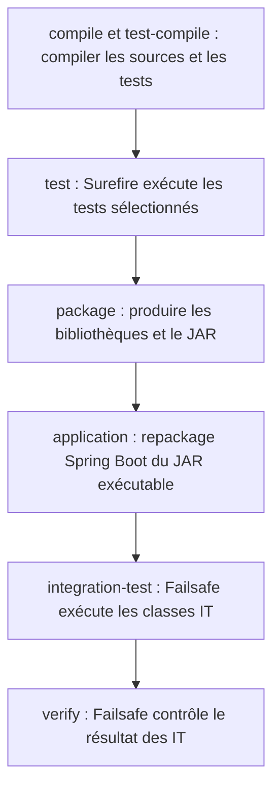
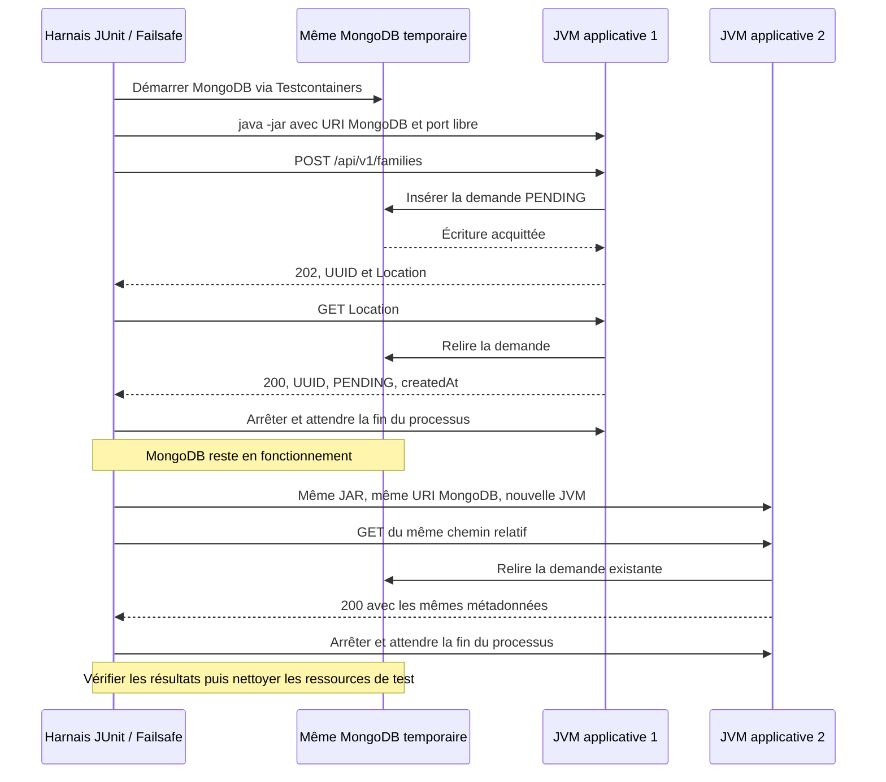

# INT-12 — Vérifier la persistance

> **Repère historique :** les preuves ci-dessous sont celles d'INT-12, en `PENDING`. Depuis [INT-14](../sprint-04/INT-14-publier-et-consommer.md), le test existant attend `PROCESSING` avant le redémarrage puis vérifie sa conservation, sans ajouter de scénario ni prouver une reprise du travail.

| Contexte | Description |
|---|---|
| **Sprint** | [03 — Persistance MongoDB et cycle des états](../../docs/stages/sprint-03-mongodb.md#int-12--vérifier-la-persistance) |
| **Statut** | Terminée sur feu vert « commit 11 & go 12 » ; clôture pédagogique du sprint à confirmer, sans démarrage d'INT-13 |
| **Date des preuves** | 2026-10-22 |
| **Git préalable** | INT-11 commitée localement : `af3f215` — `feat(INT-11): guard MongoDB status transitions atomically` ; aucun push demandé pour cet incrément |
| **Périmètre** | Raccordement Maven Failsafe, réutilisation des tests MongoDB et preuve HTTP de conservation après redémarrage du JAR réel ; aucun code applicatif modifié |
| **Vérification exécutée** | `clean verify` avec 1 cas Surefire sélectionné et 5 cas Failsafe ; 6 réussites, aucun échec/erreur/ignoré |

**[Simulation ConfluxLab]** Les données, outils et résultats sont ceux du laboratoire. Il ne s'agit ni d'une preuve de fonctionnement du SI AXA, ni d'une mesure de performance historique.

À l'issue de cette tâche, les modifications INT-12 restent non commitées. Le commit préalable INT-11 est local, sans push. Ces indications décrivent cette session, pas l'état futur du dépôt.

## Parcours de lecture

1. Sections **1 et 2** : comprendre ce que prouve un redémarrage et pourquoi Maven doit d'abord construire le JAR.
2. Sections **3 et 4** : suivre le câblage Failsafe, le MongoDB commun et les deux processus successifs.
3. Sections **5 à 7** : reproduire la sélection utile, lire les preuves et savoir en expliquer les limites.

### Sommaire

- [1. Problème et vocabulaire](#1-problème-et-vocabulaire)
- [2. Le cycle Maven : tester avant et après le packaging](#2-le-cycle-maven--tester-avant-et-après-le-packaging)
- [3. Fichiers et configuration expliqués](#3-fichiers-et-configuration-expliqués)
- [4. Le test de redémarrage pas à pas](#4-le-test-de-redémarrage-pas-à-pas)
- [5. Commandes et résultats observés](#5-commandes-et-résultats-observés)
- [6. Ce que cette preuve ne garantit pas](#6-ce-que-cette-preuve-ne-garantit-pas)
- [7. Réponse d'entretien](#7-réponse-dentretien)
- [8. Suivi centralisé](#8-suivi-centralisé)

## 1. Problème et vocabulaire

INT-10 a remplacé la mémoire par MongoDB et prouvé l'insertion avant le `202`. INT-11 a sécurisé les transitions concurrentes. Il manquait une preuve visible depuis l'extérieur : **la demande reste-t-elle consultable quand le processus qui l'a acceptée n'existe plus ?**

Relire deux fois avec le même repository ne suffit pas à répondre à cette question. Un stockage mémoire pourrait également réussir cette vérification tant que sa JVM reste vivante.

| Terme | Sens dans ce cours |
|---|---|
| **JVM / processus** | Exécution de Java avec sa propre mémoire ; un nouveau processus ne récupère pas les objets du précédent |
| **PID** | Identifiant du processus attribué par le système ; le test vérifie que les deux lancements sont distincts |
| **JAR Boot** | Artefact exécutable assemblant l'application et ses dépendances, lancé par `java -jar` |
| **Surefire / Failsafe** | Plugins Maven qui exécutent des tests à des moments différents du cycle de construction |
| **Testcontainers** | Bibliothèque de test qui démarre ici un vrai MongoDB temporaire dans Docker |
| **MockMvc** | Outil qui exerce Spring MVC dans le processus de test, sans requête réseau vers un serveur HTTP réel |
| **Harnais de test** | Code JUnit qui prépare la base, lance les processus, envoie les requêtes et vérifie les résultats |
| **Port dynamique** | Port disponible choisi au lancement, plutôt qu'un numéro fixe susceptible d'être déjà occupé |

### Avant et après INT-12

| Avant | Ajout d'INT-12 |
|---|---|
| MongoDB déjà utilisé par l'application | Aucun nouveau stockage de production |
| Tests d'insertion et de transitions nommés `*Test`, exécutés à la phase `test` | Mêmes quatre cas renommés `*IT`, exécutés par Failsafe |
| POST/GET via MockMvc déjà vérifiés | Un seul nouveau scénario HTTP contre le JAR réellement packagé |
| Conservation après redémarrage non démontrée | Première JVM arrêtée, seconde JVM lancée avec la même base, mêmes métadonnées retrouvées |

On n'ajoute donc pas une nouvelle fonctionnalité métier : on rend la vérification de persistance **automatisée et reproductible**.

## 2. Le cycle Maven : tester avant et après le packaging

Schéma simplifié des phases pertinentes, appliquées à chaque module du réacteur :



`verify` n'est pas un autre nom pour `test` : Maven traverse aussi les phases précédentes. Ici, **le JAR doit exister avant le test de redémarrage**, d'où Failsafe après `package`. Le repackage est un goal du plugin Boot rattaché au packaging, pas une phase Maven supplémentaire.

- **Surefire** découvre notamment les classes `*Test` ; `-Dtest` permet d'en sélectionner une classe ou une méthode.
- **Failsafe** découvre notamment les classes `*IT` ; sa sélection spécifique utilise `-Dit.test`.
- Le goal Failsafe `integration-test` exécute les cas et enregistre leurs résultats ; `verify` fait échouer le build si ces résultats contiennent des échecs. Ce découpage permet de traverser la phase de nettoyage `post-integration-test` quand elle est configurée.
- Dans ce projet, le nettoyage des JVM applicatives se fait dans le code Java du test ; aucun goal de déploiement ou de nettoyage d'environnement distant n'est ajouté.

**Piège :** renommer une classe `*IT` sans activer Failsafe pourrait la faire disparaître des tests exécutés. Le nom n'est pas un branchement Maven.

**Autre piège :** un nom `*Test` ne prouve pas qu'un test est unitaire. Des tests HTTP Spring existants restent sous Surefire et utilisent MongoDB. INT-12 ne réorganise pas toute la suite.

## 3. Fichiers et configuration expliqués

### 3.1 Carte des changements

| Fichier | Rôle dans INT-12 |
|---|---|
| [POM racine](../../pom.xml) | Fixer la version de Failsafe à `3.5.4` |
| [POM application](../../application/pom.xml) | Activer ses goals et transmettre le chemin du JAR au processus de test |
| [MongoTestSupport.java](../../application/src/test/java/dev/confluxlab/MongoTestSupport.java) | Exposer l'URI du MongoDB temporaire pour les contextes Spring et les processus enfants |
| [MongoFamilyRequestStoreIT.java](../../application/src/test/java/dev/confluxlab/capability/internal/MongoFamilyRequestStoreIT.java) | Réutiliser les deux cas d'insertion/échec d'INT-10 |
| [MongoFamilyRequestTransitionIT.java](../../application/src/test/java/dev/confluxlab/capability/internal/MongoFamilyRequestTransitionIT.java) | Réutiliser les deux cas de transitions d'INT-11 |
| [FamilyRequestPersistenceIT.java](../../application/src/test/java/dev/confluxlab/FamilyRequestPersistenceIT.java) | Ajouter le seul nouveau cas : redémarrage du JAR et relecture HTTP |

Les sources de production de Capability et d'Experience ne sont pas modifiées. Les anciennes notes INT-10/11 conservent leurs commandes historiques et signalent le renommage de leurs classes.

### 3.2 Gérer une version n'active pas le plugin

Extrait partiel du **POM racine**, sous `build/pluginManagement/plugins` :

```xml
<plugin>
    <groupId>org.apache.maven.plugins</groupId>
    <artifactId>maven-failsafe-plugin</artifactId>
    <version>3.5.4</version>
</plugin>
```

`pluginManagement` fournit une version/configuration de référence aux modules qui utilisent le plugin. Ce bloc, seul, **ne déclenche pas les IT**. L'activation est dans `application/pom.xml`, sous `build/plugins` :

```xml
<plugin>
    <groupId>org.apache.maven.plugins</groupId>
    <artifactId>maven-failsafe-plugin</artifactId>
    <executions>
        <execution>
            <goals>
                <goal>integration-test</goal>
                <goal>verify</goal>
            </goals>
        </execution>
    </executions>
    <configuration>
        <failIfNoTests>true</failIfNoTests>
        <forkedProcessTimeoutInSeconds>180</forkedProcessTimeoutInSeconds>
        <systemPropertyVariables>
            <application.jar>${project.build.directory}/${project.build.finalName}.jar</application.jar>
        </systemPropertyVariables>
    </configuration>
</plugin>
```

- Les goals ont leurs phases par défaut : inutile de recopier explicitement ces phases dans cet extrait.
- `failIfNoTests=true` interdit de déclarer silencieusement les IT réussis si aucun cas n'est découvert dans ce module.
- `forkedProcessTimeoutInSeconds=180` borne la JVM de test forkée par Failsafe. Ce n'est ni le timeout MongoDB ni celui d'une requête HTTP.
- `systemPropertyVariables` transmet une **propriété système Java à la JVM de test**. `application.jar` lui indique quel fichier lancer ; ce n'est pas une propriété de configuration métier de l'application.
- Maven résout le chemin vers `application/target/application-0.1.0-SNAPSHOT.jar` dans cette version. Le test vérifie sa présence avant de lancer le processus enfant.

### 3.3 Conserver la même base pendant les deux lancements

`MongoTestSupport` conserve son conteneur singleton par JVM de test. L'extraction ajoutée est la méthode `mongoUri()` ; extrait partiel :

```java
@DynamicPropertySource
static void mongoProperties(DynamicPropertyRegistry registry) {
    registry.add("spring.data.mongodb.uri", MongoTestSupport::mongoUri);
}

protected static String mongoUri() {
    return "mongodb://" + MONGO.getHost() + ":" + MONGO.getMappedPort(27017) + "/conflux_lab_test"
            + "?serverSelectionTimeoutMS=3000&connectTimeoutMS=3000&socketTimeoutMS=5000&retryWrites=false";
}
```

Pour les tests `@SpringBootTest`, `@DynamicPropertySource` injecte cette URI dans leur contexte Spring. Le nouveau test de redémarrage **n'a pas cette annotation de test Spring** : il appelle directement `mongoUri()` et transmet la valeur aux deux applications enfants.

Le conteneur utilise l'image officielle **`mongo:8.0.16`**, en standalone. Docker attribue un port accessible depuis les JVM locales. La base `conflux_lab_test` est isolée des données utilisateur et reçoit des UUID de test ; elle n'est pas supprimée entre les deux lancements du scénario. Testcontainers supprime le conteneur après la JVM de test. Des JVM de test différentes, par exemple Surefire et Failsafe, ne partagent pas nécessairement le même singleton.

Le cache WiredTiger est réglé à **0,25 Gio** : cela ne plafonne pas toute la mémoire du conteneur. Aucun replica set ou volume utilisateur n'est créé.

## 4. Le test de redémarrage pas à pas

Le schéma ci-dessous décrit **le scénario implémenté et exécuté**, pas une cible future :



La JVM du harnais est un outil de test, **pas un second service métier déployé**. Les deux JVM applicatives sont successives : le premier processus est confirmé arrêté avant le démarrage du second. Chaque lancement contient toujours le même monolithe modulaire, avec appel Java interne Experience → Capability.

### 4.1 Lancer le véritable artefact

Extrait partiel de `FamilyRequestPersistenceIT.start(...)` :

```java
String java = Path.of(System.getProperty("java.home"), "bin", "java").toString();
Process process = new ProcessBuilder(java, "-jar", jar.toString(),
        "--server.address=127.0.0.1", "--server.port=0", "--spring.data.mongodb.uri=" + mongoUri())
        .redirectErrorStream(true)
        .redirectOutput(log.toFile())
        .start();
```

- `java.home` choisit le Java de la JVM de test : on ne dépend pas d'un autre exécutable trouvé par hasard dans le `PATH`.
- `ProcessBuilder` reçoit une liste d'arguments, pas une commande interprétée par un shell ; le chemin du JAR reste un seul argument même s'il contient des espaces.
- `127.0.0.1` limite l'écoute HTTP à la machine locale ; `0` demande à Tomcat un port disponible.
- L'argument Spring `spring.data.mongodb.uri` force la même base temporaire pour chaque enfant, au lieu de la base locale par défaut.
- Les sorties standard et d'erreur sont réunies dans un fichier de log : elles restent consultables en cas d'échec sans bloquer sur un pipe non consommé.

### 4.2 Attendre un signal, pas une durée arbitraire

Le test recherche `Tomcat started on port (\d+)` dans le log et construit l'origine HTTP avec le port trouvé. Il vérifie toutes les **100 ms**, au plus **40 s**, que le processus est vivant et que ce signal est apparu.

Ce n'est pas « dormir 5 secondes puis espérer » : si l'application démarre plus vite, le test poursuit ; si elle sort ou dépasse la limite, l'erreur indique le fichier à inspecter et le processus est arrêté.

**Compromis :** le signal dépend du format de log Tomcat/Boot actuel. Ce n'est pas un health check universel ni une preuve suffisante que MongoDB fonctionne. Ce sont les POST/GET suivants qui vérifient réellement le parcours et l'accès à la base.

### 4.3 Enregistrer puis comparer les métadonnées

Le `HttpClient` Java envoie de vraies requêtes réseau, avec un délai de connexion et un délai par requête de **5 s**. Après le POST, le test vérifie `202`, un UUID valide, `PENDING` et la cohérence de `Location` avec `statusUrl`.

Le premier GET doit répondre `200` avec **exactement trois champs** : `requestId`, `status`, `createdAt`. La date doit être un `Instant` valide. Le chemin `Location` est relatif : après redémarrage, le test le résout contre le **nouveau port**, pas contre l'adresse de l'ancien processus.

Extrait partiel du second lancement :

```java
RunningApplication second = start(jar, reports.resolve("persistence-after-restart.log"));
try (second) {
    assertNotEquals(first.process().pid(), second.process().pid(), "The restart must use a new JVM.");
    HttpResponse<String> lookup = get(client, second.origin().resolve(location));
    assertEquals(200, lookup.statusCode(), lookup.body());
    assertEquals(beforeRestart, mapper.readTree(lookup.body()),
            "UUID, PENDING and original createdAt must survive the application restart.");
}
```

`JsonNode` compare le contenu JSON, pas l'ordre textuel des propriétés. L'égalité vérifie donc ensemble l'UUID, le statut et la date initiale, sans exposer le payload. Aucun second POST n'est envoyé pour recréer la demande après redémarrage.

### 4.4 Fermer les ressources même en cas d'assertion en échec

`RunningApplication` implémente `AutoCloseable`. Les blocs `try (...)` appellent `close()` même si une assertion échoue : arrêt du processus, attente de **10 s**, puis arrêt forcé et attente supplémentaire de **5 s** si nécessaire. Le chemin d'échec du démarrage prévoit lui aussi un arrêt forcé. Le client HTTP est également fermé.

Le test affirme explicitement que la première JVM est morte avant la seconde et que la seconde est arrêtée après la preuve. Ce nettoyage concerne les processus lancés par ce test, pas des services utilisateur. La suppression du MongoDB temporaire relève de Testcontainers.

## 5. Commandes et résultats observés

### 5.1 Préconditions et commande exécutée

**Répertoire de départ : racine du dépôt `conflux-lab/`.** Prérequis : JDK 21, Docker accessible et dépendances Maven/image disponibles ou téléchargeables. Les versions observées sont Spring Boot **3.5.7**, Testcontainers **1.21.4** et Docker **29.8.0**.

```sh
./mvnw -B -ntp '-Dtest=ModuleArchitectureTest#experienceOnlyUsesThePublicCapabilityApi' -Dsurefire.failIfNoSpecifiedTests=false clean verify
```

| Élément | Explication et effet |
|---|---|
| `./mvnw` | Utiliser Maven via le Wrapper du dépôt ; pas besoin de Maven installé séparément |
| `-B` / `-ntp` | Mode batch, sans progression des téléchargements |
| `-Dtest=...#...` | Exécuter un seul contrôle Surefire existant de frontière Experience/Capability, pas toute la suite |
| `-Dsurefire.failIfNoSpecifiedTests=false` | Ne pas échouer dans les autres modules simplement parce qu'ils ne contiennent pas ce test précis |
| `clean` | Supprimer les sorties générées `target/`, pas les sources ; ici utile pour éliminer les anciennes classes compilées après renommage `*Test` → `*IT` |
| `verify` | Compiler et packager le réacteur, puis exécuter et contrôler les IT Failsafe du module d'assemblage |

**`-Dtest` ne filtre pas Failsafe.** Sans `-Dit.test`, les trois classes `*IT` sont découvertes normalement. Sélectionner les IT utiliserait `-Dit.test` ; aucune sélection supplémentaire de ce type n'a été exécutée ici.

Cette commande écrit des fichiers locaux, démarre un MongoDB Docker temporaire et deux applications locales successives. Elle ne publie aucun artefact distant et ne fait ni commit ni push. La résolution de dépendances ou d'image peut nécessiter le réseau ; aucune donnée réelle n'est utilisée.

### 5.2 Résultat du passage

**Résultat observé : `BUILD SUCCESS`, environ 31 s pour la commande complète.** Les goals `failsafe:integration-test` et `failsafe:verify` ont tous deux été observés.

| Plugin / classe | Cas exécutés | Origine |
|---|---:|---|
| Surefire — `ModuleArchitectureTest` | 1 | Contrôle existant sélectionné |
| Failsafe — `MongoFamilyRequestStoreIT` | 2 | Cas INT-10 réutilisés : insertion/collision et échec d'insertion simulé sans faux reçu |
| Failsafe — `MongoFamilyRequestTransitionIT` | 2 | Cas INT-11 réutilisés : prise en charge concurrente et refus/protection des états finaux |
| Failsafe — `FamilyRequestPersistenceIT` | 1 | Seul nouveau scénario : conservation entre deux JVM applicatives |
| **Total sélectionné** | **6** | **0 échec, 0 erreur, 0 ignoré** |

Les deux anciens tests MongoDB sont renommés, pas recopiés ni rejoués sous leurs anciens noms. Le test de panne d'insertion reste **simulé par une doublure**, même si les autres chemins d'intégration utilisent MongoDB réel. Ce n'est pas un test de coupure réseau du serveur.

Le passage compile et package tous les modules, **sans exécuter toutes leurs suites Surefire**. Le dernier résultat non filtré documenté reste celui d'INT-08 : 181 cas à cette étape historique, pas le total courant validé.

### 5.3 Preuve concrète du redémarrage

| Élément | Avant | Après |
|---|---|---|
| JAR | `application-0.1.0-SNAPSHOT.jar` | Même fichier |
| PID de l'application | `591557` | `591651` |
| Port HTTP | `43047` | `32929` |
| MongoDB | `localhost:32773`, base `conflux_lab_test` | Même endpoint et même base, maintenus en fonctionnement |
| Demande | `3bfc5530-6199-402c-ace1-c54f18d6c9ae` | Même UUID |
| Statut | `PENDING` | `PENDING` |
| `createdAt` | Date initiale du premier GET | Égalité vérifiée par assertion ; valeur exacte non imprimée |

Les PID et ports sont des observations de cette exécution, pas des valeurs à copier dans une configuration. Ils changent normalement à la prochaine exécution. Les deux JVM ont été arrêtées ; le contrôle Docker après le test ne trouvait plus de conteneur Testcontainers.

Rapports et traces locaux consultés :

- `application/target/surefire-reports/TEST-dev.confluxlab.ModuleArchitectureTest.xml` : 1 cas, tous les compteurs d'échec à zéro ;
- `application/target/failsafe-reports/TEST-*.xml` : trois classes, 5 cas réussis ;
- `application/target/failsafe-reports/failsafe-summary.xml` : 5 cas terminés, aucun échec/erreur/ignoré, pas de timeout ;
- `application/target/failsafe-reports/persistence-before-restart.log` et `persistence-after-restart.log` : PID, ports HTTP et même MongoDB.

Ces sorties sont sous `target/`, **ignorées par Git**. Elles ne sont pas commitées et un futur `clean` les supprimera ; cette note conserve la synthèse des preuves. La rédaction documentaire n'a pas provoqué de nouveau build.

### 5.4 Commande plus large disponible, non exécutée telle quelle

```sh
./mvnw -B -ntp verify
```

Depuis la même racine et avec les mêmes prérequis, cette commande est configurée pour exécuter les suites Surefire puis les IT Failsafe. **Elle n'a pas été lancée sans filtre dans INT-12** : ne pas lui attribuer le résultat des six cas sélectionnés.

Elle n'est pas nécessaire à relancer pour lire ou réécrire ce cours. De même, la recette manuelle du [README](../../README.md#démarrage-local), avec conteneur nommé et volume Docker conservé, reste un exemple non exécuté ici ; le test automatisé n'utilise pas ce volume.

## 6. Ce que cette preuve ne garantit pas

| Ce qui est vérifié | Limite à conserver |
|---|---|
| Même demande consultable après arrêt puis nouveau lancement de l'application | Pas de crash brutal ou redémarrage de MongoDB, pas de perte du disque testée |
| MongoDB maintenu entre les deux JVM | Ni sauvegarde, ni réplication, ni haute disponibilité démontrées |
| POST `202` puis GET `200` sur le JAR réel | Le `202` ne signifie toujours pas « famille créée » ; aucun traitement n'est lancé |
| `PENDING` identique après redémarrage | C'est normal : il n'existe encore ni événement, ni listener `@Async`, ni orchestration de production |
| Quatre scénarios MongoDB réutilisés et un redémarrage ajoutés | Pas de nouvelle matrice exhaustive ni d'exécution de toutes les suites |
| Failsafe réellement exécuté pendant `verify` ciblé | Aucun workflow CI créé ou exécuté, aucune CI verte revendiquée |
| Une seule application métier à la fois | Les processus de test ne changent pas l'architecture en plusieurs services déployables |
| Stories techniques INT-09 à INT-12 réalisées | Compréhension de l'apprenant et clôture pédagogique non évaluées ; aucun feu vert INT-13 déduit |

Créer deux contextes Spring dans une seule JVM aurait vérifié la recréation de beans et leur relecture de MongoDB, mais pas le redémarrage du **processus et du JAR exécutable**. À l'inverse, redémarrer MongoDB lui-même explorerait une autre panne ; ce n'est pas nécessaire au critère retenu dans INT-12.

## 7. Réponse d'entretien

### Formulation en 30–60 secondes

> Dans le laboratoire, j'ai vérifié la persistance depuis le JAR réellement livré, pas seulement avec un repository ou MockMvc. Maven construit d'abord le JAR Boot, puis Failsafe exécute un scénario qui crée une demande par HTTP, arrête l'application et relance le même artefact dans une nouvelle JVM avec la même base MongoDB Testcontainers. Le GET retrouve exactement l'UUID, le statut et la date initiale. Les quatre tests MongoDB existants ont été réutilisés ; seul ce scénario est nouveau. Le passage ciblé a réussi avec six cas, mais ce n'est ni toute la suite ni un test de redémarrage MongoDB. Cela ne prouve pas non plus une sauvegarde, de la réplication ou l'exécution du traitement métier.

Cette formulation décrit **ConfluxLab**, pas une réalisation historique AXA à attribuer sans preuve à l'utilisateur.

### Deux relances et leurs corrections

**« `mvn test` suffit puisque le test s'appelle `IT` ? »** Non. Le nom ne déclenche aucun plugin. Ici les `*IT` sont exécutés par Failsafe après `package`, et leur résultat est contrôlé à `verify`. Le scénario a besoin du JAR produit dans ce même cycle.

**« Si le test passe, les données résisteront à une perte du disque MongoDB ? »** Non. On a remplacé la JVM applicative en conservant MongoDB vivant. On prouve l'indépendance vis-à-vis de la mémoire de l'application, pas la récupération après destruction de son stockage externe.

## 8. Suivi centralisé

- [TD-B011 — Persistance et raccordement Maven : action terminée avec preuves](../todos.md#td-b011).
- [TD-R019 — Cycle Maven et persistance entre deux JVM : repère de cours](../todos.md#td-r019).
