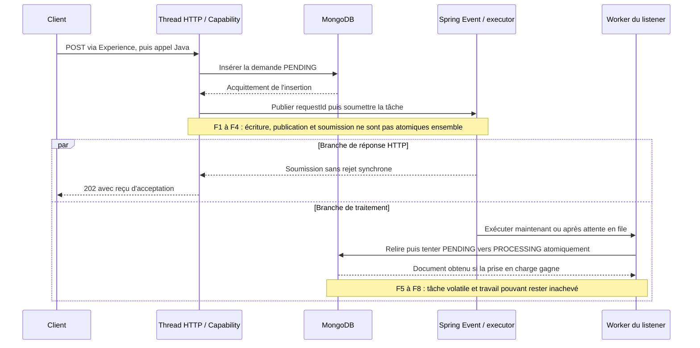
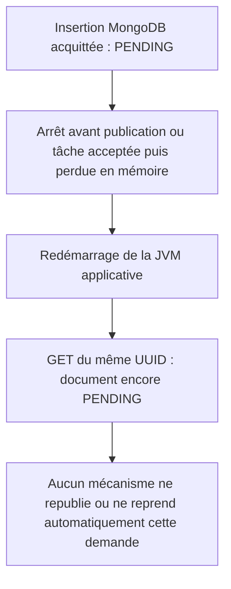
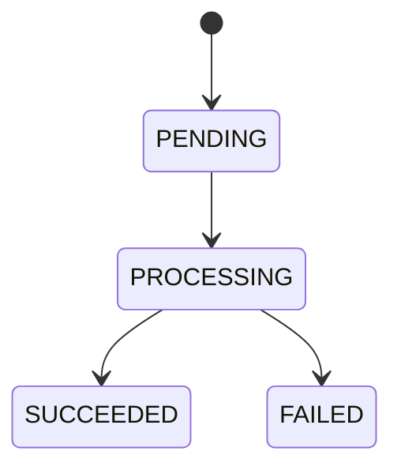

# INT-13 — Dessiner les fenêtres de panne

| Contexte | Description |
|---|---|
| **Sprint** | [04 — Spring Events locaux et traitement asynchrone](../../docs/stages/sprint-04-async.md#int-13--dessiner-les-fenêtres-de-panne) |
| **Statut** | Analyse documentaire réalisée sur feu vert « go 13 » ; INT-14 à INT-16 non commencées |
| **Date** | 2026-10-22 |
| **Point de départ** | INT-11 et INT-12 commitées et poussées ; HEAD initial `470494b`. Les stories techniques du sprint 03 sont terminées, sa clôture pédagogique n'est pas évaluée |
| **Périmètre** | Dessiner le flux cible, expliquer les réponses HTTP et les états possibles lors des pannes ; aucun code Java, POM ou paramètre d'exécution modifié |
| **Nature des preuves** | Lecture du code existant et revue statique du scénario ; aucune panne asynchrone provoquée, aucun test ni build exécuté |

**[Simulation ConfluxLab]** Les mécanismes étudiés appartiennent au laboratoire. Aucun réglage de pool, comportement de rejet ou mécanisme de reprise précis n'est attribué à AXA.

**[Proposition — cible non implémentée]** Tous les schémas avec publication, executor ou listener décrivent les incréments suivants. Les dessiner ne signifie pas qu'ils sont déjà câblés dans l'application, ni qu'INT-14/15 sont autorisées.

## Parcours de lecture

1. Sections **1 et 2** : distinguer ce que fait aujourd'hui le POST de ce que l'on prépare.
2. Sections **3 et 4** : suivre les deux branches concurrentes et repérer les fenêtres de panne.
3. Sections **5 à 7** : comprendre le rejet, les limites du statut et les preuves encore absentes.

### Sommaire

- [1. Le problème et les mots utiles](#1-le-problème-et-les-mots-utiles)
- [2. Le point de départ réellement implémenté](#2-le-point-de-départ-réellement-implémenté)
- [3. Le flux cible et les deux ordres possibles](#3-le-flux-cible-et-les-deux-ordres-possibles)
- [4. Carte des fenêtres de panne](#4-carte-des-fenêtres-de-panne)
- [5. Rejet de soumission et exception du worker](#5-rejet-de-soumission-et-exception-du-worker)
- [6. Statuts, reprise et limites à ne pas masquer](#6-statuts-reprise-et-limites-à-ne-pas-masquer)
- [7. Vérifications, commandes et preuves](#7-vérifications-commandes-et-preuves)
- [8. Réponse d'entretien](#8-réponse-dentretien)
- [9. Suivi centralisé](#9-suivi-centralisé)

## 1. Le problème et les mots utiles

Une demande peut être **enregistrée** sans être **traitée**. MongoDB garde un document, mais l'événement et la tâche asynchrone ne disposent pas automatiquement de la même durabilité.

L'objectif n'est donc pas seulement de faire fonctionner un listener. Il faut pouvoir répondre à deux questions différentes :

1. Qu'a pu recevoir le client HTTP ?
2. Que reste-t-il réellement en base, et qui fera avancer ce document ?

| Terme | Sens concret dans le labo |
|---|---|
| **Fenêtre de panne** | Intervalle entre deux actions pendant lequel un arrêt peut laisser un état incomplet |
| **Événement Spring local** | Notification entre composants de la même application ; ni message réseau ni enregistrement durable |
| **Publication** | Appel au mécanisme Spring qui distribue l'événement aux listeners ; pas un acquittement de travail terminé |
| **Listener** | Méthode qui réagit à l'événement ; `@EventListener` ne la rend pas asynchrone à lui seul |
| **Executor** | Composant qui reçoit des tâches et fournit les threads qui les exécutent |
| **Soumission** | Remise d'une tâche à l'executor ; elle peut être exécutée rapidement, attendre en file ou être refusée |
| **Worker** | Thread qui exécute la tâche, distinct du thread HTTP dans la cible `@Async` |
| **Prise en charge** | Ici, transition atomique `PENDING → PROCESSING`, pas simplement retrait d'une tâche de la file |
| **Rejet** | Refus de soumettre une tâche, par exemple à saturation ou pendant l'arrêt de l'executor |
| **Abandon** | Document laissé sans traitement capable de le faire avancer ; aucun mécanisme de reprise automatique n'existe actuellement |

Une file d'executor est en mémoire de la JVM. Une tâche acceptée dans cette file ne devient pas durable parce que son `requestId` figure dans MongoDB.

## 2. Le point de départ réellement implémenté

### 2.1 Le POST actuel attend seulement l'insertion

Extrait partiel de [FamilyRequestService.java](../../capability-api/src/main/java/dev/confluxlab/capability/internal/FamilyRequestService.java), après validation et création du snapshot :

```java
UUID requestId = UUID.randomUUID();
StoredFamilyRequest stored = StoredFamilyRequest.pending(
                requestId, snapshot, Instant.now(clock).truncatedTo(ChronoUnit.MILLIS));
store.save(stored);
return new RequestAccepted(requestId, stored.status(), "/api/v1/requests/" + requestId);
```

`store.save(...)` appelle `MongoTemplate.insert(...)`. Le [MongoTemplate configuré](../../capability-api/src/main/java/dev/confluxlab/capability/internal/FamilyRequestConfiguration.java) exige `majority` et journalisation. Le service construit le reçu **après** le retour de l'insertion, mais ne publie encore rien.

Le [contrôleur Experience](../../experience-api/src/main/java/dev/confluxlab/experience/FamilyController.java) transforme ensuite le reçu en réponse :

```java
return ResponseEntity.accepted()
        .location(URI.create(statusUrl))
        .body(publicResponse);
```

Construire ce `ResponseEntity` n'est pas encore la preuve que les octets ont atteint le client. Une coupure pendant l'envoi peut laisser le client sans reçu alors que MongoDB contient déjà la demande.

### 2.2 La gestion d'erreur HTTP existante

Extrait partiel de [ApiExceptionHandler.java](../../experience-api/src/main/java/dev/confluxlab/experience/ApiExceptionHandler.java) :

```java
@ExceptionHandler(Exception.class)
public ResponseEntity<ProblemDetail> handleUnexpected(Exception exception) {
    return ResponseEntity.internalServerError().body(problem(HttpStatus.INTERNAL_SERVER_ERROR));
}
```

Une exception inattendue qui remonte dans le traitement MVC peut donc produire un **`500` générique**, tant que la réponse peut encore être construite. Un processus tué ne passe pas par cet advice : il peut simplement couper la connexion. Aucun mapping spécifique de saturation en `503` n'est livré.

### 2.3 Ce qui manque encore

La recherche dans les sources Java de production ne trouve ni `ApplicationEventPublisher`, ni `@EventListener`, ni `@EnableAsync`/`@Async`, ni configuration explicite `ThreadPoolTaskExecutor`. Les transitions MongoDB d'INT-11 n'ont toujours que des appelants de test. Les demandes acceptées restent normalement `PENDING`.

Le résultat historique d'[INT-12](../sprint-03/INT-12-verifier-la-persistance.md) prouve qu'un document survit au redémarrage de l'application avec la même base. Il ne prouve pas qu'un traitement redémarre : aucun traitement n'existait dans cette démonstration.

## 3. Le flux cible et les deux ordres possibles

### 3.1 Hypothèses de lecture, non configuration livrée

**[Proposition]** Pour raisonner sur INT-14/15, on considère un seul listener métier `@Async`, appelé via le mécanisme Spring, et un executor dédié borné. Le distributeur d'événements reste synchrone : il appelle le proxy du listener, qui **soumet** le travail à l'executor. Ce n'est pas le distributeur lui-même qui est rendu asynchrone.

La cible étudiée ne supprime pas silencieusement les tâches refusées. Un rejet de soumission remonte au demandeur si aucun composant ne l'absorbe. La configuration exacte, les capacités et le traitement des erreurs restent à implémenter/tester dans leurs stories ; aucun nombre de threads ou taille de file n'est décidé ici.

### 3.2 Une dépendance obligatoire, puis deux branches

**Schéma cible non implémenté — cas nominal :**



Les deux branches partent de la soumission ; il n'y a **aucune flèche « réception du `202` → démarrage du listener »**. Une tâche peut commencer avant même que l'appel de soumission ait rendu la main au thread HTTP. « Mise en file » ne signifie pas qu'elle attend obligatoirement : un thread libre peut la prendre immédiatement.

### 3.3 Deux entrelacements valides

**Illustrations pédagogiques non exécutées :**

| Ordre possible | Conséquence |
|---|---|
| Insertion → soumission → `202` reçu → prise en charge | Un premier GET peut encore voir `PENDING` |
| Insertion → soumission → prise en charge → `202` reçu | Un premier GET peut déjà voir `PROCESSING`, voire un état final lorsque le traitement complet existera |

Le reçu du POST peut annoncer `PENDING` comme état d'acceptation initial, alors que le document a déjà progressé. Cela ne veut pas dire que l'on doit réécrire le document à `PENDING` pour le faire correspondre au reçu. Le GET relit l'état courant.

## 4. Carte des fenêtres de panne

### 4.1 Comment lire la réponse possible

Dans la cible étudiée, la publication et la soumission précèdent la construction du reçu. Pour une panne **avant cette soumission**, on ne suppose donc pas un `202` déjà reçu.

Après soumission, HTTP et worker avancent indépendamment. Les colonnes ci-dessous ne forment pas une chronologie unique : **un même état MongoDB peut correspondre à des observations HTTP différentes**.

Un arrêt brutal peut couper la connexion sans réponse exploitable. Un `202` déjà reçu ne se transforme jamais rétroactivement en `500` ; une réponse d'erreur n'est possible que si la requête peut encore être traitée et si l'erreur lui remonte.

### 4.2 Tableau des pannes

**Analyse de la cible, pas résultats de tests.** On suppose un parcours unique, sans modification administrative du document ni perte du stockage MongoDB.

| Repère / moment | Réponse possible pour le client | État possible du document | Risque ou réaction attendue |
|---|---|---|---|
| **F1 — Avant insertion ou pendant l'écriture, sans acquittement reçu** | Refus de validation `400` si entrée invalide ; échec technique interceptable `500` ; timeout/coupure si le processus disparaît | Absent si aucun enregistrement n'a eu lieu ; **éventuellement `PENDING`** si MongoDB a écrit mais que l'acquittement s'est perdu | Une erreur d'écriture ne prouve pas l'absence en base ; ne pas publier sans confirmation |
| **F2 — Insertion confirmée, avant toute soumission : arrêt ou échec de publication** | `500` si exception remontée et réponse encore possible ; sinon timeout/coupure. Pas de `202` construit dans cette branche cible | `PENDING`, `updatedAt == createdAt`, pas de `completedAt` | Document présent mais aucune tâche soumise ; un redémarrage ne republie rien automatiquement |
| **F3 — Soumission refusée : saturation ou executor arrêté** | Sous l'hypothèse d'un rejet propagé, erreur avant le reçu ; l'advice actuel donnerait `500`. Aucun `503` spécifique implémenté | `PENDING` si aucune autre tâche ne l'a prise ; aucun rollback de l'insertion | Ne pas masquer le rejet puis annoncer que la soumission a réussi ; ne pas inventer `PENDING → FAILED` |
| **F4 — Soumission acceptée, tâche encore en attente, puis arrêt de la JVM** | `202` peut déjà avoir été reçu ; sinon timeout/coupure possible | `PENDING` | La file en mémoire disparaît ; la présence du document n'assure pas sa consommation |
| **F5 — Worker démarré, mais échec de lecture ou arrêt avant la prise en charge confirmée** | Le POST peut continuer vers `202`, l'avoir déjà envoyé ou être coupé ; l'erreur du worker ne revient pas automatiquement au thread HTTP | `PENDING` si aucune transition n'a été faite | Démarrer un thread ne suffit pas à faire progresser la demande ; erreur à diagnostiquer, pas de reprise livrée |
| **F6 — Commande de prise en charge envoyée, mais réponse MongoDB perdue** | Même indépendance entre HTTP et worker | `PENDING` **ou `PROCESSING`** : l'issue de la commande est inconnue pour l'appelant | Ne pas traiter un timeout comme une certitude d'absence de modification ou comme un simple `Optional.empty()` |
| **F7 — Prise en charge confirmée, puis arrêt ou exception pendant le travail** | `202` déjà reçu reste valable ; s'il ne l'est pas encore, la réponse HTTP peut encore réussir ou être interrompue | `PROCESSING` si l'arrêt précède toute écriture terminale ; `FAILED` si un futur handler a fait appliquer cette transition, même si son acquittement est ensuite perdu | Sans handler et sans reprise, la demande peut rester bloquée. Mettre à jour l'état peut lui-même échouer |
| **F8 — Travail effectué, mais état final non confirmé, ou reçu HTTP perdu** | `202` possible si le POST termine ; sinon timeout/coupure malgré le travail. Un `202` reçu reste inchangé | `PROCESSING` ou état final si son écriture a réussi ; en cas de seul échec d'envoi HTTP, l'état déjà atteint reste conservé | HTTP, statut et effet partenaire ne forment pas une transaction unique. La répétition n'est pas automatiquement sûre |

F8 anticipe seulement le risque du futur travail métier : **aucun appel partenaire ou orchestrateur n'est ajouté par INT-13**.

### 4.3 Le cas essentiel : enregistré mais jamais pris en charge

**Schéma de panne cible, non exécuté :**



Le résultat n'est pas contradictoire : **la donnée a survécu, le signal de traitement non**. Le test de persistance INT-12 ne suffit donc pas à valider la fiabilité de la future exécution asynchrone.

## 5. Rejet de soumission et exception du worker

### 5.1 Le rejet arrive sur le chemin de soumission

Avec le distributeur synchrone et le listener `@Async` de l'hypothèse, l'appel de publication atteint le proxy Spring qui tente la soumission. Un rejet peut alors remonter sur ce chemin, avant le retour du service. C'est différent d'une erreur levée **à l'intérieur du corps du listener**, une fois la tâche acceptée.

Si ce rejet remonte jusqu'à MVC sans mapping spécifique, le handler générique existant correspondrait à un `500`, **pas à un `202`**. Ce résultat devra être testé avec le véritable câblage ; il n'est pas démontré par une simple lecture de l'advice.

L'insertion préalable n'est pas annulée. Il peut donc rester un `PENDING` avec une erreur HTTP. Ici, « ne pas donner de faux `202` » signifie **ne pas cacher un rejet connu au moment de répondre** ; cela ne transforme pas toute tâche acceptée en travail durable.

### 5.2 Toutes les politiques de rejet ne conviennent pas

| Politique, expliquée à titre théorique | Effet | Pourquoi ce n'est pas équivalent |
|---|---|---|
| Rejet explicite, par exemple `AbortPolicy` / exception de soumission | Refuser lorsque l'executor ne peut pas accepter | Permet de ne pas masquer le refus ; mapping et test restent à réaliser dans INT-15 |
| `CallerRunsPolicy` | Faire exécuter la tâche par l'appelant lors de la saturation, si l'executor n'est pas arrêté | Peut bloquer le thread HTTP sur le travail métier ; ce n'est plus le découplage attendu. À l'arrêt, cette politique peut ne rien exécuter |
| `DiscardPolicy` / `DiscardOldestPolicy` | Supprimer silencieusement une tâche, nouvelle ou déjà en attente | Peut laisser une demande `PENDING` sans signal exploitable de refus ; incompatible avec l'exigence de refus observable |

Ces noms expliquent des alternatives, **pas une configuration déjà choisie et livrée**. Ajouter un second niveau asynchrone sur le distributeur d'événements déplacerait également le lieu d'observation du rejet : on ne peut pas conserver ce raisonnement sans revoir le câblage et ses tests.

### 5.3 L'exception du worker ne réécrit pas le POST

Pour un listener `@Async void`, l'appelant n'attend pas une valeur de retour qui transporterait l'exception du travail. Le mécanisme `AsyncUncaughtExceptionHandler` permet de traiter les exceptions non capturées de cette méthode ; **il n'est pas un rollback MongoDB ni une reprise automatique**.

INT-15 devra rendre les échecs observables et garder les statuts cohérents si la base est disponible. Si MongoDB est lui-même indisponible, on ne peut pas promettre un `FAILED` persisté. Une erreur survenue avant la prise en charge ne justifie pas de simuler une prise en charge pour « rendre le statut joli ».

Avec plusieurs listeners, une publication pourrait aussi échouer **après** qu'un autre listener a soumis une tâche. Une erreur du publisher ne prouverait alors pas l'absence de travail. Le tableau F2 est volontairement limité au cas **avant toute soumission** ; le scénario pédagogique vise un seul listener métier.

## 6. Statuts, reprise et limites à ne pas masquer

### 6.1 Garder le graphe et la concurrence séparés de la panne HTTP

Le [modèle actuel](../../capability-api/src/main/java/dev/confluxlab/capability/internal/StoredFamilyRequest.java) autorise seulement :



- Un rejet avant prise en charge **ne permet pas** `PENDING → FAILED` dans ce graphe. L'ajouter serait une décision de modèle distincte, pas une correction documentaire implicite.
- Le futur listener doit conditionner le travail à la prise en charge atomique de [MongoFamilyRequestStore.transition(...)](../../capability-api/src/main/java/dev/confluxlab/capability/internal/MongoFamilyRequestStore.java). Un candidat perdant ne doit ni lancer le métier ni marquer la demande en échec à la place du gagnant.
- `Optional.empty()` veut dire que le filtre ne correspond pas : absence, statut déjà changé ou date trop ancienne. Une exception MongoDB reste une exception ; elle ne doit pas être transformée en « quelqu'un d'autre a gagné ».
- Après `PROCESSING`, un crash ne remplit pas magiquement `completedAt`. Cette date est écrite atomiquement avec le statut terminal. L'écriture peut avoir été appliquée même si un timeout ou une déconnexion empêche l'appelant d'en recevoir confirmation.

La prise en charge atomique empêche deux gagnants sur ce passage. Elle ne garantit pas « exactly once » pour tous les effets, ne possède pas de bail de traitement et ne reprend pas un `PROCESSING` abandonné.

### 6.2 Ce que le client peut réellement déduire

| Observation du client | Déduction raisonnable | Déduction interdite |
|---|---|---|
| `202` avec UUID | Acceptation confirmée selon le contrat de cette étape ; utiliser le GET pour suivre | « Le listener a fini », « le travail sera exécuté même après un crash » |
| `500` ou timeout du POST | Échec de réponse/acceptation ; l'issue de l'écriture peut être inconnue | « Il n'existe aucune demande », « je peux rejouer ce POST sans risque » |
| GET `200 PENDING` | Le document existe et n'a pas franchi la prise en charge | « Une tâche est forcément en file » ou « un worker viendra forcément » |
| GET `200 PROCESSING` | Une prise en charge a été enregistrée | « Un thread est encore vivant » ou « le partenaire n'a encore rien fait » |
| GET en erreur | Le suivi n'est pas accessible dans cette réponse | « La demande a disparu » |

Aujourd'hui le `202` correspond à l'insertion acquittée. Dans la cible proposée, il serait aussi précédé d'une soumission sans rejet synchrone, **sans garantie de durabilité de cette soumission**.

Si l'UUID est connu, consulter le GET est préférable à rejouer aveuglément le POST ; le GET ne relance rien. Si le reçu a été perdu, le client peut ne pas connaître l'UUID. Aucun mécanisme de recherche par payload ou de clé d'idempotence n'est ajouté. Deux POST identiques peuvent toujours produire deux UUID.

Le suivi public reste limité à `requestId`, `status`, `createdAt` : aucun champ de diagnostic ou détail interne n'est exposé par ce cours. `updatedAt`/`completedAt` servent au modèle interne, pas à une nouvelle route de surveillance.

### 6.3 Pourquoi les fausses solutions ne ferment pas la fenêtre

- **Inverser l'ordre en publiant avant d'insérer** permettrait au listener de chercher une demande qui n'existe pas encore, ou de démarrer malgré une insertion finalement échouée.
- **Faire une lecture au démarrage** n'est pas une reprise sûre en soi : il faut définir les demandes éligibles et les effets déjà produits. Aucun balayage/retry automatique n'est livré.
- **Employer un événement « après commit »** ne rend pas cet événement durable : un arrêt reste possible entre le commit et sa consommation. Aucune transaction MongoDB multi-document n'est configurée ici.
- **Supprimer le document en compensation** ne prouve pas que le travail n'a pas commencé et efface la trace de la demande ; ce n'est pas notre stratégie.

Des mécanismes de reprise persistante ou un outbox pourraient traiter d'autres exigences, mais restent des pistes théoriques hors de cet incrément. Pas de broker, de transaction distribuée, de nouvelle infrastructure ou de garantie de reprise ajoutée.

## 7. Vérifications, commandes et preuves

### 7.1 Ce qui a été vérifié pendant INT-13

- Lecture de `FamilyRequestService`, du store/modèle MongoDB, de la configuration du `MongoTemplate`, du contrôleur et de l'advice : l'ordre actuel, le graphe et les erreurs génériques sont bien ceux décrits ici.
- Recherche dans les Java de production des composants événementiels/asynchrones cités : aucun câblage explicite correspondant trouvé.
- Confrontation de chaque fenêtre avec les états autorisés et la séparation HTTP/worker : analyse statique, **pas simulation de panne exécutée**.

**Contrôles documentaires exécutés :** `git diff --check` ne signale aucune erreur ; le contrôle local Python valide **197 liens locaux et leurs ancres**, ainsi que l'unicité des **34 identifiants** du registre. Il vérifie aussi l'absence de blancs de fin de ligne dans la nouvelle note et confirme que les **7 fichiers modifiés sont uniquement des Markdown**. Ce contrôle lit le dépôt, ne modifie pas les sources et ne constitue pas un test applicatif.

Une relecture critique a également fait préciser qu'une écriture terminale et son `completedAt` peuvent être présents en base même si leur acquittement est perdu. Aucun build n'est nécessaire pour modifier ces seuls fichiers Markdown.

Depuis la **racine du dépôt**, la commande de contrôle de whitespace est :

```sh
git --no-pager diff --check
```

Elle vérifie les différences locales suivies par Git, sans build, suppression de fichiers ni publication distante. `--no-pager` évite un affichage interactif. Le nouveau fichier non suivi doit aussi être contrôlé séparément ; cette commande seule ne le couvre pas avant son ajout à l'index.

### 7.2 Les preuves historiques ne deviennent pas de nouveaux tests

INT-12 a réussi avec **1 cas Surefire et 5 cas Failsafe**, dont le redémarrage du JAR sur la même base. INT-11 a prouvé séparément la prise en charge atomique. **Ces résultats ne sont pas rejoués ici et ne prouvent pas les pannes d'un listener encore absent.**

Aucun serveur, conteneur ou processus de panne n'a été lancé pour ce cours. Aucun résultat de test supplémentaire, CI verte ou durée de traitement n'est revendiqué.

### 7.3 Comment vérifier la cible plus tard — non exécuté, sans nouveau périmètre

Les vérifications suivantes reformulent les critères des stories existantes, sans créer une nouvelle suite ni les autoriser :

| Story prévue | Preuve minimale attendue |
|---|---|
| [INT-14](../../docs/stages/sprint-04-async.md#int-14--publier-et-consommer) | Écriture échouée : pas de publication ; double réception : un seul gagnant ; travail tenu par un verrou de test pendant que le POST peut rendre l'acceptation |
| [INT-15](../../docs/stages/sprint-04-async.md#int-15--borner-lexécution) | Saturation déterministe de capacités réellement configurées : refus observable, pas de `202` masquant un rejet ; échec du worker diagnostiqué et statut cohérent si persistable |
| [INT-16](../../docs/stages/sprint-04-async.md#int-16--tester-avec-un-traitement-contrôlé) | Doublure contrôlée et attentes bornées : indépendance HTTP/travail, rejet, échec et simulation d'abandon, sans annoncer une reprise |

On réutilisera les tests déjà suffisants : ce tableau n'exige pas de doubler les scénarios entre stories. Un signal de test, par exemple un `CountDownLatch` avec délai, peut contrôler l'entrelacement ; un `Thread.sleep` ne démontre pas que le listener commence après ou avant le `202`. Aucune de ces vérifications futures n'a été implémentée dans INT-13.

## 8. Réponse d'entretien

### Formulation en 30–60 secondes

> Dans ConfluxLab, l'insertion MongoDB et la notification Spring sont deux actions distinctes. Je peux donc garder un document `PENDING` si l'application s'arrête avant publication, ou si une tâche acceptée disparaît de la file en mémoire. Un `202` confirme l'acceptation, pas une exécution durable. Après soumission, le thread HTTP et le worker avancent indépendamment : le listener peut commencer avant le retour du `202`. Un rejet de soumission peut encore remonter au POST ; une exception du worker ne modifie pas une réponse déjà envoyée. Le passage atomique à `PROCESSING` évite deux prises en charge gagnantes, mais pas l'abandon après crash ni les effets partenaires partiels. À ce stade, ces fenêtres sont documentées, pas encore testées avec un listener réel.

### Deux pièges et leurs corrections

**« Le client reçoit `500`, donc la demande n'est pas en base ? »** Non. L'écriture peut avoir réussi avant la panne de publication ou la perte d'acquittement. Un nouveau POST n'est pas idempotent par la seule présence d'un UUID.

**« Le `202` garantit que le listener n'a pas encore commencé ? »** Non. Dès la soumission, le worker peut prendre la main avant que le thread HTTP termine sa réponse. Il faut tester l'indépendance, pas imposer cet ordre.

Cette formulation décrit le labo. Elle ne doit pas être présentée comme une implémentation historique AXA réalisée par l'utilisateur.

## 9. Suivi centralisé

- [TD-R020 — Fenêtres de panne, soumission et réponse HTTP : repère documentaire](../todos.md#td-r020).
- [TD-B012 — Publier et consommer : INT-14, à autoriser](../todos.md#td-b012).
- [TD-B013 — Borner l'exécution et traiter ses erreurs : INT-15, à autoriser](../todos.md#td-b013).
- [TD-B014 — Vérifier le traitement contrôlé et l'abandon : INT-16, à autoriser](../todos.md#td-b014).
