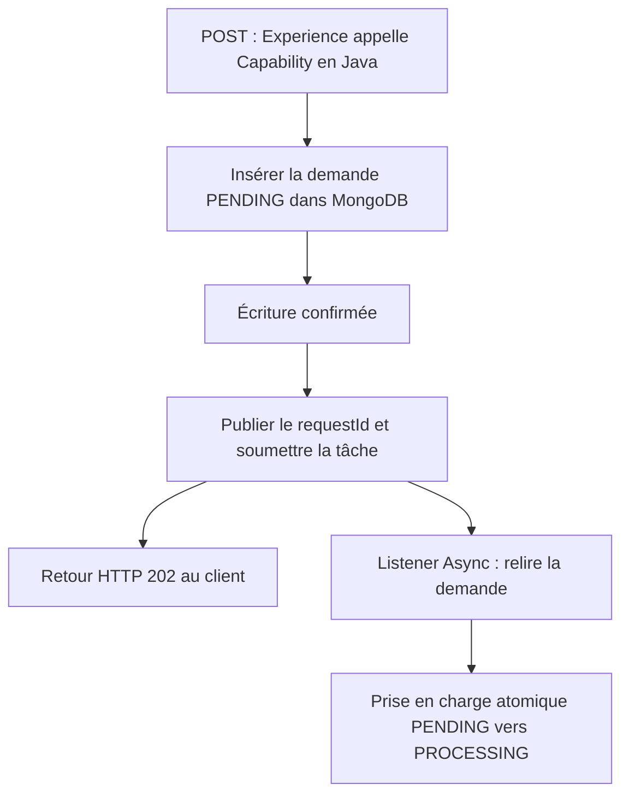

# INT-13 — Dessiner les fenêtres de panne

**Statut : terminée — note simplifiée sur demande utilisateur.** Documentation uniquement, sans test de panne exécuté. La version initiale a été commitée dans `f12c97d` ; cette révision ne modifie pas le code. INT-14 a été amorcée ensuite, puis mise en pause : ses changements restent à revoir séparément.

**[Simulation ConfluxLab]** L'objectif est de comprendre une limite du labo, pas de construire un système de reprise de production ni de décrire une implémentation historique AXA.

## 1. Le problème en une phrase

**Une demande peut être enregistrée dans MongoDB sans que son traitement arrive au bout, voire sans qu'il commence.**

Une *fenêtre de panne* est simplement un moment entre deux actions où un arrêt peut laisser le parcours incomplet. Il suffit ici de distinguer :

- **l'enregistrement** : le document `PENDING` est conservé dans MongoDB ;
- **la soumission** : une tâche est confiée à l'executor, le composant qui fournit les threads et une file en mémoire ;
- **la prise en charge** : le listener, qui reçoit l'événement, fait gagner atomiquement un seul passage `PENDING → PROCESSING`.

L'événement Spring local et la tâche en mémoire ne survivent pas automatiquement à l'arrêt de la JVM. Conserver le document ne garantit donc pas de reprendre le travail.

## 2. Le flux à comprendre

**[Proposition — schéma cible, pas preuve d'INT-14 terminée.]** Au point de départ d'INT-13, l'insertion et le suivi MongoDB étaient déjà réalisés. Publication et listener appartiennent à l'étape suivante.

Cas nominal, lorsque l'insertion est confirmée et la tâche acceptée :

**Les deux branches après la soumission n'ont pas d'ordre imposé.** Le listener peut commencer avant ou après la réception du `202`. Ce statut HTTP signifie « demande acceptée », pas « famille créée » ni « traitement garanti après un crash ».

## 3. Trois situations suffisent

Ce tableau décrit des conséquences possibles, **pas des pannes reproduites par des tests**.

| Situation | État possible en base | Ce que le client peut observer |
|---|---|---|
| **1. L'insertion n'est pas confirmée** : échec ou acquittement perdu | Aucun document, ou déjà `PENDING` si l'écriture a eu lieu | Erreur technique, généralement `500` avec le handler existant, ou coupure/timeout. Ne pas publier ni annoncer `202` sans confirmation |
| **2. La demande est enregistrée, mais pas prise en charge** : arrêt avant publication, soumission refusée ou tâche perdue en file | `PENDING` sans traitement capable d'avancer | Erreur/coupure avant la réponse ; `202` possible si la tâche avait été acceptée avant sa perte |
| **3. Le traitement est pris en charge puis s'interrompt** : exception ou arrêt | `PROCESSING` peut rester bloqué ; `FAILED` seulement si une transition d'échec est effectivement écrite | Un `202` déjà reçu reste inchangé. L'erreur du worker, le thread de traitement, ne revient pas automatiquement au POST |

**Exemple essentiel :** l'insertion réussit, puis l'application s'arrête avant de publier l'événement. Au redémarrage, le GET retrouve le document `PENDING`, mais rien ne relance automatiquement son traitement. **La donnée a survécu, pas le signal de traitement.**

## 4. Les nuances à garder, sans développer une autre architecture

- **Un rejet de soumission et une erreur du worker sont différents.** Si le rejet remonte avant la réponse, le POST peut encore échouer. Une fois le `202` envoyé, une erreur du worker ne peut plus le réécrire.
- **Une erreur ou un timeout ne prouve pas l'absence d'une écriture.** L'acquittement peut avoir été perdu. Ne pas rejouer aveuglément un POST : un UUID de corrélation ne rend pas la création idempotente.
- **Le graphe ne change pas.** `PENDING → PROCESSING → SUCCEEDED/FAILED` : un rejet avant prise en charge n'autorise pas directement `PENDING → FAILED`. La transition atomique évite deux gagnants, pas l'abandon après un crash.

On s'arrête à ces limites : aucune reprise automatique, nouvelle infrastructure ou liste exhaustive de pannes n'est demandée par INT-13. Les choix de code et de tests d'INT-14 seront revus séparément ; cette note ne les tranche pas.

## 5. Vérifications et formulation d'entretien

**Preuves :** l'analyse initiale s'appuie sur la lecture du service, du store/modèle MongoDB et du BFF à l'issue d'INT-12. La présente révision simplifie l'explication et ses résumés documentaires ; elle ne valide pas l'ébauche INT-14. Aucun build, test applicatif ou scénario de crash n'est exécuté pour cette réécriture.

La conservation du document après redémarrage a été vérifiée dans [INT-12](../sprint-03/INT-12-verifier-la-persistance.md). Ce résultat historique ne prouve pas la reprise d'un traitement asynchrone.

**À l'oral :**

> Dans le labo, enregistrer une demande et déclencher son traitement sont deux actions distinctes. Un arrêt entre les deux peut laisser un document PENDING sans tâche ; après prise en charge, un arrêt peut laisser PROCESSING. L'événement Spring local n'est pas durable et aucune reprise automatique n'est promise. Le 202 confirme l'acceptation, pas la réussite métier. Le listener peut d'ailleurs commencer avant que le client le reçoive. Enfin, une erreur HTTP ne prouve pas que rien n'a été écrit : rejouer un POST sans mécanisme d'idempotence peut créer une autre demande.

**Piège : « `PENDING` prouve qu'une tâche attend dans la file ? »** Non : le statut du document ne prouve ni la présence d'une tâche ni celle d'un worker vivant.

## 6. Suivi centralisé

- [TD-R020 — Repère : enregistrement, soumission et réponse HTTP](../todos.md#td-r020).
- [TD-B012 — INT-14 : ébauche en pause, à revoir séparément](../todos.md#td-b012).
