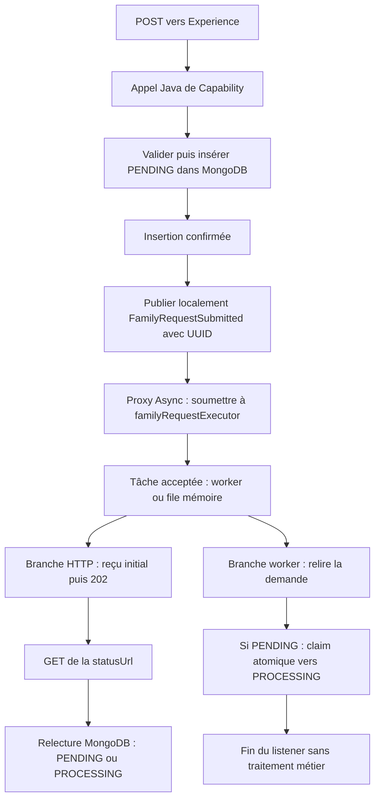

# INT-13 + INT-14 + INT-16 — Prendre en charge les demandes en arrière-plan

> **Portée historique :** ce document décrit les étapes indiquées dans son titre, pas une nouvelle validation du parcours actuel. Le raccordement ultérieur via Feign et la finalisation sont réalisés dans [INT-21 + INT-22](../sprint-06/INT-21-creer-une-famille-de-bout-en-bout.md).

**Statut : prise en charge technique réalisée jusqu'à `PROCESSING`, pas jusqu'à la création d'une famille.** Cet incrément couvre insertion, publication, proxy async, claim, suivi et compréhension des pannes. [Fiche du sprint 04](../../docs/stages/sprint-04-async.md).

**[Simulation ConfluxLab]** Experience et Capability sont deux modules d'une seule application Spring Boot, avec appels Java internes. Ce cours ne certifie pas une implémentation historique AXA. Les fragments sont partiels, issus des sources inspectées, sans classe entière ni code de harnais de test.

**Repères historiques :** INT-14 (`bdb93f8`) utilisait l'executor auto-configuré Boot `applicationTaskExecutor`. INT-15 l'a remplacé par `familyRequestExecutor`, dédié et borné, décrit dans [Borner et diagnostiquer l'exécution](INT-15-pool-borne-et-erreurs-async.md). INT-16 a relu le code de `59c881c` après ce changement : le regroupement pédagogique ne change pas cette chronologie. Aucun résultat n'est actualisé par cette rédaction.

## 1. Le flux et les responsabilités Spring

**Enregistrer**, c'est conserver le document `PENDING`. **Soumettre**, c'est confier une tâche à l'executor, qui fournit les threads et la file mémoire. Le **claim** est la prise en charge conditionnelle confirmée en base, pas simplement le démarrage d'un thread.

Flux nominal actuel, lorsque la soumission est acceptée :



**Aucun ordre n'est imposé entre démarrage du worker et réception du `202`.** Le worker peut déjà avoir gagné le claim ; le `202` signifie acceptation, jamais fin du traitement. Le GET ne vérifie pas qu'un worker est vivant.

Le distributeur d'événements de ce montage appelle le proxy synchroniquement ; **le proxy `@Async`** soumet le corps du listener à un autre thread. L'événement n'est donc pas asynchrone par nature. Il reste **local et non durable**, sans broker.

| Élément | Annotation / contrat | Rôle dans ce flux |
|---|---|---|
| `FamilyRequestService` | `@Service`, interface publique `FamilyRequests` | Porter le cas d'usage dans Capability, sans exposer son stockage au BFF |
| `ApplicationEventPublisher` | Fourni par le contexte Spring | Remettre la notification aux listeners locaux |
| `FamilyRequestListener` | `@Component`, `@EventListener` | Bean recevant le type `FamilyRequestSubmitted` ; `@EventListener` seul ne détache pas le travail |
| Configuration / méthode du listener | `@EnableAsync` / `@Async("familyRequestExecutor")` actuellement | Activer l'interception puis sélectionner le pool nommé ; à l'étape INT-14, le nom était `applicationTaskExecutor` |

Un **bean** est un objet géré par Spring ; le **proxy** est son intermédiaire d'interception. Un appel sur un listener créé avec `new`, ou une auto-invocation contournant le proxy, ne bénéficie pas de cet asynchronisme.

## 2. Insérer avant de publier

[FamilyRequestService.java](../../capability-api/src/main/java/dev/confluxlab/capability/internal/service/FamilyRequestService.java), fragment de `createFamily(...)`, après copie et validation de l'entrée :

```java
UUID requestId = UUID.randomUUID();
StoredFamilyRequest stored = StoredFamilyRequest.pending(
                requestId, snapshot, Instant.now(clock).truncatedTo(ChronoUnit.MILLIS));
store.save(stored);
events.publishEvent(new FamilyRequestSubmitted(requestId));
return new RequestAccepted(requestId, stored.status(), "/api/v1/requests/" + requestId);
```

1. L'UUID corrèle reçu, document et événement ; la date est normalisée à la milliseconde pour MongoDB.
2. `save` attend l'insertion acquittée. Dans [MongoFamilyRequestStore.java](../../capability-api/src/main/java/dev/confluxlab/capability/internal/persistence/MongoFamilyRequestStore.java), il s'agit de `mongoTemplate.insert(request)`, sans upsert ni remplacement d'un UUID existant.
3. Une exception de sauvegarde empêche d'atteindre la publication. Après réussite, le proxy peut soumettre la notification.
4. Le reçu utilise l'objet local initial, encore `PENDING`, même si la base est déjà passée à `PROCESSING`.

[FamilyRequestSubmitted.java](../../capability-api/src/main/java/dev/confluxlab/capability/internal/event/FamilyRequestSubmitted.java) est un record interne avec **seulement `UUID requestId`**, non nul. Le service crée cette valeur, qui n'est pas un bean ; les données familiales restent dans le document.

[FamilyController.java](../../experience-api/src/main/java/dev/confluxlab/experience/FamilyController.java) appelle l'interface publique en Java, puis construit le `202`, `Location` et `statusUrl`. Le BFF ne connaît ni événement ni store interne.

**Corrélation n'est pas idempotence :** deux POST identiques peuvent créer deux demandes différentes. Une erreur ou un timeout ne prouve pas l'absence d'écriture : l'acquittement a pu être perdu. Ne pas rejouer aveuglément le POST.

## 3. Relire puis gagner le claim atomique

[FamilyRequestListener.java](../../capability-api/src/main/java/dev/confluxlab/capability/internal/event/FamilyRequestListener.java), fragment du corps exécuté sur le worker :

```java
store.findById(event.requestId())
        .filter(request -> request.status() == RequestStatus.PENDING)
        .ifPresent(request -> {
            // This increment stops at the atomic claim; no business processing is simulated.
            store.transition(request.requestId(), RequestStatus.PENDING, RequestStatus.PROCESSING, Instant.now(clock));
        });
```

Une absence ou un autre statut arrête ce chemin. Les accès MongoDB restent **bloquants pour le worker** : `@Async` change le thread qui attend, pas la nature des I/O ni nécessairement la durée du travail.

Deux workers peuvent lire le même `PENDING` ; le filtre Java ne réserve rien. Dans `MongoFamilyRequestStore.transition(...)`, le filtre de la commande est :

```java
Query query = Query.query(
    Criteria.where("_id").is(requestId).and("status").is(expectedStatus).and("updatedAt").lte(timestamp)
);
```

UUID, statut attendu et date compatible doivent correspondre. **Le statut attendu exclut le second gagnant** après modification ; la condition de date évite seulement un recul d'`updatedAt`.

Même méthode, fragment exécuté après préparation de l'`Update` :

```java
mongoTemplate.findAndModify(
    query,
    update,
    FindAndModifyOptions.options().returnNew(true).upsert(false),
    StoredFamilyRequest.class
)
```

MongoDB vérifie condition et modification **atomiquement sur le document**. L'update ne change que statut et dates, pas le payload ; `completedAt` est absent en `PROCESSING`. `returnNew(true)` retourne la valeur modifiée, `upsert(false)` interdit de créer un document pendant une transition.

Le store retourne un `Optional` : présent, claim confirmé ; vide, aucune correspondance, **pas une panne avalée**. Les erreurs MongoDB restent des exceptions. Un seul gagnant sur cette transition ne garantit pas un « exactly once » de tous les effets métier.

Le listener termine après la tentative, sans exploiter son résultat pour poursuivre. Une future orchestration devra continuer uniquement sur un claim gagnant. **Même après INT-20, l'orchestrateur Java n'est pas raccordé au listener : aucun appel partenaire ni état final n'est produit par ce chemin.**

## 4. Le suivi n'est pas le reçu initial

[FamilyRequestService.java](../../capability-api/src/main/java/dev/confluxlab/capability/internal/service/FamilyRequestService.java), fragment de `getRequest(...)` :

```java
StoredFamilyRequest stored = store.findById(requestId)
        .orElseThrow(RequestNotFoundException::new);
return new RequestView(stored.requestId(), stored.status(), stored.createdAt());
```

Le GET `/api/v1/requests/{requestId}` expose seulement `requestId`, `status`, `createdAt` ; pas de payload ni de diagnostic interne. Un UUID absent devient `404` via le BFF.

POST `202 PENDING`, puis GET `200 PROCESSING` est normal : **le reçu décrit l'acceptation initiale, le GET relit l'état courant**. Il peut aussi voir encore `PENDING`. UUID et date de création restent stables ; on ne remet pas le document à `PENDING` pour l'aligner sur le reçu.

`PROCESSING` constate un claim enregistré, pas un worker toujours actif ni une famille créée.

## 5. Trois fenêtres de panne utiles

Une fenêtre de panne est un intervalle où une interruption peut laisser le parcours incomplet. Ce tableau explique les conséquences possibles ; **aucun crash n'a été reproduit pour cette analyse**.

| Situation | État possible en base | Observation côté client |
|---|---|---|
| **Insertion non confirmée**, échec ou acquittement perdu | Absent ou déjà `PENDING` | Erreur, coupure ou timeout ; sans confirmation, ni publication ni reçu `202` |
| **Enregistrée sans prise en charge**, arrêt avant publication, rejet ou tâche perdue en mémoire | `PENDING` sans tâche capable d'avancer | Erreur/coupure, ou `202` déjà reçu si la tâche avait été acceptée avant sa perte |
| **Prise en charge puis interruption**, après le claim | `PROCESSING` peut rester abandonné | Un `202` reçu reste inchangé ; aucun passage final automatique |

Exemple essentiel : après insertion, un arrêt avant publication conserve **la donnée, pas le signal de traitement**. Retrouver `PROCESSING` après redémarrage ne prouve pas davantage une reprise.

Le pool actuel est borné ; un rejet peut produire **`500` avec document `PENDING`** malgré l'absence de reçu. Le mécanisme de rejet et le diagnostic async sont expliqués uniquement dans [l'incrément INT-15](INT-15-pool-borne-et-erreurs-async.md#3-rejet-de-soumission--pourquoi-500-et-pending).

Le modèle autorise `PENDING → PROCESSING → SUCCEEDED/FAILED`, mais ce flux ne réalise que la première transition. Document persistant, claim atomique et log ne créent ni reprise automatique ni durabilité de l'événement.

## 6. Preuves historiques

Comptes rendus du **2026-10-22**, non renouvelés par cette rédaction :

| Origine | Résultat conservé | Portée |
|---|---|---|
| INT-13 | Analyse documentaire | Un schéma et trois situations, sans exécution de panne |
| INT-14, repère `bdb93f8` | **5 cas Surefire + 4 cas Failsafe**, aucun échec/erreur/ignoré | Publication après insertion et absence sur échec, réponse indépendante, claim unique, suivi, insertion et redémarrage du JAR ; un seul scénario ajouté |
| INT-16, relecture de `59c881c` | Code et deux rapports ciblés INT-15 relus, **sans nouvelle exécution** | Câblage, signaux, attentes bornées et nettoyage ; aucune adaptation jugée nécessaire pour les critères. Les résultats relus appartiennent à [INT-15](INT-15-pool-borne-et-erreurs-async.md#6-preuves-historiques-int-15) |

Les deux tests de service utilisent des doublures pour vérifier l'ordre et l'absence de publication sur échec. Dans [FamilyRequestEventsIT.java](../../application/src/test/java/dev/confluxlab/capability/internal/event/FamilyRequestEventsIT.java), Spring et MongoDB Testcontainers sont réels ; MockMvc n'ouvre pas de socket. Deux tentatives sont bloquées avant la commande : le POST répond sans les libérer, puis deux retours normaux donnent un seul gagnant. Aucun ordre autour du `202` n'est imposé.

INT-16 a relu les trois cas existants, dont les contrôles de bornage/diagnostic détaillés dans la seconde note. Les attentes sont bornées, les signaux libérés dans les `finally` et le pool attendu au repos, sans `Thread.sleep` comme preuve. Ce contrôle reste dans les tests, pas dans un faux métier applicatif.

[FamilyRequestPersistenceIT.java](../../application/src/test/java/dev/confluxlab/FamilyRequestPersistenceIT.java) a, dans INT-14, redémarré le vrai JAR sur la même base et retrouvé `PROCESSING` et les mêmes métadonnées. MongoDB restait vivant : conservation, **pas reprise du travail**.

**Commande historique INT-14, non exécutée ici**, depuis la racine `conflux-lab/`, avec JDK 21, Docker et dépendances/image MongoDB disponibles ou téléchargeables :

```sh
./mvnw -B -ntp '-Dtest=FamilyRequestServiceTest#storesThePayloadAsPendingBeforeReturningAcceptance+doesNotReturnAcceptanceWhenTheStoreThrows,FamilyRequestTrackingHttpTest#followsThePostLocationToMetadataAndKeepsCreatedAtAcrossGets+correlatesEachOfTwoPostsWithItsOwnTrackingView,ModuleArchitectureTest#experienceOnlyUsesThePublicCapabilityApi' -Dsurefire.failIfNoSpecifiedTests=false '-Dit.test=FamilyRequestEventsIT,MongoFamilyRequestStoreIT,FamilyRequestPersistenceIT' verify
```

`-Dtest` sélectionne Surefire, `-Dit.test` Failsafe ; `surefire.failIfNoSpecifiedTests=false` tolère les modules sans les méthodes demandées. `verify` atteint packaging et vérification des IT, contrairement à `test`. Cette commande écrivait `target/`, utilisait une base temporaire et lançait deux JVM applicatives ; aucun artefact distant ni base utilisateur. Des téléchargements peuvent nécessiter le réseau.

À l'étape INT-14, la classe événementielle n'avait qu'un cas et le listener utilisait l'executor Boot. La relancer après INT-15 ne reproduirait pas la même sélection. **Ne pas additionner les comptes des passages qui se recouvrent ni traiter INT-16 comme un nouveau run.** Les rapports volatils sous `target/` ne sont ni relus ni actualisés ici ; aucune suite globale, CI verte ou mesure de performance n'est revendiquée.

Restitution orale non évaluée, clôture pédagogique à confirmer ; cette note n'autorise aucun développement suivant.

## 7. Repères et suivi

- [TD-R020 — Persistance, soumission volatile et réponse HTTP](../todos.md#td-r020), [TD-R021 — Publication, proxy et claim](../todos.md#td-r021).
- [TD-B012 — Publication/consommation](../todos.md#td-b012), [TD-B014 — Consolidation des preuves](../todos.md#td-b014) ; pour la maîtrise des ressources, voir [le cours INT-15](INT-15-pool-borne-et-erreurs-async.md).
