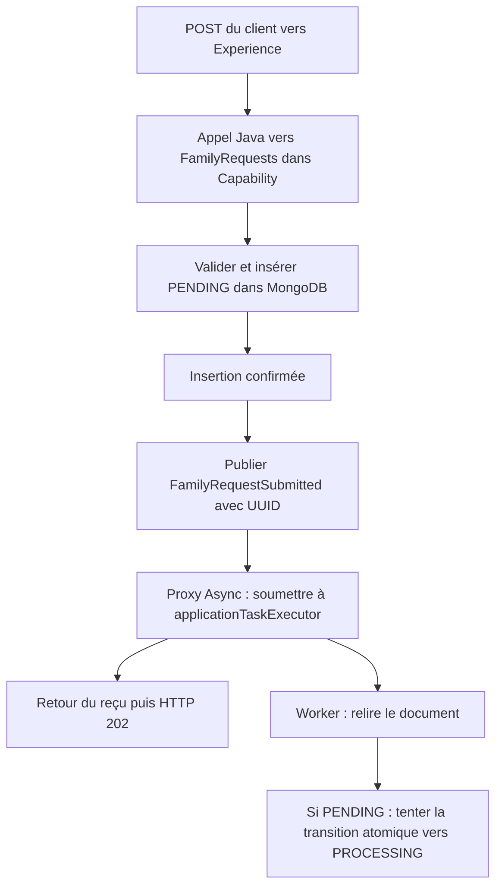

# INT-14 — Publier et consommer

**Statut : terminée sur reprise explicite « commit la 13 et reprends la 14 ».** Les preuves du **2026-10-22** portent sur 9 cas ciblés réussis. INT-14 et le plan allégé ont ensuite été commitées localement dans **`bdb93f8`**, avant INT-15, sans push.

> **Version de référence du cours : `bdb93f8`.** Les codes ci-dessous ont été vérifiés dans ce commit, pas reconstruits de mémoire. Depuis [INT-15](INT-15-borner-l-execution.md), le listener utilise `familyRequestExecutor`, dédié et borné, et le test événementiel contient deux cas supplémentaires. Ici, on explique **l'étape INT-14 avec `applicationTaskExecutor`**, sans attribuer les ajouts d'INT-15 à cette étape. La réécriture n'a changé aucun code ni relancé les tests.

**[Simulation ConfluxLab]** Une seule application Spring Boot : Experience appelle Capability en Java, sans HTTP interne. L'événement est local au processus. Le code et les résultats décrivent le laboratoire, pas une implémentation historique AXA certifiée.

## Parcours de lecture

- **Sections 1 à 4** : comprendre le flux, les types, le service et le proxy async.
- **Sections 5 et 6** : distinguer les preuves unitaires du véritable câblage Spring/MongoDB.
- **Sections 7 et 8** : comprendre les adaptations HTTP/persistance et le résultat réellement exécuté.
- Les petits fichiers centraux et le test événementiel sont reproduits **en entier**. Les extraits d'autres tests et du store sont explicitement partiels ; les liens pointent vers les fichiers actuels, qui peuvent avoir évolué depuis le commit de référence.

### Sommaire

- [1. Le problème et le flux](#1-le-problème-et-le-flux)
- [2. L'événement et les objets à ne pas confondre](#2-lévénement-et-les-objets-à-ne-pas-confondre)
- [3. Le service : enregistrer puis publier](#3-le-service--enregistrer-puis-publier)
- [4. Configuration, listener et prise en charge atomique](#4-configuration-listener-et-prise-en-charge-atomique)
- [5. Les deux tests unitaires renforcés](#5-les-deux-tests-unitaires-renforcés)
- [6. Le test événementiel complet](#6-le-test-événementiel-complet)
- [7. Adapter le suivi et la preuve de persistance](#7-adapter-le-suivi-et-la-preuve-de-persistance)
- [8. Commande exécutée et résultat](#8-commande-exécutée-et-résultat)
- [9. Limites et réponse d'entretien](#9-limites-et-réponse-dentretien)
- [10. Suivi centralisé](#10-suivi-centralisé)

## 1. Le problème et le flux

Avant INT-14, le POST validait la demande, l'insérait dans MongoDB, puis renvoyait un reçu. Le GET savait la relire et INT-11 avait fourni une transition atomique, mais **aucun composant de production ne déclenchait encore cette prise en charge**.

INT-14 relie ces briques : publier l'UUID après sauvegarde, recevoir l'événement sur un worker, relire le document et tenter `PENDING → PROCESSING`.

| Mot | Sens dans cet incrément |
|---|---|
| **Événement local** | Notification entre objets du même processus Spring ; ni requête réseau ni message durable |
| **Publisher** | Composant qui annonce l'événement, ici via `ApplicationEventPublisher` injecté dans le service |
| **Listener** | Méthode que Spring appelle pour réagir à ce type d'événement |
| **Proxy** | Objet intermédiaire géré par Spring qui intercepte l'appel pour appliquer `@Async` |
| **Executor / worker** | Composant qui reçoit les tâches / thread qui les exécute |
| **Prise en charge** | Transition atomique enregistrée en base, pas simplement démarrage d'un thread |

Flux nominal **implémenté dans INT-14** :



Après soumission, les deux branches avancent indépendamment : **le listener peut commencer avant ou après la réception du `202`**. La publication doit suivre l'insertion, mais rien n'impose que le travail attende la fin de la réponse HTTP.

Cet incrément s'arrête à la tentative de prise en charge. Le listener termine ensuite : aucun appel partenaire, orchestration ou faux `SUCCEEDED` n'est ajouté. `PROCESSING` ne prouve donc pas qu'un worker tourne encore.

## 2. L'événement et les objets à ne pas confondre

### 2.1 Événement complet

[FamilyRequestSubmitted.java](../../capability-api/src/main/java/dev/confluxlab/capability/internal/FamilyRequestSubmitted.java) — **fichier complet de la version INT-14** :

```java
package dev.confluxlab.capability.internal;

import java.util.Objects;
import java.util.UUID;

record FamilyRequestSubmitted(UUID requestId) {

    FamilyRequestSubmitted {
        Objects.requireNonNull(requestId, "requestId");
    }
}
```

- Le `record` transporte une seule valeur, un UUID immuable ; le constructeur compact interdit `null`.
- Il reste dans `capability.internal`, sans modifier les contrats publics partagés avec Experience.
- Il n'a pas besoin d'être un bean `@Component` : le service crée une valeur et la publie. Spring accepte les événements objets via `publishEvent(Object)` ; aucune classe héritant obligatoirement d'`ApplicationEvent` n'est nécessaire ici.
- Le payload familial n'est pas recopié dans l'événement. Le listener le retrouverait dans le document en base lorsque le travail métier en aura besoin.

### 2.2 Quatre rôles différents

| Objet | Destinataire / rôle | Ce qu'il ne garantit pas |
|---|---|---|
| `CreateFamilyRequest` | Entrée de création, avec les données fictives à valider et conserver | Pas une demande déjà acceptée |
| `StoredFamilyRequest` | Représentation interne persistée : payload, statut et dates | Sa présence ne prouve pas qu'une tâche est encore en file |
| `FamilyRequestSubmitted` | Notification locale contenant l'UUID pour réveiller le listener | Ni durabilité du signal ni idempotence métier |
| `RequestAccepted` / `RequestView` | Reçu initial du POST / métadonnées courantes du GET | Ni famille créée ni garantie qu'un worker est toujours vivant |

L'UUID **corrèle** ces objets. Il n'empêche pas deux POST identiques de créer deux demandes différentes.

## 3. Le service : enregistrer puis publier

### 3.1 Fichier complet

[FamilyRequestService.java](../../capability-api/src/main/java/dev/confluxlab/capability/internal/FamilyRequestService.java) — **fichier complet de la version INT-14** :

```java
package dev.confluxlab.capability.internal;

import java.time.Clock;
import java.time.Instant;
import java.time.temporal.ChronoUnit;
import java.util.ArrayList;
import java.util.UUID;

import dev.confluxlab.capability.api.FamilyRequests;
import dev.confluxlab.capability.api.InvalidFamilyRequestException;
import dev.confluxlab.capability.api.RequestNotFoundException;
import dev.confluxlab.contracts.CreateFamilyRequest;
import dev.confluxlab.contracts.RequestAccepted;
import dev.confluxlab.contracts.RequestView;
import jakarta.validation.Validator;
import org.springframework.context.ApplicationEventPublisher;
import org.springframework.stereotype.Service;

@Service
class FamilyRequestService implements FamilyRequests {

    private final FamilyRequestStore store;
    private final Validator validator;
    private final Clock clock;
    private final ApplicationEventPublisher events;

    FamilyRequestService(FamilyRequestStore store, Validator validator, Clock clock, ApplicationEventPublisher events) {
        this.store = store;
        this.validator = validator;
        this.clock = clock;
        this.events = events;
    }

    @Override
    public RequestAccepted createFamily(CreateFamilyRequest request) {
        if (request == null) {
            throw new InvalidFamilyRequestException();
        }
        // Validate a local snapshot; the stored record then freezes its list before publication.
        CreateFamilyRequest snapshot = new CreateFamilyRequest(request.principal(),
                request.dependents() == null ? null : new ArrayList<>(request.dependents()));
        if (!validator.validate(snapshot).isEmpty()) {
            throw new InvalidFamilyRequestException();
        }

        UUID requestId = UUID.randomUUID();
        StoredFamilyRequest stored = StoredFamilyRequest.pending(
                        requestId, snapshot, Instant.now(clock).truncatedTo(ChronoUnit.MILLIS));
        store.save(stored);
        events.publishEvent(new FamilyRequestSubmitted(requestId));
        return new RequestAccepted(requestId, stored.status(), "/api/v1/requests/" + requestId);
    }

    @Override
    public RequestView getRequest(UUID requestId) {
        if (requestId == null) {
            throw new IllegalArgumentException("requestId must not be null.");
        }
        StoredFamilyRequest stored = store.findById(requestId)
                .orElseThrow(RequestNotFoundException::new);
        return new RequestView(stored.requestId(), stored.status(), stored.createdAt());
    }
}
```

### 3.2 Lire l'injection et l'ordre des opérations

`@Service` rend l'implémentation découvrable par Spring. Avec ce constructeur unique, Spring injecte ses dépendances sans `@Autowired` supplémentaire :

| Dépendance | Utilité |
|---|---|
| `FamilyRequestStore` | Insérer et relire sans exposer la persistance au BFF ; l'implémentation de production est MongoDB |
| `Validator` | Vérifier aussi les appels Java directs : la validation HTTP du BFF ne suffit pas |
| `Clock` | Fournir une date UTC remplaçable par une horloge fixe dans les tests |
| `ApplicationEventPublisher` | Publier la notification locale après sauvegarde ; c'est l'ajout central du service dans INT-14 |

La séquence est volontairement simple :

1. **Valider une copie locale.** La liste reçue est copiée avant validation ; le record stocké en fige ensuite la liste. Un appelant ne doit pas pouvoir modifier cette liste après l'acceptation.
2. **Créer l'UUID et le document `PENDING`.** La date est normalisée à la milliseconde, précision retenue pour le stockage MongoDB.
3. **Appeler `store.save(stored)`.** L'adaptateur attend l'insertion acquittée. S'il lève une exception, le flux ne passe pas à la ligne suivante.
4. **Publier l'UUID.** Avec le distributeur Spring synchrone de ce montage, la publication appelle le proxy du listener, qui soumet la tâche. Le service n'attend pas le corps du listener.
5. **Construire le reçu.** Le statut du record local reste `PENDING`, même si le document en base a déjà changé entre-temps.

Publier avant de sauvegarder risquerait de réveiller un listener qui ne trouve pas encore le document, voire de déclencher du travail pour une écriture finalement refusée. Inversement, sauvegarder puis publier laisse une fenêtre de panne : un arrêt entre les deux peut abandonner un document `PENDING`. Cette limite n'est pas résolue par INT-14 ; voir [INT-13](INT-13-dessiner-les-fenetres-de-panne.md).

### 3.3 Le BFF reste mince

Extrait partiel de [FamilyController.java](../../experience-api/src/main/java/dev/confluxlab/experience/FamilyController.java), **inchangé dans cet incrément** :

```java
@PostMapping("/families")
public ResponseEntity<RequestAccepted> createFamily(@Valid @RequestBody CreateFamilyRequest request) {
    RequestAccepted accepted = familyRequests.createFamily(request);
    String statusUrl = "/api/v1/requests/" + accepted.requestId();
    RequestAccepted publicResponse = new RequestAccepted(accepted.requestId(), accepted.status(), statusUrl);
    return ResponseEntity.accepted()
            .location(URI.create(statusUrl))
            .body(publicResponse);
}
```

Le contrôleur appelle l'interface publique `FamilyRequests`, construit les liens HTTP et adapte le reçu. Il ne connaît ni l'événement interne, ni le listener, ni le store. **La réponse `202` est construite après le retour du service, mais sa réception par le client reste distincte du démarrage du worker.**

## 4. Configuration, listener et prise en charge atomique

### 4.1 Configuration complète à l'étape INT-14

[FamilyRequestConfiguration.java](../../capability-api/src/main/java/dev/confluxlab/capability/internal/FamilyRequestConfiguration.java) — **version complète du commit `bdb93f8`, avant les ajouts d'INT-15** :

```java
package dev.confluxlab.capability.internal;

import java.time.Clock;
import java.util.concurrent.TimeUnit;

import com.mongodb.WriteConcern;

import org.springframework.context.annotation.Bean;
import org.springframework.context.annotation.Configuration;
import org.springframework.data.mongodb.MongoDatabaseFactory;
import org.springframework.data.mongodb.core.MongoTemplate;
import org.springframework.data.mongodb.core.convert.MongoConverter;
import org.springframework.scheduling.annotation.EnableAsync;

@Configuration(proxyBeanMethods = false)
@EnableAsync
class FamilyRequestConfiguration {

    @Bean
    MongoTemplate mongoTemplate(MongoDatabaseFactory factory, MongoConverter converter) {
        MongoTemplate template = new MongoTemplate(factory, converter);
        template.setWriteConcern(WriteConcern.MAJORITY.withJournal(true).withWTimeout(5, TimeUnit.SECONDS));
        return template;
    }

    @Bean
    Clock familyRequestClock() {
        return Clock.systemUTC();
    }
}
```

- Les beans MongoDB et horloge existaient déjà ; INT-14 ajoute **`@EnableAsync`** pour activer le traitement des méthodes `@Async` par des proxies Spring.
- `proxyBeanMethods = false` concerne les appels entre méthodes `@Bean` de cette configuration. Cela **ne désactive pas** le proxy async du listener.
- Aucun bean de pool dédié n'est déclaré à cette étape. L'assemblage Boot fournit `applicationTaskExecutor`, que le listener demande par son nom.
- INT-14 ne fixe pas ici un dimensionnement de production. Le réglage à deux threads montré dans le test plus bas appartient au **contexte de test**.

L'executor dédié, sa file bornée et le handler personnalisé sont des changements **ultérieurs d'INT-15**, détaillés dans [son cours](INT-15-borner-l-execution.md). Il ne faut pas ajouter leurs propriétés à cette version historique pour expliquer les preuves INT-14.

### 4.2 Listener complet à l'étape INT-14

[FamilyRequestListener.java](../../capability-api/src/main/java/dev/confluxlab/capability/internal/FamilyRequestListener.java) — **version complète du commit `bdb93f8`** :

```java
package dev.confluxlab.capability.internal;

import java.time.Clock;
import java.time.Instant;

import dev.confluxlab.contracts.RequestStatus;
import org.springframework.context.event.EventListener;
import org.springframework.scheduling.annotation.Async;
import org.springframework.stereotype.Component;

@Component
class FamilyRequestListener {

    private final MongoFamilyRequestStore store;
    private final Clock clock;

    FamilyRequestListener(MongoFamilyRequestStore store, Clock clock) {
        this.store = store;
        this.clock = clock;
    }

    @Async("applicationTaskExecutor")
    @EventListener
    public void onFamilyRequestSubmitted(FamilyRequestSubmitted event) {
        store.findById(event.requestId())
                .filter(request -> request.status() == RequestStatus.PENDING)
                .ifPresent(request -> {
                    // This increment stops at the atomic claim; no business processing is simulated.
                    store.transition(request.requestId(), RequestStatus.PENDING, RequestStatus.PROCESSING, Instant.now(clock));
                });
    }
}
```

### 4.3 Ce que font réellement les annotations

| Élément | Rôle précis |
|---|---|
| `@Component` | Créer le listener comme bean géré par Spring, avec injection du store et de l'horloge |
| `@EventListener` | Abonner la méthode au type de son paramètre, `FamilyRequestSubmitted` ; seul, cela ne rend pas la méthode asynchrone |
| `@Async("applicationTaskExecutor")` | Intercepter l'appel au bean et soumettre son corps à l'executor nommé |
| Méthode publique `void` | Point d'entrée du listener ; aucun résultat de traitement n'est renvoyé au publisher |

Il faut traverser le **proxy Spring**. Un appel direct sur `new FamilyRequestListener(...)` ou une auto-invocation contournant le proxy ne prouverait pas ce fonctionnement async. Dans le test d'intégration, on publie donc réellement l'événement dans le contexte Spring.

Les appels MongoDB restent bloquants pour le worker qui les exécute. `@Async` les détache du thread HTTP ; il ne les transforme pas en I/O non bloquantes et ne prouve aucune accélération du travail.

### 4.4 Pourquoi la lecture `PENDING` ne suffit pas

Le listener relit le document, ignore une absence ou un état déjà différent de `PENDING`, puis tente la transition. Mais **deux workers peuvent avoir lu le même `PENDING`** avant que l'un écrive.

Voici la méthode de stockage réutilisée, **extrait partiel de [MongoFamilyRequestStore.java](../../capability-api/src/main/java/dev/confluxlab/capability/internal/MongoFamilyRequestStore.java), développée dans INT-11 et non ajoutée par INT-14** :

```java
Optional<StoredFamilyRequest> transition(
    UUID requestId,
    RequestStatus expectedStatus,
    RequestStatus nextStatus,
    Instant changedAt
) {
    Objects.requireNonNull(requestId, "requestId");
    StoredFamilyRequest.requireTransition(expectedStatus, nextStatus);
    Instant timestamp = Objects.requireNonNull(changedAt, "changedAt").truncatedTo(ChronoUnit.MILLIS);
    Query query = Query.query(
        Criteria.where("_id").is(requestId).and("status").is(expectedStatus).and("updatedAt").lte(timestamp)
    );
    Update update = new Update().set("status", nextStatus).set("updatedAt", timestamp);
    if (nextStatus == RequestStatus.PROCESSING) {
        update.unset("completedAt");
    } else {
        update.set("completedAt", timestamp);
    }
    // The expected status and the update must be evaluated together by MongoDB, not by a Java read/save pair.
    return Optional.ofNullable(
        mongoTemplate.findAndModify(
            query,
            update,
            FindAndModifyOptions.options().returnNew(true).upsert(false),
            StoredFamilyRequest.class
        )
    );
}
```

Dans INT-14, elle est appelée uniquement pour `PENDING → PROCESSING`. Le filtre exige toujours le statut attendu **au moment de l'écriture**, et MongoDB évalue condition et modification ensemble sur le document. Après le premier gagnant, le second filtre `status == PENDING` ne correspond plus, même si sa date est plus récente.

Un `Optional` présent confirme la modification gagnante ; un résultat vide signifie qu'aucun document ne correspond. Une panne MongoDB reste une exception, pas un résultat vide. Le garde-fou de date empêche un recul chronologique : **il ne détecte pas un second candidat**.

La méthode du listener finit après cette tentative. Elle n'a donc pas encore de travail métier à conditionner à son résultat. Lorsque l'orchestration sera ajoutée, elle devra continuer **seulement pour le gagnant** ; il ne faudra pas placer un appel partenaire inconditionnel après `transition(...)`.

## 5. Les deux tests unitaires renforcés

Ces tests existaient avant INT-14 : on ajoute les assertions utiles à la publication, sans nouvelle matrice de cas. Ils créent le service directement, avec un validator et une horloge fixe préparés par leur classe de test.

### 5.1 La publication doit observer le document déjà présent

[FamilyRequestServiceTest.java](../../capability-api/src/test/java/dev/confluxlab/capability/internal/FamilyRequestServiceTest.java) — **extrait partiel du fichier, méthode complète de la version INT-14** :

```java
@Test
void storesThePayloadAsPendingBeforeReturningAcceptance() {
    InMemoryFamilyRequestStore store = new InMemoryFamilyRequestStore();
    List<FamilyRequestSubmitted> published = new ArrayList<>();
    ApplicationEventPublisher events = event -> {
        FamilyRequestSubmitted submitted = assertInstanceOf(FamilyRequestSubmitted.class, event);
        assertTrue(store.findById(submitted.requestId()).isPresent(), "Insertion must precede publication.");
        published.add(submitted);
    };
    FamilyRequestService service = new FamilyRequestService(store, validator, CLOCK, events);
    CreateFamilyRequest request = new CreateFamilyRequest(PRINCIPAL, DEPENDENTS);

    RequestAccepted accepted = service.createFamily(request);

    assertNotNull(accepted.requestId());
    assertEquals(RequestStatus.PENDING, accepted.status());
    assertEquals("/api/v1/requests/" + accepted.requestId(), accepted.statusUrl());
    StoredFamilyRequest stored = store.findById(accepted.requestId()).orElseThrow();
    assertEquals(accepted.requestId(), stored.requestId());
    assertEquals(RequestStatus.PENDING, stored.status());
    assertEquals(request, stored.payload());
    assertEquals(CLOCK.instant(), stored.createdAt());
    assertEquals(List.of(new FamilyRequestSubmitted(accepted.requestId())), published);
}
```

La lambda remplace le publisher pour ce test unitaire. Elle vérifie la présence dans le store **pendant l'appel de publication**, pas seulement après le retour du service : c'est ce qui prouve l'ordre sauvegarde → publication. La liste finale attend exactement un événement avec le bon UUID.

`InMemoryFamilyRequestStore` est une doublure sous `src/test`, pas un fallback de production. Ce test ne prouve ni MongoDB ni l'asynchronisme : ces points exigent le contexte réel de la section 6.

### 5.2 Une sauvegarde échouée ne publie rien

Même fichier — **extrait partiel, méthode complète** :

```java
@Test
void doesNotReturnAcceptanceWhenTheStoreThrows() {
    InMemoryFamilyRequestStore failingStore = mock(InMemoryFamilyRequestStore.class);
    IllegalStateException failure = new IllegalStateException("Simulated storage failure.");
    doThrow(failure).when(failingStore).save(any(StoredFamilyRequest.class));
    ApplicationEventPublisher events = mock(ApplicationEventPublisher.class);
    FamilyRequestService service = new FamilyRequestService(failingStore, validator, CLOCK, events);

    assertSame(failure, assertThrows(IllegalStateException.class,
            () -> service.createFamily(new CreateFamilyRequest(PRINCIPAL, DEPENDENTS))));
    verifyNoInteractions(events);
}
```

Mockito force `save(...)` à échouer. `assertThrows` et `assertSame` vérifient que cette erreur remonte sans reçu ; `verifyNoInteractions(events)` prouve qu'aucune publication n'a été tentée. **C'est une panne simulée**, pas une coupure réseau MongoDB.

Dans les autres tests unitaires, un publisher inactif satisfait simplement la nouvelle dépendance du constructeur. On ne duplique pas ces assertions dans tous les tests de validation ou de lecture.

## 6. Le test événementiel complet

### 6.1 Version historique réelle

[FamilyRequestEventsIT.java](../../application/src/test/java/dev/confluxlab/capability/internal/FamilyRequestEventsIT.java) — **fichier complet du commit `bdb93f8`**, avec son unique nouveau scénario INT-14. La version actuelle contient aussi les deux cas ajoutés dans INT-15 ; ils ne sont pas recopiés ici :

```java
package dev.confluxlab.capability.internal;

import java.time.Duration;
import java.time.Instant;
import java.util.Optional;
import java.util.Queue;
import java.util.UUID;
import java.util.concurrent.ConcurrentLinkedQueue;
import java.util.concurrent.CountDownLatch;
import java.util.concurrent.TimeUnit;

import com.fasterxml.jackson.databind.ObjectMapper;
import dev.confluxlab.ConfluxLabApplication;
import dev.confluxlab.MongoTestSupport;
import dev.confluxlab.contracts.RequestStatus;
import org.junit.jupiter.api.Test;
import org.springframework.beans.factory.annotation.Autowired;
import org.springframework.beans.factory.annotation.Qualifier;
import org.springframework.boot.test.autoconfigure.web.servlet.AutoConfigureMockMvc;
import org.springframework.boot.test.context.SpringBootTest;
import org.springframework.context.ApplicationEventPublisher;
import org.springframework.http.MediaType;
import org.springframework.scheduling.concurrent.ThreadPoolTaskExecutor;
import org.springframework.test.context.bean.override.mockito.MockitoSpyBean;
import org.springframework.test.web.servlet.MockMvc;
import org.springframework.test.web.servlet.MvcResult;

import static org.awaitility.Awaitility.await;
import static org.junit.jupiter.api.Assertions.assertEquals;
import static org.junit.jupiter.api.Assertions.assertTrue;
import static org.mockito.ArgumentMatchers.any;
import static org.mockito.ArgumentMatchers.eq;
import static org.mockito.Mockito.doAnswer;
import static org.springframework.test.web.servlet.request.MockMvcRequestBuilders.get;
import static org.springframework.test.web.servlet.request.MockMvcRequestBuilders.post;
import static org.springframework.test.web.servlet.result.MockMvcResultMatchers.jsonPath;
import static org.springframework.test.web.servlet.result.MockMvcResultMatchers.status;

@SpringBootTest(classes = ConfluxLabApplication.class, properties = "spring.task.execution.pool.core-size=2")
@AutoConfigureMockMvc
class FamilyRequestEventsIT extends MongoTestSupport {

    private static final String VALID_REQUEST = """
            {
              "principal": {"firstName": "Alex", "lastName": "Exemple", "birthDate": "1990-04-12"},
              "dependents": [
                {"firstName": "Camille", "lastName": "Exemple", "birthDate": "2015-08-21"},
                {"firstName": "Noa", "lastName": "Exemple", "birthDate": "2018-02-03"}
              ]
            }
            """;

    @Autowired
    private MockMvc mockMvc;

    @Autowired
    private ObjectMapper objectMapper;

    @Autowired
    private ApplicationEventPublisher events;

    @Autowired
    @Qualifier("applicationTaskExecutor")
    private ThreadPoolTaskExecutor taskExecutor;

    @MockitoSpyBean
    private MongoFamilyRequestStore store;

    @Test
    void acceptsWhileTheListenerIsBlockedAndOnlyOneDuplicateEventCanClaim() throws Exception {
        CountDownLatch ready = new CountDownLatch(2);
        CountDownLatch release = new CountDownLatch(1);
        CountDownLatch finished = new CountDownLatch(2);
        Queue<Optional<?>> results = new ConcurrentLinkedQueue<>();
        Queue<Thread> workers = new ConcurrentLinkedQueue<>();
        Thread requestThread = Thread.currentThread();
        doAnswer(invocation -> {
            workers.add(Thread.currentThread());
            ready.countDown();
            try {
                assertTrue(release.await(10, TimeUnit.SECONDS), "Test must release both claim attempts.");
                Optional<?> result = (Optional<?>) invocation.callRealMethod();
                results.add(result);
                return result;
            } finally {
                finished.countDown();
            }
        }).when(store).transition(any(UUID.class), eq(RequestStatus.PENDING), eq(RequestStatus.PROCESSING), any(Instant.class));

        try {
            MvcResult response = mockMvc.perform(post("/api/v1/families")
                            .contentType(MediaType.APPLICATION_JSON).content(VALID_REQUEST))
                    .andExpect(status().isAccepted())
                    .andExpect(jsonPath("$.status").value("PENDING"))
                    .andReturn();
            UUID requestId = UUID.fromString(objectMapper.readTree(response.getResponse().getContentAsString())
                    .path("requestId").asText());
            events.publishEvent(new FamilyRequestSubmitted(requestId));

            assertTrue(ready.await(5, TimeUnit.SECONDS), "Both event deliveries must reach the claim before release.");
            assertTrue(workers.stream().allMatch(worker -> worker != requestThread), "The listener must not run on the HTTP thread.");
            assertEquals(RequestStatus.PENDING, store.findById(requestId).orElseThrow().status());

            release.countDown();
            assertTrue(finished.await(10, TimeUnit.SECONDS), "Both claim attempts must finish.");
            assertEquals(2, results.size(), "Both MongoDB attempts must return normally; inspect async logs otherwise.");
            assertEquals(1L, results.stream().filter(Optional::isPresent).count());
            assertEquals(RequestStatus.PROCESSING, store.findById(requestId).orElseThrow().status());
            mockMvc.perform(get("/api/v1/requests/{requestId}", requestId))
                    .andExpect(status().isOk())
                    .andExpect(jsonPath("$.status").value("PROCESSING"));
        } finally {
            release.countDown();
            await("Async test workers to finish").atMost(Duration.ofSeconds(10))
                    .until(() -> taskExecutor.getActiveCount() == 0 && taskExecutor.getThreadPoolExecutor().getQueue().isEmpty());
        }
    }
}
```

### 6.2 Lire le contexte et les injections

| Élément | Ce qui est réel / contrôlé |
|---|---|
| `@SpringBootTest(classes = ConfluxLabApplication.class)` | Charge l'assemblage Spring réel, pas seulement le listener isolé |
| `spring.task.execution.pool.core-size=2` | Remplace une propriété Boot **dans ce test** pour permettre deux candidats bloqués simultanément |
| `@AutoConfigureMockMvc` / `MockMvc` | Exerce le contrôleur et le service sans socket réseau ; le thread du test joue ici le rôle du thread HTTP |
| `MongoTestSupport` | Fournit un véritable MongoDB Testcontainers temporaire, pas une map mémoire |
| `ApplicationEventPublisher` injecté | Publie réellement dans le contexte Spring et atteint le listener proxifié |
| `@Qualifier("applicationTaskExecutor")` | Sélectionne le même executor que celui demandé par `@Async` à cette étape |
| `@MockitoSpyBean` | Enveloppe le vrai store : le test intercepte une méthode mais les accès restent réels quand il appelle la méthode originale |

Les données JSON sont fictives. Le spy est une **instrumentation de test**, pas un faux traitement de production.

### 6.3 Les trois signaux

Un `CountDownLatch` est un compteur qui permet d'attendre un événement précis. `countDown()` le décrémente ; `await(...)` attend zéro, ici avec une borne de temps.

| Signal | Départ | Fonction |
|---|---:|---|
| `ready` | 2 | Confirmer que deux workers ont atteint l'interception de la transition |
| `release` | 1 | Bloquer ces tentatives jusqu'à ce que le test ouvre la porte |
| `finished` | 2 | Attendre que les deux tentatives de commande se terminent |

Les `ConcurrentLinkedQueue` collectent les threads et les résultats sans utiliser une liste non protégée depuis plusieurs workers. `doAnswer(...)` ajoute un comportement à la méthode du spy ; `any(...)` et `eq(...)` définissent les arguments concernés.

### 6.4 L'enchaînement exact de la preuve

1. Le POST insère le document et publie un premier événement. Sa réponse doit revenir alors que `release` est encore fermé : le service n'attend pas la prise en charge.
2. Le test republie **le même UUID**, sans second POST : il simule une double réception de la notification, pas deux demandes métier distinctes.
3. `ready.await(...)` attend que les deux workers soient arrivés à `transition(...)`. Ils ont donc pu passer la lecture et le filtre `PENDING`, mais pas encore exécuter la commande MongoDB.
4. L'identité des threads prouve qu'ils ne sont pas le thread du POST. La lecture en base confirme que le document est encore `PENDING` pendant ce blocage.
5. `release.countDown()` ouvre la porte. `invocation.callRealMethod()` effectue les **vrais `findAndModify`** du store ; il ne fabrique pas un gagnant dans Mockito.
6. Le test attend deux retours normaux et compte un seul `Optional` présent. Il relit le document et le GET public en `PROCESSING`.

Le test **n'impose pas** que le worker ait commencé avant le `202`, ni qu'il démarre après. Il prouve que la réponse peut être obtenue sans libérer le travail. Les attentes sont des conditions explicites, pas un `Thread.sleep` utilisé comme intuition de synchronisation.

### 6.5 Pourquoi le nettoyage fait partie du test

Le `finally` ouvre toujours `release`, même si une assertion échoue. Awaitility attend ensuite zéro worker actif et une file vide, au plus 10 s. Sans ce nettoyage, des tâches de test pourraient rester bloquées ou perturber le scénario suivant.

L'assertion `results.size() == 2` est également utile : une exception du worker ne doit pas être confondue avec un simple candidat perdant. Le test exige les deux retours normaux avant d'interpréter le nombre de résultats présents.

## 7. Adapter le suivi et la preuve de persistance

### 7.1 Un reçu initial n'est pas une lecture instantanée de la base

Le POST décrit l'acceptation initiale avec `PENDING`. Le GET relit l'état courant. Il est donc normal d'observer :

- POST `202 PENDING`, puis GET encore `PENDING` si le worker n'a pas pris en charge ;
- POST `202 PENDING`, puis GET `PROCESSING` si le worker a déjà gagné.

On ne doit ni réécrire le document à `PENDING` pour l'aligner sur le reçu, ni imposer que deux GET conservent le même statut. En revanche, UUID, contrat des trois champs publics et `createdAt` restent stables.

[FamilyRequestTrackingHttpTest.java](../../application/src/test/java/dev/confluxlab/FamilyRequestTrackingHttpTest.java) — **extrait partiel du fichier, helper complet de la version INT-14** :

```java
private JsonNode getRequestAndAssertMetadata(MvcResult accepted) throws Exception {
    JsonNode acceptance = objectMapper.readTree(accepted.getResponse().getContentAsString());
    String requestId = acceptance.path("requestId").asText();
    String location = accepted.getResponse().getHeader("Location");

    MvcResult result = mockMvc.perform(get(location))
            .andExpect(status().isOk())
            .andExpect(content().contentTypeCompatibleWith(MediaType.APPLICATION_JSON))
            .andExpect(jsonPath("$.requestId").value(requestId))
            .andExpect(jsonPath("$.status").value(anyOf(is("PENDING"), is("PROCESSING"))))
            .andExpect(jsonPath("$.createdAt").isString())
            .andReturn();

    JsonNode response = objectMapper.readTree(result.getResponse().getContentAsString());
    assertEquals(3, response.size(), "Tracking must expose only requestId, status and createdAt.");
    assertDoesNotThrow(() -> Instant.parse(response.path("createdAt").asText()));
    return response;
}
```

Accepter ces deux états n'abandonne pas la vérification de progression : **le test événementiel vérifie séparément `PROCESSING` après les tentatives**, et le test de persistance attend cet état avant son snapshot.

### 7.2 Comparer après stabilisation du point vérifié

[FamilyRequestPersistenceIT.java](../../application/src/test/java/dev/confluxlab/FamilyRequestPersistenceIT.java) — **extrait partiel de la version INT-14** :

```java
beforeRestart = await("Request to reach PROCESSING before restart")
        .atMost(Duration.ofSeconds(10))
        .until(() -> {
            HttpResponse<String> lookup = get(client, first.origin().resolve(location));
            assertEquals(200, lookup.statusCode(), lookup.body());
            return mapper.readTree(lookup.body());
        }, view -> "PROCESSING".equals(view.path("status").asText()));
assertEquals(3, beforeRestart.size(), "Tracking must contain only its three public metadata fields.");
assertEquals(requestId.toString(), beforeRestart.path("requestId").asText());
assertEquals("PROCESSING", beforeRestart.path("status").asText());
Instant.parse(beforeRestart.path("createdAt").asText());
```

Le test attend une condition réelle, puis arrête la première JVM et relance le même JAR avec la même base. Autre **extrait partiel du même test** :

```java
RunningApplication second = start(jar, reports.resolve("persistence-after-restart.log"));
try (second) {
    assertNotEquals(first.process().pid(), second.process().pid(), "The restart must use a new JVM.");
    HttpResponse<String> lookup = get(client, second.origin().resolve(location));
    assertEquals(200, lookup.statusCode(), lookup.body());
    assertEquals(beforeRestart, mapper.readTree(lookup.body()),
            "UUID, PROCESSING and original createdAt must survive the application restart.");
}
```

La comparaison `JsonNode` porte sur le contenu JSON, sans dépendre de l'ordre textuel des propriétés. Elle prouve la conservation de l'UUID, du statut et de la date initiale. **MongoDB est maintenu en fonctionnement ; il n'est pas redémarré. Retrouver `PROCESSING` ne prouve pas la reprise du travail.**

Le test d'insertion [MongoFamilyRequestStoreIT.java](../../application/src/test/java/dev/confluxlab/capability/internal/MongoFamilyRequestStoreIT.java) attend lui aussi `PROCESSING` avant de comparer le snapshot après une collision d'UUID. Il vérifie encore l'insertion initiale `PENDING`, le payload, les dates cohérentes et l'absence d'écrasement. Ces adaptations réutilisent les scénarios existants ; elles n'ajoutent pas une nouvelle série de tests.

## 8. Commande exécutée et résultat

### 8.1 Commande historique d'INT-14

**Répertoire de départ : racine `conflux-lab/`. Prérequis : JDK 21, Docker accessible, dépendances et image de test disponibles ou téléchargeables. Version de référence : `bdb93f8`.**

```sh
./mvnw -B -ntp '-Dtest=FamilyRequestServiceTest#storesThePayloadAsPendingBeforeReturningAcceptance+doesNotReturnAcceptanceWhenTheStoreThrows,FamilyRequestTrackingHttpTest#followsThePostLocationToMetadataAndKeepsCreatedAtAcrossGets+correlatesEachOfTwoPostsWithItsOwnTrackingView,ModuleArchitectureTest#experienceOnlyUsesThePublicCapabilityApi' -Dsurefire.failIfNoSpecifiedTests=false '-Dit.test=FamilyRequestEventsIT,MongoFamilyRequestStoreIT,FamilyRequestPersistenceIT' verify
```

| Élément | Rôle et effet |
|---|---|
| `./mvnw` | Utiliser Maven via le Wrapper du dépôt |
| `-B -ntp` | Éviter l'interaction et la progression des téléchargements |
| `-Dtest=...` | Sélectionner les méthodes Surefire, avec `#` pour la méthode et `+` pour plusieurs méthodes d'une classe |
| `-Dsurefire.failIfNoSpecifiedTests=false` | Ne pas échouer dans les modules qui ne contiennent pas ces méthodes précises |
| `-Dit.test=...` | Sélectionner séparément les trois classes d'intégration Failsafe |
| `verify` | Compiler et packager le réacteur, puis exécuter et contrôler les IT ; un simple `test` n'exécuterait pas ce parcours Failsafe |

La commande a écrit les sorties `target/`, utilisé un MongoDB Testcontainers temporaire et lancé deux JVM applicatives pour la preuve du JAR. Elle n'a touché ni base utilisateur ni artefact distant. Aucun `clean` n'était nécessaire pour cette validation ; la suite complète n'était pas sélectionnée.

**Cette commande et son résultat sont historiques.** Après INT-15, `FamilyRequestEventsIT` contient trois cas au lieu d'un ; relancer cette sélection sur le code actuel ne correspondrait donc plus à la même sélection de neuf cas. Elle n'a pas été relancée pour cette réécriture. La validation propre à INT-15 est décrite dans [son cours](INT-15-borner-l-execution.md).

### 8.2 Les neuf cas réellement observés

**Résultat du 2026-10-22 : `BUILD SUCCESS`, 9 réussites, 0 échec, 0 erreur, 0 ignoré.**

| Sélection exécutée dans INT-14 | Cas | Nature de la preuve |
|---|---:|---|
| Surefire — service | 2 | Ordre de publication et absence de publication si la sauvegarde échoue, avec doublures unitaires |
| Surefire — suivi HTTP | 2 | Métadonnées et corrélation de deux demandes via MVC |
| Surefire — frontière publique Experience/Capability | 1 | Contrôle ArchUnit existant |
| Failsafe — événement / worker bloqué / double réception | 1 | Seul scénario nouveau, avec Spring et MongoDB réel |
| Failsafe — insertion/collision et panne de stockage | 2 | Scénarios réutilisés ; la panne est simulée au niveau du store |
| Failsafe — redémarrage du JAR | 1 | Deux processus réels, même base et métadonnées conservées |

Les rapports correspondants ont été inspectés **pendant cette exécution INT-14** sous `capability-api/target/surefire-reports/`, `application/target/surefire-reports/` et `application/target/failsafe-reports/`. Ces sorties sont ignorées par Git ; certains fichiers ont depuis été remplacés par les validations d'INT-15. On ne les additionne pas aujourd'hui comme s'ils étaient tous contemporains.

La preuve du JAR a retrouvé la demande `a607b4ab-beb8-46eb-9907-f43feddea055` en `PROCESSING` après un nouveau lancement. Les deux JVM ont été arrêtées et aucun conteneur Testcontainers ne restait après le passage. Aucun timestamp de création non imprimé n'est inventé dans cette note.

Le test direct `MongoFamilyRequestTransitionIT` n'était pas sélectionné dans ce passage. Ses preuves antérieures ne sont pas comptées parmi les neuf cas.

### 8.3 Vérifier la provenance du cours sans modifier le projet

Cette commande de lecture a notamment servi pendant la réécriture, depuis la racine :

```sh
git --no-pager show bdb93f8:capability-api/src/main/java/dev/confluxlab/capability/internal/FamilyRequestListener.java
```

Elle affiche le fichier tel qu'il était au commit INT-14, sans restaurer ce fichier dans le répertoire de travail. `--no-pager` évite un affichage interactif. **Aucun checkout, nouveau commit ou build n'est nécessaire pour relire cette version** ; il ne faut pas écraser l'implémentation INT-15 pour suivre le cours.

## 9. Limites et réponse d'entretien

- L'événement reste **local et non durable** : pas de broker ou de reprise automatique.
- Le code termine après la tentative de prise en charge : ni orchestration, ni famille créée, ni production d'un état final.
- La prise en charge atomique évite deux gagnants sur ce passage, pas une garantie « exactly once » de tous les effets futurs.
- Le pool dédié borné, la politique explicite de rejet et la journalisation async corrélée sont ajoutés et vérifiés séparément dans INT-15, pas dans INT-14.
- La suite complète n'a pas été exécutée et aucune CI verte n'est revendiquée. Les tests unitaires, les requêtes MockMvc et les véritables processus JAR ne constituent pas le même niveau de preuve.

### Formulation orale en 30–60 secondes

> Dans ConfluxLab, je publie l'UUID après l'insertion confirmée. Spring remet l'événement à un listener asynchrone qui relit la demande et tente une prise en charge atomique en base. Le POST n'attend pas ce worker, et je ne suppose pas qu'il démarre après le 202. Les tests unitaires vérifient l'ordre et l'absence de publication en cas d'échec ; le test d'intégration bloque les tentatives tout en obtenant la réponse, puis vérifie un seul gagnant pour deux réceptions. À cette étape, le code s'arrête à PROCESSING : ni succès métier fictif ni reprise garantie après crash. Le pool dédié et ses erreurs appartiennent à l'incrément suivant.

**« Le publisher est forcément asynchrone ? »** Non. Ici le distributeur Spring appelle le proxy du listener de manière synchrone ; c'est `@Async` sur le listener qui soumet le corps à un autre thread.

**« La lecture `PENDING` empêche deux workers de gagner ? »** Non. Les deux peuvent lire cet état. C'est la commande conditionnelle atomique en base, pas la lecture Java, qui arbitre.

## 10. Suivi centralisé

- [TD-B012 — Publication et consommation : action terminée avec preuves](../todos.md#td-b012).
- [TD-R021 — Événement local, proxy async et prise en charge : repère de cours](../todos.md#td-r021).
- [TD-B013 — Bornage et erreurs d'exécution : action INT-15 terminée](../todos.md#td-b013).
- [TD-B014 — Consolidation des preuves : INT-16, nouveau feu vert requis](../todos.md#td-b014).
