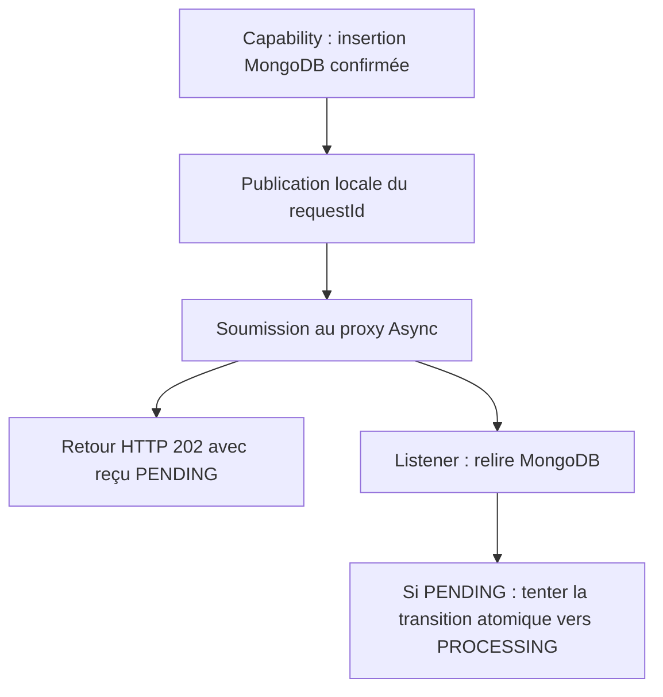

# INT-14 — Publier et consommer

**Statut : terminée sur reprise explicite « commit la 13 et reprends la 14 ».** La simplification d'INT-13 et la consigne d'équilibre ont été commitées localement dans `6081781`, sans l'ébauche Java. Les changements INT-14 restent non commités à l'issue de cette session ; aucun push effectué.

**[Simulation ConfluxLab]** Une seule application Spring Boot : Experience appelle Capability en Java. L'événement et le listener restent internes à Capability. Aucun mécanisme précis n'est attribué à AXA.

## 1. Ce que cet incrément apporte

Après sauvegarde de la demande, Capability publie un événement contenant **uniquement le `requestId`**. Un listener asynchrone relit MongoDB et tente la transition atomique `PENDING → PROCESSING` déjà développée dans INT-11.

Le POST garde son reçu initial `PENDING`. Le GET peut ensuite voir `PENDING` ou `PROCESSING`, selon l'instant de lecture. **Le listener peut commencer avant ou après le retour du `202`.**

Cet incrément s'arrête à la prise en charge : le listener termine après sa tentative de transition. Aucun parcours métier n'est simulé et aucun `SUCCEEDED` n'est produit. `PROCESSING` ne prouve donc pas qu'un worker tourne encore.



## 2. Les quatre éléments du câblage

| Fichier | Rôle |
|---|---|
| [FamilyRequestSubmitted.java](../../capability-api/src/main/java/dev/confluxlab/capability/internal/FamilyRequestSubmitted.java) | Record interne immuable : UUID non nul, sans payload personnel |
| [FamilyRequestService.java](../../capability-api/src/main/java/dev/confluxlab/capability/internal/FamilyRequestService.java) | Publier après le retour de l'insertion, avant le reçu |
| [FamilyRequestListener.java](../../capability-api/src/main/java/dev/confluxlab/capability/internal/FamilyRequestListener.java) | Recevoir sur un worker, relire et tenter la prise en charge |
| [FamilyRequestConfiguration.java](../../capability-api/src/main/java/dev/confluxlab/capability/internal/FamilyRequestConfiguration.java) | Activer les proxies asynchrones avec `@EnableAsync` |

### Sauvegarder avant de notifier

Extrait partiel du service :

```java
store.save(stored);
events.publishEvent(new FamilyRequestSubmitted(requestId));
return new RequestAccepted(requestId, stored.status(), "/api/v1/requests/" + requestId);
```

Spring injecte `ApplicationEventPublisher` dans le constructeur. Si `save` lève une exception, la publication n'est jamais atteinte. Publier avant d'enregistrer pourrait au contraire réveiller un listener qui ne retrouve pas encore le document.

L'objet `stored` est immuable : son statut reste celui de l'acceptation initiale, même si le document MongoDB a déjà progressé lorsque le client reçoit le POST.

### Recevoir sur un autre thread

Extrait partiel du listener :

```java
@Async("applicationTaskExecutor")
@EventListener
public void onFamilyRequestSubmitted(FamilyRequestSubmitted event) {
```

- `@EventListener` abonne cette méthode au type de l'événement.
- `@EnableAsync` active l'interception Spring ; `@Async` demande au proxy de soumettre l'exécution à l'executor nommé `applicationTaskExecutor`.
- Ici, cet executor est celui auto-configuré par Boot. **Aucun pool dédié borné ni handler d'erreur personnalisé n'est ajouté** : ces choix appartiennent à INT-15.
- Un appel Java direct sur un objet créé avec `new`, ou une auto-invocation contournant le proxy, ne fournirait pas cette séparation de threads.

Le listener dépend du store MongoDB interne et de l'horloge de Capability. Il relit la demande, ignore une absence ou un état différent de `PENDING`, puis appelle `transition(...)`. La lecture seule ne verrouille rien : c'est le filtre MongoDB évalué atomiquement avec la modification qui laisse un seul gagnant.

Il n'y a pas de travail métier après cette tentative dans INT-14. La future orchestration devra continuer seulement pour la prise en charge gagnante, jamais pour un résultat vide.

## 3. Tests : réutiliser et vérifier le câblage manquant

**Un seul scénario est ajouté**, dans [FamilyRequestEventsIT.java](../../application/src/test/java/dev/confluxlab/capability/internal/FamilyRequestEventsIT.java). Il utilise le véritable événement Spring, le listener proxifié et MongoDB Testcontainers :

1. Un spy du store bloque les tentatives de transition derrière un `CountDownLatch`, un signal que le test peut libérer.
2. Le POST doit néanmoins répondre `202` ; une seconde publication du même UUID fait arriver deux workers devant la prise en charge.
3. Le test confirme qu'ils ne tournent pas sur le thread HTTP et que le document est encore `PENDING` tant que le signal reste fermé.
4. Après libération, les deux commandes MongoDB retournent normalement et **une seule retourne un document gagnant**. Le GET voit `PROCESSING`.

Le blocage est une instrumentation de test, pas un faux traitement de production. Les attentes sont bornées ; aucun `Thread.sleep` ne sert de preuve. Le signal est libéré même en cas d'échec, puis le test attend que ses workers terminent. Le réglage de deux threads est propre à ce test pour permettre deux candidats, pas un dimensionnement de production.

Deux tests unitaires existants du service ont été renforcés : publication une fois le document présent ; **aucune publication si l'insertion échoue**. Les autres constructions unitaires reçoivent un publisher inactif de test.

Les tests de suivi acceptent désormais les deux états légitimes sans exiger que le statut reste stable entre deux GET ; UUID, trois champs publics et `createdAt` restent vérifiés. Les tests d'insertion et de redémarrage attendent `PROCESSING` avant de comparer un snapshot, pour ne pas dépendre de la course avec le listener. Aucun cas existant n'est supprimé.

## 4. Commande exécutée et résultat

**Depuis la racine `conflux-lab/`, avec JDK 21 et Docker disponibles :**

```sh
./mvnw -B -ntp '-Dtest=FamilyRequestServiceTest#storesThePayloadAsPendingBeforeReturningAcceptance+doesNotReturnAcceptanceWhenTheStoreThrows,FamilyRequestTrackingHttpTest#followsThePostLocationToMetadataAndKeepsCreatedAtAcrossGets+correlatesEachOfTwoPostsWithItsOwnTrackingView,ModuleArchitectureTest#experienceOnlyUsesThePublicCapabilityApi' -Dsurefire.failIfNoSpecifiedTests=false '-Dit.test=FamilyRequestEventsIT,MongoFamilyRequestStoreIT,FamilyRequestPersistenceIT' verify
```

`-B -ntp` évite l'interaction et la progression des téléchargements. `-Dtest` sélectionne les tests Surefire ; `-Dit.test` sélectionne séparément les IT Failsafe. `surefire.failIfNoSpecifiedTests=false` permet aux autres modules de ne pas contenir les méthodes sélectionnées. `verify` compile/package le réacteur, puis exécute et contrôle les IT ; aucun `clean` n'était nécessaire ici.

La commande écrit les sorties `target/`, démarre un MongoDB temporaire et deux JVM applicatives pour le test du JAR. Elle ne touche pas à une base utilisateur et ne publie aucun artefact distant.

**Résultat observé le 2026-10-22 : `BUILD SUCCESS`, 9 cas réussis, 0 échec, 0 erreur, 0 ignoré.**

| Sélection | Cas |
|---|---:|
| Surefire — service : ordre de publication et échec de sauvegarde | 2 |
| Surefire — suivi HTTP : métadonnées et corrélation de deux demandes | 2 |
| Surefire — frontière publique Experience/Capability | 1 |
| Failsafe — événements, worker bloqué et double réception | 1 |
| Failsafe — insertion/collision et erreur de stockage simulée | 2 |
| Failsafe — redémarrage du JAR et conservation du document | 1 |

Les rapports XML correspondants ont été lus sous `capability-api/target/surefire-reports/`, `application/target/surefire-reports/` et `application/target/failsafe-reports/`. Ils sont ignorés par Git. Le test du JAR a retrouvé la demande `a607b4ab-beb8-46eb-9907-f43feddea055` en `PROCESSING` après un nouveau lancement ; les deux JVM ont été arrêtées et aucun conteneur Testcontainers ne restait après le passage.

**La suite complète n'a pas été exécutée.** Le test direct des transitions `MongoFamilyRequestTransitionIT` n'était pas sélectionné dans ce passage ; ses résultats antérieurs ne sont pas comptés parmi ces neuf cas.

## 5. Limites et réponse d'entretien

L'événement reste local et non durable. Aucune reprise après crash, orchestration, transition terminale, gestion complète des erreurs async ou CI n'est livrée. Retrouver `PROCESSING` après redémarrage prouve la persistance de l'état, **pas la reprise de son exécution**. Les limites essentielles restent dans [INT-13](INT-13-dessiner-les-fenetres-de-panne.md), sans nouvelle matrice de pannes.

**À l'oral :**

> Dans ConfluxLab, je publie l'UUID après l'insertion confirmée. Spring remet l'événement à un listener asynchrone qui relit la demande et tente une prise en charge atomique en base. Le POST n'attend pas ce worker, et je ne suppose pas qu'il démarre après le 202. Le test bloque le worker tout en obtenant la réponse, puis vérifie un seul gagnant pour deux réceptions. À cette étape, le code s'arrête à PROCESSING : ni succès métier fictif ni garantie de reprise après crash. L'executor dédié et ses erreurs seront traités séparément.

**Piège : « La lecture `PENDING` empêche deux workers de gagner ? »** Non : les deux peuvent la lire. C'est la commande conditionnelle atomique d'INT-11 qui arbitre, pas cette lecture Java.

## 6. Suivi centralisé

Les [tâches restantes du sprint](../../docs/stages/sprint-04-async.md#int-15--borner-lexécution) ont été resserrées : bornage et journalisation dans INT-15, consolidation sans doublons dans INT-16. Cette révision du plan ne modifie ni les preuves ci-dessus ni le code, et ne démarre pas ces tâches.

- [TD-B012 — Publication et consommation : action terminée avec preuves](../todos.md#td-b012).
- [TD-R021 — Événement local, proxy async et prise en charge : repère de cours](../todos.md#td-r021).
- [TD-B013 — Bornage et erreurs d'exécution : INT-15, nouveau feu vert requis](../todos.md#td-b013).
- [TD-B014 — Consolidation des preuves : INT-16, nouveau feu vert requis](../todos.md#td-b014).
