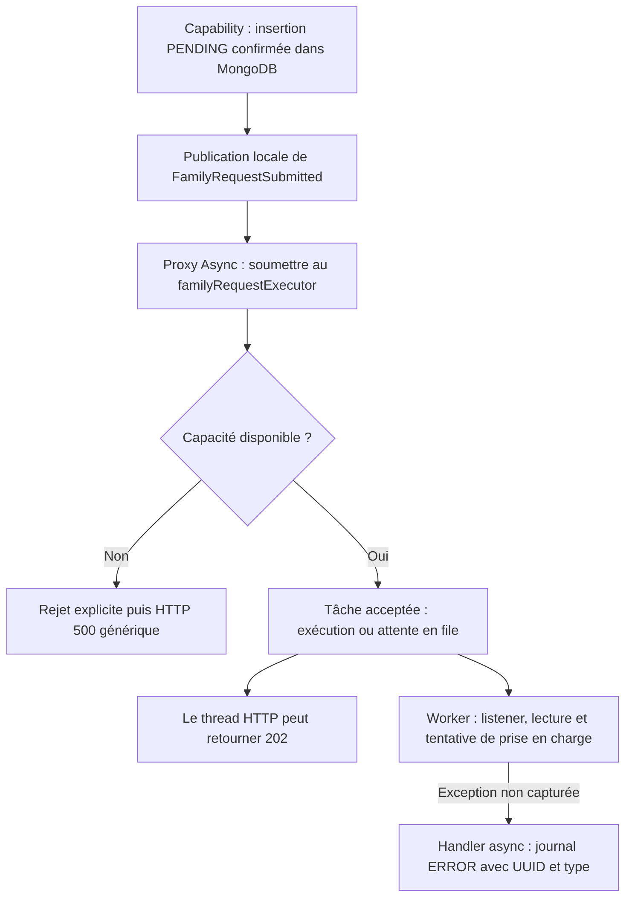

# INT-15 — Borner l'exécution

**Statut : terminée sur feu vert « ok commit ça & go 15 ».** INT-14 et le plan allégé ont été commitées localement au préalable dans `bdb93f8`. Aucun push n'a été effectué lors de l'implémentation. Les preuves d'exécution sont celles du **2026-10-22** ; la réécriture pédagogique n'a relancé aucun test.

**[Simulation ConfluxLab]** Les valeurs présentées sont des réglages pédagogiques modifiables, pas un dimensionnement de production ni un paramétrage historique AXA. Ce cours détaille le code existant sans ajouter de mécanisme, de scénario ou de travail métier fictif.

## Parcours de lecture

- Pour comprendre le fonctionnement : sections **1 à 5**, puis le résultat en **7**.
- Pour suivre les preuves : section **6**, avec le fichier de test complet et sa lecture guidée.
- Les fichiers de production reproduits sont complets ; les petits extraits du service et de l'advice sont explicitement partiels. Les sources liées restent la référence si le code évolue.

### Sommaire

- [1. Le problème et le flux](#1-le-problème-et-le-flux)
- [2. La configuration Java complète](#2-la-configuration-java-complète)
- [3. Le listener et la publication](#3-le-listener-et-la-publication)
- [4. Rejet et exception async : deux chemins différents](#4-rejet-et-exception-async--deux-chemins-différents)
- [5. Où se trouve la configuration YAML ?](#5-où-se-trouve-la-configuration-yaml-)
- [6. Les tests complets et leur lecture guidée](#6-les-tests-complets-et-leur-lecture-guidée)
- [7. Commande exécutée, résultats et limites](#7-commande-exécutée-résultats-et-limites)
- [8. Formulation d'entretien](#8-formulation-dentretien)
- [9. Suivi centralisé](#9-suivi-centralisé)

## 1. Le problème et le flux

INT-14 a séparé la réponse HTTP de la prise en charge : le service publie l'UUID et un listener travaille sur un autre thread. Il utilisait l'executor auto-configuré par Boot. **INT-15 rend explicites les capacités de ce traitement et la visibilité de ses erreurs.**

| Mot | Sens concret |
|---|---|
| **Thread HTTP** | Thread qui traite le POST et construit sa réponse |
| **Executor / pool** | Composant qui reçoit les tâches et fournit les threads de travail |
| **Worker** | Thread du pool qui exécute une tâche ; il peut aussi être inoccupé |
| **File d'attente** | Stockage en mémoire des tâches acceptées qui attendent un worker |
| **Soumission** | Remise d'une tâche à l'executor, avant son exécution effective |
| **Saturation** | Les workers et les places en file sont occupés, donc l'executor ne peut plus accepter une tâche |
| **Handler** | Fonction appelée pour traiter une erreur ; le handler de rejet et celui des exceptions async ont des rôles différents |

Flux simplifié du code livré, dans **un seul monolithe modulaire** :



Les branches HTTP et worker n'imposent aucun ordre entre le démarrage du listener et la réception du `202`. Ce dernier ne signifie toujours pas « famille créée » ni « exécution durable ».

Trois fichiers changent dans INT-15 : [la configuration](../../capability-api/src/main/java/dev/confluxlab/capability/internal/FamilyRequestConfiguration.java), [le listener](../../capability-api/src/main/java/dev/confluxlab/capability/internal/FamilyRequestListener.java) et [le test événementiel](../../application/src/test/java/dev/confluxlab/capability/internal/FamilyRequestEventsIT.java). Il n'y a ni nouvelle dépendance, ni route HTTP, ni champ MongoDB.

## 2. La configuration Java complète

### 2.1 Fichier réel

[FamilyRequestConfiguration.java](../../capability-api/src/main/java/dev/confluxlab/capability/internal/FamilyRequestConfiguration.java) — **fichier complet inspecté** :

```java
package dev.confluxlab.capability.internal;

import java.time.Clock;
import java.util.concurrent.ThreadPoolExecutor;
import java.util.concurrent.TimeUnit;

import com.mongodb.WriteConcern;

import org.slf4j.Logger;
import org.slf4j.LoggerFactory;
import org.springframework.aop.interceptor.AsyncUncaughtExceptionHandler;
import org.springframework.beans.factory.annotation.Value;
import org.springframework.context.annotation.Bean;
import org.springframework.context.annotation.Configuration;
import org.springframework.data.mongodb.MongoDatabaseFactory;
import org.springframework.data.mongodb.core.MongoTemplate;
import org.springframework.data.mongodb.core.convert.MongoConverter;
import org.springframework.scheduling.annotation.AsyncConfigurer;
import org.springframework.scheduling.annotation.EnableAsync;
import org.springframework.scheduling.concurrent.ThreadPoolTaskExecutor;

@Configuration(proxyBeanMethods = false)
@EnableAsync
class FamilyRequestConfiguration implements AsyncConfigurer {

    private static final Logger LOGGER = LoggerFactory.getLogger(FamilyRequestConfiguration.class);

    @Bean
    MongoTemplate mongoTemplate(MongoDatabaseFactory factory, MongoConverter converter) {
        MongoTemplate template = new MongoTemplate(factory, converter);
        template.setWriteConcern(WriteConcern.MAJORITY.withJournal(true).withWTimeout(5, TimeUnit.SECONDS));
        return template;
    }

    @Bean
    Clock familyRequestClock() {
        return Clock.systemUTC();
    }

    @Bean
    ThreadPoolTaskExecutor familyRequestExecutor(
            @Value("${conflux.processing.workers:2}") int workers,
            @Value("${conflux.processing.queue-capacity:16}") int queueCapacity,
            @Value("${conflux.processing.shutdown-await-seconds:5}") int shutdownAwaitSeconds) {
        if (workers < 1 || queueCapacity < 0 || shutdownAwaitSeconds < 1) {
            throw new IllegalArgumentException("Processing workers and shutdown wait must be positive; queue capacity must be non-negative.");
        }
        ThreadPoolTaskExecutor executor = new ThreadPoolTaskExecutor();
        executor.setCorePoolSize(workers);
        executor.setMaxPoolSize(workers);
        executor.setQueueCapacity(queueCapacity);
        executor.setThreadNamePrefix("family-request-");
        executor.setRejectedExecutionHandler(new ThreadPoolExecutor.AbortPolicy());
        executor.setWaitForTasksToCompleteOnShutdown(true);
        executor.setAwaitTerminationSeconds(shutdownAwaitSeconds);
        return executor;
    }

    @Override
    public AsyncUncaughtExceptionHandler getAsyncUncaughtExceptionHandler() {
        return (failure, method, parameters) -> {
            String requestId = parameters.length > 0 && parameters[0] instanceof FamilyRequestSubmitted submitted
                    ? submitted.requestId().toString() : "unknown";
            // Exception messages and event arguments may contain personal data; do not log them.
            LOGGER.error("Async family request failed: requestId={}, exceptionType={}",
                    requestId, failure.getClass().getSimpleName());
        };
    }
}
```

### 2.2 Les annotations et l'injection

- **`@Configuration`** indique une classe de configuration Spring ; ses méthodes `@Bean` fournissent des objets gérés par le conteneur.
- **`proxyBeanMethods = false`** désactive l'interception des appels Java entre méthodes `@Bean` de cette classe. Cela **ne désactive pas** les proxies `@Async` du listener : ce sont deux mécanismes distincts.
- **`@EnableAsync`** active le traitement de `@Async`. Spring peut alors placer un proxy devant le listener pour soumettre ses appels à un executor.
- **`@Bean familyRequestExecutor(...)`** donne ici son nom au bean. C'est exactement ce nom que le listener demande avec `@Async("familyRequestExecutor")`.
- **`@Value`** résout une propriété Spring puis la convertit en `int` ; la valeur après `:` est le défaut si la propriété est absente.
- **`implements AsyncConfigurer`** permet de fournir à Spring le handler des exceptions non capturées des méthodes async `void`. Ce handler n'est pas la politique de rejet du pool.

Spring crée normalement un seul bean de cet executor, l'initialise et gère sa destruction. Il ne faut donc ni créer un pool par requête ni appeler manuellement son initialisation dans ce code.

Les beans `mongoTemplate` et `familyRequestClock` existaient déjà. Le premier impose l'acquittement MongoDB retenu dans INT-10 ; le second fournit l'horloge UTC utilisée pour les dates. **Le `5` de `withWTimeout` concerne l'acquittement d'écriture, pas l'attente de fermeture de l'executor.** Voir [INT-10](../sprint-03/INT-10-persister-avant-d-accepter.md) pour ses limites ; il ne borne pas universellement toute la requête HTTP.

### 2.3 Les trois propriétés

| Propriété | Défaut | Effet |
|---|---:|---|
| `conflux.processing.workers` | 2 | Plafond fixe de workers, car core et maximum sont égaux |
| `conflux.processing.queue-capacity` | 16 | Nombre de tâches pouvant attendre en mémoire |
| `conflux.processing.shutdown-await-seconds` | 5 | Attente de terminaison lors de la destruction de ce bean |

Le garde-fou Java refuse un nombre de workers ou une attente inférieurs à 1, ainsi qu'une file négative. **Une file de capacité `0` est permise** : pas de stockage en attente, une soumission doit pouvoir être remise immédiatement à un worker disponible, sinon elle est rejetée.

Les valeurs se remplacent par les propriétés Spring usuelles. Dans les tests exécutés, `@SpringBootTest(properties = ...)` les remplace réellement : **2 workers, mais seulement 1 place en file**. Il n'y a pas de fichier de configuration fictif à créer pour expliquer ce réglage.

### 2.4 Le rôle de chaque réglage du pool

| Instruction | Pourquoi elle est là |
|---|---|
| `setCorePoolSize(workers)` | Fixer le nombre de workers de base ; ils sont créés selon les besoins du pool |
| `setMaxPoolSize(workers)` | Interdire de dépasser ce même nombre : pas d'extension au-delà du plafond quand la file se remplit |
| `setQueueCapacity(queueCapacity)` | Borner les tâches acceptées mais pas encore exécutées |
| `setThreadNamePrefix("family-request-")` | Identifier ces threads dans les logs et le débogueur ; le nom ne constitue pas à lui seul une preuve d'asynchronisme |
| `setRejectedExecutionHandler(new AbortPolicy())` | Lever une erreur si la tâche ne peut pas être acceptée, sans perte silencieuse ou exécution sur le thread appelant |

Avec les défauts, on peut avoir **2 tâches exécutées et 16 en attente**. Si ces capacités restent occupées, la soumission suivante est refusée. Cela ne signifie pas que chaque requête d'un certain numéro sera rejetée : les workers libèrent normalement des places au fil du temps. Le test bloque volontairement leur progression pour rendre la saturation déterministe.

La capacité de file borne un **nombre de tâches**, pas directement une quantité de mémoire en octets ou une latence maximale. L'événement ne transporte que l'UUID ; la file reste néanmoins volatile.

### 2.5 Ce que signifie l'attente de fermeture

`setWaitForTasksToCompleteOnShutdown(true)` permet aux tâches déjà soumises de terminer au lieu de demander immédiatement leur interruption et d'abandonner la file lors de la destruction du bean. `setAwaitTerminationSeconds(5)` borne l'attente de terminaison effectuée à cet endroit.

**Ce n'est pas un timeout de tâche, un arrêt forcé après 5 s ou une borne sur toute la fermeture de la JVM.** Un travail bloqué peut encore continuer au-delà. Un crash brutal ne passe pas par cette fermeture propre et peut perdre les tâches en mémoire. La configuration est présente ; aucun test d'arrêt prolongé n'a été exécuté dans INT-15.

## 3. Le listener et la publication

### 3.1 Listener complet

[FamilyRequestListener.java](../../capability-api/src/main/java/dev/confluxlab/capability/internal/FamilyRequestListener.java) — **fichier complet inspecté** :

```java
package dev.confluxlab.capability.internal;

import java.time.Clock;
import java.time.Instant;

import dev.confluxlab.contracts.RequestStatus;
import org.springframework.context.event.EventListener;
import org.springframework.scheduling.annotation.Async;
import org.springframework.stereotype.Component;

@Component
class FamilyRequestListener {

    private final MongoFamilyRequestStore store;
    private final Clock clock;

    FamilyRequestListener(MongoFamilyRequestStore store, Clock clock) {
        this.store = store;
        this.clock = clock;
    }

    @Async("familyRequestExecutor")
    @EventListener
    public void onFamilyRequestSubmitted(FamilyRequestSubmitted event) {
        store.findById(event.requestId())
                .filter(request -> request.status() == RequestStatus.PENDING)
                .ifPresent(request -> {
                    // This increment stops at the atomic claim; no business processing is simulated.
                    store.transition(request.requestId(), RequestStatus.PENDING, RequestStatus.PROCESSING, Instant.now(clock));
                });
    }
}
```

**Lecture dans l'ordre :**

1. `@Component` rend le listener découvrable dans le contexte Spring. Son constructeur reçoit le store et l'horloge ; Experience ne dépend pas de ces classes internes.
2. `@EventListener` sélectionne les événements du type `FamilyRequestSubmitted`, le record interne contenant l'UUID non nul.
3. L'appel passe par le proxy `@Async`, qui demande l'executor **nommé** `familyRequestExecutor`. Appeler directement un objet créé par `new`, ou contourner le proxy par une auto-invocation, ne fournirait pas cette séparation de threads.
4. Sur un worker, `findById` relit le document. Une absence ou un statut différent de `PENDING` ne déclenche pas de tentative de transition.
5. La lecture ne verrouille rien : deux workers peuvent tous deux lire `PENDING`. C'est la commande conditionnelle atomique de [MongoFamilyRequestStore](../../capability-api/src/main/java/dev/confluxlab/capability/internal/MongoFamilyRequestStore.java), développée dans INT-11, qui laisse un seul gagnant.

**Le code s'arrête après cette tentative.** Il n'exécute pas les six opérations métier et ne produit pas de succès artificiel. La future orchestration devra continuer seulement sur un résultat de prise en charge gagnant, pas après un résultat vide. `PROCESSING` ne prouve pas qu'un worker est encore vivant.

### 3.2 Pourquoi un rejet peut laisser un document en base

Extrait partiel de [FamilyRequestService.java](../../capability-api/src/main/java/dev/confluxlab/capability/internal/FamilyRequestService.java), inchangé par INT-15 :

```java
UUID requestId = UUID.randomUUID();
StoredFamilyRequest stored = StoredFamilyRequest.pending(
                requestId, snapshot, Instant.now(clock).truncatedTo(ChronoUnit.MILLIS));
store.save(stored);
events.publishEvent(new FamilyRequestSubmitted(requestId));
return new RequestAccepted(requestId, stored.status(), "/api/v1/requests/" + requestId);
```

L'insertion précède la publication. Avec le distributeur d'événements synchrone actuel, publier atteint le proxy du listener, qui tente la soumission. Si le pool refuse, l'exception remonte **avant** le `return new RequestAccepted(...)`. Le reçu n'est donc pas retourné, mais MongoDB a déjà reçu le document.

Cela explique le couple **`500` côté client / `PENDING` en base**. Il n'y a ni rollback commun entre MongoDB et l'événement, ni reprise automatique. Ne pas rejouer aveuglément le POST : l'UUID de corrélation ne rend pas une seconde création idempotente.

## 4. Rejet et exception async : deux chemins différents

| Situation | Où l'erreur apparaît | Comportement livré |
|---|---|---|
| L'executor refuse la soumission | Sur le chemin du thread HTTP qui publie l'événement | `AbortPolicy` provoque une erreur de soumission ; Spring la remonte, et l'advice HTTP renvoie `500` générique |
| La tâche est acceptée, puis le corps du listener lève une exception | Sur le worker | Le `AsyncUncaughtExceptionHandler` journalise l'UUID et le type ; l'erreur ne revient pas automatiquement au POST |

### 4.1 Le rejet ne passe pas par le handler du corps async

La tâche refusée n'a pas commencé à exécuter le listener. `ThreadPoolTaskExecutor` traduit le refus natif en erreur de soumission Spring (`TaskRejectedException`). Le handler MVC générique existant peut donc la traiter.

Extrait partiel de [ApiExceptionHandler.java](../../experience-api/src/main/java/dev/confluxlab/experience/ApiExceptionHandler.java), **pas un nouvel advice** :

```java
@ExceptionHandler(Exception.class)
public ResponseEntity<ProblemDetail> handleUnexpected(Exception exception) {
    return ResponseEntity.internalServerError().body(problem(HttpStatus.INTERNAL_SERVER_ERROR));
}
```

Le test vérifie `500`, le détail générique, l'absence de `Location` et de `requestId` public. Il ne revendique pas un nouveau mapping de saturation en `503`.

### 4.2 Lire le callback d'exception async

Le handler complet figure dans la configuration de la section 2. Spring lui fournit :

- `failure` : l'exception non capturée du corps async ;
- `method` : la méthode concernée, non utilisée dans le message actuel ;
- `parameters` : ses arguments ; ici le premier est normalement `FamilyRequestSubmitted`.

La condition `parameters.length > 0` évite un accès hors limites. Le pattern `instanceof FamilyRequestSubmitted submitted` vérifie le type et crée une variable typée. Seul `submitted.requestId()` est lu ; l'événement complet n'est pas converti en texte. Si l'argument attendu est absent, le journal utilise `unknown` au lieu de provoquer une seconde erreur dans le handler.

Le message contient **UUID et nom du type d'exception**, au niveau `ERROR`. On n'y passe ni `failure.getMessage()`, ni le `Throwable` complet, ni les arguments. C'est un diagnostic volontairement minimal : il facilite la corrélation mais ne fournit pas de stack trace détaillée. Ce compromis évite de recopier des données personnelles éventuellement présentes dans les exceptions.

Extrait réellement observé dans le test, avec **échec volontairement simulé** :

```text
Async family request failed: requestId=0f23db7c-2622-456b-9168-5dcccb5a966a, exceptionType=DataAccessResourceFailureException
```

Le handler **ne modifie aucun statut**. Un échec avant prise en charge ne permet pas `PENDING → FAILED`, et une panne MongoDB peut empêcher toute écriture. Une réponse `202` déjà reçue reste inchangée ; le worker peut aussi échouer avant sa réception sans faire automatiquement échouer ce POST.

## 5. Où se trouve la configuration YAML ?

Les défauts `2 / 16 / 5` sont dans les `@Value` Java. **INT-15 n'a ajouté ni fichier YAML ni section `conflux.processing`.** Le test remplace réellement deux valeurs par son annotation Spring ; la section 6 en montre le code.

[application.yml](../../application/src/main/resources/application.yml) — **fichier existant complet, inchangé dans INT-15** :

```yaml
spring:
  application:
    name: conflux-lab
  data:
    mongodb:
      uri: ${MONGODB_URI:mongodb://localhost:27017/conflux_lab?serverSelectionTimeoutMS=3000&connectTimeoutMS=3000&socketTimeoutMS=5000&retryWrites=false}
      uuid-representation: standard

server:
  port: 8080
  error:
    include-message: never
    include-binding-errors: never
    include-stacktrace: never
    include-exception: false
```

- L'URI MongoDB sert au démarrage local ; les tests Testcontainers lui substituent l'adresse de leur base temporaire via `MongoTestSupport`.
- `server.error.*` règle les informations autorisées dans les erreurs Boot. Ces clés **n'assainissent pas automatiquement les journaux Java** et ne remplacent pas le `ProblemDetail` générique construit par l'advice.
- Les délais de connexion/lecture MongoDB, l'acquittement d'écriture et l'attente de fermeture du pool sont des réglages distincts. Ils ne définissent pas ensemble une garantie de durée métier.

## 6. Les tests complets et leur lecture guidée

### 6.1 Pourquoi trois cas, pas une nouvelle matrice

| Cas dans `FamilyRequestEventsIT` | Origine | Preuve recherchée |
|---|---|---|
| `acceptsWhileTheListenerIsBlockedAndOnlyOneDuplicateEventCanClaim` | Réutilisé d'INT-14 | Réponse HTTP indépendante et un seul gagnant malgré deux réceptions |
| `rejectsTheNextRequestWhenWorkersAndQueueAreFull` | Nouveau INT-15 | Capacité réellement bornée et refus explicite, sans exécution sur le thread HTTP |
| `logsAsyncFailureWithItsRequestIdWithoutLeakingTheExceptionMessage` | Nouveau INT-15 | Erreur du worker visible, corrélée et sans message privé ; statut non inventé |

### 6.2 Fichier de test réel complet

[FamilyRequestEventsIT.java](../../application/src/test/java/dev/confluxlab/capability/internal/FamilyRequestEventsIT.java) — **fichier complet inspecté**, incluant le cas réutilisé pour voir le câblage et le nettoyage sans devoir assembler plusieurs fragments :

```java
package dev.confluxlab.capability.internal;

import java.time.Duration;
import java.time.Instant;
import java.util.Optional;
import java.util.Queue;
import java.util.UUID;
import java.util.concurrent.ConcurrentLinkedQueue;
import java.util.concurrent.CountDownLatch;
import java.util.concurrent.TimeUnit;

import com.fasterxml.jackson.databind.ObjectMapper;
import dev.confluxlab.ConfluxLabApplication;
import dev.confluxlab.MongoTestSupport;
import dev.confluxlab.contracts.RequestStatus;
import org.junit.jupiter.api.Test;
import org.junit.jupiter.api.extension.ExtendWith;
import org.mockito.ArgumentCaptor;
import org.springframework.beans.factory.annotation.Autowired;
import org.springframework.beans.factory.annotation.Qualifier;
import org.springframework.boot.test.autoconfigure.web.servlet.AutoConfigureMockMvc;
import org.springframework.boot.test.context.SpringBootTest;
import org.springframework.boot.test.system.CapturedOutput;
import org.springframework.boot.test.system.OutputCaptureExtension;
import org.springframework.context.ApplicationEventPublisher;
import org.springframework.dao.DataAccessResourceFailureException;
import org.springframework.data.mongodb.core.MongoTemplate;
import org.springframework.http.MediaType;
import org.springframework.scheduling.concurrent.ThreadPoolTaskExecutor;
import org.springframework.test.context.bean.override.mockito.MockitoSpyBean;
import org.springframework.test.web.servlet.MockMvc;
import org.springframework.test.web.servlet.MvcResult;

import static org.awaitility.Awaitility.await;
import static org.junit.jupiter.api.Assertions.assertEquals;
import static org.junit.jupiter.api.Assertions.assertFalse;
import static org.junit.jupiter.api.Assertions.assertTrue;
import static org.mockito.ArgumentMatchers.any;
import static org.mockito.ArgumentMatchers.eq;
import static org.mockito.Mockito.doAnswer;
import static org.mockito.Mockito.doThrow;
import static org.mockito.Mockito.times;
import static org.mockito.Mockito.verify;
import static org.springframework.test.web.servlet.request.MockMvcRequestBuilders.get;
import static org.springframework.test.web.servlet.request.MockMvcRequestBuilders.post;
import static org.springframework.test.web.servlet.result.MockMvcResultMatchers.header;
import static org.springframework.test.web.servlet.result.MockMvcResultMatchers.jsonPath;
import static org.springframework.test.web.servlet.result.MockMvcResultMatchers.status;

@SpringBootTest(classes = ConfluxLabApplication.class, properties = {
        "conflux.processing.workers=2", "conflux.processing.queue-capacity=1"})
@AutoConfigureMockMvc
@ExtendWith(OutputCaptureExtension.class)
class FamilyRequestEventsIT extends MongoTestSupport {

    private static final String VALID_REQUEST = """
            {
              "principal": {"firstName": "Alex", "lastName": "Exemple", "birthDate": "1990-04-12"},
              "dependents": [
                {"firstName": "Camille", "lastName": "Exemple", "birthDate": "2015-08-21"},
                {"firstName": "Noa", "lastName": "Exemple", "birthDate": "2018-02-03"}
              ]
            }
            """;

    @Autowired
    private MockMvc mockMvc;

    @Autowired
    private ObjectMapper objectMapper;

    @Autowired
    private ApplicationEventPublisher events;

    @Autowired
    @Qualifier("familyRequestExecutor")
    private ThreadPoolTaskExecutor taskExecutor;

    @MockitoSpyBean
    private MongoFamilyRequestStore store;

    @Autowired
    private MongoTemplate mongoTemplate;

    @Test
    void acceptsWhileTheListenerIsBlockedAndOnlyOneDuplicateEventCanClaim() throws Exception {
        CountDownLatch ready = new CountDownLatch(2);
        CountDownLatch release = new CountDownLatch(1);
        CountDownLatch finished = new CountDownLatch(2);
        Queue<Optional<?>> results = new ConcurrentLinkedQueue<>();
        Queue<Thread> workers = new ConcurrentLinkedQueue<>();
        Thread requestThread = Thread.currentThread();
        doAnswer(invocation -> {
            workers.add(Thread.currentThread());
            ready.countDown();
            try {
                assertTrue(release.await(10, TimeUnit.SECONDS), "Test must release both claim attempts.");
                Optional<?> result = (Optional<?>) invocation.callRealMethod();
                results.add(result);
                return result;
            } finally {
                finished.countDown();
            }
        }).when(store).transition(any(UUID.class), eq(RequestStatus.PENDING), eq(RequestStatus.PROCESSING), any(Instant.class));

        try {
            MvcResult response = postAcceptedRequest();
            UUID requestId = UUID.fromString(objectMapper.readTree(response.getResponse().getContentAsString())
                    .path("requestId").asText());
            events.publishEvent(new FamilyRequestSubmitted(requestId));

            assertTrue(ready.await(5, TimeUnit.SECONDS), "Both event deliveries must reach the claim before release.");
            assertTrue(workers.stream().allMatch(worker -> worker != requestThread), "The listener must not run on the HTTP thread.");
            assertEquals(RequestStatus.PENDING, store.findById(requestId).orElseThrow().status());

            release.countDown();
            assertTrue(finished.await(10, TimeUnit.SECONDS), "Both claim attempts must finish.");
            assertEquals(2, results.size(), "Both MongoDB attempts must return normally; inspect async logs otherwise.");
            assertEquals(1L, results.stream().filter(Optional::isPresent).count());
            assertEquals(RequestStatus.PROCESSING, store.findById(requestId).orElseThrow().status());
            mockMvc.perform(get("/api/v1/requests/{requestId}", requestId))
                    .andExpect(status().isOk())
                    .andExpect(jsonPath("$.status").value("PROCESSING"));
        } finally {
            release.countDown();
            awaitWorkersIdle();
        }
    }

    @Test
    void rejectsTheNextRequestWhenWorkersAndQueueAreFull() throws Exception {
        assertEquals(2, taskExecutor.getCorePoolSize());
        assertEquals(2, taskExecutor.getMaxPoolSize());
        assertEquals(1, taskExecutor.getQueueCapacity());
        CountDownLatch running = new CountDownLatch(2);
        CountDownLatch release = new CountDownLatch(1);
        Queue<Thread> workers = new ConcurrentLinkedQueue<>();
        Thread requestThread = Thread.currentThread();
        doAnswer(invocation -> {
            workers.add(Thread.currentThread());
            running.countDown();
            assertTrue(release.await(10, TimeUnit.SECONDS), "Test must release the saturated workers.");
            return invocation.callRealMethod();
        }).when(store).transition(any(UUID.class), eq(RequestStatus.PENDING), eq(RequestStatus.PROCESSING), any(Instant.class));

        try {
            postAcceptedRequest();
            postAcceptedRequest();
            assertTrue(running.await(5, TimeUnit.SECONDS), "Both workers must be occupied before filling the queue.");
            postAcceptedRequest();
            assertEquals(1, taskExecutor.getThreadPoolExecutor().getQueue().size());

            mockMvc.perform(post("/api/v1/families")
                            .contentType(MediaType.APPLICATION_JSON).content(VALID_REQUEST))
                    .andExpect(status().isInternalServerError())
                    .andExpect(header().doesNotExist("Location"))
                    .andExpect(jsonPath("$.detail").value("An unexpected error occurred."))
                    .andExpect(jsonPath("$.requestId").doesNotHaveJsonPath());
            assertEquals(2, workers.size(), "The rejected task must not execute on the HTTP thread.");
            assertTrue(workers.stream().allMatch(worker -> worker != requestThread));

            ArgumentCaptor<StoredFamilyRequest> saved = ArgumentCaptor.forClass(StoredFamilyRequest.class);
            verify(store, times(4)).save(saved.capture());
            UUID rejectedId = saved.getAllValues().get(3).requestId();
            release.countDown();
            awaitWorkersIdle();
            verify(store, times(3)).transition(any(UUID.class), eq(RequestStatus.PENDING), eq(RequestStatus.PROCESSING), any(Instant.class));
            assertEquals(RequestStatus.PENDING, store.findById(rejectedId).orElseThrow().status(),
                    "Insertion is not rolled back when submission is rejected.");
        } finally {
            release.countDown();
            awaitWorkersIdle();
        }
    }

    @Test
    void logsAsyncFailureWithItsRequestIdWithoutLeakingTheExceptionMessage(CapturedOutput output) throws Exception {
        String privateMarker = "INT15_PRIVATE_PAYLOAD_MARKER";
        doThrow(new DataAccessResourceFailureException(privateMarker)).when(store).findById(any(UUID.class));

        try {
            MvcResult response = postAcceptedRequest();
            UUID requestId = UUID.fromString(objectMapper.readTree(response.getResponse().getContentAsString())
                    .path("requestId").asText());
            String expectedLog = "Async family request failed: requestId=" + requestId
                    + ", exceptionType=DataAccessResourceFailureException";
            await("Correlated async error log").atMost(Duration.ofSeconds(5))
                    .untilAsserted(() -> assertTrue(output.getAll().contains(expectedLog)));
            awaitWorkersIdle();
            assertFalse(output.getAll().contains(privateMarker));
            StoredFamilyRequest stored = mongoTemplate.findById(requestId, StoredFamilyRequest.class);
            assertEquals(RequestStatus.PENDING, stored.status(), "A failure before claiming must not invent FAILED.");
        } finally {
            awaitWorkersIdle();
        }
    }

    private MvcResult postAcceptedRequest() throws Exception {
        return mockMvc.perform(post("/api/v1/families")
                        .contentType(MediaType.APPLICATION_JSON).content(VALID_REQUEST))
                .andExpect(status().isAccepted())
                .andExpect(jsonPath("$.status").value("PENDING"))
                .andReturn();
    }

    private void awaitWorkersIdle() {
        await("Async test workers to finish").atMost(Duration.ofSeconds(10))
                .until(() -> taskExecutor.getActiveCount() == 0 && taskExecutor.getThreadPoolExecutor().getQueue().isEmpty());
    }
}
```

### 6.3 Le contexte de test n'est pas une simulation totale

- **`@SpringBootTest`** charge l'assemblage réel, avec des propriétés de test pour le pool ; le défaut de file `16` devient `1` pour atteindre rapidement la saturation.
- **`@AutoConfigureMockMvc`** fournit `MockMvc`. Les POST passent par le vrai contrôleur et le service, mais **sans socket HTTP réel** : le thread du test tient ici le rôle du thread de requête. Le test du JAR d'INT-14, distinct, utilisait un vrai client réseau.
- **`MongoTestSupport`** démarre le MongoDB Testcontainers temporaire. Il ne remplace pas MongoDB par une map.
- **`@MockitoSpyBean`** enveloppe le vrai store : sauf interception explicite, ses méthodes accèdent réellement à MongoDB. Ce n'est pas un repository intégralement mocké.
- **`@Qualifier("familyRequestExecutor")`** injecte précisément le pool que le proxy du listener utilise. Le test contrôle donc le bean réel, pas un executor isolé créé pour l'occasion.
- **`OutputCaptureExtension` / `CapturedOutput`** capturent les sorties pour vérifier le journal du handler.

Les données JSON sont fictives. Les blocages et exceptions ajoutés par les tests ne sont pas un traitement métier branché dans l'application.

### 6.4 Lire le cas concurrent réutilisé

`ready` part de 2 et confirme que deux workers ont atteint la tentative de transition. `release` part de 1 et garde ces tentatives bloquées jusqu'à sa libération. `finished` permet d'attendre leurs retours. Les collections sont concurrentes parce que plusieurs workers y écrivent.

Le premier POST doit obtenir `202` alors que `release` est fermé ; une seconde publication du même UUID fait arriver le second candidat. Les deux ont pu lire `PENDING`. Après libération, `invocation.callRealMethod()` exécute les vraies commandes MongoDB : deux retours normaux, mais **un seul `Optional` présent**.

Si le listener exécutait ce travail sur le thread du POST, il resterait bloqué derrière le signal et le scénario ne pourrait pas se dérouler comme attendu. Le test vérifie également l'identité des threads ; il ne déduit pas l'asynchronisme d'une simple durée ou du nom du worker.

### 6.5 Lire le cas de saturation

| Étape contrôlée | Ce qu'elle établit |
|---|---|
| Vérifier core `2`, max `2`, file `1` | Les propriétés de test ont bien configuré le bean utilisé |
| Deux POST acceptés puis `running.await(...)` | Les deux workers sont réellement occupés avant de remplir la file |
| Troisième POST accepté, file de taille `1` | Une tâche attend et ne peut pas avancer tant que les deux workers sont bloqués |
| Quatrième POST | Le refus doit remonter en `500`, sans reçu ni `Location` |
| Deux workers observés, aucun égal au thread de requête | La tâche refusée n'a pas été exécutée sur ce thread en guise de secours |
| Capturer les quatre appels `save(...)` | Les quatre insertions ont précédé leur tentative de publication ; le quatrième UUID existe en interne malgré l'absence de reçu public |
| Libérer, attendre la fin, vérifier trois transitions | Les trois tâches acceptées ont atteint la prise en charge, pas une quatrième |
| Relire le quatrième document | Le rejet n'a ni annulé l'insertion ni inventé un état final : il reste `PENDING` |

`ArgumentCaptor` récupère les objets réellement passés à `save`, dans l'ordre de ces POST séquentiels. Il ne modifie pas le contrat HTTP pour obtenir l'UUID refusé. Le `finally` ouvre le signal même si une assertion échoue, afin de ne pas laisser les workers bloqués pendant les tests suivants.

### 6.6 Lire le cas d'erreur async

`doThrow(...)` provoque l'échec de `findById` dans le listener. **Il s'agit d'une erreur simulée au niveau du store, pas d'une coupure réseau MongoDB.** L'insertion, elle, a déjà eu lieu.

Le POST doit toujours pouvoir répondre `202`, car l'exception du corps async n'est pas renvoyée à ce thread. Awaitility attend une condition concrète, le message attendu, au plus 5 s. Le test vérifie ensuite que le marqueur privé de l'exception n'a pas été recopié.

La lecture finale passe directement par `mongoTemplate` parce que `store.findById` est précisément la méthode sabotée par le spy. Elle vérifie le véritable document en base, encore `PENDING` : le handler ne l'a pas transformé artificiellement en `FAILED`.

`awaitWorkersIdle()` attend à la fois zéro worker actif et une file vide, avec un délai maximal. Le timeout du signal et celui de la fermeture du bean sont distincts. **Aucun `Thread.sleep` ne sert de preuve.**

## 7. Commande exécutée, résultats et limites

### 7.1 Commande déjà exécutée pendant l'implémentation

**Répertoire de départ : racine `conflux-lab/`. Prérequis : JDK 21 et Docker accessibles, dépendances Maven et images disponibles ou téléchargeables.**

```sh
./mvnw -B -ntp -pl application -am '-Dtest=ModuleArchitectureTest#experienceOnlyUsesThePublicCapabilityApi' -Dsurefire.failIfNoSpecifiedTests=false -Dit.test=FamilyRequestEventsIT verify
```

| Option / phase | Rôle et effet |
|---|---|
| `./mvnw` | Utiliser le Maven Wrapper du dépôt, sans Maven installé séparément |
| `-B -ntp` | Mode batch, sans progression des téléchargements |
| `-pl application -am` | Sélectionner l'assemblage et construire aussi ses modules nécessaires |
| `-Dtest=...#...` | Sélectionner un seul contrôle Surefire de frontière Experience/Capability |
| `-Dsurefire.failIfNoSpecifiedTests=false` | Accepter que les autres modules ne contiennent pas cette méthode précise |
| `-Dit.test=FamilyRequestEventsIT` | Sélectionner séparément les trois cas Failsafe de cette classe |
| `verify` | Traverser compilation et packaging, puis exécuter et contrôler les IT ; pas seulement `test` |

Cette commande écrit les sorties locales `target/` et démarre un MongoDB temporaire dans Docker. Les téléchargements manquants peuvent nécessiter le réseau. Elle ne touche pas à une base utilisateur et ne publie aucun artefact distant. **Elle n'a pas été relancée pour enrichir cette note.**

### 7.2 Résultat effectivement observé

**`BUILD SUCCESS` le 2026-10-22 : 4 cas réussis, 0 échec, 0 erreur, 0 ignoré.**

| Exécution sélectionnée | Cas |
|---|---:|
| Surefire — `ModuleArchitectureTest` | 1 contrôle existant |
| Failsafe — `FamilyRequestEventsIT` | 3 cas : 1 réutilisé, 2 nouveaux |

Les deux rapports XML ont été lus :

- `application/target/surefire-reports/TEST-dev.confluxlab.ModuleArchitectureTest.xml` ;
- `application/target/failsafe-reports/TEST-dev.confluxlab.capability.internal.FamilyRequestEventsIT.xml`.

Ils sont générés sous `target/`, ignorés par Git et supprimables par un futur `clean`. Aucun conteneur Testcontainers ne restait après le passage. La ligne `ERROR` présentée en section 4 est l'erreur **attendue et injectée par le test**, pas un échec du build.

### 7.3 Limites honnêtes de ces preuves

- La suite complète n'a pas été exécutée ; les anciens rapports d'autres classes ne sont pas ajoutés au total de quatre cas.
- Le test exerce une file de capacité `1`, pas une campagne de charge validant les défauts `2 / 16 / 5` pour la production.
- Le refus des configurations invalides figure dans le code mais n'a pas de test spécifique exécuté ici.
- L'attente de fermeture est configurée, sans expérience avec un worker durablement bloqué ni garantie d'arrêt forcé.
- Aucun redémarrage du JAR, crash ou reprise n'a été rejoué dans INT-15. Les preuves de redémarrage d'INT-14 restent historiques.
- Le listener ne réalise toujours ni parcours métier ni état final ; aucun broker, stockage de diagnostics ou workflow CI n'est ajouté.

## 8. Formulation d'entretien

> Dans le labo, j'ai remplacé l'executor par défaut par un pool dédié avec un nombre fixe de workers et une file bornée. Une saturation provoque un refus explicite, pas une exécution sur le thread HTTP ni une acceptation silencieuse. Comme MongoDB a déjà reçu la demande, un rejet peut laisser PENDING malgré le 500. Les exceptions du listener void passent par un handler qui journalise l'UUID et leur type sans recopier de données personnelles. L'attente de fermeture est bornée, mais ce n'est pas un timeout du travail ni une garantie de reprise après crash.

**« Le handler doit toujours écrire `FAILED` ? »** Non. Un échec avant prise en charge ne permet pas cette transition, et une panne MongoDB peut empêcher toute écriture. Ici le handler journalise, il ne modifie pas le statut.

**« `proxyBeanMethods = false` annule `@Async` ? »** Non. Cela concerne les appels entre méthodes de la configuration, pas le proxy asynchrone placé autour du listener.

## 9. Suivi centralisé

- [TD-B013 — Bornage et journalisation : action terminée avec preuves](../todos.md#td-b013).
- [TD-R022 — Capacités, rejet et erreurs async : repère de cours](../todos.md#td-r022).
- [TD-B014 — INT-16 : consolidation des preuves, nouveau feu vert requis](../todos.md#td-b014).
