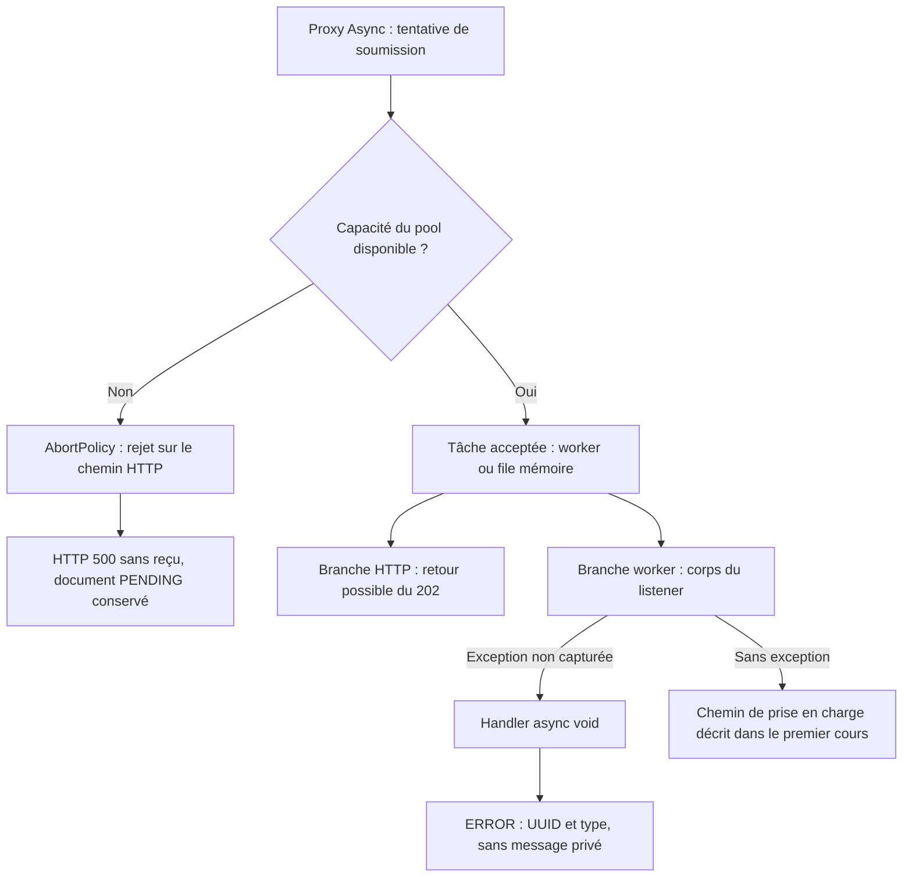

# INT-15 — Borner et diagnostiquer l'exécution

**Statut : résultat technique réalisé**, sur feu vert INT-15, repère `59c881c`. Un pool dédié limite workers et file ; ses rejets et les exceptions du listener deviennent visibles sans exposer de message privé. [Fiche du sprint 04](../../docs/stages/sprint-04-async.md).

**[Simulation ConfluxLab]** Les valeurs sont pédagogiques, ni dimensionnement de production ni paramètres historiques AXA. Les fragments applicatifs sont partiels et issus des sources inspectées ; aucun code de harnais de test n'est reproduit. Cette rédaction ne relance ni build ni test et n'actualise aucun résultat.

Le [cours INT-13 + INT-14 + INT-16](INT-13-traiter-les-demandes-en-arriere-plan.md) explique insertion, publication, proxy, claim et suivi. **INT-14 utilisait `applicationTaskExecutor`, auto-configuré par Boot ; INT-15 branche le listener sur `familyRequestExecutor`.** On ne réattribue pas le pool dédié aux preuves INT-14.

## 1. Où intervient le bornage ?

Un **executor** reçoit les tâches ; ses **workers** sont les threads qui les exécutent et sa **file** garde celles qui attendent en mémoire. La saturation survient lorsque ni worker ni place d'attente ne permet d'accepter une tâche.



Le rejet de soumission et l'exception dans une tâche acceptée ne se produisent pas au même endroit. Le diagramme sépare ces erreurs ; il ne fixe aucun ordre entre le worker et la réception du `202`.

## 2. Lire la configuration et ses paramètres

Source : [FamilyRequestConfiguration.java](../../capability-api/src/main/java/dev/confluxlab/capability/internal/FamilyRequestConfiguration.java).

| Élément / bean | Annotation ou contrat | Rôle |
|---|---|---|
| Configuration | `@Configuration(proxyBeanMethods = false)` | Déclarer les beans ; désactiver les appels interceptés entre méthodes `@Bean` ne désactive pas le proxy async du listener |
| `familyRequestExecutor` | `@Bean`, nom de la méthode | Un `ThreadPoolTaskExecutor` initialisé/détruit par Spring, pas un pool par requête |
| Paramètres de l'executor | `@Value` | Résoudre les propriétés Spring ; la valeur après `:` dans l'expression est le défaut |
| Configuration | `AsyncConfigurer` | Fournir le handler d'exceptions async `void`, distinct de la politique de rejet |
| `mongoTemplate`, `familyRequestClock` | Deux beans préexistants | Accès MongoDB avec acquittement retenu et horloge UTC ; pas des ajouts INT-15 |

Le nom est important : [FamilyRequestListener.java](../../capability-api/src/main/java/dev/confluxlab/capability/internal/FamilyRequestListener.java) demande précisément `@Async("familyRequestExecutor")`. Le rôle du proxy et de `@EnableAsync` est expliqué dans le premier cours.

| Propriété | Défaut | Effet et contrainte |
|---|---:|---|
| `conflux.processing.workers` | 2 | Plafond fixe de workers ; au moins 1 |
| `conflux.processing.queue-capacity` | 16 | Places en attente ; au moins 0, zéro signifiant aucune place de file |
| `conflux.processing.shutdown-await-seconds` | 5 | Attente de terminaison à la destruction du bean ; au moins 1 |

Ces défauts viennent des `@Value` Java, pas d'une section YAML ajoutée. Ils sont remplaçables par les propriétés Spring usuelles. Fragment de validation à la création du bean :

```java
if (workers < 1 || queueCapacity < 0 || shutdownAwaitSeconds < 1) {
    throw new IllegalArgumentException("Processing workers and shutdown wait must be positive; queue capacity must be non-negative.");
}
```

Une configuration invalide fait échouer le démarrage, pas une requête ultérieure. Une capacité zéro reste permise : remise immédiate à un worker disponible ou rejet, sans stockage en attente.

Même méthode, fragment des réglages après création de l'executor :

```java
executor.setCorePoolSize(workers);
executor.setMaxPoolSize(workers);
executor.setQueueCapacity(queueCapacity);
executor.setThreadNamePrefix("family-request-");
executor.setRejectedExecutionHandler(new ThreadPoolExecutor.AbortPolicy());
```

- **Core et maximum égaux** : le pool ne crée pas de workers au-delà du plafond lorsque la file se remplit. Les threads sont créés selon les besoins.
- **File bornée** : avec les défauts, jusqu'à 2 tâches s'exécutent et 16 attendent. Une soumission supplémentaire est refusée si ces capacités restent occupées ; ce n'est pas une règle sur le numéro d'une requête.
- **Préfixe** : aide à retrouver les threads, mais leur nom ne prouve pas à lui seul l'asynchronisme.
- **`AbortPolicy`** : refus explicite, sans perte silencieuse ni exécution de secours sur le thread appelant comme avec `CallerRunsPolicy`.

La capacité borne un nombre de tâches, pas leur durée ni une quantité précise de mémoire. La file reste volatile : aucune garantie de reprise après crash n'est ajoutée.

## 3. Rejet de soumission : pourquoi 500 et PENDING

L'insertion précède la publication, comme montré dans le premier cours. Le distributeur local appelle le proxy sur le chemin HTTP ; si le pool refuse, l'exception remonte **avant le retour du reçu**. Le listener refusé ne commence pas : ce n'est pas une exception de son corps async.

`ThreadPoolTaskExecutor` traduit le refus natif en erreur Spring de soumission (`TaskRejectedException`). [ApiExceptionHandler.java](../../experience-api/src/main/java/dev/confluxlab/experience/ApiExceptionHandler.java), fragment du mapping générique existant :

```java
@ExceptionHandler(Exception.class)
public ResponseEntity<ProblemDetail> handleUnexpected(Exception exception) {
    return ResponseEntity.internalServerError().body(problem(HttpStatus.INTERNAL_SERVER_ERROR));
}
```

Le résultat livré est **`500` générique, sans reçu ni `Location`**, pas un nouveau `503` de saturation. MongoDB a déjà reçu le document : le rejet n'annule pas cette insertion, d'où **`PENDING` sans tâche**. Il n'existe pas de rollback atomique commun entre base et notification.

Ne pas traiter ce `500` comme la preuve que rien n'a été enregistré. Le risque de rejouer un POST et la distinction UUID/idempotence sont expliqués dans le premier cours.

## 4. Exception du worker : diagnostiquer sans divulguer

Si la tâche a été acceptée puis le corps du listener `void` lève une exception non capturée, Spring utilise le callback fourni par `AsyncConfigurer`. Ce handler n'est pas le handler de rejet du pool.

`FamilyRequestConfiguration.getAsyncUncaughtExceptionHandler()`, fragment du callback :

```java
String requestId = parameters.length > 0 && parameters[0] instanceof FamilyRequestSubmitted submitted
        ? submitted.requestId().toString() : "unknown";
// Exception messages and event arguments may contain personal data; do not log them.
LOGGER.error("Async family request failed: requestId={}, exceptionType={}",
        requestId, failure.getClass().getSimpleName());
```

1. Spring fournit l'exception, la méthode et ses paramètres ; la méthode n'est pas utilisée dans le message actuel.
2. Le contrôle de longueur évite un accès hors limites ; le pattern `instanceof` récupère l'événement typé. Sans premier argument attendu, le journal utilise `unknown`.
3. Seul l'UUID est extrait de l'événement. Le journal `ERROR` contient UUID et nom du type d'exception, **pas `getMessage()`, les arguments complets ou le `Throwable`/sa trace brute**, qui pourraient contenir des données personnelles.

C'est un diagnostic volontairement minimal, pas une analyse détaillée de la cause. Les réglages `server.error.*` d'[application.yml](../../application/src/main/resources/application.yml) limitent les erreurs Boot ; ils n'assainissent pas les logs Java à la place de ce callback.

**Le handler n'écrit pas `FAILED` et ne modifie aucun document.** Le modèle interdit `PENDING → FAILED`, et une panne MongoDB peut empêcher toute écriture. L'exception du worker ne revient pas automatiquement au POST, même survenue avant réception du `202` ; elle ne peut pas réécrire une réponse déjà envoyée.

## 5. Fermeture : une attente bornée, pas un timeout de tâche

Dernier fragment utile de `familyRequestExecutor(...)` :

```java
executor.setWaitForTasksToCompleteOnShutdown(true);
executor.setAwaitTerminationSeconds(shutdownAwaitSeconds);
```

La première ligne permet aux tâches soumises de terminer au lieu de demander immédiatement leur interruption et d'abandonner la file à la destruction du bean. La seconde borne l'attente de terminaison effectuée à cet endroit, à 5 s par défaut.

**Ces 5 s ne sont ni un timeout de tâche, ni une interruption forcée, ni une borne sur toute la fermeture de la JVM.** Un travail bloqué peut continuer au-delà ; un crash brutal ne passe pas par cette fermeture propre. Le réglage est distinct des délais réseau et d'acquittement MongoDB. Aucun arrêt prolongé avec worker bloqué n'a été expérimenté dans INT-15.

## 6. Preuves historiques INT-15

**`verify` ciblé réussi le 2026-10-22 : 1 cas Surefire + 3 cas Failsafe, aucun échec/erreur/ignoré.** Un contrôle de frontière et le cas concurrent d'INT-14 sont réutilisés ; deux cas sont ajoutés dans [FamilyRequestEventsIT.java](../../application/src/test/java/dev/confluxlab/capability/internal/FamilyRequestEventsIT.java).

| Preuve décisive | Ce qui a été vérifié historiquement |
|---|---|
| Saturation, configuration de test à **2 workers/1 place** | Les deux workers sont confirmés occupés, puis la file pleine ; quatrième POST `500`, sans reçu/`Location` ni exécution sur HTTP. Après libération, trois claims seulement et quatrième document toujours `PENDING` |
| Erreur de lecture injectée dans le listener | POST accepté, journal contenant UUID/type et aucun marqueur privé ; relecture réelle encore `PENDING`. Panne simulée au store, pas coupure réseau provoquée |
| Cas concurrent réutilisé | Réponse indépendante et claim unique ; explication et preuves initiales dans [le premier cours](INT-13-traiter-les-demandes-en-arriere-plan.md#6-preuves-historiques) |

Spring, le pool nommé et MongoDB Testcontainers sont réels ; MockMvc n'ouvre pas de socket. Les conditions sont contrôlées par signaux et attentes bornées, libérés/nettoyés en `finally`, pas par une pause arbitraire. Aucun harnais ne devient un faux traitement de production.

**Commande historique, non exécutée ici**, depuis la racine `conflux-lab/`, avec JDK 21, Docker et dépendances/image MongoDB disponibles ou téléchargeables :

```sh
./mvnw -B -ntp -pl application -am '-Dtest=ModuleArchitectureTest#experienceOnlyUsesThePublicCapabilityApi' -Dsurefire.failIfNoSpecifiedTests=false -Dit.test=FamilyRequestEventsIT verify
```

`-pl application -am` construit l'assemblage et ses dépendances. La sélection Surefire/Failsafe et `verify` suivent les explications du premier cours ; cette commande écrivait `target/` et utilisait un MongoDB temporaire, sans base utilisateur ni publication distante. Des téléchargements peuvent nécessiter le réseau.

Les deux rapports ciblés sous `application/target/surefire-reports/` et `application/target/failsafe-reports/` ont été relus dans INT-16, **pas réexécutés**. Ils ne sont ni relus ni actualisés pour cette rédaction. Ne pas additionner les passages INT-14/15 qui se recouvrent, ni annoncer une validation globale actuelle.

Suite complète, JAR, crash et arrêt prolongé non rejoués dans INT-15 ; configurations invalides contrôlées dans le code, sans test spécifique exécuté ici. Ni dimensionnement de production, mesure de performance ni CI verte ne sont prouvés. Le raccordement de l'orchestrateur au listener et la production d'états finaux restent absents même après INT-20, comme indiqué dans le premier cours.

Restitution orale non évaluée, clôture pédagogique à confirmer ; cette note n'autorise aucun développement suivant.

## 7. Repères et suivi

- [TD-R022 — Capacités, rejet et erreurs async](../todos.md#td-r022), [TD-B013 — Bornage/journalisation](../todos.md#td-b013).
- Pour le flux de prise en charge et les limites de durabilité : [INT-13 + INT-14 + INT-16](INT-13-traiter-les-demandes-en-arriere-plan.md).
