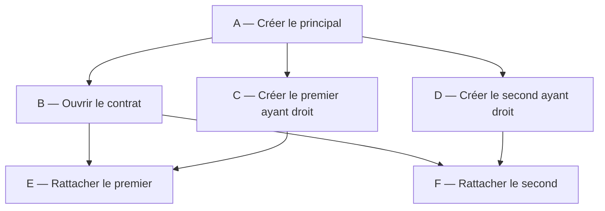

# INT-17 à INT-20 — Orchestrer les six opérations

**Résultat réalisé : un graphe Java de six opérations, avec identifiants typés, dépendances locales, attente finale et soumission à un executor explicite.** Cette note réunit INT-17 à INT-20 autour de ce résultat, pas de quatre développements à recommencer.

**[Simulation ConfluxLab]** Les opérations A–F sont fictives ; elles ne décrivent pas les contrats réels GFP/Open ni un paramétrage historique AXA.

**Limite principale : le graphe n'est pas raccordé au listener.** Il n'existe ni bean d'orchestrateur ni implémentation/bean de production de `FamilyOperations`. Aucun appel HTTP partenaire ou état final MongoDB n'est produit par ce travail.

**Référence des extraits : code INT-20 du 2026-10-22, commité dans `c989e29`**, après INT-19 (`eb0dc5a`). Les fragments sont partiels : ni classe entière, ni imports, ni constructeurs recopiés. La présente consolidation est documentaire ; aucun test ou build n'est relancé.

| Source inspectée | Rôle dans le flux |
|---|---|
| [FamilyOperations.java](../../capability-api/src/main/java/dev/confluxlab/capability/internal/FamilyOperations.java) | Entrées, résultats et identifiants des six opérations internes |
| [FamilyOrchestrator.java](../../capability-api/src/main/java/dev/confluxlab/capability/internal/FamilyOrchestrator.java) | Composition du graphe et soumission des invocations |
| [FamilyRequestConfiguration.java](../../capability-api/src/main/java/dev/confluxlab/capability/internal/FamilyRequestConfiguration.java) | Pool borné existant, créé dans INT-15 |
| [FamilyRequestListener.java](../../capability-api/src/main/java/dev/confluxlab/capability/internal/FamilyRequestListener.java) | Prise en charge asynchrone existante, sans appel au graphe |

## 1. Lire le parcours avant les opérateurs Java

Une **future** représente une issue à venir : réussite avec une valeur, réussite sans valeur ou échec. Ce n'est pas un thread. Un **graphe de dépendances**, ou DAG (graphe orienté sans cycle), indique quels résultats autorisent les opérations suivantes.



Chaque méthode reçoit le même `requestId` UUID ; le tableau ne le répète pas. Les conditions portent sur des **résultats réussis**, pas seulement sur des méthodes déjà appelées.

| Opération / méthode | Condition et données nécessaires | Résultat de la future |
|---|---|---|
| A — `createPrincipal` | Données initiales `PersonPayload` du principal | `PrincipalId` |
| B — `openContract` | A réussie : identifiant du principal | `ContractId` |
| C — `createFirstDependent` | A réussie + données du premier ayant droit | `DependentId` |
| D — `createSecondDependent` | A réussie + données du second ayant droit | `DependentId` |
| E — `attachFirstDependent` | B et C réussies : contrat + premier ayant droit | `Void` |
| F — `attachSecondDependent` | B et D réussies : contrat + second ayant droit | `Void` |

Après A, B/C/D sont indépendantes entre elles. E devient éligible sans attendre D ; F sans attendre C. Cela n'impose ni leur ordre de démarrage ni une exécution immédiate : l'executor et sa capacité restent déterminants.

## 2. Des contrats typés pour faire circuler les bonnes données

Dans `FamilyOperations.java`, ces records distinguent les rôles :

```java
record PrincipalId(String value) {}
record ContractId(String value) {}
record DependentId(String value) {}
```

Le compilateur refuse un `PrincipalId` là où il faut un `ContractId`. En revanche, ces enveloppes ne valident ni le contenu de la chaîne ni l'appartenance à une famille. Deux ayants droit ont le même type : leur bonne association reste à assurer par le graphe et les arguments transmis.

Même source, deux signatures suffisent à lire le passage A → B :

```java
CompletableFuture<PrincipalId> createPrincipal(UUID requestId, PersonPayload principal);
CompletableFuture<ContractId> openContract(UUID requestId, PrincipalId principalId);
```

A fournit l'identifiant que B consomme. L'interface décrit les données, **elle n'ordonne pas les appels**. Elle reste interne à Capability : ce n'est ni le contrat HTTP public ni l'API Java appelée par Experience.

`requestId` corrèle la demande, sans rendre sa création idempotente. Pour E/F, `CompletableFuture<Void>` signifie « pas de nouvelle valeur utile », pas « déjà terminé » ou « impossible d'échouer ». Une complétion normale avec `null` est différente d'une méthode retournant une future `null`.

`PersonPayload` et `CreateFamilyRequest` sont réutilisés sans modification. L'entrée d'`execute` est supposée déjà validée, avec deux ayants droit ; l'orchestrateur sélectionne leurs données sans redéfinir les règles du contrat public.

## 3. Composer A → B/C/D, sans attendre sur un thread

Dans `FamilyOrchestrator.execute(...)`, extrait courant pour A et B :

```java
CompletableFuture<PrincipalId> principal = submit(() -> operations.createPrincipal(requestId, request.principal()));
CompletableFuture<ContractId> contract = principal.thenCompose(
        principalId -> submit(() -> operations.openContract(requestId, principalId)));
```

`submit` soumet l'invocation ; son mécanisme est détaillé plus loin. La lambda `() -> ...` décrit le travail à exécuter : elle n'appelle pas l'opération avant la soumission.

`thenCompose` enregistre une **continuation**, une fonction appelée après la réussite de la future précédente. Ici, elle reçoit le `PrincipalId`, puis retourne la future suivie pour B. Le résultat reste `CompletableFuture<ContractId>`, et non une future contenant une autre future.

C et D sont enregistrées séparément sur **la même future `principal`**, avec leurs personnes respectives. Elles ne sont pas chaînées après B. Si A échoue, ces fonctions ne sont pas appelées ; si A réussit, les trois branches peuvent avancer sans attendre les résultats les unes des autres.

Aucune boucle d'attente n'est nécessaire : construire les dépendances puis retourner une future laisse le thread disponible. Ce chevauchement possible ne prouve pas que trois appels travaillent simultanément sur trois threads.

## 4. Combiner deux résultats, puis aplatir le rattachement

Même fichier, extrait courant pour E :

```java
CompletableFuture<Void> firstAttachment = contract.thenCombine(firstDependent,
                (contractId, dependentId) -> submit(() -> operations.attachFirstDependent(requestId, contractId, dependentId)))
        .thenCompose(future -> future);
```

`thenCombine` attend les réussites de B **et** C, puis fournit leurs deux identifiants à la fonction. D n'apparaît pas dans cette condition. F utilise la même forme avec `secondDependent`, donc B/D, sans dépendance supplémentaire à C.

La fonction de combinaison retourne déjà une `CompletableFuture<Void>`. Sans le dernier `thenCompose`, le résultat serait `CompletableFuture<CompletableFuture<Void>>` : l'enveloppe pourrait finir alors que le rattachement est encore en cours.

**Aplatir** signifie suivre directement l'issue de la future intérieure. `future -> future` ne fabrique pas un succès : cette fonction conserve le résultat réel du rattachement, y compris son échec.

Une barrière globale B/C/D **avant** E/F ajouterait des attentes inutiles. Les conditions de démarrage restent locales ; la jonction globale vient seulement à la fin.

### Les opérateurs utiles dans ce code

| Opérateur | Ce qu'il fait ici | Attention |
|---|---|---|
| `thenCompose` | Enchaîner une fonction qui retourne une future et aplatir son résultat | Ne lance pas automatiquement un nouveau thread |
| `thenCombine` | Utiliser deux résultats réussis | Ne suit pas seul la fin d'une future retournée par sa fonction |
| `allOf` | Fournir une future de fin pour toutes les futures données | N'agrège pas leurs valeurs et ne bloque pas le thread appelant |
| `supplyAsync(operation, executor)` | Soumettre l'invocation au composant choisi explicitement | La méthode peut elle-même retourner une future à aplatir |
| `failedFuture(rejected)` | Représenter un refus comme une issue exceptionnelle | Ce n'est ni une réussite vide ni une nouvelle tentative |
| Continuations sans suffixe `Async` | Composer et soumettre sans redistribution automatique | Peuvent tourner sur le thread de complétion ou d'enregistrement si le résultat est déjà prêt |

## 5. Attendre la fin des branches, même après un échec

Le seul `allOf` de l'orchestrateur est **final** :

```java
return CompletableFuture.allOf(contract, firstDependent, secondDependent, firstAttachment, secondAttachment);
```

Il attend explicitement B/C/D et les chemins E/F, après avoir enregistré leurs dépendances. Il ne retarde donc pas le démarrage nominal des rattachements. A est déjà un prérequis de toutes ces branches.

Si B échoue alors que C/D sont en cours, les fonctions appelant E/F ne s'exécutent pas. Les chemins **composés** E/F terminent exceptionnellement à cause de leurs prérequis ; cela ne signifie pas que les opérations E/F ont été invoquées.

C/D déjà lancées ne sont pas annulées. La future globale reste incomplète tant que ces branches ne sont pas terminées, puis expose un échec, sans le transformer en succès. `allOf` attend toutes ses futures ; il ne garantit pas une collecte exhaustive des causes si plusieurs échouent.

Cette future globale est le **point à observer avant une future finalisation**, pas une écriture de `FAILED` ou `SUCCEEDED`. Si une opération ne termine jamais, le graphe peut rester incomplet : aucun timeout métier n'est ajouté ici.

Annuler une future ne garantit ni l'arrêt d'une I/O ni l'annulation d'une création partenaire déjà effectuée. **Annulation n'est pas rollback** ; aucune compensation, reprise ou réussite de secours n'est implémentée.

## 6. Soumettre les six invocations à un executor explicite

Une signature `CompletableFuture` ne garantit pas que l'invocation retourne rapidement : un adaptateur pourrait faire une I/O bloquante avant de rendre sa future. INT-20 déplace donc **les six invocations A–F** dans le helper `submit`, avec un `Executor` reçu au constructeur.

Dans `FamilyOrchestrator.submit(...)`, instruction centrale :

```java
return CompletableFuture.supplyAsync(operation, executor).thenCompose(Function.identity());
```

`operation` est un `Supplier<CompletableFuture<T>>` : une fonction sans argument, retournant la future de l'opération. `supplyAsync` utilise **l'executor fourni**, sans `ForkJoinPool.commonPool()` implicite.

Le résultat intermédiaire est encore une future de future. `Function.identity()` renvoie son argument : avec `thenCompose`, on suit la future retournée par l'opération, et pas seulement le retour de son invocation. C'est un autre niveau d'aplatissement que celui placé après `thenCombine` pour E/F.

Les continuations ordinaires ne font ici que composer et soumettre ; les invocations métier passent par ce helper. Ajouter `Async` partout ne résoudrait pas un besoin supplémentaire. Un appel Feign bloquant restera bloquant et occupera le worker qui l'exécute.

**Aucun `join/get` dans l'orchestrateur ; cette règle devra aussi être respectée par le futur listener raccordé.** Avec un seul worker, attendre une sous-tâche mise dans la même file peut empêcher ce worker de la traiter : c'est un risque d'interblocage. Il faut rendre la main et observer la terminaison, pas attendre dans le pool.

### Un rejet doit rester un échec

Même helper, fragment du traitement du refus :

```java
} catch (RejectedExecutionException rejected) {
    return CompletableFuture.failedFuture(rejected);
}
```

A peut être refusée avant même que `supplyAsync` retourne une future. Le `catch` permet à `execute` de retourner une future exceptionnelle, plutôt que de laisser sortir ce rejet initial. Le même helper est utilisé dans les continuations ; le rejet Spring `TaskRejectedException` relève aussi de cette famille.

La méthode refusée n'est pas appelée. Une exception levée pendant l'exécution de l'opération est, elle, capturée par la future créée par `supplyAsync`. Dans les deux cas, les autres branches déjà lancées restent attendues : ni abandon silencieux, ni retry ou faux succès.

## 7. Réutiliser le pool INT-15, sans inventer son raccordement

Le type `Executor` **ne prouve ni le bornage ni même le changement de thread** : tout dépend de l'instance fournie. Dans `FamilyRequestConfiguration.java`, le pool existant fixe ses limites ainsi :

```java
executor.setCorePoolSize(workers);
executor.setMaxPoolSize(workers);
executor.setQueueCapacity(queueCapacity);
```

Core et maximum identiques donnent un nombre fixe de workers ; la file limite les tâches acceptées en attente. Ce sont des paramètres pédagogiques du labo, pas des valeurs mesurées ou rapportées d'AXA.

| Bean, annotation ou propriété existante | Valeur / portée |
|---|---|
| `familyRequestExecutor` | Bean `ThreadPoolTaskExecutor` partagé, pas un pool par demande |
| `conflux.processing.workers` | Défaut de production : **2** ; valeur positive, core = maximum |
| `conflux.processing.queue-capacity` | Défaut de production : **16** ; valeur non négative, compte des tâches et non des graphes |
| `AbortPolicy` | Rejet explicite ; ni abandon silencieux ni exécution de secours sur le thread appelant |
| Préfixe `family-request-` | Identifie les threads du pool |
| `conflux.processing.shutdown-await-seconds` | Défaut **5 s** ; attente de fermeture, pas timeout d'opération ou garantie d'arrêt forcé |
| `@Async("familyRequestExecutor")` | Utilisé par le listener ; ne raccorde pas automatiquement l'orchestrateur |
| `FamilyOperations` / `FamilyOrchestrator` | Aucun bean de production à injecter pour lancer le graphe aujourd'hui |

Le test de partage instancie cette **même configuration**, hors contexte Spring, avec **1 worker et 16 places**, puis initialise et ferme le pool. Ce n'est pas la valeur de production 2/16 ni une preuve du câblage Spring futur.

Trois limites sont essentielles :

- **Pas de réservation par graphe.** Accepter A ne réserve aucune place pour B/C/D ou E/F. Une continuation peut être refusée plus tard, même si la première soumission a réussi.
- **Borne locale aux tâches du pool.** Si un adaptateur retourne une future incomplète et externalise son travail dans un autre pool, ce travail n'est pas borné par le nôtre. Le futur adaptateur bloquant devra exécuter son I/O dans la tâche soumise.
- **Pas de délai ou d'équité garantis.** Une file bornée ne garantit ni latence maximale, ni timeout réseau, ni reprise après crash, ni partage équitable entre demandes.

## 8. Où s'arrête réellement le flux de production ?

Dans `FamilyRequestListener.java`, le corps de la prise en charge contient cette transition :

```java
store.transition(request.requestId(), RequestStatus.PENDING, RequestStatus.PROCESSING, Instant.now(clock));
```

Le listener relit la demande, filtre `PENDING`, tente cette transition atomique, puis s'arrête. Il n'appelle pas `FamilyOrchestrator`. Le succès ou l'échec d'une future du graphe ne modifie donc actuellement ni MongoDB ni le suivi HTTP.

**Raccordement retenu, non réalisé :** fournir explicitement `familyRequestExecutor` à l'orchestrateur, lancer le graphe seulement après une prise en charge gagnante, puis observer sa terminaison sans bloquer le listener. Il manque aussi l'adaptateur de production `FamilyOperations` et la finalisation persistée.

Le monolithe modulaire reste inchangé : Experience/BFF appelle Capability en Java et ne porte pas l'orchestration. Feign sera réservé au partenaire externe. Un `202` signifie acceptation, pas fin du graphe ; les événements Spring locaux ne sont pas durables.

## 9. Preuves historiques, sans nouvelle exécution

Les résultats suivants sont **repris des preuves INT-17 à INT-20 du 2026-10-22**, désormais réunies ici. Ils ne résultent pas d'un nouveau run lors de cette consolidation.

| Étape | Preuve consignée et version |
|---|---|
| INT-17 | `test-compile` réussi, **aucun test exécuté** ; commit `d6f0e86` |
| INT-18 | **2 cas réussis** : même scénario nominal dans les deux ordres C/D ; commit `516ea0e` |
| INT-19 | **3 cas réussis** : les 2 précédents + un échec B ; commit `eb0dc5a` |
| INT-20 | **6 cas réussis** : 3 réutilisés + 2 rejets A/E + partage/isolation ; commit `c989e29` |

**Ces nombres ne s'additionnent pas.** Les sélections successives réutilisent les mêmes cas ; les rapports courants remplacent les précédents. Les extraits de cette note décrivent uniquement le code courant INT-20, pas plusieurs versions reconstituées.

Les [tests existants](../../capability-api/src/test/java/dev/confluxlab/capability/internal/FamilyOrchestratorTest.java) portent la preuve des dépendances, de la fin des branches et des rejets. Un contrôle à un worker distingue le succès et l'échec de deux UUID, pas deux parcours complets sous charge. Leur montage n'est pas recopié : la saturation réelle du pool reste une preuve historique d'INT-15, non rejouée ici.

Commandes historiques, depuis la racine `conflux-lab/`, avec JDK 21 et dépendances Maven disponibles ; Docker non requis pour ces sélections :

```sh
./mvnw -B -ntp -pl capability-api -am test-compile
./mvnw -B -ntp -pl capability-api -am -Dtest=FamilyOrchestratorTest -Dsurefire.failIfNoSpecifiedTests=false test
```

La première est la compilation INT-17. La seconde sélectionne le test du graphe : 2, puis 3, puis 6 cas selon la version. Les notes consignent `BUILD SUCCESS`, avec 0 échec/erreur/ignoré pour les passages de tests ; **la compilation seule n'est pas un test vert**.

Ces commandes peuvent écrire dans `target/` et télécharger des dépendances ; elles n'ont pas été exécutées ici. Aucun nouveau test, build global, IT, redémarrage du JAR, contrôle HTTP/MongoDB final ou benchmark n'est revendiqué. La preuve porte sur la composition Java et un partage ciblé du pool, pas sur un parcours de bout en bout.

La [fiche du sprint](../../docs/stages/sprint-05-orchestration.md) résume ce résultat et ses critères. Cette consolidation ne clôt pas pédagogiquement le sprint : compréhension et restitution orale non évaluées ; elle n'autorise pas le prochain développement.

## Suivi existant

- [TD-R023 — Contrats internes et identifiants typés](../todos.md#td-r023).
- [TD-R024 — Dépendances locales et aplatissement](../todos.md#td-r024).
- [TD-R025 — Branches lancées et échec global](../todos.md#td-r025).
- [TD-R026 — Executor explicite et limites du bornage](../todos.md#td-r026).
- [TD-B018 — Raccordement partenaire et finalisation, lot INT-21 + INT-22 à autoriser](../todos.md#td-b018).
