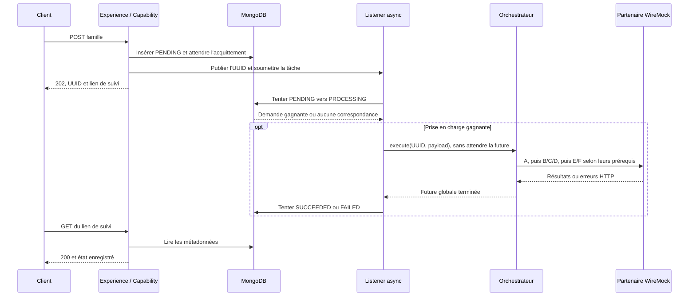

# INT-21 + INT-22 — Créer une famille de bout en bout

**[Simulation ConfluxLab] — Réalisé sur feu vert « ok go », le 2026-10-22.** Le parcours public est maintenant raccordé : POST accepté, prise en charge atomique, six appels HTTP au partenaire fictif et état final consultable. Les quatre routes ci-dessous sont inventées pour le laboratoire ; ce ne sont pas les endpoints historiques GFP/Open.

## 1. Le résultat : raccorder les briques existantes



Les branches HTTP et listener restent indépendantes : le dessin ne garantit pas que le traitement commence après réception du `202`. Le GET peut déjà voir un état final. Il expose toujours seulement `requestId`, `status`, `createdAt`, pas les données familiales ou les identifiants du partenaire.

## 2. Le contrat HTTP partenaire

[`FamilyPartnerClient.java`](../../capability-api/src/main/java/dev/confluxlab/capability/internal/client/FamilyPartnerClient.java) décrit quatre routes de ressources pour les six opérations. Tous les appels transmettent `X-Request-Id`, égal à l'UUID de corrélation reçu par le client public.

| Opération | POST | Corps JSON | Réponse de succès simulée |
|---|---|---|---|
| A | `/principals` | `PersonPayload` : prénom, nom, naissance | `201`, `{"id":"principal-1"}` |
| B | `/contracts` | `{"principalId":"principal-1"}` | `201`, `{"id":"contract-1"}` |
| C / D | `/dependents` | `{"principalId":"principal-1","person":{…}}` | `201`, identifiant de l'ayant droit concerné |
| E / F | `/contracts/{contractId}/dependents` | `{"dependentId":"dependent-1"}` ou le second identifiant | `204`, sans corps |

C/D partagent une route, mais consomment chacun les données de leur personne ; E/F partagent une route, mais transmettent chacun son identifiant. Les stubs vérifient ces associations : deux réponses réussies ne suffiraient pas si les identifiants étaient inversés.

**Fragment du contrat Feign pour C/D :**

```java
@PostMapping(value = "/dependents", consumes = "application/json", produces = "application/json")
IdResponse createDependent(@RequestHeader("X-Request-Id") UUID requestId,
        @RequestBody CreateDependentRequest request);
```

Spring Cloud OpenFeign crée le proxy HTTP à partir de cette interface. Les petits records de requête/réponse sont imbriqués dans le client et restent internes à Capability. Le BFF n'importe aucune de ces classes et continue d'appeler `FamilyRequests` en Java.

## 3. Adapter HTTP sans créer un second mécanisme async

[`FeignFamilyOperations.java`](../../capability-api/src/main/java/dev/confluxlab/capability/internal/client/FeignFamilyOperations.java) implémente le contrat interne existant. **Fragment pour A :**

```java
return invoke(() -> new PrincipalId(requireId(client.createPrincipal(requestId, principal))));
```

Le proxy renvoie une réponse partenaire, `requireId` refuse une réponse absente ou un identifiant nul/blanc, puis l'adaptateur construit le type attendu par le graphe. B fournit de même un `ContractId` ; C/D des `DependentId` ; les rattachements n'ont pas de nouvelle valeur utile.

**Fragment du helper `invoke` :**

```java
return CompletableFuture.completedFuture(operation.get());
```

L'ordre est important : **`operation.get()` exécute l'appel HTTP bloquant avant la création de la future terminée**. Ce helper ne crée aucun thread. C'est le `supplyAsync(..., executor)` déjà présent dans l'orchestrateur qui place l'invocation sur le pool borné. Une exception HTTP synchrone est capturée par cette future extérieure, sans être changée en succès ni perdre sa cause.

Le [cours du graphe](../sprint-05/INT-17-orchestrer-les-six-operations.md) explique ses dépendances et ses aplatissements à l'étape INT-20. Sa composition n'a pas changé pour ce raccordement.

## 4. Lancer seulement après une prise en charge gagnante

Dans [`FamilyRequestConfiguration.java`](../../capability-api/src/main/java/dev/confluxlab/capability/internal/config/FamilyRequestConfiguration.java), `@EnableFeignClients(clients = FamilyPartnerClient.class)` active uniquement ce client. Le bean d'orchestrateur reçoit `FamilyOperations` et **l'executor explicitement qualifié** `familyRequestExecutor` ; aucun pool supplémentaire n'est créé.

Dans [`FamilyRequestListener.java`](../../capability-api/src/main/java/dev/confluxlab/capability/internal/event/FamilyRequestListener.java), fragment du chemin de prise en charge :

```java
.flatMap(request -> store.transition(request.requestId(), RequestStatus.PENDING,
        RequestStatus.PROCESSING, Instant.now(clock)))
.ifPresent(request -> {
```

Le listener ne lance pas le graphe sur la simple lecture de `PENDING`. Le `findAndModify` atomique peut perdre face à un autre candidat ; seul l'`Optional` contenant la demande après modification atteint l'`ifPresent`. Le payload de cette demande gagnante est fourni à `execute`.

**Fragment d'observation de sa terminaison :**

```java
processing.whenComplete((unused, failure) -> finalizeRequest(request, failure));
```

Enregistrer cette fonction rend la main, sans `join/get` dans le pool. Le callback peut être appelé tout de suite si la future est déjà terminée, ou plus tard par le thread qui la termine. La jonction globale existante attend les branches lancées avant de décider de l'issue ; l'échec de B n'écrit donc pas immédiatement `FAILED` pendant que C/D avancent.

## 5. État final confirmé, refusé ou incertain

**Fragment de la décision dans le même listener :**

```java
RequestStatus target = failure == null ? RequestStatus.SUCCEEDED : RequestStatus.FAILED;
```

Le callback tente ensuite la transition conditionnelle `PROCESSING → target`. La protection des états finaux reste celle du store existant, pas un nouveau verrou Java.

| Issue | Comportement livré |
|---|---|
| Graphe réussi, écriture finale confirmée | Le GET expose `SUCCEEDED` |
| Graphe en échec, écriture finale confirmée | Le GET expose `FAILED`, avec toujours un HTTP `200` de consultation |
| Aucun document ne correspond à la transition finale | Journal `Family finalization not applied`, avec UUID et cible ; aucun faux acquittement |
| Exception de l'écriture finale | Journal `Family finalization unconfirmed`, avec UUID, cible et type d'exception ; aucune tentative aveugle de réécrire un autre état |

**Pourquoi le callback capture-t-il lui-même l'erreur de stockage ?** Les erreurs d'une future retournée par `whenComplete` ne sont pas automatiquement prises en charge par le handler du listener `@Async void`. Le callback journalise donc explicitement sa tentative, sans message d'exception, corps partenaire ou trace brute. Une erreur de traitement est aussi journalisée avec UUID et type seulement.

Une exception MongoDB peut laisser une écriture **inconnue**, pas forcément absente : le document peut rester `PROCESSING`, ou l'état final avoir été écrit malgré la perte d'acquittement. Aucun `FAILED` de secours, reprise automatique ou garantie de statut final après panne de stockage n'est promis.

## 6. Délais et absence de retries implicites

[`FamilyPartnerFeignConfiguration.java`](../../capability-api/src/main/java/dev/confluxlab/capability/internal/client/FamilyPartnerFeignConfiguration.java) est enregistré **par ce client Feign**, sans `@Configuration` qui le ferait scanner globalement.

| Réglage | Valeur / raison |
|---|---|
| `conflux.partner.base-url` | `FAMILY_PARTNER_URL`, sinon `http://localhost:9090` ; WireMock de test remplace l'URL par son port éphémère |
| `conflux.partner.connect-timeout-ms` | 1000 ms ; doit être positif |
| `conflux.partner.read-timeout-ms` | 3000 ms ; doit être positif |
| `Request.Options` | Options propres au client, redirections désactivées |
| `Retryer.NEVER_RETRY` | Aucune répétition automatique par Feign |
| Transport Apache HC5 | `disableAutomaticRetries()` et `disableRedirectHandling()` ; sa fermeture est gérée par Spring |

Désactiver seulement le retry Feign laisserait ouverte la question des répétitions du transport : les deux niveaux sont explicités. Un `503` ne déclenche donc pas une nouvelle création automatique. Ces délais ne sont **pas une deadline globale** : attente en file, acquisition de connexion et durée totale du graphe restent distinctes.

Le BOM Spring Cloud **2025.0.0** accompagne Boot **3.5.7** et gère OpenFeign **4.3.0** / Feign **13.6**. WireMock standalone **3.13.1**, en scope test, évite de mélanger sa pile serveur avec celle de Boot. Aucun Resilience4j, fallback ou coupe-circuit n'est ajouté dans ce lot.

## Organisation interne après déplacement

Les [six sous-packages et leurs rôles](../../docs/dat/ConfluxLab.md#46-organisation-interne-de-capability) rendent `internal` plus compact à parcourir, sans nouvelle architecture ni changement métier. La visibilité Java `public` nécessaire entre sous-packages ne les ouvre pas au BFF : seule `capability.api` lui est accessible, avec les mêmes règles ArchUnit.

**Validation du refactor — 2026-10-22 :** depuis la racine, avec les mêmes prérequis que ci-dessous :

```sh
./mvnw -B -ntp -pl application -am '-Dtest=FamilyOrchestratorTest,FamilyRequestListenerTest,FamilyRequestTrackingHttpTest,ModuleArchitectureTest,ArchitectureRuleDetectionTest' -Dsurefire.failIfNoSpecifiedTests=false -Dit.test=FamilyPartnerFlowIT,FamilyRequestEventsIT,MongoFamilyRequestStoreIT,FamilyRequestPersistenceIT clean verify
```

`clean` supprime les anciennes classes compilées avant de vérifier les nouveaux packages. **Résultat observé : `BUILD SUCCESS`, 25 cas Surefire + 8 cas Failsafe, aucun échec/erreur/ignoré**, rapports XML inspectés. Les frontières du monolithe, le parcours partenaire et le redémarrage sont vérifiés. Le test d'insertion MongoDB réutilisé vérifie aussi la lecture d'un document conservant l'ancien `_class` `dev.confluxlab.capability.internal.StoredFamilyRequest` : cette lecture typée ne nécessite pas de migration des données. Aucun changement de logique de production ni nouvelle dépendance ; pas de suite globale ni CI exécutée.

Les preuves de livraison ci-dessous précèdent ce déplacement ; elles restent distinctes de cette nouvelle exécution.

## 7. Vérifications de cette session

Depuis la racine, avec JDK 21, Docker disponible et les dépendances Maven accessibles :

```sh
./mvnw -B -ntp -pl application -am '-Dtest=FamilyOrchestratorTest,FamilyRequestListenerTest,FamilyRequestTrackingHttpTest,ModuleArchitectureTest#experienceOnlyUsesThePublicCapabilityApi' -Dsurefire.failIfNoSpecifiedTests=false -Dit.test=FamilyPartnerFlowIT,FamilyRequestEventsIT,MongoFamilyRequestStoreIT,FamilyRequestPersistenceIT verify
```

`-Dtest` sélectionne Surefire, `-Dit.test` Failsafe ; `verify` construit le JAR avant ses IT. Les autres options de sélection sont expliquées dans le [README](../../README.md#vérifier-depuis-la-racine). La commande écrit sous `target/`, démarre des ressources de test temporaires et deux JVM du JAR pour le redémarrage ; elle ne publie rien.

**Résultat observé : `BUILD SUCCESS`, 14 cas Surefire + 8 cas Failsafe, aucun échec, erreur ou cas ignoré.** Les rapports XML ont été inspectés. Ce sont **3 nouveaux scénarios et 19 cas réutilisés**, pas une suite globale ou une CI verte.

- Deux nouveaux cas intégrés traversent le vrai service, MongoDB, le listener, le graphe et Feign : six échanges corrélés en succès ; contrat `503` appelé une fois, sans rattachement ni fuite de son corps d'erreur, puis `FAILED`.
- Un seul nouveau cas unitaire vérifie le journal d'une écriture finale non confirmée, sans données privées ni rattrapage artificiel vers `FAILED`.
- Les tests de claim/insertion utilisent un graphe incomplet **dans leurs doublures de test uniquement**. Le suivi accepte maintenant les états finaux. Le test existant du JAR retrouve `FAILED` après redémarrage, avec un seul appel partenaire au total : conserver un état ne déclenche pas une reprise.

Le premier passage avait échoué à la compilation des tests sur l'import WireMock de `RequestPatternBuilder` ; l'import a été corrigé avant le `verify` réussi. Avertissements Mockito/JVM connus, sans échec. Pas de campagne de charge, de mesure de performance ou de simulation complète des timeouts ; la politique détaillée des pannes reste le prochain lot.

## Suivi

Le partenaire reste une simulation à réponses contrôlées. En cas d'échec partiel, certaines créations externes peuvent déjà avoir réussi ; ni l'UUID ni `FAILED` ne donnent une idempotence ou un rollback. L'événement local peut être perdu après un crash.

[TD-B018 — Raccordement et finalisation réalisés](../todos.md#td-b018). La suite **[INT-23 + INT-24 — Terminer proprement malgré une panne partenaire](INT-23-terminer-malgre-une-panne-partenaire.md)** a été réalisée le 2026-10-23 : diagnostic par opération, refus et timeout vérifiés, sans retry faute de garantie de répétition sûre. Les preuves ci-dessus restent celles de la livraison initiale et du refactor ; le complément possède sa propre commande et ses résultats.
