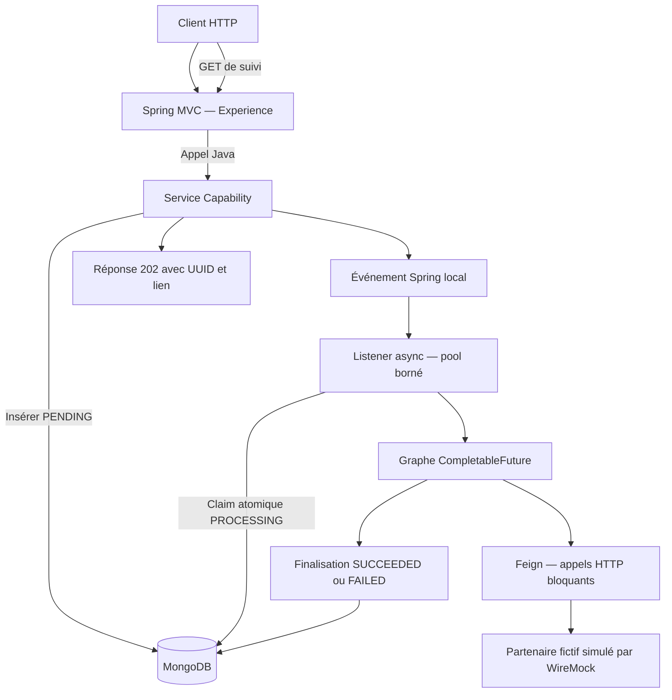

# ConfluxLab — Vue d'ensemble des technologies

**[Simulation ConfluxLab] — État au 2026-10-23, code de référence `7fae263`, jusqu'à INT-28.** Cette note présente les technologies réellement utilisées et leur place dans le parcours. Elle ne décrit pas les versions historiques d'AXA et ne remplace ni le [DAT](../docs/dat/ConfluxLab.md), ni les cours détaillés de [l'index](README.md).

## 1. Le projet en une phrase

Un backend **Java 21 / Spring Boot**, organisé en **monolithe modulaire**, accepte une demande de création de famille fictive, la conserve dans **MongoDB**, traite six opérations en arrière-plan via **Feign**, puis expose un statut de suivi.

Le traitement peut commencer **avant** que le client reçoive le `202`. Le diagramme n'impose pas cet ordre temporel. WireMock est démarré par les tests, pas par le JAR applicatif.

## 2. Architecture et modules

Ce n'est **pas une architecture microservices** : une application Spring Boot, une JVM et un seul JAR exécutable, malgré les quatre modules Maven.

| Module | Responsabilité |
|---|---|
| `contracts` | Records et contraintes des objets échangés : demande, personnes, reçu, suivi et statuts |
| `experience-api` | BFF mince : HTTP, validation de forme, liens et adaptation des erreurs |
| `capability-api` | Cas d'usage, invariants, persistance, événement, orchestration et client partenaire |
| `application` | Assemblage des modules et unique point de démarrage Spring Boot |

Experience appelle l'interface publique Java `FamilyRequests` de Capability, **sans HTTP interne ni accès à son stockage**. Les classes d'implémentation restent sous `capability.internal`, rangées en `config`, `service`, `persistence`, `event`, `orchestration` et `client`.

Pour approfondir : [architecture, assemblage et frontières — INT-01/03/04](sprint-01/INT-01-socle-modulaire.md).

## 3. Java, Spring et API REST

| Technologie | Ce qu'on en fait concrètement |
|---|---|
| **Java 21** | Records pour les données, enums pour les statuts, interfaces, exceptions, collections, UUID, dates et concurrence |
| **Spring Boot 3.5.7** | Démarrage, auto-configuration, configuration externe et packaging exécutable |
| **Spring Framework / injection de dépendances** | Assemblage des services et adaptateurs via beans, constructeurs et configuration Java |
| **Spring MVC** | Endpoints avec `@RestController`, `@PostMapping`, `@GetMapping` et `ResponseEntity` |
| **Tomcat embarqué** | Serveur HTTP lancé avec l'application, sans serveur séparé à installer |
| **Jackson** | Conversion JSON ↔ objets Java, notamment les records et les dates |
| **Jakarta Bean Validation / Hibernate Validator** | Contraintes de champs, dates, objets imbriqués et nombre d'ayants droit |
| **`ProblemDetail` / `@RestControllerAdvice`** | Erreurs HTTP homogènes, sans exposer exceptions, valeurs refusées ou détails privés |

Les endpoints :

- `POST /api/v1/families` : accepte une demande valide et renvoie `202`, UUID, `statusUrl` et en-tête `Location` si le chemin d'acceptation réussit.
- `GET /api/v1/requests/{requestId}` : renvoie uniquement `requestId`, `status`, `createdAt`, sans modifier la demande.

Les contraintes sont contrôlées à l'entrée HTTP **et dans Capability** pour protéger aussi les appels Java directs. Hibernate **Validator** n'est pas Hibernate ORM : le projet n'utilise pas JPA pour stocker ses données.

Sources : [contrats HTTP](../docs/dat/http-contracts.md), [contrôleur](../experience-api/src/main/java/dev/confluxlab/experience/FamilyController.java), [gestion des erreurs](../experience-api/src/main/java/dev/confluxlab/experience/ApiExceptionHandler.java).

## 4. MongoDB et gestion des états

| Technologie / mécanisme | Utilisation |
|---|---|
| **MongoDB** | Conservation du payload familial, de l'UUID, du statut et des dates |
| **Spring Data MongoDB** | Mapping entre document MongoDB et record Java `StoredFamilyRequest` |
| **`MongoTemplate`** | Insertion, lecture et modification conditionnelle ; pas de repository JPA |
| **`findAndModify` atomique** | Prise en charge et transitions de statut, sans fragile « lire puis sauvegarder » |
| **Write concern `majority` avec journal** | Acquittement demandé pour les écritures ; sur standalone, cela n'ajoute ni réplication ni sauvegarde |
| **UUID** | Identification et corrélation des demandes, pas déduplication des POST |

Le cycle est **`PENDING → PROCESSING → SUCCEEDED` ou `FAILED`**. L'insertion ne remplace pas une demande portant déjà le même UUID. Une transition attend un statut précis : un seul candidat peut gagner la prise en charge ; les états finaux sont protégés.

Le montage d'intégration utilise **MongoDB 8.0.16 standalone**. Il n'existe aucune transaction atomique commune entre MongoDB et les appels HTTP partenaires : les échecs partiels sont possibles.

Pour approfondir : [modèle et transitions](sprint-03/INT-09-modele-et-transitions-atomiques.md), [insertion et persistance](sprint-03/INT-10-insertion-et-persistance-mongodb.md).

## 5. Asynchronisme et concurrence

| Technologie | Rôle précis |
|---|---|
| **Spring Events / `ApplicationEventPublisher`** | Signaler localement qu'une demande a été enregistrée |
| **`@EventListener` + `@Async` / `@EnableAsync`** | Traiter cet événement sur un worker, hors du cycle de traitement HTTP |
| **`ThreadPoolTaskExecutor`** | Pool et file bornés, rejet explicite en saturation et attente bornée à l'arrêt |
| **`CompletableFuture`** | Composer les dépendances des six opérations et leur chevauchement possible |
| **`thenCompose`, `thenCombine`, `allOf`** | Enchaîner les futures, combiner les prérequis et attendre les branches lancées |
| **`whenComplete`** | Observer la terminaison globale puis tenter la finalisation MongoDB |
| **`Clock` / `Instant` / `System.nanoTime()`** | Horodatages métier injectables et mesures locales de durée, avec des bornes distinctes |

Le graphe : **A précède B/C/D ; E nécessite B+C ; F nécessite B+D**. B, C et D peuvent donc se chevaucher après A, selon les workers disponibles. La finalisation attend les branches déjà lancées, même en cas d'erreur.

Trois distinctions importantes :

- `@Async` détache le traitement de l'HTTP ; il ne garantit pas une réduction de sa durée métier.
- `CompletableFuture` organise le travail ; un appel HTTP bloquant reste bloquant pour son worker.
- Un événement Spring est **local et non durable**, pas un message broker : un crash peut abandonner une demande.

Pour approfondir : [prise en charge async](sprint-04/INT-13-traiter-les-demandes-en-arriere-plan.md), [pool et erreurs](sprint-04/INT-15-pool-borne-et-erreurs-async.md), [graphe A–F](sprint-05/INT-17-orchestrer-les-six-operations.md).

## 6. HTTP sortant et traitement des pannes

| Technologie / mécanisme | Utilisation |
|---|---|
| **Spring Cloud OpenFeign** | Interface déclarative pour les appels HTTP au partenaire fictif uniquement |
| **BOM Spring Cloud 2025.0.0** | Gestion cohérente des versions Spring Cloud associées à Boot |
| **Apache HttpClient 5 via `feign-hc5`** | Transport HTTP bloquant derrière Feign |
| **Timeouts** | Connexion 1 000 ms et lecture 3 000 ms par défaut ; ce n'est pas une deadline globale |
| **`X-Request-Id`** | Transmission de l'UUID de corrélation aux six appels partenaires |
| **SLF4J** | Logs avec UUID, opération, catégorie d'erreur, statut HTTP disponible et statut final confirmé |

Les messages d'exception, corps et traces brutes ne sont pas journalisés par le diagnostic applicatif ajouté, car ils peuvent contenir des données privées. Aucun MDC n'est nécessaire au montage actuel : l'UUID est passé explicitement.

**Aucun retry automatique** : Feign et HC5 le désactivent, ainsi que les redirections. Les six POST n'ont aucune garantie de répétition sûre. Une erreur potentiellement transitoire ne suffit donc pas à autoriser un nouvel appel.

**Resilience4j n'est pas implémenté** : le lot pannes a retenu explicitement l'absence de retry, plutôt que d'ajouter une bibliothèque sans opération éligible. Après un timeout, `FAILED` signifie échec local, pas certitude qu'aucune ressource distante n'a été créée. Aucun fallback de réussite ni rollback global n'est promis.

Pour approfondir : [Feign et raccordement](sprint-06/INT-21-creer-une-famille-de-bout-en-bout.md), [politique des pannes](sprint-06/INT-23-terminer-malgre-une-panne-partenaire.md).

## 7. Tests et mesures : les outils réellement utilisés

| Outil | Ce qu'il vérifie ou fournit |
|---|---|
| **JUnit 5** | Tests et assertions, y compris scénarios paramétrés |
| **Mockito** | Doubles pour piloter les réponses, futures et erreurs sans vrai partenaire |
| **Spring Boot Test** | Chargement et vérification du câblage réel Spring |
| **MockMvc** | Vérification des contrats MVC sans connexion réseau entrante réelle |
| **JDK `HttpClient`** | Appels à un vrai port HTTP pour démonstration et tests du JAR |
| **Awaitility** | Attente bornée d'un résultat asynchrone, sans imposer une durée fixe de traitement |
| **WireMock 3.13.1** | Simulation HTTP du partenaire : réponses, délais, refus, comptage et contrôle des échanges |
| **Testcontainers 1.21.4 + Docker** | Démarrage d'un vrai MongoDB isolé et temporaire pour les tests |
| **ArchUnit 1.4.1** | Contrôle des frontières : pas de cycle, de dépendance Capability → Experience ou d'accès du BFF aux classes internes |
| **Maven Surefire / Failsafe 3.5.4** | Exécution des `*Test`, puis des `*IT` raccordés à `verify`, après packaging |

Docker sert ici à fournir l'environnement des tests ; **cela ne signifie pas qu'une image de déploiement applicative ou une CD existe**. Surefire ne veut pas automatiquement dire « test unitaire » : certains `*Test` chargent Spring et utilisent MongoDB.

Le montage de mesures sépare latence HTTP vue du client, durée issue des dates stockées et taux de réussite. La comparaison séquentiel/concurrent reste sous `src/test`, avec les mêmes opérations, ressources et délais simulés, sans assertion fragile sur le gain.

**Preuve historique la plus récente :** le lot INT-25 à INT-28 a réussi son passage ciblé avec **7 cas Surefire + 6 Failsafe**, sans échec/erreur/ignoré. Ce n'est pas le total de la suite globale. Les [relevés et leurs limites](sprint-07/INT-25-demontrer-et-mesurer-le-parcours.md) restent dans leur note : ils ne constituent ni benchmark général ni mesure AXA.

## 8. Build, configuration et versionnement

| Technologie | Utilisation |
|---|---|
| **Maven multi-modules** | Compilation, dépendances, tests et assemblage des quatre modules |
| **Maven Wrapper** | Maven **3.9.16** épinglé, sans dépendre d'une installation Maven système |
| **Spring Boot Maven Plugin** | Production du seul JAR exécutable, dans `application` |
| **YAML / propriétés / variables d'environnement** | Réglages MongoDB, partenaire, timeouts et pool, sans secret réel committé |
| **Git / GitHub** | Historique des incréments et dépôt distant ; ne remplace pas une CI |
| **Markdown / Mermaid** | DAT, cours, suivi et schémas du parcours |

Sources de versions : [POM parent](../pom.xml), [POM Capability](../capability-api/pom.xml), [POM application](../application/pom.xml), [Maven Wrapper](../.mvn/wrapper/maven-wrapper.properties). Guide : [build et versionnement](sprint-01/INT-02-build-et-versionnement.md).

## 9. CI et limites du périmètre

| Sujet | État à cette version |
|---|---|
| **GitHub Actions / CI** | Absent du snapshot applicatif `7fae263`, puis **réalisé le 2026-10-23** : [workflow, runs vert/rouge/retour vert et artefacts observés](sprint-08/INT-29-verifier-et-preparer-la-ci.md), 190 Surefire + 14 Failsafe réussis sur les verts. PR de preuve fermée sans fusion ; actions officielles Node 24 et correction de synchronisation d'un test async |
| **CD et déploiement** | Théorie uniquement : aucune livraison en staging/production |
| **Resilience4j** | Non ajouté pour les raisons de répétition sûre expliquées ci-dessus |
| **Actuator / plateforme de métriques** | Non ajoutés ; logs et relevés locaux suffisent au périmètre réalisé |
| **Kafka/RabbitMQ, WebFlux, microservices** | Non utilisés ; événements locaux, Spring MVC et monolithe modulaire |

**À retenir :** Spring MVC reçoit, MongoDB conserve, Spring Events et `@Async` détachent, `CompletableFuture` compose, Feign appelle le partenaire, puis MongoDB porte le résultat consultable.

Cette note est documentaire : **aucun test ou build relancé pour sa rédaction**, aucune nouvelle tâche créée et aucune compréhension orale déclarée acquise.
